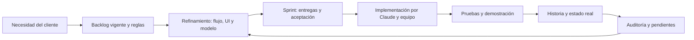

# Cómo leer la documentación de RIKOS

Actualizado: 11 de octubre de 2026. Guía para el equipo, el cliente y sus socios.

## Empezar por la pregunta que necesitas responder

| Pregunta | Documento o carpeta | Qué representa |
|---|---|---|
| ¿Qué problema resolvemos y para quién? | [PRD](producto/prd/README.md), especialmente [usuario de referencia](producto/prd/02-usuario-de-referencia.md) | Visión, actores, alcance y Product Backlog. El cajero en hora punta es el usuario de referencia; el dueño necesita poder delegar con control. |
| ¿Qué tenemos realmente y qué falta revisar? | [Auditoría del 11/10/2026](auditorias/2026-10-11/README.md) | Comparación entre requisitos, código disponible y verificaciones. Corte hasta sprint 7 parcial. |
| ¿Qué debe corregir o completar Claude? | [Pendientes de esta auditoría](pendientes/02-auditoria-integral-sprints-0-7-2026-10-11.md) | Prioridad, solución propuesta y criterio de aceptación. No significa que el arreglo esté implementado. |
| ¿Cómo funciona el negocio? | [Flujos](producto/flujos/README.md) | Actores, historias, reglas de negocio y procesos previstos. No todos están implementados. |
| ¿Qué entra en cada sprint? | [Plan](producto/plan/README.md) | Secuencia y especificaciones. El estado debe comprobarse con historias y evidencia, no solo con una etiqueta «completo». |
| ¿Cómo está diseñado el sistema? | [TRD](producto/trd/README.md) | Arquitectura y despliegue previsto. La auditoría aclara qué existe en el código. |
| ¿Qué datos se guardan? | [Modelo lógico](producto/modelo-de-datos/README.md) y [conciliación física](auditorias/2026-10-11/05-modelo-datos-arquitectura.md) | El lógico describe todo el producto; las migraciones Flyway describen el esquema construido por sprint. |
| ¿Qué se construyó y cómo se probó? | [Historias](../rikos-backend/doc/historias/README.md) | Evidencia de entregas, límites y verificaciones de cada sesión. |
| ¿Por qué se tomó una decisión? | [Decisiones técnicas](../rikos-backend/doc/RIKOS-decisiones-tecnicas.md) | Bitácora DT-NNN; conserva su historial. |
| ¿Cómo levanto el entorno? | [EMPEZAR](EMPEZAR.md) | Guía operativa. Tiene divergencias señaladas en la auditoría; revisar requisitos y comandos antes de seguirla. |

## Para qué sirven las otras carpetas

| Carpeta | Uso | Cómo mantenerla |
|---|---|---|
| `fuente/especificacion-v0.1/` | Especificación original del propietario | Se conserva. Las aclaraciones van en documentos derivados con fecha y origen. |
| `producto/prd/` | Requisitos y versiones del backlog | Usar v3 para referencia vigente y la tabla de traducción para enlazar historias antiguas de tres dígitos. No renumerar el código por conveniencia. |
| `producto/flujos/` | Procesos y reglas RN | Separar flujo actual, excepción y flujo previsto. |
| `producto/ui-ux/` | Pantallas y reglas de interacción | Mantener criterios comprobables: permisos, errores, tamaños táctiles, teclado, móvil. |
| `producto/trd/` | Diseño técnico organizado por tema | Actualizar cuando se decide o implementa algo que cambia la arquitectura. |
| `producto/modelo-de-datos/` | Modelo completo por dominio | Indicar fase y diferencias respecto de Flyway. Una tabla propuesta no es una tabla desplegada. |
| `producto/plan/` | Sprints y entregas verificables | Registrar pendiente / en curso / verificado / aceptado; enlazar evidencia. |
| `pendientes/` | Defectos, deuda, preguntas y propuestas de solución | Un identificador por asunto; estado y criterio de cierre. Las preguntas RF, deudas P y hallazgos de auditoría se enlazan, sin perder su origen. |
| `auditorias/` | Revisiones del producto y del código | Conservar fecha, alcance, evidencia y límites. No confundir con la tabla `auditoria` del sistema. |
| `aprendizajes/` | Problemas que el equipo aprendió a evitar | Extraer lecciones reutilizables; enlazar la historia donde ocurrió. |
| `designs/` | Mockups y referencias visuales | Enlazar diseños que existan y marcar versión/aprobación. Hoy su índice está incompleto. |
| `superpowers/plans/` y `superpowers/specs/` | Planes tácticos anteriores | Historia de implementación. No sustituyen al plan vigente ni prueban que todo se ejecutó. |
| `rikos-backend/doc/historias/` | Resultado real de cada entrega | Al cerrar una entrega, explicar qué quedó hecho, qué faltó y cómo se verificó. |
| `rikos-backend/doc/capturas/` | Evidencia visual | Una captura necesita fecha, rol y escenario para servir como prueba. |

## Flujo de trabajo en equipo

Para esta sesión la entrega es documental. Una propuesta en `pendientes` pasa al Sprint Backlog cuando el equipo la selecciona. La aceptación del cliente y sus socios se registra después de una demostración, con resultados; esta auditoría no inventa su aprobación.
