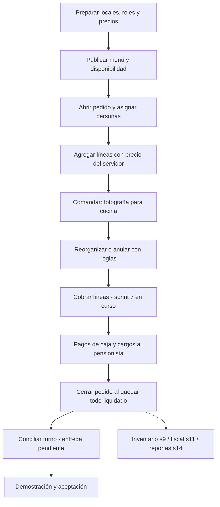

# Producto, sprints y trabajo en equipo

Fecha de corte: 11/10/2026. Alcance: sprints 0–6b y sprint 7 parcial.

Durante la consolidación otra sesión documentó US-033/DT-062–064 y declaró hecha
la entrega 2 backend. La auditoría revisa esa implementación sin certificar el
circuito UI ni aceptación final; conserva las brechas con evidencia. Los conteos
de fuentes corresponden al inicio de la revisión.

## El resultado que debe percibir el cliente

El objetivo es que el dueño delegue la atención y la caja con confianza, y pueda explicar a sus socios qué se vendió, qué se cobró y qué quedó en la cuenta de cada pensionista. Una pantalla funcionando permite demostrar avance; un circuito consistente y aceptado permite operar el negocio.

| Necesidad | Capacidad disponible | Límite de esta revisión | Evidencia de éxito a preparar |
|---|---|---|---|
| Atender con rapidez en el almuerzo | Mapa, personas por pedido, oferta del día, comandas y movimientos entre mesas | Cambios simultáneos y UX requieren controles adicionales; impresión real pendiente | Mozo toma y comanda mesa mixta en móvil; otro ve el cambio y no duplica líneas |
| Saber quién hizo cada cambio | Roles, permisos y bitácora | Escalada por asignación de roles y otras brechas documentadas | Admin local no obtiene administración central; acciones sensibles conservan actor, local y motivo |
| Cobrar bien sin recalcular a mano | Motor de precios y API de cobro en curso | No hay circuito UI completo ni cierre/conciliación aceptados | Suma de medios y cargos igual a las líneas; vuelto y saldo correctos |
| Dar confianza al pensionista | Planes versionados, ficha, responsable y libro de movimientos | Abonos, pre-ticket, portal y cierre mensual pertenecen a sprints posteriores | Mismo saldo se reconstruye del libro; un reintento no duplica el consumo |
| Entender costos | Recetas/subrecetas y costos en cascada | Fuga de costos por catálogo y riesgo de recálculo; historial económico incompleto en cobro WIP | Permisos protegen costos y una receta modificada no altera el costo histórico de la venta |
| Mostrar control a los socios | Documentación y bitácora existentes | Panel y reportes consolidados son sprint 14, sin atribuirlos a sprint 7 | Demostración y acta de aceptación con escenarios y cifras reconciliadas; reportes cuando toque su sprint |

## Inventario real por módulo

Inventario de fuentes al comenzar la auditoría; cantidades son archivos, no porcentaje de avance. Los conteos de pruebas corresponden a clases `*Test.java` y excluyen helpers. `menu` no tiene Java propio: su implementación está dentro de `catalogo`.

| Dominio / componente | Backend observado | Frontend / evidencia | Estado de producto | Informe |
|---|---|---|---|---|
| Contratos | ULID, Dinero, Resultado y enums fiscales; 22 tests ejecutados | Identificadores y céntimos atraviesan APIs | Base presente; defecto ULID confirmado | [Modelo](05-modelo-datos-arquitectura.md) |
| Gateway | Rutas `/api/**`, `/facturacion/**` y salud | Entrada del frontend según configuración | Esqueleto funcional; perfiles/red de producción sin demostrar | [Modelo](05-modelo-datos-arquitectura.md) |
| Identidad | 91 Java, 7 controllers, 22 archivos de test | Login, usuarios, roles, locales, horarios | Entregado con brechas de autorización y alcance | [Fundaciones](02-fundaciones-catalogo-pensionistas.md) |
| Común | 13 Java, 1 controller, 5 archivos de test | Errores, auditoría, seguridad y reloj de Lima | Base transversal; límites de módulos pendientes | [Fundaciones](02-fundaciones-catalogo-pensionistas.md) |
| Catálogo, recetas y menú | 90 Java, 11 controllers, 27 archivos de test | Productos, categorías, unidades, proveedores, recetas, menú y disponibilidad | Entregado; problemas de costos, unidades y consistencia documentados | [Fundaciones](02-fundaciones-catalogo-pensionistas.md) |
| Pensionistas | 64 Java, 6 controllers, 11 archivos de test | Planes, ficha, parámetros, cuenta | Base sprint 5 presente; circuito posterior planificado | [Fundaciones](02-fundaciones-catalogo-pensionistas.md) |
| Venta / POS | 88 Java, 3 controllers, 35 clases de prueba | Mesas, órdenes, pedido, historial y comanda | Cierre histórico de sprint 6/6b el 05/10/2026 con pendientes diferidos, incluido hardware | [Venta](03-venta-pos-caja.md) |
| Caja | 28 Java, 2 controllers, 4 archivos de test, incluyendo archivos sin confirmar | Integración de cobro/apertura/cierre en UI incompleta | Sprint 7 parcial; V40 y V41 backend declarado hecho, con hallazgos de auditoría | [Venta](03-venta-pos-caja.md) |
| Facturación | Salud, configuración y migraciones V1/V2 | Superficie fiscal futura | Esqueleto; emisión real del sprint 11 pendiente | [Modelo](05-modelo-datos-arquitectura.md) |
| Inventario, compras y producción | Sin Java en módulo `inventario`; proveedores sí existen en catálogo | Proveedores operables, inventario restante previsto | Sprint 9 / parte del 14 | Dependencias futuras |
| Delivery / recojo | Sin Java en módulo `delivery` | Motorizado provisional | Sprint 12 | Dependencias futuras |
| Kiosco, portal y abonos | Sin circuito completo actual | Superficies provisionales | Sprints 8 y 13 | [Frontend](04-frontend-experiencia-cliente.md) |
| Reportes, sincronización y respaldo | Diseño, tablas base de publicación, sin circuito completo | Pantallas futuras | Sprints 10 y 14 | [Modelo](05-modelo-datos-arquitectura.md) |

## Estado por sprint: construcción y aceptación

| Sprint | Plan / compromiso | Lo que existe | Condición para cerrar o mantener aceptación |
|---|---|---|---|
| 0 | Infraestructura y esqueleto | Reactor, contratos, salud, PostgreSQL y Flyway | Corregir ULID y asegurar guía de arranque reproducible; no basta longitud de identificador |
| 1 | Identidad y multilocal | Login/PIN, usuarios, locales y sesiones | Validar aislamiento de local, desactivación y asignación de privilegios |
| 2 | Catálogo | Productos, categorías, unidades y proveedores | Documentar cobertura real; el criterio táctil de v3 queda abierto |
| 3 | Permisos, auditoría, motivos y horarios | Implementación transversal presente | Arquitectura sin ciclos, permisos por rol/ámbito y evidencia fiel de bitácora |
| 4 | Recetas, costos, programación y agotados | Migraciones V20–V24 y pantallas | Cerrar riesgos de recálculo, permisos de costos, unidad base y horarios nocturnos |
| 5 | Planes y cuenta del pensionista | V26–V28, saldo como suma y ajuste con motivo | Datos reales validados y precios por vigencia correctos; flujo de abonos/portal aún futuro |
| 6 | Mesa, pedido, comanda, anulaciones y reorganización | V29–V37; adenda V38 «Terminar pedido»; cierre histórico documentado 05/10/2026 | Cierre registrado con HT-10 y otras brechas diferidas; esta auditoría no lo reabre automáticamente. Validar hardware/concurrencia/contenido al preparar la siguiente entrega |
| 6b | Rediseño POS | Shell, mapa, órdenes, historial y Pedido rápido para llevar; este último hecho según historia del 01/10/2026, incluido en cierre del 05/10 | Conciliar plan antiguo y validar permisos, móvil, errores y actualización entre dispositivos |
| 7 | Cajas/turnos, cobro, descuentos/anulación, conciliación, reapertura | Plan aprobado y entrega 1 hecha el 05/10/2026; entrega 2 backend declarada hecha durante esta revisión, con V41 en cambios locales | Integración UI y aceptación con hallazgos abiertas; descuentos, cierre y reapertura siguen previstos |

El [plan de sprints](../../producto/plan/README.md), `ESTADO.md` y las historias conservan afirmaciones de sesiones anteriores. La auditoría no revoca automáticamente la aceptación histórica ni declara nuevas aceptaciones. Señala qué controles necesitan revisión antes de la próxima entrega.

## Relación con el Product Backlog

La referencia vigente es [backlog v3](../../producto/prd/03-backlog-v3.md), de 64 historias en 5 épicas. Código e historias conservan IDs antiguos de tres dígitos; usar [traducción de IDs](../../producto/prd/04-traduccion-de-ids-v3.md), [enmiendas](../../producto/prd/05-enmiendas-al-backlog-v3.md) y [comparación](../../producto/plan/04-comparacion-backlog-v3.md). El plan antiguo cuenta 72 elementos e incluye habilitantes técnicos: no comparar esos totales como si fueran la misma unidad.

| Artefacto | Responsable por función | Cuándo se actualiza | Condición de calidad |
|---|---|---|---|
| Product Backlog | Product Owner con cliente | Refinamiento y decisiones de alcance | Historia, valor, reglas y aceptación; ID vigente enlazado al antiguo |
| Sprint Backlog | Equipo | Selección y avance de cada entrega | Separar defectos, deuda y función prevista; registrar dependencia y responsable real |
| Implementación | Claude / desarrollo | Cada cambio | Código, migración nueva si corresponde, pruebas significativas y documentación del cambio |
| Validación | QA / revisor independiente | Antes de demostración | Caso crítico, rol, local, resultado y evidencia; no suponer que «compila» equivale a aceptación |
| Aceptación | Cliente / Product Owner | Demostración final | Aprobación o observación registrada; los socios pueden revisar evidencias, sin inventar roles nuevos en el sistema |

No se asignan personas ni fechas de compromiso sin acuerdo del equipo. Las prioridades y bloques sugeridos están en [pendientes](../../pendientes/02-auditoria-integral-sprints-0-7-2026-10-11.md).

## Flujo actual y punto de entrega

## Mejoras de producto para validar con el cliente

| Mejora propuesta | Razón | Validación sin ampliar silenciosamente el alcance |
|---|---|---|
| Mostrar deuda, a favor y último movimiento con lenguaje uniforme | Reduce discusiones de saldo y cobro | Cliente y pensionista explican el mismo saldo a partir de un caso de prueba |
| Indicar guardado, fallo, datos desactualizados y reintento | Evita que el mozo crea que una orden quedó enviada | Cortar respuesta de API y pedir al mozo que identifique qué se guardó |
| Resumen de cobro con líneas, medios, cargo, recibido y vuelto | Facilita delegar caja | Dueño y cajero reconcilian el importe sin calculadora externa |
| Acta de aceptación por recorrido operativo | Da evidencia comprensible a cliente y socios | Registrar escenarios con cifras y observaciones; no sustituirlos por número de tests |
| Panel/reportes con cifras históricas estables cuando corresponda | Los socios necesitan cifras que no cambien al editar recetas | Mantener snapshots desde sprint 7; implementar reportes en su sprint previsto |
