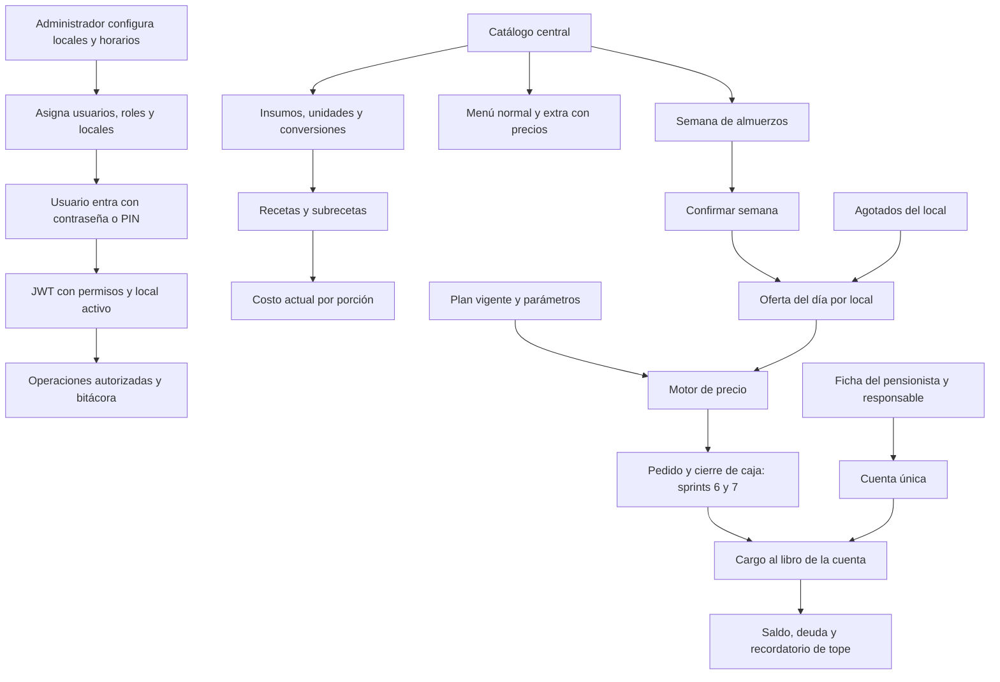
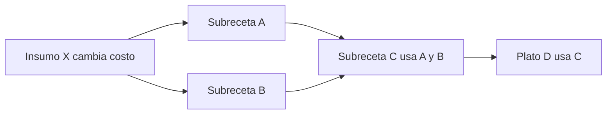

# Auditoría de fundaciones, catálogo, menú y pensionistas

Fecha: **11 de octubre de 2026**, Lima. Alcance: backend de los sprints 0–5 y sus dependencias que ya existen en venta/caja hasta el sprint 7. Revisión de lectura del estado de trabajo, incluidas modificaciones locales preexistentes. No se modificó código, migraciones ni la especificación del dueño. Las soluciones siguientes son propuestas para el Product Backlog y para que Claude las implemente después.

La base funcional es amplia: autenticación real, permisos efectivos, catálogo central, recetas con conversión, menú semanal y cuenta corriente con protección en PostgreSQL. Las principales brechas para un cliente real son **escalamiento de privilegios desde administración de usuarios, acceso persistente con JWT después de desactivar usuarios, identidad ambigua por PIN repetido y costos derivados que pueden quedar desactualizados**. “Sprint cerrado” no equivale a aceptación integral de todos los criterios del producto.

## Cómo leer la evidencia

| Etiqueta | Significado |
|---|---|
| Confirmado por lectura | El flujo o la estructura citada permite comprobar el comportamiento; no implica que se haya explotado en el entorno |
| Inferencia / riesgo | La condición se deduce de varios componentes y requiere la prueba indicada |
| No verificado | No se ejecutó ese escenario ni se inspeccionó el entorno productivo |
| Futuro / diferido | Está asignado a una entrega posterior; no se presenta como fallo del sprint cerrado |

Las rutas abreviadas de evidencia se resuelven así, desde `D:/Proyectos/RIKOS/`:

| Prefijo | Ruta completa desde la raíz del repositorio |
|---|---|
| `J/` | `rikos-backend/servicio-operacion/src/main/java/pe/rikos/operacion/` |
| `T/` | `rikos-backend/servicio-operacion/src/test/java/pe/rikos/operacion/` |
| `M/` | `rikos-backend/servicio-operacion/src/main/resources/db/migration/` |

La numeración de líneas corresponde a los archivos leídos en esta auditoría. Una corrección posterior puede desplazarla. La suite general la verifica el informe principal. Aquí se ejecutaron únicamente la simulación aritmética de CAT-03, el resolver Java de horario con repositorios dobles (FND-06) y una comprobación aislada de Spring MVC (FND-07); no se corrió la suite completa ni se conectaron estas comprobaciones a una base de datos. Las clases de comprobación se guardaron temporalmente fuera del repositorio; no se modificó código del producto.

## Cobertura por módulo y trazabilidad al backlog v3

| Módulo / bloque | IDs técnicos → v3 | Qué existe | Qué conserva valor para el cliente | Situación de aceptación |
|---|---|---|---|---|
| Organización y horarios | US-001/US-007 → US-52/US-58 | Empresa/locales, estados, horarios semanales y días especiales, local activo | Distinguir locales y determinar el servicio | Parcial: revisar autorización y cruce de medianoche; caja/inventario implícitos deben comprobarse contra las entregas que los crean |
| Usuarios y autenticación | US-002/003/005 → US-53/54/55 | Contraseña y PIN con BCrypt; sesiones, asignación multilocal, bloqueo persistido | Atribuir operaciones a personas | Funcional con brechas de privilegios y PIN individual |
| Roles y permisos | US-004 → US-56 | Unión de roles y excepciones, catálogo de permisos, token con permisos | Controlar quién puede actuar | Parcial: identidad sigue autorizando varias acciones por rol fijo y admite autoasignación de central |
| Auditoría | US-006 → US-57 | Registro transversal, JSON con Jackson, consulta paginada y filtros | Explicar decisiones sensibles a socios | Solo lectura en API; protección de base y cobertura de cambios sensibles incompletas |
| Categorías y productos | US-008 → US-33 | Árbol de dos niveles, regla de hoja, banderas de uso, servicios, precio, estados | Un catálogo común sin duplicar productos por local | Funcional; revisar costo visible, importes y unidad mutable |
| Unidades, presentaciones, conversiones | US-009 → US-34 | Unidad base, presentaciones de compra, conversión por producto | Comparar compras y recetas | Funcional para alta; falta política de pares inversos incompatibles |
| Proveedores | US-011 → US-35 | Ficha, RUC único si existe, estados y eliminación | Preparar compras con proveedor consistente | Historial de compras diferido al sprint 9; no inventar deuda o compras que aún no existen |
| Motivos | US-012 → US-36 | Lista por tipo, estado, observación obligatoria cuando corresponde | Estandarizar anulaciones y correcciones | Funcional; modificaciones de descripción pueden cambiar la lectura del pasado |
| Recetas y costeo | US-010 → US-37 | Ingredientes, subrecetas, rendimiento, costo de seis decimales, rechazo de ciclos, permisos de costo | Conocer costo por porción y futuro margen | Parcial: cascada compartida, cambio de unidad y exposición por catálogo |
| Menú normal/extra | US-014 → US-03 | Dos productos protegidos y precio central, misma composición | Cobro uniforme entre locales | Funcional con datos reales pendientes; no confundir extra de menú con agregado |
| Programación semanal | US-013 → US-02 | Lunes–domingo, borrador/confirmado, estado calculado por fecha, repetición de segundos | Planificar cocina sin reescribir el catálogo | Parcial al integrar ventas: retirar una opción usada del día falla por FK |
| Disponibilidad | US-015 → US-04 | Agotado por local, reactivación con motivo, registro de actor | Ocultar productos sin cambiar comandas pasadas | Buena separación de configuración central y disponibilidad local; comportamiento depende de integridad del local activo del JWT |
| Ficha y responsable | US-016 → US-15; estado US-026 → US-32 | DNI único, responsable obligatorio, comidas habituales, PIN aleatorio, cuenta única | Relacionar persona, responsable y deuda | Alta/estado existen; contraseña portal y kiosco son diferidos |
| Planes y parámetros | US-017 → US-16 | Identidad del plan y versiones por fecha; tres precios por comida; táper y segundo consumo configurables | Precios explicables, vigencia y excepciones | Buena base; concurrencia de cambios de plan requiere prueba |
| Cuenta corriente | US-018 → US-17 | Libro de agregado, suma de saldo, tope preventivo, saldo inicial y ajustes | Una sola deuda/saldo por pensionista, con local por movimiento | Libro fuerte; contrato de reintentos y periodos debe completarse |

## Flujo que ya se puede explicar al cliente



La emisión del pre-ticket, abonos, sincronización, portal y cierre mensual no se pueden vender como terminados por tener las tablas o servicios base. Corresponden respectivamente a sprints 8, 10 y 13. El tope es un recordatorio y permite consumir: cambiarlo a bloqueo contradiría las decisiones del usuario del sprint 5.

## Hallazgos de fundaciones

### FND-01 — Un administrador de local puede elevarse a administrador central

**P0 · Confirmado por lectura · US-55/56.** `ConfiguracionSeguridad.java:75–80` permite todo `/usuarios/**` a ambos administradores, salvo el matcher específico de excepciones. `UsuarioController.java:217` expone `PUT /usuarios/{id}/roles-locales`; `AsignarRolesYLocales.java:46–70` comprueba que los IDs existen y reemplaza las asignaciones. No comprueba jerarquía, local administrado ni que el destino sea el propio actor. `CrearUsuario` tampoco limita los roles que entrega.

**Caso de aceptación que hoy falla por diseño:** un administrador de local usa el rol central que obtiene del listado de roles, se lo asigna o crea un usuario central, inicia una sesión nueva y obtiene todos sus permisos. Esto elude la protección separada de `identidad.administrar_permisos` y permite administrar otros locales. No se ejecutó la elevación sobre datos del usuario.

**Solución propuesta:** una política explícita para asignar roles y locales, aplicada en casos de uso; reservar la concesión del rol central y el cambio de otros administradores a autoridad central. Validar actor, destino, conjunto permitido y ámbito. Auditar antes/después. **Aceptación:** administrador de local no se eleva, no altera central ni usuarios de locales ajenos; central sí realiza operaciones permitidas; rechazo 403 sin escrituras, con rastro; mismas garantías en alta y edición.

### FND-02 — Los permisos de identidad no gobiernan sus propias acciones

**P1 · Confirmado por lectura · US-56, RN-013.** `ConfiguracionSeguridad.java:75–80` utiliza `hasAnyRole` para crear/editar/desactivar usuarios, roles y locales. En cambio el catálogo de permisos define `identidad.ver`, `crear`, `modificar` y `desactivar` en `SembradorCatalogoPermisos.java:45,62,74,82`.

Retirar `identidad.crear` a un administrador mediante una excepción no le impide crear usuarios con el endpoint actual; conceder ese permiso a un rol propio tampoco abre el endpoint. La pantalla y `/auth/mis-permisos` pueden indicar un permiso que no corresponde a la decisión del servidor.

**Solución propuesta:** matriz por acción con permisos efectivos, más la política jerárquica de FND-01. **Aceptación:** retirar/conceder cada acción cambia realmente la autorización tras aplicar la política de renovación; una prueba por método y por excepción, incluyendo roles propios. Mantener las restricciones centrales adicionales donde el negocio las exige.

### FND-03 — Desactivar usuarios/locales o retirar permisos no invalida el JWT abierto

**P1 · Confirmado por lectura; decisión previa DT-047.** `JwtServicio.java:59–65` comprueba firma/expiración. `FiltroAutenticacionJwt.java:35–73` construye autoridades y local desde los claims; no vuelve a verificar estado, asignación ni versión de autorización. `CambiarEstadoUsuario` solo cambia la fila. La decisión DT-047 reconoce los permisos desactualizados; no resuelve el cierre inmediato de acceso de US-005.

**Consecuencia:** un token ya emitido sigue autorizando hasta su expiración. No se afirma la duración efectiva de producción, que no se inspeccionó. Reemitir al cambiar local tampoco invalida el token anterior.

**Solución propuesta:** versión de autorización o revocación local persistida, validación de usuario/local activo y cambios sensibles, con política coherente para funcionamiento offline. **Aceptación:** desactivar y quitar asignación/permiso rechaza el siguiente acceso protegido con el token previo; reactivar no reactiva automáticamente tokens revocados; pruebas con token realmente emitido, evitando reemplazarlo por uno de prueba.

### FND-04 — PIN repetido de trabajadores produce una identidad ambigua

**P1 · Confirmado por lectura · US-54, RN-011.** `AsignarPin.java:27–29` guarda cualquier PIN válido sin comprobar coincidencias entre usuarios del mismo local. `AutenticarConPin.java:73–80` recorre candidatos y termina con el primer hash coincidente. La consulta `UsuarioLocalRepositorio.findByLocalIdAndUsuario_ActivoTrue` no define orden.

**Ejemplo:** dos trabajadores activos del mismo local con el mismo PIN entran como el primer candidato encontrado. La operación queda atribuida a otra persona. Saltear la elección de usuario exige resolver esa unicidad; el PIN de pensionista no presenta este problema si el kiosco usa DNI + PIN.

**Solución propuesta:** impedir coincidencias en locales compartidos sin guardar PIN legible; incluir asignación a nuevo local en la validación. Si no es viable garantizarla, revisar selección de identidad antes del PIN. **Aceptación:** dos activos que comparten local no obtienen el mismo PIN; mover un usuario a un local con colisión se rechaza con error de negocio; dos locales independientes siguen la política acordada; no registrar credenciales en bitácora.

### FND-05 — User-Agent no identifica una terminal ni limita un intento automatizado

**P1 · Confirmado por lectura · RN-091, DT-039.** `AutenticacionController.java:86–89` pasa `User-Agent` como dispositivo; `LimitadorIntentosPin.java:51–80` lo normaliza y busca la pareja local/valor. Dos terminales con navegador igual comparten bloqueo. Cambiar ese encabezado crea otra huella y evade el contador. El recorte de 120 caracteres ya existe: el antiguo 500 por longitud no sigue abierto.

**Solución propuesta:** identificar terminal registrada y aplicar límites adicionales que no dependan solo de un encabezado arbitrario; proteger también carreras del contador y limpiar huellas vencidas. **Aceptación:** dos terminales iguales no se bloquean entre sí; cambiar encabezado no reinicia libremente el límite; varios intentos simultáneos no pierden conteos ni generan 500; reiniciar nodo conserva bloqueo. Confirmar umbral con dueño (P-18/RF-006).

### FND-06 — El horario que cruza medianoche se asocia al día incorrecto

**P1 · Confirmado por ejecución aislada del resolver Java · US-58; impacto futuro en kiosco.** `ResolverServicioVigente.java:58–77` filtra solo el día/fecha actual. `RangoHorario.java:26–31` comprueba únicamente la hora circular. Una cena **lunes 19:00–martes 00:30** aparece lunes 00:15 y desaparece martes 00:15 si el martes no tiene franja propia. Los días especiales tienen la misma separación por fecha, aún pendiente de ejecutar esa variante.

Se ejecutó la clase compilada `ResolverServicioVigente` con una única franja semanal de lunes, sin día especial y repositorios dobles mediante `java.lang.reflect.Proxy`. No se conectó a PostgreSQL:

| Momento de comprobación | Resultado real | Esperado |
|---|---|---|
| Lunes 12/10/2026 00:15 | `Optional[cena]` | Sin servicio de esa franja |
| Lunes 12/10/2026 19:00 | `Optional[cena]` | Cena |
| Martes 13/10/2026 00:15 | `Optional.empty` | Cena de la franja iniciada el lunes |
| Martes 13/10/2026 00:30 | `Optional.empty` | Sin servicio de esa franja |

**Solución propuesta:** resolver intervalos con fecha de inicio y revisar el arrastre del día anterior; definir prioridad frente a feriado/día especial del día siguiente y solapamientos entre servicios. **Aceptación:** lunes 00:15 fuera de esa cena, lunes 19:00 dentro, martes 00:15 dentro y martes 00:30 fuera; mismos escenarios con días especiales. Los tests actuales de `RangoHorario` por hora no prueban el calendario completo.

### FND-07 — Entradas inválidas y conflictos previsibles terminan en ERROR_INTERNO

**P1 · Confirmado por ejecución aislada de Spring MVC para tres clases de entrada.** `ManejadorGlobalDeErrores.java:39–45` captura `Exception` y devuelve 500. Se utilizó `MockMvcBuilders.standaloneSetup` con el manejador real compilado y las dependencias del proyecto, un controlador de comprobación con `@Valid @RequestBody` y otro con parámetro `int`, sin iniciar Spring Boot ni conectar PostgreSQL. El manejador interceptó estas excepciones antes de los resolutores predeterminados:

| Entrada aislada | Respuesta | Excepción resuelta |
|---|---|---|
| DTO válido | 200 | Ninguna |
| Campo `@NotBlank` vacío con `@Valid` | 500, `ERROR_INTERNO` | `MethodArgumentNotValidException` |
| JSON mal formado | 500, `ERROR_INTERNO` | `HttpMessageNotReadableException` |
| Parámetro entero con texto `bad` | 500, `ERROR_INTERNO` | `MethodArgumentTypeMismatchException` |

Esta comprobación confirma la conversión de estas tres clases de error; no afirma que toda entrada inválida o todo 4xx termine en 500. Las fallas que los casos de uso traducen expresamente a `Resultado` conservan su respuesta. Por lectura adicional, `AutenticacionController.java:72,86,103` omite `@Valid` pese a las restricciones del DTO; activar la anotación sin arreglar el manejador provocaría el primer tipo de 500. Los escenarios de restricciones SQL, longitud máxima y carrera no se ejecutaron; requieren las pruebas propuestas. `ActualizarCategoria` tampoco transforma por sí mismo el nombre duplicado en `Resultado`.

**Solución propuesta:** activar validación uniforme y devolver 400/422/409 para errores esperados, conservar referencia y 500 para errores reales; traducir restricciones conocidas sin ocultar fallas de infraestructura. **Aceptación:** PIN nulo/formato incorrecto, JSON roto, campo demasiado largo, importe fuera de rango y duplicación concurrente reciben el contrato definido y no alteran datos; 500 imprevisto sigue correlacionable y no expone stack trace. Validar también rutas de cambio de local y de ajustes.

### FND-08 — La bitácora está protegida en API, sin protección de inmutabilidad en migraciones

**P2 · Confirmado sobre esquema versionado; permisos reales de producción no verificados.** `M/V13__permisos_y_auditoria.sql:51` crea `auditoria`; no se encontró trigger de UPDATE/DELETE ni REVOKE/GRANT de protección en V1–V41. `T/identidad/api/InmutabilidadDeAuditoriaTest.java:32–70` comprueba interfaz/controlador por reflexión. Eso no prueba SQL directo. El libro de cuenta sí incorpora trigger en V28.

**Solución propuesta:** migración nueva que aplique protección equivalente al libro para bitácora, con usuario de aplicación de privilegios limitados y procedimiento de mantenimiento definido. **Aceptación:** UPDATE y DELETE mediante la conexión de aplicación son rechazados; INSERT y lectura permitida funcionan; no se puede mutar un evento existente por `save`; prueba de PostgreSQL, además de reflexión. No usar este resultado como certificación de cumplimiento legal.

### FND-09 — Repetir cambio de estado inventa el valor anterior de la bitácora

**P2 · Confirmado por lectura.** `CambiarEstadoUsuario.java:36` registra `!activo` como anterior en lugar del valor leído. Desactivar un usuario ya desactivado produce un falso cambio de verdadero a falso. `CambiarEstadoMotivo` sí captura el estado antes de actuar y sirve de referencia.

**Solución propuesta:** obtener estado real y acordar si la repetición es idempotente sin evento o un intento explícito. **Aceptación:** dos desactivaciones no crean una transición ficticia; registrar valor real, actor/local y resultado; mismo criterio en locales, productos y pensionistas.

### FND-10 — Asignar roles/locales y cambiar PIN del trabajador no deja bitácora transversal

**P2 · Confirmado por lectura.** `AsignarRolesYLocales.java:62–73` elimina/reinserta asignaciones sin `RegistradorAuditoria`; `AsignarPin.java:27–31` tampoco lo utiliza. Los timestamps de asignación no conservan el conjunto retirado. Sí se auditan las excepciones de permiso y regeneración de PIN de pensionista.

**Solución propuesta:** eventos de autorización/credencial que registren conjuntos anteriores/nuevos y actor, sin hash ni PIN. **Aceptación:** los socios pueden reconstruir quién dio acceso central, a qué locales y cuándo, y quién reinició una credencial; lectura de bitácora conserva acceso por permiso.

## Hallazgos de catálogo, recetas y menú

### CAT-01 — El catálogo revela costos aunque recetas los oculte

**P1 · Confirmado por lectura; pendiente previo P-30 · RN-012.** `ProductoController.java:85–96,111–114` incluye `costoUltimaCompra` sin comprobar `recetas.ver_costos`/`inventario.ver_costos`. El acceso solo exige `catalogo.ver` (`ConfiguracionSeguridad.java:192–196`), otorgado también a cajero, mozo y cocina. `RecetaController` sí oculta costos.

**Solución propuesta:** política unificada de visibilidad económica; filtrar DTO de catálogo/recetas y respuestas de escritura. **Aceptación:** mozo/cajero/cocina sin el permiso correspondiente no obtienen costos en ninguna respuesta; central/local autorizado sí; permisos excepcionales funcionan. No basta ocultar una columna en React.

### CAT-02 — Cambiar unidad base deja recetas y presentaciones en otra escala

**P1 · Confirmado por lectura; pendiente previo P-31.** `ActualizarProducto.java:30–58` acepta otra unidad sin analizar dependencias ni recalcular. `Producto.actualizar` reemplaza `unidadBase`; el rendimiento y costo manual siguen con sus números anteriores. También quedan factores de compra expresados respecto a la base anterior.

**Solución propuesta:** bloquear cambio con dependencias o diseñar conversión explícita de cantidades/rendimientos/costos/factores, preservando snapshots. **Aceptación:** cambiar kg→g con recetas/presentaciones no deja el mismo costo unitario numérico ni el mismo rendimiento sin conversión; si se bloquea, error explicable con dependencias. Validar cambio de banderas insumo/subreceta y estado que afecten recetas.

### CAT-03 — Recálculo en cascada deja ancestros obsoletos cuando hay ramas compartidas

**P1 · Confirmado por seguimiento del algoritmo; prueba integrada pendiente · US-37 CA4.** `CalculadoraCostoReceta.java:103–115` usa un único conjunto de visitados y propaga inmediatamente hacia arriba. En un grafo acíclico con dependencia compartida, una receta puede recalcularse una segunda vez después de otro ingrediente, pero la llamada recursiva queda bloqueada por `visitados`, de modo que sus consumidores no reciben el segundo costo.



**Ejemplo aritmético:** cantidades/rendimientos/porciones de 1; antes X=A=B=1, C=D=2. Al pasar X a 2 y recorrer A primero: A=2, C=3, D=3; luego B=2, C=4, pero D permanece 3. Recorrer B primero produce la misma brecha. Los tests actuales prueban cadenas, sin esta convergencia seguida de otro ancestro.

Se ejecutó una simulación mínima en JavaScript del recorrido observado, en memoria y sin modificar archivos: ambos órdenes devolvieron C=4 y D=3 frente a D=4 esperado. Esto verifica la traza aritmética; aún falta ejecutar el caso sobre las entidades Java y PostgreSQL antes de declarar una reproducción integrada.

**Solución propuesta:** recalcular el subgrafo afectado en orden topológico desde ingredientes hasta consumidores, o invalidar/recalcular asegurando que todos sus hijos estén actualizados. **Aceptación:** ejemplo anterior termina C=D=4 para cualquier orden de consulta; cubrir más de una rama compartida, ingrediente sin costo y ediciones de composición; no modificar costo histórico de ventas ya cerradas.

### CAT-04 — Precio normal y costo manual aceptan valores negativos

**P1 · Confirmado por lectura del flujo y esquema.** `CrearProducto.java` exige precio solo si vendible, no valida signo; `ActualizarProducto` tampoco. `RegistrarCostoManual.java` acepta el BigDecimal recibido y `Producto.registrarCostoManual` lo guarda. V14 no tiene CHECK de signo en `producto.precio_venta` ni `costo_ultima_compra`.

**Solución propuesta:** validar signo/precisión/límites en dominio y DB; definir explícitamente si costo cero y precio cero son admisibles para cortesías. **Aceptación:** un precio/costo negativo se rechaza antes de guardar y antes de propagarlo a recetas; importes extremos y exceso de decimales siguen la política definida; `null` permanece “sin dato” donde esté permitido.

### CAT-05 — Se permiten conversiones inversas incompatibles

**P2 · Confirmado por lectura.** `CrearConversion.java:44–51` comprueba solo el par dirigido. Puede guardar kg→g=1000 y g→kg=0.002. `CalculadoraCostoReceta.java:55–64` toma la primera coincidencia en cualquiera de los dos sentidos, sin orden explícito. Tampoco se rechaza origen=destino con factor distinto de 1.

**Solución propuesta:** un par canónico por producto o consistencia matemática de inversas, rechazando autoconversión inútil; definir si se admiten conversiones encadenadas. **Aceptación:** esos dos factores no pueden coexistir; la conversión obtenida es independiente del orden de filas y convierte 1000 g a 1 kg; factor positivo y precisión apropiada.

### CAT-06 — Eliminación física no fue adaptada a referencias de los sprints nuevos

**P2 · Confirmado por lectura de casos de uso/FK; resultado HTTP no ejecutado.** `EliminarProducto.java:60–62` consulta presentaciones/recetas/programación/disponibilidad, pero no `detalle_pedido` ni `detalle_pedido_componente`. V32:58,86 protege con RESTRICT. `QuitarOpcionMenu.java:25–35` permite quitar la opción de hoy sin comprobar si ya fue usada; V32:87 referencia `opcion_menu` con RESTRICT. Su comentario “nadie la vendió todavía” deja de ser válido en pleno almuerzo. La base conserva historial, pero la respuesta esperada termina en FND-07.

**Solución propuesta:** desactivar/retirar oferta sin borrar identidad usada y mantener snapshots; si se conserva borrado para registros sin uso (DT-051), devolver `TIENE_HISTORIAL` en toda referencia actual/futura. **Aceptación:** producto vendido y opción usada del día no se borran ni dan 500; opción desaparece de oferta nueva por el mecanismo acordado y pedido/comanda/cobro existente sigue intacto. Aplicar revisión equivalente a `EliminarLocal` con caja/mesas/operación nuevas.

### CAT-07 — El motivo histórico puede mostrarse con texto cambiado posteriormente

**P2 · Confirmado por lectura; política de negocio pendiente.** `ActualizarMotivo.java:24–34` modifica descripción y obligación de observar sin versionado ni auditoría. `CuentaController.java:129` consulta descripción actual para mostrar cada movimiento; un ajuste antiguo puede mostrarse con motivo renombrado. En cambio varias operaciones guardan descripción del motivo en JSON de auditoría.

**Solución propuesta:** preservar snapshot/versionado del texto aplicado y auditar mantenimiento; definir si un motivo usado se renombra o se sustituye por otro. **Aceptación:** renombrar “Corrección de cobro” no hace que el estado de cuenta antiguo parezca tener otro motivo; la descripción aplicada y quién la cambió siguen recuperables.

## Hallazgos y mejoras en pensionistas

### PEN-01 — Idempotencia del libro compara solo ID, sin contenido ni atomicidad del reintento

**P1 antes de sincronización · Confirmado por lectura del contrato; carrera inferida.** `LibroDeCuenta.java:27–32` devuelve cualquier movimiento existente con el ID recibido, sin validar cuenta/local/signo/importe/pedido. Un ID existente con otros datos se considera éxito. El patrón find/save tampoco maneja dos inserciones simultáneas del mismo ID. `RegistrarConsumo` es servicio interno, no endpoint público independiente: no se afirma explotación externa actual. `LibroDeCuentaTest` demuestra repetición secuencial del mismo contenido, no contenido diferente ni carreras.

**Solución propuesta:** inserción idempotente atómica y comparación de contenido normalizado; mismo ID con contenido diferente es conflicto. **Aceptación:** mismo ID/mismo contenido retorna el mismo movimiento una vez; mismo ID/otra cuenta o importe devuelve conflicto y no falso éxito; dos reenvíos paralelos registran una fila y respuestas coherentes. Antes de sprint 10, verificar también `registrado_en` y reloj de origen sin sobrescribirlos en reintentos.

### PEN-02 — Reintentar el POST de ajustes puede duplicar un movimiento financiero

**P2 · Confirmado por lectura del contrato actual.** `RegistrarAjuste.java:66` llama `libro.agregar(null, ...)`; cada petición genera un ULID nuevo. El cliente no entrega identificador de acción en `CuentaController.AjusteRequest`. Si se confirmó el ajuste pero se perdió la respuesta, reenviar produce otro ajuste válido. El saldo inicial sí tiene unicidad parcial por cuenta.

**Solución propuesta:** ID de acción/idempotency key estable en los comandos financieros que puedan reenviarse; diferenciar dos ajustes intencionales de un reintento. **Aceptación:** después de una respuesta perdida el mismo comando se recupera sin duplicar deuda; dos acciones nuevas iguales pueden coexistir con IDs distintos. No implementar deduplicación por monto/tiempo que borre ajustes legítimos.

### PEN-03 — Versiones de plan no bloquean modificaciones simultáneas

**P2 · Inferencia de concurrencia, no fallo ejecutado.** `VersionPlan.java` no tiene `@Version`; `VersionPlanRepositorio` no usa locks. `CambiarPreciosPlan.java:60–78` lee última versión y después corrige/cierra/inserta. Dos correcciones del precio de hoy pueden perder una escritura y dos nuevas vigencias pueden chocar con el índice de versión abierta, generando 500 en vez de conflicto. V26 garantiza una abierta y fecha inicial única, pero no declara exclusión de rangos históricos solapados.

**Solución propuesta:** serializar cambios por plan o versión optimista con contrato 409; reforzar intervalo de vigencia donde corresponda. **Aceptación:** dos administradores cambiando un plan a la vez reciben una actualización y un conflicto explícito/reintento coherente; no precios solapados ni una bitácora que afirme versiones que no existieron; consultar fecha exacta en el límite conserva precio correcto.

### PEN-04 — Una sola autorización de lectura abre la ficha extensa al mozo

**P2 · Mejora de producto/privacidad a refinar; no incumplimiento declarado.** `ConfiguracionSeguridad.java:148–149` exige `pensionistas.ver` para todos los GET. El mozo tiene ese permiso; `PensionistaController.java:96–108,175–181` devuelve datos académicos, contacto, límite y la ficha completa del responsable. Para identificar a quien atiende, el POS necesita un resumen mucho menor.

**Solución propuesta:** separar búsqueda/identificación operacional de ficha administrativa y cuenta financiera según las necesidades reales de cada actor. **Aceptación propuesta:** mozo obtiene DNI/nombre/estado y dato de tarifa necesario; responsable/contactos extensos se reservan a administradores autorizados, sin romper la operación. Acordar matriz con cliente antes de restringir; este documento no interpreta obligaciones legales.

## Modelo de datos: decisiones correctas, desalineaciones y límites

| Tema | Evaluación del modelo implementado | Acción documental o de producto |
|---|---|---|
| Convención ULID y FK RESTRICT | La convención es adecuada; la implementación del generador está defectuosa, confirmada en [MOD-01](05-modelo-datos-arquitectura.md#mod-01--el-generador-sobrescribe-parte-del-timestamp-ulid). Las FK ayudan a conservar historial incluso cuando la aplicación omite dependencias | Corregir generador sin reemplazar IDs históricos, según MOD-01; revisar borrados por uso nuevo (CAT-06) |
| Cuenta única y libro append-only | Buena decisión; saldo reconstruible, local obligatorio, trigger real UPDATE/DELETE | Preservar al integrar caja/abonos y hacer sincronización |
| Relación pensionista/responsable/cuenta | Alta transaccional crea los tres. UNIQUE en hijo garantiza como máximo uno; no por sí solo que cada pensionista tenga ambos | Agregar validación/reconciliación de integridad antes de carga real; no suponer obligatoriedad garantizada solo por el ER |
| Plan único + versiones por comida | Refinamiento coherente del diseño inicial por producto; el plan del pensionista apunta a identidad estable | Documentar ER físico vigente y resolver PEN-03 |
| Receta y subreceta por rendimiento | Costeo homogéneo por unidad base evita usar porciones como kilos | Resolver CAT-02/03 y acordar desactivación P-32 |
| `version` en producto y receta | Bloqueo optimista evita varias pérdidas simultáneas; no resuelve grafos económicos ni ciclos concurrentes entre recetas distintas | Prueba de dos ediciones cruzadas A→B y B→A; condición inferida, no confirmada en runtime |
| Configuración central frente a disponibilidad local | Separación correcta; menú no duplica costo/precio por local | Validar acceso real al local en JWT (FND-03) |
| V28 sin FK `pedido_id`/`abono_id` | Fue intencional cuando no existían venta/abonos; V32 ya creó pedido y no se encontró migración posterior que añada FK a `movimiento_cuenta.pedido_id` | Diseñar migración nueva tras auditar datos, o documentar referencia lógica justificada por sincronización; no agregar FK sin estudiar orden de recepción |
| `periodo_cuenta` y `saldo_cuenta_cache` del modelo | No creados en sprint 5; periodo diferido al 13 y saldo se consulta hoy | No contarlos como faltantes de sprint cerrado; tabla §16 y ER deben distinguir actual/propuesto |
| Motivos del modelo §3.11 | Enum documental mantiene seis tipos aunque DB añade `disponibilidad` y `ajuste_cuenta` en V23/V28 | Actualizar modelo vigente, documentación OpenAPI y glosario; no editar fuente fija |
| Modelo pensionistas §7.1/7.2 y ER §7.12 | Encabezado explica lo construido, pero tablas/ER siguen representando `precio_plan`, portal NOT NULL y cache/periodos futuros | Separar explícitamente modelo físico vigente del diseño futuro; un compañero debe poder implementar sin interpretar párrafos contradictorios |
| Regla “ninguna tabla admite borrado físico” del bloque 90 | Contradice DT-043/DT-051 y endpoints de eliminación reales | Definir regla actual: estados preservan historial; borrar únicamente no usados si decisión aceptada; listar excepciones |
| Dinero en céntimos y costos en NUMERIC(14,6) | Buena separación evita double en reglas monetarias | Añadir límites/signo CAT-04 y mantener criterio de redondeo acordado; no convertir cálculos a float |

## Verificación disponible y faltante

| Área | Evidencia de pruebas existentes | Qué no demuestran todavía |
|---|---|---|
| Autenticación | `AutenticarConContrasenaTest`, `AutenticarConPinTest`, `LimitadorIntentosPinTest`, pruebas de usuario/local inactivo | Revocar token ya emitido, PIN repetido, terminales con mismo User-Agent, carreras y jerarquía administrativa |
| Permisos/auditoría | Resolver de permisos, acceso por rol a bitácora, JSON real, inmutabilidad por reflexión | Permisos granulares de identidad, autoasignación central, inmutabilidad SQL de bitácora, estado repetido real |
| Manejo HTTP | Comprobación aislada con MockMvc y manejador real: validación de DTO, JSON roto y tipo incorrecto devuelven 500 | Integrar errores 400/422/409, activar validación ausente y comprobar restricciones/concurrencia por endpoint real |
| Horarios | `RangoHorarioTest` y `ResolverServicioVigenteTest`; comprobación aislada del resolver real reprodujo los dos errores del turno lunes→martes | Integrar regresión de fecha completa y resolver prioridad del feriado siguiente |
| Catálogo/recetas | Altas, regla de hoja, conversiones, ciclos, cascada simple, ocultación de costo en recetas | Cascada con convergencia, no fuga por productos, cambio de base con dependencias, negativas y pares inversos inconsistentes |
| Menú/agotados | `ProgramacionSemanalTest`, `MenuTest`, `DisponibilidadTest`; integración con comanda intacta ya existe en venta | Retirar del menú una opción del día que ya aparece en pedidos, desactivar/cambiar categoría de una opción futura |
| Pensionistas/planes | Ficha, DNI único, planes, motor de precios, tope y servicios de atención | Dos cambios de precio concurrentes, minimizar ficha por actor y rangos temporales adversos |
| Cuenta | Libro idempotente secuencial, suma por varios locales, UPDATE/DELETE rechazado en DB | Reenvío simultáneo o contenido distinto con mismo ID, respuesta perdida de ajuste, offline real |

## Reproducción aislada de FND-06 y FND-07

Entorno observado: **JDK 21.0.11**, dependencias compiladas del proyecto (Spring Boot 4.1.1, Spring MVC/test 7.0.9) y classpath de los XML Surefire. Se ejecutaron las clases del producto de `servicio-operacion/target/classes` mediante Java source-file mode, sin arrancar la aplicación ni utilizar base de datos. Los fragmentos siguientes son herramientas temporales de comprobación, no código propuesto para el producto.

Desde la raíz del repositorio, resolver el classpath sin imprimir otras propiedades del XML:

```powershell
$auditXmlPath = Get-ChildItem -LiteralPath 'rikos-backend/servicio-operacion/target/surefire-reports' -Filter 'TEST-*.xml' |
    Select-Object -First 1 -ExpandProperty FullName
[xml]$auditTestXml = Get-Content -LiteralPath $auditXmlPath -Raw
$auditCp = ($auditTestXml.testsuite.properties.property |
    Where-Object { $_.name -eq 'java.class.path' }).value
$auditProbeDirectory = Join-Path $env:TEMP 'rikos-auditoria-fnd07-20261011'
New-Item -ItemType Directory -Path $auditProbeDirectory -Force | Out-Null
# Guardar allí los dos fragmentos Java siguientes, con el nombre de su clase.
$auditJava = 'C:\Program Files\Eclipse Adoptium\jdk-21.0.11.10-hotspot\bin\java.exe'
& $auditJava -cp $auditCp (Join-Path $auditProbeDirectory 'AuditFnd06Probe.java')
& $auditJava -cp $auditCp (Join-Path $auditProbeDirectory 'AuditFnd07Probe.java')
```

Si no existen clases compiladas o XML Surefire, primero hace falta la compilación/verificación aislada descrita en [validación](06-validacion-y-aceptacion.md). No ejecutar la integración contra la base habitual del usuario solo para obtener este classpath.

**FND-06 — guardar temporalmente como `AuditFnd06Probe.java`:**

```java
import java.lang.reflect.Proxy;
import java.time.*;
import java.util.*;
import pe.rikos.operacion.identidad.aplicacion.ResolverServicioVigente;
import pe.rikos.operacion.identidad.infraestructura.*;

public class AuditFnd06Probe {
    @SuppressWarnings("unchecked")
    static <T> T repo(Class<T> type, Object result) {
        return (T) Proxy.newProxyInstance(type.getClassLoader(),
                new Class<?>[]{type}, (object, method, args) -> result);
    }
    public static void main(String[] args) {
        var weekly = List.of(new HorarioServicio("horario", "local", "cena",
                "lunes", LocalTime.of(19, 0), LocalTime.of(0, 30)));
        var resolver = new ResolverServicioVigente(
                repo(DiaEspecialRepositorio.class, Optional.empty()),
                repo(HorarioDiaEspecialRepositorio.class, List.of()),
                repo(HorarioServicioRepositorio.class, weekly));
        for (var time : List.of(LocalDateTime.of(2026, 10, 12, 0, 15),
                LocalDateTime.of(2026, 10, 12, 19, 0),
                LocalDateTime.of(2026, 10, 13, 0, 15),
                LocalDateTime.of(2026, 10, 13, 0, 30))) {
            System.out.println(time + " -> " + resolver.resolver("local", time));
        }
    }
}
```

**FND-07 — guardar temporalmente como `AuditFnd07Probe.java`:**

```java
import jakarta.validation.Valid;
import jakarta.validation.constraints.NotBlank;
import org.springframework.http.MediaType;
import org.springframework.test.web.servlet.*;
import org.springframework.test.web.servlet.setup.MockMvcBuilders;
import org.springframework.web.bind.annotation.*;
import pe.rikos.operacion.comun.web.ManejadorGlobalDeErrores;
import static org.springframework.test.web.servlet.request.MockMvcRequestBuilders.*;

public class AuditFnd07Probe {
    public record Input(@NotBlank String value) {}
    @RestController
    public static class ProbeController {
        @PostMapping("/validate")
        public String validate(@Valid @RequestBody Input input) { return input.value(); }
        @GetMapping("/typed")
        public String typed(@RequestParam("q") int q) { return Integer.toString(q); }
    }
    public static void main(String[] args) throws Exception {
        ((ch.qos.logback.classic.Logger) org.slf4j.LoggerFactory.getLogger(
                org.slf4j.Logger.ROOT_LOGGER_NAME)).setLevel(ch.qos.logback.classic.Level.OFF);
        MockMvc mvc = MockMvcBuilders.standaloneSetup(new ProbeController())
                .setControllerAdvice(new ManejadorGlobalDeErrores()).build();
        emit("valid", mvc.perform(post("/validate").contentType(MediaType.APPLICATION_JSON)
                .content("{\"value\":\"ok\"}")).andReturn());
        emit("blank_validated", mvc.perform(post("/validate").contentType(MediaType.APPLICATION_JSON)
                .content("{\"value\":\"\"}")).andReturn());
        emit("malformed_json", mvc.perform(post("/validate").contentType(MediaType.APPLICATION_JSON)
                .content("{bad")).andReturn());
        emit("type_mismatch", mvc.perform(get("/typed").param("q", "bad")).andReturn());
    }
    static void emit(String name, MvcResult result) throws Exception {
        System.out.println(name + ": status=" + result.getResponse().getStatus()
                + ", exception=" + (result.getResolvedException() == null ? "none"
                        : result.getResolvedException().getClass().getSimpleName())
                + ", body=" + result.getResponse().getContentAsString());
    }
}
```

Resultados esperados para reproducir el defecto actual: FND-06 da cena a lunes 00:15 y vacío a martes 00:15; FND-07 devuelve 200 al caso válido y 500 a las otras tres entradas. Tras corregirlos, esas salidas deben cambiar conforme a los criterios de aceptación anteriores.

## Trabajo que sí es futuro y no un defecto oculto

| Trabajo | Clasificación | Referencia / criterio para entregar |
|---|---|---|
| Compras que reemplazan costo manual, historial del proveedor | Sprint 9 / P-28 | Integrar recálculo correcto CAT-03; no permitir borrar proveedor usado |
| Desactivación de recetas | P-32, diferido con diseño necesario | Definir efecto en recetas consumidoras, oferta y costos; la fuente lo contempla aunque entrega 1 no lo implementó |
| Kiosco, DNI + PIN, pre-ticket único | Sprint 8 | No confundir ficha/PIN generado con identificación de consumo ya validada |
| Abonos en efectivo y digitales | Sprint 8 | Digital pendiente no mueve saldo; aprobación genera crédito idempotente |
| Portal y su contraseña separada | Sprint 13 / RF-027 | El hash portal nullable actual es una decisión documentada |
| Cierre mensual y PDF fijo | Sprint 13 | Periodos y snapshot no pueden añadirse de forma que dupliquen arrastres o permitan cambiar meses cerrados |
| Sincronización real | Sprint 10 | PEN-01 y relojes/orden de FK deben resolverse antes; las pruebas de dos locales en una DB no equivalen a desconexión real |
| Datos reales/precios/horarios/PIN operacionales | Preparación de piloto | Validación del dueño y carga controlada; no cobrar usando valores inventados de desarrollo |

## Propuesta de orden para el equipo

| Orden | Paquete a llevar a pendientes | Definición de listo para implementar | Prueba de aceptación con cliente/socios |
|---|---|---|---|
| 1 | FND-01/02/03/04/05 | Matriz permisos/jerarquía, política de revocación y PIN inequívoco | Administrador de local no se eleva; trabajador desactivado deja de operar; cada operación tiene actor correcto |
| 2 | CAT-01/02/03/04 y FND-07 | Política de datos económicos y grafo de cálculo; errores esperados definidos | Costos correctos en receta compartida y precio no negativo; usuario sin permiso no ve costo |
| 3 | FND-06 y CAT-06 | Fecha operativa y retiro de oferta ya usada | Cena cruza medianoche correctamente; cambio del menú no rompe pedidos/historial |
| 4 | FND-08/09/10 y CAT-07 | Eventos sensibles y protección de bitácora acordados | Socios reconstruyen permisos y correcciones con el antes/después real |
| 5 | PEN-01/02/03/04 y actualización del modelo | Contrato de reintento, conflictos y visibilidad, ER actual separado del futuro | Una respuesta perdida no duplica deuda; dos administradores no pisan tarifa; búsqueda del mozo mantiene mínimo necesario |

Los hallazgos no están implementados ni cerrados por este documento. Incorporarlos al [registro central de pendientes](../../pendientes/02-auditoria-integral-sprints-0-7-2026-10-11.md) conservando estos IDs, su evidencia y los criterios de aceptación. La priorización ordena la revisión de sprints ya construidos; no cambia por sí sola el alcance de los siguientes sprints ni asigna responsabilidades al siguiente compañero.
