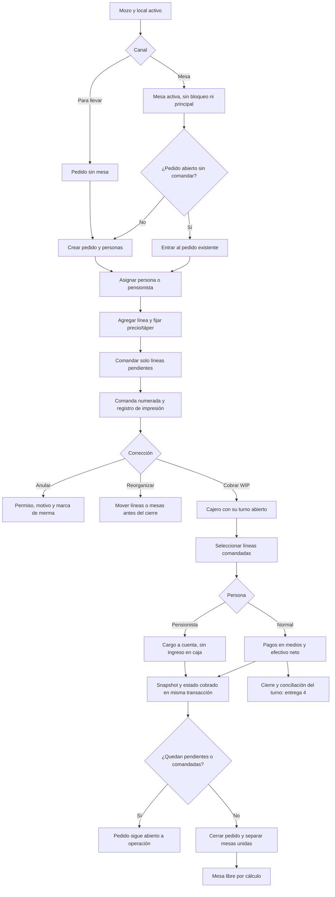
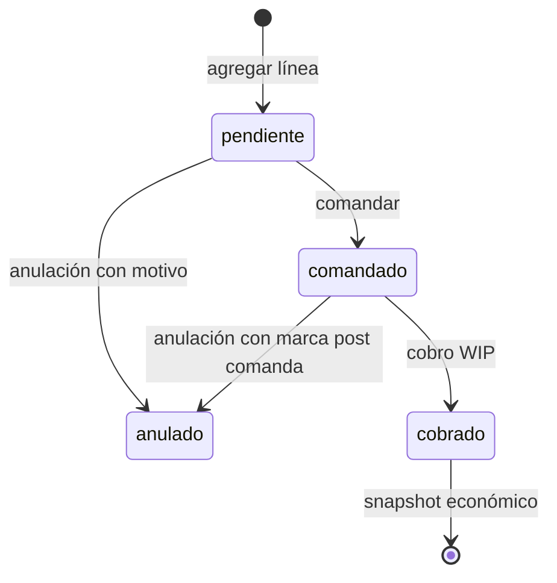
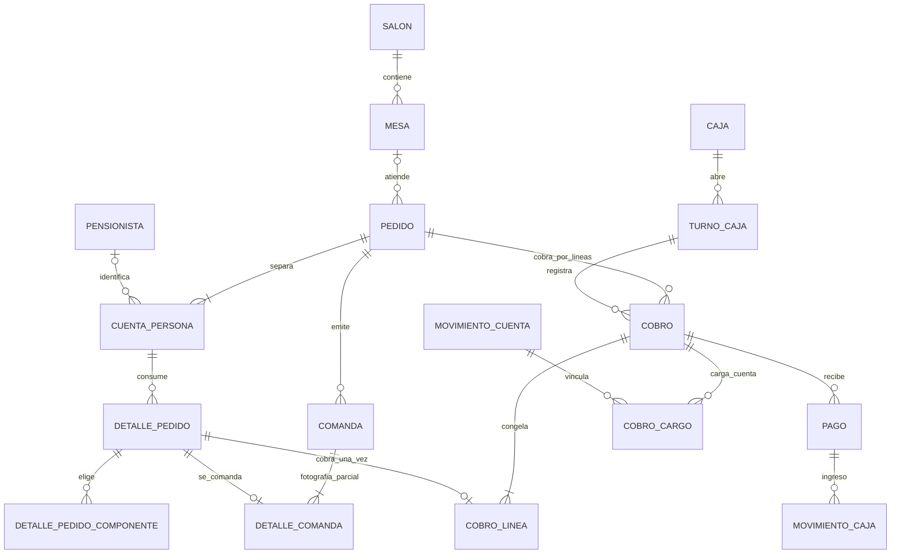

# Auditoría de venta, POS, mesas, comandas y caja

**Fecha:** 2026-10-11, America/Lima. **Alcance:** backend de sprint 6 y 6b; sprint 7, entrega 1 y código de entrega 2 en curso. **Objetivo:** preparar una revisión y pendientes implementables para Claude; esta auditoría no cambia código, migraciones aplicadas ni datos.

La base funcional de venta existe: mesas por local, personas, precios calculados en servidor, comandas incrementales, anulaciones con motivo y reorganización. Caja tiene apertura de turnos. En el corte inicial, cobro y V41 aparecían sin seguimiento en Git y sin historia de cierre. Durante la auditoría se agregó una historia y el plan declaró el backend de entrega 2 hecho; la revisión posterior queda registrada abajo. Esa declaración documental no constituye una nueva aceptación de esta auditoría: persisten hallazgos y falta la pantalla. No corresponde declarar terminado el sprint 7 ni presentar el producto como listo para cobrar y conciliar dinero real.

La prioridad para el cliente y sus socios es conservar tres hechos diferentes: lo que se pidió, lo que recibió cocina y lo que se cobró. El sistema ya los separa parcialmente; falta consolidar su integridad cuando varias personas trabajan a la vez y cuando cambian productos o recetas.

## 1. Método, fuentes y límites

Se revisaron casos de uso, controladores, repositorios, entidades, V29–V41 y pruebas de venta/caja. Se contrastó contra los planes aprobados, historias y backlog v3 con sus enmiendas. No se ejecutó una suite adicional desde esta revisión; los resultados de ejecución de la auditoría general se registran en el documento principal. La existencia de un test no equivale a que haya pasado hoy.

| Marca | Significado |
|---|---|
| Confirmado por lectura | La condición se observa directamente en el código, SQL o contrato. Se incluye el caso que demuestra el problema; no implica reproducción HTTP ejecutada. |
| Riesgo de concurrencia | El intercalado de transacciones es posible según las escrituras y bloqueos actuales; requiere prueba con conexiones/hilos reales. |
| Brecha documental | Modelo/plan/pendientes describen una versión diferente a la implementación. |
| Previsto | Trabajo de entregas o sprints posteriores. No se cuenta como defecto del sprint ya entregado. |

**Severidad:** P1 = puede perder integridad operativa, financiera o histórica; P2 = comportamiento incorrecto o contrato ambiguo con impacto controlable; P3 = mejora de mantenimiento/documentación. P1 de código en curso es una condición para cerrar esa entrega, no una afirmación de incidente en producción.

### Reconciliación de cambios concurrentes

Una segunda lectura de archivos y `git diff`, posterior a la redacción inicial, encontró estas actualizaciones. Las horas de última escritura se expresan en America/Lima; son metadatos del filesystem, no prueba de aprobación ni de autoría.

| Archivo / última escritura 2026-10-11 | Observación inicial | Estado en segunda lectura |
|---|---|---|
| [US-033-cobro.md](../../../rikos-backend/doc/historias/US-033-cobro.md), 15:45:05 | No existía historia de entrega 2 en el corte inicial. | Nueva historia declara backend hecho y 23 pruebas de caso de uso/7 HTTP; aún sin seguimiento Git. Se registra la declaración sin atribuir su autoría ni aceptar automáticamente sus resultados. |
| [Plan sprint 7](../../producto/plan/sprint-07-cobrar-y-cerrar.md), 15:49:55 | Solo entrega 1 figuraba hecha. | Estado y tabla ahora declaran entrega 2 backend hecha; §4.2 bis registra medio CHECK, solo comandadas, unidades y Terminar con pendientes. Decisión 5 todavía dice vacío/todas anuladas. |
| [Modelo de caja](../../producto/modelo-de-datos/07-caja-turnos-pagos--ep06.md), 15:50:01 | No distinguía nuevo esquema de cobro. | Se agrega encabezado sobre V40/V41 y ausencia de `medio_pago`; **las tablas internas y RN viejas no se actualizaron**. DOC-CAJ-01 queda parcialmente reconciliado; DOC-CAJ-02 permanece. |
| [Decisiones técnicas](../../../rikos-backend/doc/RIKOS-decisiones-tecnicas.md), DT-062 a DT-064 | No se había identificado decisión de cierre de cobro en la lectura inicial. | Ahora registra cobro por líneas, turno único y cargo transaccional. Debe complementarse con contenido completo de snapshot y resolución de los riesgos. |
| V41 y `CobrarPedido.java`, 15:04:11 y 15:09:34 respectivamente | Código en curso leído en esta auditoría. | Última escritura anterior a los compilados preparados aproximadamente 15:36 para la validación general. Se mantienen las ramas de efectivo, snapshot y cierre citadas; no se observaron correcciones de CAJ-01/02/03. No se infiere igualdad binaria únicamente del timestamp. |

En tablas siguientes, **WIP** identifica el corte técnico inicial/local revisado; la declaración posterior de backend hecho se encuentra en esta reconciliación. El estado Git cambió nuevamente después del corte, como se registra a continuación; no se declara una aceptación nueva.

### Cambios posteriores al corte, requieren nueva verificación

La auditoría principal se congela en **V41 y código preparado aproximadamente a las 15:36**, con la suite general terminada aproximadamente a las 15:56 (647 pruebas, dos errores; detalle en [validación](06-validacion-y-aceptacion.md)). No cubre íntegramente la nueva entrega de descuentos V42.

Una lectura posterior encontró que HEAD pasó a `1336ae2` (documentación, 2026-10-11 15:56:35), con padre `23da169` (backend V41, 15:55:53). También encontró modificaciones locales posteriores, con escrituras de `PedidoRepositorio` a las 15:58:52, `CajaPorDefecto` a las 15:58:53 y `CobrarPedido` a las 15:59:29, más V42/descuentos/pruebas nuevas. Se anotan para que un hallazgo del corte no se presente como si ningún desarrollo posterior lo hubiera atendido. **Estas modificaciones no están cubiertas por la suite del corte y no se marcan aceptadas ni verificadas en ejecución.**

Las referencias archivo/línea de las tablas principales corresponden al código V41 auditado; los cambios posteriores desplazan líneas del working tree. `23da169` conserva el código V41 comprometido durante la sesión para contrastar esas referencias; las evidencias siguientes corresponden al diff posterior contra ese código. No se atribuye autoría ni autorización de esos commits a esta auditoría.

| ID | Evidencia posterior por lectura | Estado posterior a registrar en pendientes | Verificación que falta |
|---|---|---|---|
| **CAJ-01** | `CobrarPedido.validarPagos` ahora mantiene conjunto de medios y devuelve `MEDIO_REPETIDO` si uno se repite, antes de escribir. `CobrarPedidoTest` agrega efectivo S/5 + S/5 rechazado. | **Solución candidata incorporada después del corte**, mediante un pago por medio. El defecto existía en V41; no describirlo como vigente en esa misma forma sin mencionar este cambio. | Ejecutar AC-CAJ-01 adaptado al contrato 422; comprobar respuesta, rollback y caso efectivo repetido con vuelto. |
| **CAJ-02** | `snapshotDe` continúa guardando recetaId/costoPorPorcion y, para menú, producto/nombre/componente; cambios agregan motivo de descuento, no ingredientes/árbol histórico. | **Permanece abierto** en segunda lectura técnica. | Snapshot completo y prueba de receta/subreceta editada después del cobro. |
| **CAJ-03** | `PedidoRepositorio.bloquearPorIdYLocal` agrega `@Lock(PESSIMISTIC_WRITE)`; la sobrecarga transaccional de cinco argumentos de `CobrarPedido` lo usa antes de cargar líneas. | **Mitigación candidata incorporada después del corte** para dos cobros del mismo pedido; no afirmar reproducción ni arreglo probado. | Dos cajeros con conexiones reales y líneas disjuntas; verificar una sola liberación/cierre y recuperación de conflicto. Comprobar transacción tanto por HTTP como por usos directos del caso de uso. |
| **CAJ-05** | `CajaPorDefecto` pasa a `CajaRepositorio.insertarSiNoExiste`, SQL `ON CONFLICT (local_id, lower(nombre)) DO NOTHING`, seguido de nueva lectura. | **Carrera de creación con solución candidata**. Permanece el aspecto de consulta que crea con actor nulo/sin evento de creación. | Dos primeros GET concurrentes y evento/actor de creación; validar SQL/migraciones y resultado con transacciones independientes. |
| **POS-01** | El bloqueo nuevo solo lo adopta cobro; `AgregarLinea` continúa leyendo pedido con `findByIdAndLocalId` e insertando línea sin escribir/versionar pedido. `TerminarPedido` y otras mutaciones no comparten protocolo único. | **Permanece abierto**: bloquear únicamente cobro no serializa altas de líneas frente a cerrar. | Prueba real agregar↔cobrar/terminar y adopción del protocolo en todas las mutaciones. |
| **CAJ-06** | `CobroController` conserva pagos nulos para validación; `validarPagos` ya rechaza elemento nulo y monto mayor que 100.000.000 céntimos. Medios únicos limitan suma de pagos a cuatro entradas válidas. | **Parcialmente atendido después del corte**: nulo/importe de pago sí; límites y aritmética de cantidades/precios de líneas requieren revisión. | HTTP `pagos:[null]` con 4xx, monto extremo y ausencia de escrituras; límites y overflow de bruto de línea/porcentaje. |

La mitigación de CAJ-03 también requiere revisar el límite transaccional nuevo: la sobrecarga pública de **cuatro argumentos perdió `@Transactional` y delega por llamada interna** a la de cinco argumentos. Esa llamada interna no pasa por el proxy Spring; un uso directo sin transacción externa no queda protegido por la anotación de la segunda sobrecarga y puede fallar al intentar tomar el bloqueo. El endpoint HTTP actual llama directamente la de cinco argumentos; las pruebas heredadas suelen disponer de transacción externa. Esta observación exige nueva verificación del cambio, no modifica el resultado de la suite V41.

V42 agrega motivo/observación del descuento y una restricción que exige motivo cuando descuento > 0. `DescuentoSolicitado` y `CobroConDescuentoTest` son trabajo posterior: su presencia no equivale a aceptar toda la entrega 3, permisos o nuevos casos financieros. No se ejecutaron pruebas nuevas en esta reconciliación.

| Fuente | Uso |
|---|---|
| [CLAUDE.md](../../../CLAUDE.md) | Convenciones y localización de fuentes de verdad. |
| [Sprint 6](../../producto/plan/sprint-06-vender-en-mesa.md), [cierre real](../../../rikos-backend/doc/historias/sprint-06-cierre.md) | Decisiones de negocio y alcance construido. |
| [Sprint 6b](../../producto/plan/sprint-06b-lista-de-pedidos.md) | Lista, historial, categorías y regla ocupada al comandar. |
| [Sprint 7 aprobado](../../producto/plan/sprint-07-cobrar-y-cerrar.md), [US-032](../../../rikos-backend/doc/historias/US-032-cajas-y-turnos.md) | Apertura entregada y secuencia de cobro/descuento/cierre/reapertura. |
| [Backlog v3](../../producto/prd/03-backlog-v3.md), [enmiendas](../../producto/prd/05-enmiendas-al-backlog-v3.md) | Criterios vigentes y equivalencia de IDs. |
| [Modelo de venta](../../producto/modelo-de-datos/06-venta-pos-comandas--ep05.md), [modelo de caja](../../producto/modelo-de-datos/07-caja-turnos-pagos--ep06.md) | Contraste del modelo conceptual con SQL y decisiones recientes. |
| [Pendientes previos](../../pendientes/README.md), [decisiones técnicas](../../../rikos-backend/doc/RIKOS-decisiones-tecnicas.md) | Evitar duplicar hallazgos o reabrir asuntos ya corregidos. |

## 2. Cobertura por módulo e historia

| Módulo / historia repo → v3 | Evidencia y capacidad existente | Evaluación al corte |
|---|---|---|
| Mesas y salones, US-027 → US-05 | `MesaController`, `SalonController`, `ConsultaMesas`, `GuardarPlano`; V29, V30 y V34. Estado derivado y marca tomando pedido. | Implementado; revisar carreras entre abrir/mover/unir/bloquear. |
| Toma del pedido, US-028 → US-06 | `AbrirPedido`, personas, `AgregarLinea`, `ModificarLinea`, `ConsultaPedidos`, motor de precios; V32 y V35. | Implementado para mesa/para llevar; tipo de entrega pendiente de definición. |
| Reorganizar, US-029 → US-07 | `TrasladarLineas`, `MoverPedidoDeMesa`, `UnirMesas`, `SepararMesa`; precio recalculado al cambiar a pensionista. | Implementado conforme a enmienda de unión; concurrencia y segundo consumo pendientes. |
| Comanda, US-030 → US-08 | `ComandarPedido`, `ConsultaComandas`, `RegistrarImpresion`; V33 y V36. Nueva comanda solo con pendientes, contador atómico y COPIA. | Implementado con impresión de navegador; foto histórica incompleta y HT-10 pendiente. |
| Anulación, US-031 → US-09 | `AnularLinea`, motivo activo del tipo correcto, observación exigida cuando corresponde; marca posterior a comanda. | Implementado; inventario queda correctamente para sprint 9. En WIP se protege línea cobrada. |
| Sprint 6b | `ListaDePedidos` pagina y carga por lotes, filtros local/canal/situación/estado/fecha/texto. Historial de cierres V38. | Implementado; totales aún no expresan saldo por cobrar del nuevo cobro parcial. |
| Apertura de caja, US-032 → US-18 | `CajaController`, `AbrirTurno`; V40, un turno por caja y por cajero mediante índices únicos parciales. | Entrega 1 documentada como hecha. No incluye cierre de turno. |
| Cobro, US-033 → US-19 | `CobrarPedido`, `CobroController`, `cobro_linea`, pagos, movimientos y cargo al pensionista; V41. | Corte inicial **en curso**; documentación concurrente declara backend hecho, sin pantalla. Hay 23 tests de caso de uso identificados por lectura, más acceso HTTP. Los hallazgos CAJ permanecen; aceptación no revalidada por esta declaración. |
| Descuentos/anulación en caja, US-034 → US-20 | Se prevé entrega 3. `descuento` existe en snapshot WIP con valor 0. | Previsto; no afirmar descuento implementado. |
| Cierre de turno, US-036 → US-22 | Entrega 4; esperado/contado/diferencia/cierre inalterable. No hay caso de uso/tabla de cierre en el corte revisado. | Previsto; apertura sola no completa el ciclo de dinero. |
| Reapertura, US-035 → US-21 | Entrega 5, dentro del turno abierto de origen; compensación posterior diferida a sprint 11. | Previsto; definir reversión conservando historia antes de implementarla. |

La unión de dos mesas ocupadas del v3 fue cambiada por decisión documentada: una secundaria libre **sin pedido** se une a una principal. No es un defecto actual ni una razón para fusionar comandas y cuentas sin nueva especificación.

## 3. Flujo real y flujo de cobro en curso

No existe hoy una acción normal que coloque el pedido en `pendiente_cierre`: aparece en cálculos y filtros, pero `Pedido` solo transiciona a `comandado` y `cerrado`. Definir la acción “pedir cuenta” y si congela ediciones antes de prometer “Por cobrar” como cola de atención. Es refinamiento de flujo del sprint 7, no evidencia de cobros perdidos.

## 4. Modelo real y evaluación

`COBRO`, `COBRO_LINEA`, `PAGO`, `MOVIMIENTO_CAJA` y `COBRO_CARGO` pertenecen a **V41 en curso**. La cardinalidad del diagrama representa el esquema presente: por ejemplo, movimiento→pago todavía no impone unicidad por pago. No se muestra una tabla de cierre que todavía no existe.

| Decisión del modelo | Evaluación | Invariante a conservar |
|---|---|---|
| Estado de mesa derivado | Adecuado: evita doble fuente de estado y facilita futuro offline. | Una mesa no debe quedar bloqueada/unida y con pedido propio en curso por una carrera. |
| Cuenta por persona | Adecuado para mesa mixta y cargo automático. | Identidad de persona no se decide por texto; etiqueta repetida no fusiona personas. |
| Precio guardado al agregar | Adecuado para precio estable en sala. | Cambio deliberado de destinatario recalcula con regla explícita y auditada. |
| Dinero en céntimos `BIGINT` | Adecuado para evitar errores de coma flotante. | Sumas/multiplicaciones y límites de entrada deben impedir overflow; costos `NUMERIC` usan soles y requieren conversión explícita. |
| Cobro por líneas separado de pago | Adecuado para parcialidad y mesa mixta. | Sumatoria de líneas = total; pagos netos = `total_medios`; cargos = `total_cuentas`. |
| Cargo al pensionista dentro de la transacción | Adecuado para no cobrar sin cargar cuenta. | Rollback de cobro, pago, snapshot y libro si cualquier paso falla. |
| Snapshot en `cobro_linea` | Adecuado en ubicación; **insuficiente en contenido**. | La composición histórica debe sobrevivir cambios de ingredientes y subrecetas. |
| `cuenta_persona.estado` guardado | No se actualiza en cobro ni cierre. | Derivarlo de líneas o mantenerlo transaccionalmente; no conservar dos verdades. |
| Unicidad de línea cobrada V41 | Protege doble cobro de una misma línea. | Reapertura debe conservar hechos previos y permitir una nueva versión lógica sin borrar la venta original. |
| FKs simples de local/caja/pedido/persona | Aplicación verifica local; la base no impone todas las coincidencias entre agregados. | Reforzar invariantes críticas con claves compuestas/validación persistente cuando haya importación o sincronización. |

### Invariantes financieras para la siguiente entrega

Con importes en céntimos:

| Expresión | Qué debe significar |
|---|---|
| `importe_línea = (precio_unitario + taper_unitario) × cantidad − descuento` | Hecho de cobro de esa línea, validado no negativo. |
| `cobro.total = Σ importe_línea` | Ninguna línea perdida o agregada fuera del cobro. |
| `total = total_medios + total_cuentas` | Separación entre dinero recibido y cuenta corriente. V41 lo verifica en `cobro_total_cuadra`. |
| `Σ pago.importe = total_medios` | `importe` es efectivo **neto** más medios digitales. |
| `efectivo_recibido − efectivo_neto = vuelto` | El vuelto no se reconoce como ingreso. |
| `esperado_efectivo = fondo + Σ movimiento_caja.importe donde medio='efectivo'` | Si movimientos ya son netos, **no restar vuelto otra vez** al cerrar. |
| `Σ cobro_cargo.importe = total_cuentas` | Todo cargo tiene su movimiento de cuenta asociado. |
| `pedido cerrado por cobro ⇒ no hay línea pendiente ni comandada` | Mesa liberada solo con obligación satisfecha o anulada. |

V41 impone total = medios + cuentas y unicidad de cobro por línea, pero las otras sumatorias se sostienen principalmente en el caso de uso. Evaluar también unicidad de `movimiento_caja.pago_id` para ventas y de `cobro_cargo.movimiento_cuenta_id`, y consistencia entre pedido/turno/local. Son recomendaciones de endurecimiento del modelo, no corrupción observada.

## 5. Hallazgos de venta y POS

| ID / prioridad | Estado y evidencia | Impacto y caso | Solución propuesta para pendientes |
|---|---|---|---|
| **POS-01 / P1** | Riesgo de concurrencia. [AgregarLinea.java](../../../rikos-backend/servicio-operacion/src/main/java/pe/rikos/operacion/venta/aplicacion/AgregarLinea.java), líneas 75–80 y 187–190; [TerminarPedido.java](../../../rikos-backend/servicio-operacion/src/main/java/pe/rikos/operacion/venta/aplicacion/TerminarPedido.java), 49–66; [Pedido.java](../../../rikos-backend/servicio-operacion/src/main/java/pe/rikos/operacion/venta/infraestructura/Pedido.java), 67–69. | Agregar una línea lee pedido abierto pero no escribe/versiona su fila. Otra transacción puede cerrar después de esa lectura; la primera inserta la línea y confirma sin conflicto. Queda pedido cerrado con línea pendiente. Lo mismo afecta altas/personas frente a cierre. | Establecer un protocolo único de bloqueo por pedido para todas las mutaciones y cierre; bloqueo de fila o versión incrementada/forzada en cada cambio del agregado. Revalidar invariantes dentro de la transacción. Añadir prueba real cerrar↔agregar. |
| **POS-02 / P1** | Riesgo de concurrencia heredado. [UnirMesas.java](../../../rikos-backend/servicio-operacion/src/main/java/pe/rikos/operacion/venta/aplicacion/UnirMesas.java), 35–63; [MesaRepositorio.java](../../../rikos-backend/servicio-operacion/src/main/java/pe/rikos/operacion/venta/infraestructura/MesaRepositorio.java), 8–29; [MoverPedidoDeMesa.java](../../../rikos-backend/servicio-operacion/src/main/java/pe/rikos/operacion/venta/aplicacion/MoverPedidoDeMesa.java), 51–67; [V29](../../../rikos-backend/servicio-operacion/src/main/resources/db/migration/V29__mesas.sql), 29. | A→B y B→A concurrentes actualizan filas diferentes: `@Version` de cada mesa no evita ciclo. Abrir/mover solo lee destino; bloqueo/unión puede confirmar mientras se asigna pedido a esa mesa. SQL evita auto unión y doble pedido, pero no estos cruces. | Bloquear ambas mesas en orden estable por ID para unir/separar/mover/abrir/bloquear; validar relaciones después del bloqueo. Test con dos conexiones para ciclo y mesa bloqueada/unida con pedido propio. |
| **POS-03 / P2** | Confirmado por lectura. [AsignarPensionista.java](../../../rikos-backend/servicio-operacion/src/main/java/pe/rikos/operacion/venta/aplicacion/AsignarPensionista.java), 59–65. | Repetir el mismo `PUT` sobre la misma persona devuelve `PENSIONISTA_YA_EN_EL_PEDIDO`: la consulta también encuentra a esa propia persona. Un reintento de red parece fallar aunque el primer envío funcionó. | Devolver la asignación existente si `persona.pensionistaId` coincide; buscar duplicados excluyendo esa persona. Mantener rechazo de otra persona del pedido. |
| **POS-04 / P2** | Confirmado por lectura; pendiente previamente reconocido. [AgregarLinea.java](../../../rikos-backend/servicio-operacion/src/main/java/pe/rikos/operacion/venta/aplicacion/AgregarLinea.java), 104 y 181–182; [DetallePedidoRepositorio.java](../../../rikos-backend/servicio-operacion/src/main/java/pe/rikos/operacion/venta/infraestructura/DetallePedidoRepositorio.java), 24–30. | Agregar usa hoy del reloj para segundo consumo, mientras consulta cuenta por `pedido.fechaOperativa`. Un pedido que cruza medianoche puede comparar contra el día equivocado. La consulta también cuenta líneas pendientes de pedidos cerrados sin cobro por Terminar. | Usar fecha operativa del pedido para la regla tarifaria; definir por separado fecha del menú servido. Excluir consumos descartados/no efectivos o dejarles un estado explícito. Test cena que cruza fecha y borrador terminado. |
| **POS-05 / P2** | Confirmado por lectura y pendiente previo. [TrasladarLineas.java](../../../rikos-backend/servicio-operacion/src/main/java/pe/rikos/operacion/venta/aplicacion/TrasladarLineas.java), 109–165. | Solo se recalculan líneas que cambian de persona. Si el pensionista tiene dos almuerzos y se traslada/anula el primero, el restante conserva marca/precio de segundo; con regla `PRECIO_NORMAL` cambia dinero real. Dos primeras altas concurrentes en diferentes pedidos también pueden leer consumo previo=0. | Especificar si tarifa del segundo se fija al agregar o se recomputa por consumo vigente. Si se recomputa, aplicar recálculo atómico a todas las líneas no cobradas afectadas, con orden estable y exclusión de la propia línea. Serializar cálculo por pensionista/fecha/servicio. No modificar snapshots ya cobrados. |
| **POS-06 / P2** | Confirmado por lectura. [ConsultaComandas.java](../../../rikos-backend/servicio-operacion/src/main/java/pe/rikos/operacion/venta/aplicacion/ConsultaComandas.java), 84–127; [DetalleComanda.java](../../../rikos-backend/servicio-operacion/src/main/java/pe/rikos/operacion/venta/infraestructura/DetalleComanda.java), 24–42. | Foto guarda cantidad y etiqueta, pero reconstruye nombre/componentes desde producto actual, mesa desde pedido actual y mozo desde quien abrió. Renombrar un plato o mover mesa cambia la reimpresión. Dos personas con la misma etiqueta se fusionan en un grupo. Falta mozo emisor exigido por US-08 CA1. | Congelar nombre de producto/componentes, identificador de persona/orden, ubicación y emisor al comandar. Consultar `comanda.emitidaPor`; agrupar por identidad histórica, no por nombre. Test renombrar/mover/etiquetas iguales. |
| **POS-07 / P2** | Confirmado en código local; reconciliación documental parcial. [TerminarPedido.java](../../../rikos-backend/servicio-operacion/src/main/java/pe/rikos/operacion/venta/aplicacion/TerminarPedido.java), 17–20 y 56–58; [plan sprint 7](../../producto/plan/sprint-07-cobrar-y-cerrar.md), decisión 5 y nuevo §4.2 bis. | Decisión 5 acota Terminar a vacío/todas anuladas; el nuevo §4.2 bis registra que también acepta pendientes. Código cierra sin línea comandada y deja líneas pendientes bajo pedido cerrado; no registra cuáles se descartaron. La actualización documenta el comportamiento pero no resuelve esa incoherencia de estado ni la contradicción interna. No equivale al antiguo bypass de cobro comandado: ese bypass ya se bloquea. | Reconciliar decisión 5/§4.2 bis; definir “descartar borrador” y llevar pendientes a estado coherente, o restringir a vacío/todas anuladas. No conservar pendientes cobrables en un pedido cerrado. |
| **POS-08 / P2** | Confirmado por lectura. [AgregarLinea.java](../../../rikos-backend/servicio-operacion/src/main/java/pe/rikos/operacion/venta/aplicacion/AgregarLinea.java), 139–152 y 219–244; [ConsultaPedidos.java](../../../rikos-backend/servicio-operacion/src/main/java/pe/rikos/operacion/venta/aplicacion/ConsultaPedidos.java), 239–242; [OpcionMenuRepositorio.java](../../../rikos-backend/servicio-operacion/src/main/java/pe/rikos/operacion/catalogo/infraestructura/OpcionMenuRepositorio.java), 21–23. | Se valida activo para carta, pero no activo del producto menú ni del producto de una opción programada. Desactivar un producto ya programado puede seguir permitiendo ofrecerlo/agregarlo mientras la opción esté activa y no agotada. | Aplicar la misma política de activo/vendible a oferta y escritura del menú. Confirmar si desactivación invalida programación vigente o exige retirarla primero. Test opción programada cuyo producto se desactiva. |
| **POS-09 / P3** | Confirmado por lectura. [ModificarLinea.java](../../../rikos-backend/servicio-operacion/src/main/java/pe/rikos/operacion/venta/aplicacion/ModificarLinea.java), 60–74; [AgregarLinea.java](../../../rikos-backend/servicio-operacion/src/main/java/pe/rikos/operacion/venta/aplicacion/AgregarLinea.java), 191–194. | Extra libre crea evento de precio manual, pero aumentar su cantidad luego cambia importe manual sin nuevo registro. Reduce trazabilidad de importe manual; no cambia el precio unitario. | Auditar cantidad/importe anterior y nuevo cuando una línea manual se modifica; agrupar bajo evento específico y evitar llamarlo cambio de precio si solo cambió cantidad. |

## 6. Hallazgos de caja y cobro

| ID / prioridad | Estado y evidencia | Impacto y caso | Solución propuesta para pendientes |
|---|---|---|---|
| **CAJ-01 / P1** | Confirmado por lectura en WIP. [CobrarPedido.java](../../../rikos-backend/servicio-operacion/src/main/java/pe/rikos/operacion/caja/aplicacion/CobrarPedido.java), 210–226 y 273–282; [V41](../../../rikos-backend/servicio-operacion/src/main/resources/db/migration/V41__cobro.sql), 70–72. | Valida suma de todos los pagos efectivo, pero persiste todo el neto en la **primera** fila y omite las siguientes. Total S/10; efectivo S/5 + S/5: valida, intenta `importe=1000, monto_recibido=500`, viola CHECK y puede devolver 500. Total S/10; S/20 + S/10: devuelve vuelto S/20 pero solo guarda recibido S/20 y neto S/10; detalle no permite explicar vuelto. | Elegir contrato: exactamente una entrada por medio con 422 en duplicados, o consolidar efectivo recibido antes de persistir. Si se admiten varios pagos efectivo, distribuir netos/recibidos/vuelto correctamente. Probar igualdad entre respuesta, pagos y movimiento. |
| **CAJ-02 / P1** | Confirmado por lectura en WIP. [CobrarPedido.java](../../../rikos-backend/servicio-operacion/src/main/java/pe/rikos/operacion/caja/aplicacion/CobrarPedido.java), 302–337; [Receta.java](../../../rikos-backend/servicio-operacion/src/main/java/pe/rikos/operacion/catalogo/infraestructura/Receta.java), 100–125; RN-005/RN-046 y sprint 7 §4.2. | `composicion` guarda recetaId y costo, y para menú nombre/producto/componente. No guarda ingredientes, cantidades, unidades, rendimiento ni árbol de subrecetas. La receta se edita en la misma fila: tras cambiarla ya no se sabe qué composición histórica se aplicó. Bloquea evidencia de rentabilidad e inventario por receta del sprint 9. | Congelar árbol completo/versionado al cobro, con insumos y unidades base, factores, rendimientos y costos usados; persistir versión del formato. Prueba con subreceta, editar receta/insumos después y demostrar snapshot idéntico. No basta comprobar costo nulo cuando no hay receta. |
| **CAJ-03 / P1** | Riesgo de concurrencia en WIP. [CobrarPedido.java](../../../rikos-backend/servicio-operacion/src/main/java/pe/rikos/operacion/caja/aplicacion/CobrarPedido.java), 141, 201–205 y 246–248; [CerrarPedido.java](../../../rikos-backend/servicio-operacion/src/main/java/pe/rikos/operacion/venta/aplicacion/CerrarPedido.java), 28–30. | Dos cajeros cobran simultáneamente las dos últimas líneas, cada uno una diferente. Cada transacción observa la otra aún comandada, ninguna cierra; ambas líneas terminan cobradas y pedido sigue comandado. `@Version` por línea/UNIQUE evita doble cobro de la misma, no cierre agregado de líneas distintas. | Serializar operaciones del pedido con el mismo protocolo de POS-01. Evaluar cierre sobre datos actualizados dentro de la misma transacción bloqueada; prueba de dos parciales disjuntos y test cobrar↔agregar. |
| **CAJ-04 / P2** | Confirmado en contrato WIP. [CobroController.java](../../../rikos-backend/servicio-operacion/src/main/java/pe/rikos/operacion/caja/api/CobroController.java), 40, 64–79; [CobrarPedido.java](../../../rikos-backend/servicio-operacion/src/main/java/pe/rikos/operacion/caja/aplicacion/CobrarPedido.java), 197–198; [CobroRepositorio.java](../../../rikos-backend/servicio-operacion/src/main/java/pe/rikos/operacion/caja/infraestructura/CobroRepositorio.java), 9–11. | ID del cobro solo se genera en servidor; si confirma y se pierde respuesta, reenviar devuelve cerrado/ya cobrada. Protege de duplicación, pero no recupera resultado. No se halló GET de cobros/recibo en el controlador; hay consulta por pedido en repositorio. | Añadir ID de operación cliente o clave de idempotencia, hash del payload y respuesta recuperable; mismo ID/mismo payload devuelve mismo cobro, payload distinto 409. Exponer consulta autorizada por local/pedido/turno. Prepararlo antes del offline sprint 10. |
| **CAJ-05 / P2** | Riesgo de concurrencia en entrega 1. [CajaPorDefecto.java](../../../rikos-backend/servicio-operacion/src/main/java/pe/rikos/operacion/caja/aplicacion/CajaPorDefecto.java), 23–29; [ConsultaCajas.java](../../../rikos-backend/servicio-operacion/src/main/java/pe/rikos/operacion/caja/aplicacion/ConsultaCajas.java), 33–38; [CajaController.java](../../../rikos-backend/servicio-operacion/src/main/java/pe/rikos/operacion/caja/api/CajaController.java), 77–82. | Dos primeros GET `/cajas` del mismo local pueden leer sin cajas e insertar dos Caja 1; índice salva unicidad, pero GET no usa `protegido` y uno puede terminar en 500. Además consulta con `caja.ver` crea caja con actor nulo, sin `caja_creada`. | Crear caja por defecto al alta del local o usar inserción segura + nueva transacción/lectura tras conflicto. Registrar actor/evento si se mantiene creación perezosa. Prueba con dos primeros lectores concurrentes. |
| **CAJ-06 / P2** | Confirmado por lectura WIP. [CobroController.java](../../../rikos-backend/servicio-operacion/src/main/java/pe/rikos/operacion/caja/api/CobroController.java), 68–69; [CobrarPedido.java](../../../rikos-backend/servicio-operacion/src/main/java/pe/rikos/operacion/caja/aplicacion/CobrarPedido.java), 259–268. | Cuerpo con `pagos:[null]` pasa deserialización y desreferencia `p.medio()`: 500 por entrada inválida, en lugar de error de negocio. No se observan validaciones de tamaño de listas/límites monetarios antes de sumas `long`. | Validar estructura y elementos del request (`@Valid`, elementos no nulos o validación explícita) antes de transformar. Definir límites de cantidad/importe y usar aritmética exacta o validación previa. Test nulo, cantidad máxima, overflow y lista excesiva. |
| **CAJ-07 / P2** | Confirmado por lectura WIP, cierre incompleto del contrato de consulta. [ConsultaPedidos.java](../../../rikos-backend/servicio-operacion/src/main/java/pe/rikos/operacion/venta/aplicacion/ConsultaPedidos.java), 130–145; [ListaDePedidos.java](../../../rikos-backend/servicio-operacion/src/main/java/pe/rikos/operacion/venta/aplicacion/ListaDePedidos.java), 129–133; [CuentaPersona.java](../../../rikos-backend/servicio-operacion/src/main/java/pe/rikos/operacion/venta/infraestructura/CuentaPersona.java), 40–60; [CobrarPedido.java](../../../rikos-backend/servicio-operacion/src/main/java/pe/rikos/operacion/caja/aplicacion/CobrarPedido.java), 201–248. | Totales suman cobradas y no cobradas salvo anuladas; total histórico puede ser correcto, pero API no ofrece `total_cobrado`/`saldo_por_cobrar`. `cuenta_persona.estado` siempre permanece abierta. Una persona completamente pagada no se distingue del total pendiente sin que cada cliente lo recalcule. | Mantener `total_consumido` para historia y exponer cobradas, pendientes en medios y pendientes en cuenta por persona/pedido; derivar estado de persona o actualizarlo bajo el protocolo de agregado. Integrar cobros/descuentos históricos en lectura. |

### Caso financiero mínimo para CAJ-01

| Campo | Entrada con dos efectivos | Lo que hace el código actual | Resultado requerido |
|---|---|---|---|
| Importe normal | S/ 10,00 | 1000 céntimos | 1000 |
| Recibido | S/ 5,00 + S/ 5,00 | Valida suma 1000 | Aceptar consolidado o rechazar duplicado con 422 |
| Primer pago persistido | — | importe 1000, recibido 500 | No persistir una fila con recibido menor que importe |
| Vuelto | S/ 0,00 | 0 | 0 |
| Estado final | — | CHECK de pago puede deshacer transacción y dar 500 | Resultado predecible sin escrituras parciales |

## 7. Documentación que necesita reconciliación

| ID documental | Evidencia | Cambio pendiente recomendado |
|---|---|---|
| **DOC-POS-01** | Modelo de venta, línea 32: ocupada por abierto o comandado. Código/plan dicen solo comandado. | Actualizar regla vigente, marca tomando pedido y no bloquear borrador. |
| **DOC-POS-02** | Modelo de venta, tablas de pedido/persona aún listan subtotal/total como campos aunque nota inicial dice derivados; estado de línea incluye servido y no cobrado; impresión inicial 1 frente a SQL 0. | Separar modelo lógico objetivo de esquema aplicado por sprint. Incorporar V35–V38 y luego V41 cuando la entrega cierre. |
| **DOC-POS-03** | Modelo de venta, líneas 126–162: RN-064/065 intercambiadas, anulación RN-069, opciones RN-042. | Reconciliar con reglas consolidadas/v3: merma RN-065, cocina verbal RN-064, anulación RN-072, opciones RN-038. |
| **DOC-CAJ-01** | Observación inicial: modelo de caja describe `medio_pago` y pago por persona. Segunda lectura: nuevo encabezado reconoce V41/cobro por línea y DT-062 lo registra; las tablas 9.3/9.5/9.6 siguen con campos antiguos. | **Parcialmente reconciliado durante la auditoría.** Actualizar tablas/ERD o rotular claramente diseño futuro frente a esquema aplicado; tabla de cierre futura separada. No declarar actualizado todo el bloque por agregar un encabezado. |
| **DOC-CAJ-02** | Modelo de caja conserva RN-070 para no gastos y RN-072 para diferencia; v3 usa RN-069 y RN-070 respectivamente. El diff concurrente solo agrega encabezado. | **Permanece abierto.** Corregir referencias sin editar fuente original/backlog íntegro. |
| **DOC-CAJ-03** | Observación inicial: ESTADO decía sprint 6 casi cerrado/sprint 7 pendiente de aprobación, y no se identificó historia de V41. Segunda lectura: existe US-033-cobro.md; plan7 declara backend hecho y DT-062/064 registra la decisión. | Historia y declaración de entrega **reconciliadas documentalmente** durante la auditoría; enlazar estado e índices al corte. Distinguir backend documentado como hecho, hallazgos abiertos, pantalla faltante y aceptación real. No presentar los resultados declarados en US-033 como ejecución independiente nueva. |
| **DOC-POS-04** | README pendientes conserva categorías/falta grupo, bloqueo de principal, PIN User-Agent y falta comprobación de pedido cerrado ya corregidos. | Convertir lista narrativa en registro con estado/evidencia/fecha; no volver a implementar arreglos ya presentes. |

### Pendientes antiguos que no deben reabrirse como fallas actuales

| Asunto previo | Verificación al corte |
|---|---|
| Bloquear mesa principal con mesas unidas | `BloquearMesa` líneas 51–52 lo rechaza. |
| Cambiar/anular/agregar en pedido cerrado | Casos de uso revisados llaman `AbrirPedido.estaCerrado`; estado cerrado se rechaza. La carrera POS-01 es un problema distinto. |
| Cobrar/anular/trasladar línea ya cobrada | Protección agregada en WIP; SQL V41 también impide doble snapshot por línea. |
| El cierre no separa mesas unidas | V38 lo hacía; WIP lo centraliza en `CerrarPedido`. |
| Agotado modifica comandas ya emitidas | Hay `ComandasIntactasAlAgotarTest`; indisponibilidad no cambia la fila ya comandada. La foto mutable POS-06 se refiere a nombre/mesa, no a agotado. |
| Correlativo calculado con count puede chocar | SQL impone unicidad y `PedidoController.protegido` reintenta errores conocidos, líneas 460–490. Falta estrés real; no se etiqueta como pérdida confirmada. |
| Pedido mismo ID puede sobrescribir otro local | Abrir/agregar persona/línea/comanda detectan ID existente y rechazan pertenencia distinta; no se encontró ese bypass en lectura. |

## 8. Pruebas que aportan valor y pruebas que faltan

| Evidencia existente por lectura | Lo que realmente cubre | Extensión mínima útil |
|---|---|---|
| `MesasConPedidoTest`, `MapaDeMesasTest`, `BloqueoDeMesasTest` | Estados, alcance y bloqueo en secuencia. | Intercalados reales abrir↔bloquear, abrir↔desactivar, mover↔unir. |
| `PedidosConcurrenciaTest` | Traducción/reintentos de excepciones con dobles Mockito. | Dos conexiones independientes; barreras para forzar lectura antes de escritura. |
| `VersionDeLineasTest` | Versionado de una misma línea. | Mutación de línea distinta y cierre agregado del mismo pedido. |
| `PreciosDeLineaTest`, `RecalculoAlTrasladarTest` | Casos tarifarios y recálculo. | Medianoche, retirada del primer consumo, dos locales concurrentes con mismo pensionista. |
| `ConsultaDeComandasTest`, `RegistrarImpresionTest` | Personas/componentes, traslado y copia. | Nombre/mesa/emisor históricos, etiquetas iguales, impresora real. |
| `AbrirTurnoTest`, `CajasYTurnosAccesoPorRolTest` | Fondo, caja/local, índices/errores y permisos. | Dos primeros GET de local sin cajas; dos aperturas con conexiones reales. |
| `CobrarPedidoTest` WIP | 23 `@Test`: efectivo/vuelto, medios, parcial, cuenta, inactivo, bloqueo de cobrada, snapshot con costo nulo. | Snapshot de receta completa que cambia luego; fallo tardío y rollback; dos parciales simultáneos; efectivo repetido. |
| `CobroAccesoPorRolTest` WIP | Acceso según rol/permisos, sin turno y errores HTTP. | Resultado de respuesta perdida/reenvío, aislamiento entre locales y entrada nula con 4xx. |

No se encontró en las pruebas de cobro revisadas una prueba explícita de rollback por fallo **después** de escribir pagos/snapshot y antes de completar todos los cargos. `@Transactional` establece la intención correcta, pero ese caso debe demostrarse con una transacción no envuelta por el propio test y una consulta independiente posterior.

### Casos de aceptación para entregar a Claude

| Caso / hallazgos | Dado / cuando | Entonces |
|---|---|---|
| AC-POS-01 / POS-01, CAJ-03 | Dos transacciones leen mismo pedido; una agrega y otra intenta cerrar/cobrar última línea. | Se serializan o una recibe 409; jamás cerrado con pendientes/comandadas y jamás todo cobrado con mesa ocupada. |
| AC-POS-02 / POS-02 | Dos transacciones intentan A→B y B→A. | Una gana o ambas fallan controladamente; nunca ciclo ni principal con principal. |
| AC-POS-03 / POS-03 | PUT pensionista aplicado y reenviado sobre misma persona. | Mismo resultado; otra persona del pedido sigue dando duplicado. |
| AC-POS-04 / POS-04, POS-05 | Cena cruza medianoche; primer menú se descarta/anula/traslada. | Regla aprobada de fecha y segundo consumo se cumple; cambio tarifario no toca línea cobrada. |
| AC-POS-05 / POS-06 | Comanda emitida; se cambia nombre de producto, mesa y mozo; hay dos etiquetas iguales. | Reimpresión mantiene identificación de emisión y separa personas. |
| AC-POS-06 / POS-07 | Borrador con líneas pendientes se termina. | Acción/estado de descarte coherente, auditado y fuera del conteo de consumo efectivo. |
| AC-CAJ-01 / CAJ-01 | Cobro S/10 con efectivo S/5+S/5 y luego S/20+S/10. | Consolidación o error 422 explícito; recibido/neto/vuelto concilian. |
| AC-CAJ-02 / CAJ-02 | Cobrar plato con subreceta y editar después cantidades, unidades y costos. | Snapshot conserva composición completa y costo histórico sin consultar receta mutable. |
| AC-CAJ-03 / CAJ-03 | Dos cajeros cobran las dos últimas líneas distintas a la vez. | Ambas cobradas, pedido cerrado una vez y mesas separadas, o conflicto recuperable. |
| AC-CAJ-04 / CAJ-04 | Cobro confirma; respuesta se pierde; cliente reenvía ID de operación. | Mismo cobro y cargo, sin nuevo dinero ni nuevo movimiento de cuenta. |
| AC-CAJ-05 / CAJ-05 | Dos usuarios consultan primer GET cajas del local nuevo simultáneamente. | Ambos reciben una misma Caja 1; sin 500 y trazabilidad de creación. |
| AC-CAJ-06 / transacción | Segunda cuenta del cobro falla tras generar primer cargo y pagos. | Ningún cobro, pago, movimiento, snapshot ni cargo persiste; estado de líneas no cambia. |
| AC-CAJ-07 / CAJ-07 | Persona A completamente cobrada y B con saldo. | Total consumido, total cobrado y por cobrar son distintos y coherentes; A se identifica saldada y mesa sigue ocupada. |
| AC-CAJ-08 / entrega 4 | Fondo S/100, cobro recibido S/20/neto S/12/vuelto S/8. | Esperado S/112; no S/104 ni S/120. Diferencia S/0,01 alerta y permite cierre. |

## 9. Qué sigue planificado, sin convertirlo en defecto

| Pendiente previsto | Sprint / entrega | Decisión o dependencia |
|---|---|---|
| Descuento por línea con permiso específico, motivo y valores antes/después | 7 / entrega 3 | Tope por rol y motivos iniciales aún por acordar; descuento no debe superar base. |
| Anulación desde caja | 7 / entrega 3 | `caja.anular` y contrato de línea cobrada/reapertura; no duplicar anulaciones de sala sin reglas. |
| Conciliación y cierre inalterable del turno | 7 / entrega 4 | Impedir cobro que confirme tras cerrar turno: usar protocolo común sobre turno y cierre, no solo leer estado abierto. |
| Reapertura dentro del turno de origen | 7 / entrega 5 | Un pedido puede tener cobros parciales en turnos/cajeros diferentes: precisar qué unidad se reabre y cuál es el turno de origen. UNIQUE por línea actual requiere versión/compensación diseñada. |
| Compensación después del cierre | 11 | Con contador y documentos relacionados. Conservar cierre original. |
| Inventario y merma post comanda | 9 | Usar composición histórica. Definir momento de congelación de receta para anulado después de comanda, que nunca se cobra. |
| Offline/sincronización | 10 | Idempotencia de operación, conflictos y fecha operativa; no afirmar que ULID solo vuelve offline al sistema. |
| HT-10, papel térmico, impresión cancelada/fallida | Hardware pendiente | Registro de intento en navegador no acredita que la comandera haya impreso papel. |
| Tipo de entrega, US-06 CA6 | Refinamiento de sprint 6/7 | Definir valores con cliente antes de agregar columna/selector. |
| Terminal táctil 56 px/teclado común, US-01 | Refinamiento de UX | Cierre sprint 6 reconoce brecha; revisar con auditoría frontend. |

## 10. Orden recomendado de ejecución y entrega de equipo

1. **Antes de cerrar US-033:** corregir CAJ-01 y CAJ-02; resolver protocolo de agregado de POS-01/CAJ-03; demostrar rollback real y concurrencia sobre líneas iguales y diferentes.
2. **Antes de demo operativa con varias personas:** resolver POS-02; incluir AC de locale/permisos ya presentes y revisar respuesta del cliente ante 409. Mantener “cobro en curso” mientras no existan verificación y documento de historia.
3. **En refinamiento de esta entrega:** decidir POS-07, fecha/segundo consumo POS-04/05 y contrato de saldos CAJ-07; registrar desviaciones del modelo como decisión técnica y actualizar modelo aplicado.
4. **Entrega 3–5 del sprint 7:** avanzar según plan aprobado; enlazar cada criterio v3 a prueba y estado. Verificar cierre del turno concurrente con cobro y reapertura por cobro/turno, sin dejarlo para reportes.
5. **Para el compañero que reciba el sistema:** entregar tabla con ID, prioridad, estado, archivo, prueba de aceptación y decisión pendiente. Una tarea solo cambia a resuelta con evidencia y fecha; no borrar su historial del registro.

Los hallazgos son insumos para el [registro consolidado de pendientes de esta auditoría](../../pendientes/02-auditoria-integral-sprints-0-7-2026-10-11.md). Las decisiones sobre futuras entregas deben anotarse allí como previstas; los errores detectados en WIP deben verificarse antes de cerrar la historia, con la implementación a cargo de Claude.
