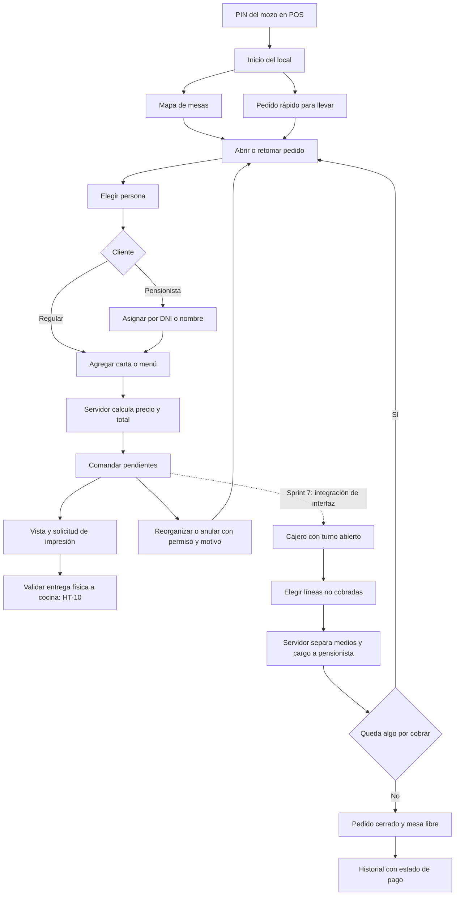
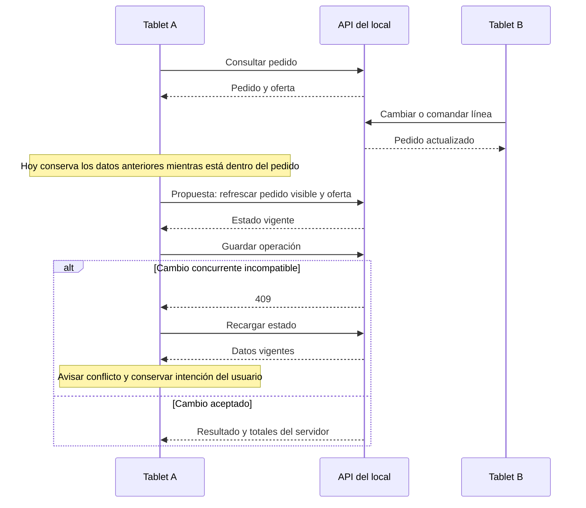

# Auditoría de frontend y experiencia del cliente

**Fecha:** 2026-10-11, America/Lima. **Alcance:** `rikos-web`, lo entregado hasta el sprint 6/6b y la integración prevista del sprint 7. **Resultado:** hay una base funcional amplia para administrar el restaurante y tomar pedidos; todavía falta cerrar permisos de interfaz, recuperación de fallos y operación compartida para una demostración confiable al cliente y a sus socios.

Esta revisión es **estática**: rutas, componentes, cliente HTTP, CSS, contratos y documentos. No se abrió un navegador, no se probaron dispositivos, no se imprimió y no se ejecutó un flujo con datos reales. Los resultados de lint/build de esta sesión corresponden al informe de verificación general; aquí no se duplicaron esas ejecuciones. Las pruebas visuales mencionadas en historias anteriores son evidencia histórica, no una validación realizada hoy.

Se respetaron los cambios preexistentes, incluida la ampliación de `cliente.ts` para cobros y el trabajo de V41. Su presencia en el árbol de trabajo **no certifica una entrega cerrada**. Las superficies de kiosco, portal y motorizado están expresamente previstas para otros sprints: sus marcadores no son fallas del sprint 6.

Seguimiento: [registro central de pendientes](../../pendientes/02-auditoria-integral-sprints-0-7-2026-10-11.md). Lectura conjunta: [índice de la auditoría integral](README.md).

## 1. Lo que ayuda al producto

| Base encontrada | Por qué sirve al cliente | Evidencia |
|---|---|---|
| Cinco superficies con carga perezosa | Permite separar la operación del mozo, administración y usuarios externos, sin cargar todas las pantallas al ingresar al POS | `rikos-web/src/App.tsx:8-36` |
| Cliente HTTP central y rutas relativas | Facilita servir la misma interfaz en el equipo del local y en la nube | `rikos-web/src/api/cliente.ts:24-64` |
| Componentes compartidos de carga, error, vacío, campo, modal y avisos | Evita que cada módulo invente su propio lenguaje de respuesta | `rikos-web/src/comun/componentes/Tabla.tsx:26-44`, `Campo.tsx:12-42`, `Aviso.tsx:14-18` |
| POS con pedidos por persona, menú compuesto, pedido para llevar, comandas y reorganización | Ya permite demostrar la parte central del servicio de salón | `rikos-web/src/apps/pos/index.tsx:121-145`, `features/venta/PantallaPedido.tsx:12-51` |
| Totales y precio del pedido procedentes del servidor | Reduce diferencias entre dispositivos y evita duplicar el motor de precios en la UI | `rikos-web/src/features/venta/PantallaPedido.tsx:54-58`, `OrdenDeLaMesa.tsx:267-282` |
| Cuenta corriente distingue deuda y saldo a favor; tope informa sin bloquear | Sigue la intención de atención al pensionista y evita tratar el límite como rechazo del servicio | `rikos-web/src/features/pensionistas/PantallaCuentasCorrientes.tsx:90-124` |
| Recetas diferencian costos visibles, nulos e incompletos | Evita presentar un costo desconocido como cero en esa pantalla | `rikos-web/src/features/catalogo/PantallaRecetas.tsx:8-11,34-36,149-155` |
| Bitácora filtrable y de consulta | Ofrece al dueño trazabilidad de cambios y una base para rendir cuentas ante sus socios | `rikos-web/src/features/auditoria/PantallaAuditoria.tsx:98-122,145-147` |

## 2. Revisión por superficie y módulo

**Estados:** construido = hay rutas y componentes con operaciones; parcial = hay parte del flujo pero faltan entregas; planeado = marcador o acceso “Pronto”, sin flujo. Construido no equivale a aceptación visual o funcional certificada en esta auditoría.

| Superficie / módulo | Estado observado | Lo que existe | Brecha o siguiente paso hasta sprint 7 | Trazabilidad / evidencia |
|---|---|---|---|---|
| Administración: acceso y sesión | Construido | Usuario/contraseña, bloqueo por intentos, local activo, persistencia de sesión | WEB-01, WEB-02, WEB-04: permisos propios, recuperación de sesión y feedback al cambiar local | v3 US-53, US-56; `SesionContexto.tsx:12-24,61-72,101-105`; `RequiereSesion.tsx:6-13` |
| Administración: locales y horarios | Construido | Alta/edición por pasos, estado del local, contacto, aspecto, horarios y días especiales | Confirmar datos reales del local; validar cambios de local con dos solicitudes concurrentes | v3 US-52, US-58; `apps/admin/index.tsx:52-55`; `api/cliente.ts:141-234` |
| Administración: usuarios | Construido | Alta, roles/locales, PIN, actividad, estado y excepciones | WEB-05: resultado parcial al guardar PIN/asignaciones; WEB-06: permisos coherentes en navegación y acciones | v3 US-55, US-56; `features/usuarios/PantallaUsuarioFormulario.tsx:145-190,205-239` |
| Administración: roles y permisos | Construido | Matriz, restauración de predeterminados, creación/edición | WEB-05: separar edición del rol y edición autorizada de permisos, o guardarlas atómicamente | v3 US-56; `features/usuarios/PantallaRolFormulario.tsx:167-188` |
| Catálogo: productos y categorías | Construido | Búsqueda/filtros, fichas, uso vendible/insumo/subreceta, precio/costo, imágenes, exportación CSV | WEB-05 y WEB-06; riesgo de costos visible en catálogo (P-30, revisar también backend); validar exportación autorizada | v3 US-33, US-37; `features/catalogo/PantallaProductos.tsx:169-189,205-210,396-397`; `PantallaProductoFormulario.tsx:313-332` |
| Catálogo: unidades/presentaciones/conversiones | Construido | Listados y altas mediante el cliente API | Verificar errores de conversión y recuperación con datos reales de compra; la validación al comprar pertenece al sprint posterior | v3 US-34; `api/cliente.ts:430-435,483-497`; ruta `apps/admin/index.tsx:66` |
| Catálogo: proveedores | Construido | Alta/edición, estado y eliminación con confirmación | Protección del historial de compras se completa cuando exista compras; no tratar ese trabajo futuro como falla de pantalla | v3 US-35; `features/proveedores/PantallaProveedores.tsx:30-42,56-61,86-94` |
| Recetas y costeo | Construido | Listado/ficha, insumos y subrecetas, costo incompleto y solo lectura según permisos | WEB-01 afecta permisos efectivos en usuarios no administradores; ocultación del costo de recetas sí tiene soporte específico | v3 US-37; `features/catalogo/PantallaRecetas.tsx:34-36`; `PantallaRecetaFormulario.tsx:90-93` |
| Menú normal/extra y programación semanal | Construido | Precio, opciones por componente, advertencias y confirmación de semana | Aceptar precios reales; errores de red y concurrencia deben distinguirse de permiso denegado | v3 US-02, US-03; `features/menu/PantallaMenuNormalYExtra.tsx:78-83,128-148`; `PantallaProgramacionSemanal.tsx:137-141` |
| Disponibilidad por local | Construido | Agotar con un toque; reactivar con motivo; usa local del token | WEB-01 puede impedir a cocina utilizar su permiso; WEB-04 para cambio de local; WEB-07 para catálogo ya abierto en otra tablet | v3 US-04; `features/menu/PantallaDisponibilidad.tsx:83-135` |
| Pensionistas: ficha y responsable | Construido | DNI, plan, comidas habituales, contacto, PIN, activación/desactivación | WEB-11: mantener nombre/identidad al retomar pedido; portal y pre-ticket siguen futuros | v3 US-15; `apps/admin/index.tsx:82-99`; `features/venta/DialogoPensionista.tsx:5-7,24-37` |
| Pensionistas: planes y parámetros | Construido | Tarifas versionadas, táper, segundo consumo y simulador | Validar importes reales y los cambios de plan pendientes del backlog; WEB-01 afecta permisos de UI | v3 US-16; `api/cliente.ts:688-738`; `features/pensionistas/PantallaPlanes.tsx:73-75` |
| Pensionistas: cuenta corriente | Construido, dependiente de cobro para consumos | Saldo inicial, ajustes con motivo, tope, resumen global y movimientos por local | Cobro del sprint 7 debe completar el cargo y alerta sin bloquear; evitar mostrar cierre sin cobro como consumo cobrado | v3 US-17; `features/pensionistas/PantallaCuentaPensionista.tsx:95-99,108-133`; plan sprint 7 §4.5 |
| Administración: configuración/motivos | Construido con tarjetas futuras | Portada y motivos; accesos a locales, parámetros y salones | WEB-06: mostrar solo accesos autorizados; tarjetas de impresoras, cajas y otras aún “Próximamente” son plan | v3 US-36; `features/configuracion/PantallaConfiguracion.tsx:29-39,83-111` |
| Salones y mesas | Construido | CRUD, formas y plano visual, cambios sin guardar, mapa en POS | WEB-05: guardar plano es secuencial y puede persistir parcialmente; probar teclado, local y recuperación | v3 US-05 y alcance administrativo; `features/salones/PantallaPlano.tsx:108-114,215-257` |
| Bitácora de auditoría | Construido | Filtros por local/usuario/fecha/evento, detalle JSON y paginación | WEB-13: faltan opciones de eventos ya emitidos; usuarios con solo permiso de auditoría no tienen catálogos de filtros | v3 US-57; `features/auditoria/PantallaAuditoria.tsx:21-36,88-95` |
| POS: PIN e inactividad | Construido | PIN autoconfirma, teclado físico/táctil, bloqueo y cambio de mozo | WEB-02 y WEB-10; comprobar una solicitud por intento y datos de local reales | v3 US-54; `features/autenticacion/PantallaPin.tsx:9,29-69,139-141`; `apps/pos/index.tsx:17,53-69` |
| POS: Inicio, mapa, órdenes activas | Construido | Resúmenes, mesas por salón, polling y apertura de pedido | WEB-03 y WEB-12: frescura de información y límite de 100 pedidos sin paginación | v3 US-05; `features/pos/PantallaInicio.tsx:29-53`; `PantallaOrdenes.tsx:26-41`; `features/venta/MapaDeMesas.tsx:462-480` |
| POS: toma de pedido/para llevar | Construido | Persona activa, carta y menú, notas, tarifa pensionista y pedido rápido | WEB-07, WEB-09, WEB-11 y WEB-14: sincronización, búsqueda, identidad y estado cobrado | v3 US-06; `features/venta/PantallaPedido.tsx:114-153`; `features/pos/PantallaPedidoRapido.tsx:30-44` |
| POS: reorganización y anulación | Construido | Mover, unir una mesa libre, separar, trasladar línea, anular comandado con motivo | Unión de dos mesas ocupadas fue enmendada: no es bug; varias operaciones secuenciales requieren feedback de resultado parcial | v3 US-07/US-09 y enmiendas; `features/venta/DialogoUnirMesa.tsx:25-26`; `PantallaPedido.tsx:524-569` |
| POS: comanda e impresión | Construido en navegador; hardware pendiente | Vista de comanda, copia y registro de impresión | WEB-15 / HT-10: impresión física no validada; distinguir solicitud de impresión de entrega a cocina | v3 US-08; `features/venta/VistaComanda.tsx:37-50`; historia `sprint-06-cierre.md` |
| POS: historial | Construido | Fecha/canal/búsqueda, paginación y consulta del pedido cerrado | WEB-03; criterio de cierre necesita estado de pago porque ya hay cierres provisionales sin cobro | `features/pos/PantallaHistorial.tsx:40-60,87-106,129-140`; enmiendas y plan sprint 7 |
| Caja y turnos | Parcial, sprint 7 en curso | API de cajas/turnos y contratos de cobro en árbol de trabajo; menú “Mi sesión” sigue deshabilitado | WEB-14: pantalla de apertura/cobro, pago parcial, vuelto y estado cobrado; no presentarlo como circuito terminado | v3 US-18 a US-22; `api/cliente.ts:1490-1557`; `features/pos/PosShell.tsx:160-167` |
| Kiosco | Planeado | Marcador “por construir” | Sprint 8; no se incluye como reparación de sprint 6 | `apps/kiosco/index.tsx:1-3` |
| Portal | Planeado | Marcador “por construir” | Sprint posterior de portal; no hay sesión externa ni estado de cuenta implementados | `apps/portal/index.tsx:1-3` |
| Motorizado | Planeado | Marcador “por construir” | Sprint posterior de delivery | `apps/motorizado/index.tsx:1-3` |
| Inventario, producción, compras operativas, facturación, reportes | Planeado desde menú | Etiquetas sin ruta o tarjetas futuras | Mantener visibles como roadmap solo en contexto de demostración; la navegación operativa puede reducirse a lo entregado | `apps/admin/BarraLateral.tsx:125-179`; `features/configuracion/PantallaConfiguracion.tsx:29-39` |

En la tabla, las rutas abreviadas se resuelven bajo `rikos-web/src/`, salvo que se indique otro documento.

## 3. Hallazgos y soluciones propuestas para pendientes

**Prioridad sugerida:** P1 = resolver para una entrega operativa fiable; P2 = resolver en consolidación/próximo incremento; P3 = documentación o mejora. **Tipo:** defecto estático confirmado, brecha conocida, riesgo pendiente de reproducir o entrega planeada. Ninguna solución de esta tabla se implementó en esta sesión.

| ID | Prioridad / tipo | Qué ocurre e impacto | Evidencia comprobable | Solución propuesta para Claude / equipo | Criterio de aceptación |
|---|---|---|---|---|---|
| **WEB-01** | P1 / defecto | Los permisos globales se obtienen de un endpoint reservado a administradores. Cocina, mozo o cajero pueden tener permisos del módulo pero recibir un conjunto vacío en UI. Por ejemplo cocina puede ver disponibilidad pero no marcar agotado. El error se oculta. | `SesionContexto.tsx:66-68`; `api/cliente.ts:275-276,1053`; backend `comun/seguridad/ConfiguracionSeguridad.java:75-80`; `PantallaDisponibilidad.tsx:84-86` | Cargar permisos del actor con `/api/auth/mis-permisos`, ya existente. Distinguir carga/error/resultado vacío. Evitar que una respuesta de una sesión anterior sobrescriba los permisos de la actual. | Cocina con `menu.marcar_agotado` tiene la acción disponible sin ser administradora; usuario sin permiso no la ve; fallo temporal muestra reintento; salir y entrar con otro usuario no conserva permisos anteriores. |
| **WEB-02** | P2 / brecha de recuperación | El guard de administración solo comprueba que exista un objeto de sesión. Un 401 queda como `ErrorApi` genérico; no hay política común para volver a autenticar. POS y admin mantienen sesiones diferentes. Esto puede dejar al usuario intentando repetidamente con un token vencido; bloqueo operativo pendiente de demostrar. | `RequiereSesion.tsx:6-13`; `SesionContexto.tsx:12-24,57`; `api/cliente.ts:37-52`; `apps/pos/index.tsx:41-44,86-90` | Definir una respuesta común a 401 por superficie, conservar destino y pedido guardado en servidor y pedir autenticación; distinguir 403 de sesión vencida. Validar la forma del objeto recuperado del almacenamiento. | Con token vencido, el siguiente acceso vuelve al login/PIN apropiado y permite retomar el pedido; un 403 muestra falta de permiso y no hace perder el contexto; JSON de sesión inválido no rompe la pantalla. |
| **WEB-03** | P1 / defecto | Inicio transforma un fallo al consultar pedidos en lista vacía, con mensaje “No hay pedidos”. Órdenes e Historial solo muestran error si nunca hubo datos; tras una carga buena presentan datos viejos sin advertir el fallo. No se encontró indicador de conexión a API local. Puede inducir a creer que una orden no existe o ya cambió. | `features/pos/PantallaInicio.tsx:34-44,138-140`; `PantallaOrdenes.tsx:28-34,48-51`; `PantallaHistorial.tsx:51-60,87-95`; regla UX §7.6 | Separar vacío, error y datos conservados; mostrar última actualización y “Sin conexión al sistema del local” cuando la consulta falla. Mantener lectura útil con aviso. Distinguir Internet del alcance de la API local; `navigator.onLine` por sí solo no demuestra ese alcance. | Cargar pedidos y cortar API no produce “No hay pedidos”; aparece aviso con hora de última actualización; al recuperar red se refresca y desaparece el aviso; el usuario puede reintentar. |
| **WEB-04** | P2 / defecto | Fallar al cambiar local en el encabezado solo escribe en consola. Además no hay estado de cambio en curso ni protección contra dos respuestas que llegan en orden inverso. El actor puede interpretar que ya está operando en otro local. | `comun/sesion/EncabezadoLocal.tsx:34-47`; `SesionContexto.tsx:101-105` | Aviso visible con local actual, selección deshabilitada mientras se cambia y control de respuesta vigente. Confirmar el nuevo local antes de habilitar acciones y recargar datos dependientes del token. | Fallo de red mantiene explícitamente el local anterior; dos selecciones rápidas no dejan un local distinto del último aceptado; no se guarda una acción con contexto ambiguo. |
| **WEB-05** | P1 / defecto de recuperación | Una única acción “Guardar” puede completar varias peticiones y fallar a mitad. Rol queda creado aunque falle permisos; usuario queda creado aunque falle PIN; producto queda creado aunque falle costo/servicios. El formulario conserva modo “nuevo” y muestra fallo general. Plano recarga después de fallar, descartando los cambios que todavía no se guardaron. | `features/usuarios/PantallaRolFormulario.tsx:177-184`; `PantallaUsuarioFormulario.tsx:149-186`; `features/catalogo/PantallaProductoFormulario.tsx:313-328,356-357`; `features/salones/PantallaPlano.tsx:236-254` | Preferir un caso de uso transaccional para la acción que el usuario percibe como única. Mientras tanto, guardar ID creado inmediatamente, pasar a edición, informar qué etapa quedó guardada y reintentar solo lo pendiente. Para plano, conservar el borrador y comparar con servidor al recuperar. | Simular fallo en la segunda petición: no se crea otra entidad al reintentar; mensaje distingue guardado parcial; permisos no autorizados no se presentan como editables; borrador del plano sigue recuperable. |
| **WEB-06** | P2 / brecha UX de permisos | Navegación admin filtra solo algunos ítems (`auditoria.ver`, `venta.ver`). Pantallas de catálogo/proveedores/roles muestran acciones sin validar cada permiso. La API sigue siendo la barrera de seguridad; esto genera accesos que terminan en 403 y confusión sobre qué puede hacer cada colaborador. | `apps/admin/BarraLateral.tsx:64,161,232-235`; `comun/sesion/RequiereSesion.tsx:6-13`; `features/catalogo/PantallaProductos.tsx:205-210`; `features/proveedores/PantallaProveedores.tsx:56-61,71`; `features/usuarios/PantallaRolFormulario.tsx:31,177-178`; regla UX §7.3 | Matriz de ruta/acción/permiso compartida, estado de acceso denegado y acciones ocultas o deshabilitadas con explicación según su contexto. Resolver WEB-01 antes. Alinear con backend; no sustituir sus controles. | Matriz por rol con crear/modificar/desactivar/exportar/administrar permisos; no se ofrece una acción imposible; URL directa devuelve una pantalla clara sin ejecutar cargas incompatibles. |
| **WEB-07** | P1 / brecha conocida respecto a UX | El mapa y listados refrescan solos, pero la pantalla de pedido solo carga al abrir y después de sus propias acciones/errores. Otra tablet puede cambiar líneas, comandar o agotar mientras la primera sigue mostrando una foto anterior. | `features/venta/PantallaPedido.tsx:114-153,158-172`; polling en `MapaDeMesas.tsx:476-480`; regla UX §7.7 | Refresco limitado mientras el pedido está visible, o suscripción posterior; invalidar oferta/disponibilidad. Proteger el diálogo/borrador local, avisar del cambio ajeno y mantener recuperación 409. No reintentar automáticamente escrituras no idempotentes. | A abre pedido y B cambia/comanda una línea: A lo ve dentro del intervalo acordado sin volver al mapa; agotado de B actualiza oferta de A; editar simultáneamente conserva feedback del conflicto y no duplica una línea. |
| **WEB-08** | P2 / brecha conocida | Backlog v3 US-01 exige 56 px y un teclado compartido para cantidades. CSS contiene acciones móviles de 40/48 px y cantidades utilizan −/+. La propia historia de cierre ya declara el desacuerdo. No se certificó tamaño medido en navegador. | `estilos/pos.css:463,471,501,530,546`; `features/venta/OrdenDeLaMesa.tsx:233-253`; `docs/producto/prd/03-backlog-v3.md:94-111`; historia `sprint-06-cierre.md` | Decidir un solo criterio vigente; aplicar token táctil al POS y documentar las excepciones aprobadas. Diseñar entrada rápida de cantidad con componente compartido sin quitar eficiencia a cantidades pequeñas. | Hoja de aceptación con medidas reales en 375/768/1280 px y dispositivo táctil; US-01 CA1/CA3 cumplidos o enmienda formal trazable; mozo real completa pedido con una mano. |
| **WEB-09** | P2 / riesgo comprobable por orden de respuestas | Buscar pensionistas espera 300 ms pero no cancela ni invalida solicitudes ya enviadas. Una respuesta antigua puede sustituir resultados nuevos, incluso después de reducir la consulta a menos de dos caracteres. El usuario puede elegir de una lista que no corresponde al texto visible. | `features/venta/DialogoPensionista.tsx:24-37` | Abort/secuencia de petición vigente, limpiar resultados al cambiar consulta y estado “Buscando”; asociar elección a resultado vigente. | Enviar búsqueda A lenta y B rápida; A no sobrescribe B. Limpiar texto no vuelve a mostrar resultados anteriores. |
| **WEB-10** | P2 / defecto y riesgo de configuración | Si el nombre del local no llega, el PIN muestra “San Isidro”. Si falta variable de entorno también usa `sanisidro`. En otro despliegue puede indicar una sede falsa u operar contra el código de desarrollo. Teclado físico además llama al login dentro del actualizador de estado: falta verificar ausencia de solicitudes duplicadas en desarrollo con StrictMode. | `features/autenticacion/PantallaPin.tsx:9,24-26,52-59,139-141`; `main.tsx:16-19` | Configuración obligatoria por local con pantalla clara si falta; mostrar local desconocido/error con reintento, sin nombre inventado. Sacar efectos de red del actualizador y controlar una solicitud por PIN completo. | Desplegar con otro local y sin variable no muestra San Isidro por defecto; fallo público informa al usuario; teclado y pantalla táctil generan exactamente un intento por PIN, medido en red. |
| **WEB-11** | P2 / defecto de continuidad | La API de persona devuelve `pensionistaId` pero no nombre; la UI guarda el nombre únicamente al identificarlo en la sesión actual. Retomar el pedido deja un genérico “Pensionista”. La etiqueta “DNI validado” no distingue búsqueda manual de una futura autenticación por ticket. | `api/cliente.ts:1085-1094`; `features/venta/PantallaPedido.tsx:111-112`; `OrdenDeLaMesa.tsx:72,108-109`; `DialogoPensionista.tsx:5-7` | Incluir nombre y DNI mínimo necesario en DTO del pedido o consulta autorizada; mostrar modo real de identificación (“Asignado por búsqueda”/“Ticket validado”) y datos legibles al retomar. | Otro mozo abre el mismo pedido y reconoce al pensionista sin repetir la búsqueda; la etiqueta corresponde al mecanismo utilizado; no se exponen datos adicionales sin propósito. |
| **WEB-12** | P2 / riesgo por volumen | Órdenes pide únicamente la primera página de 100 y calcula los contadores con esa lista; no usa total/paginación. Si hay más, quedan ocultas y el contador puede diferir del de la barra lateral. No se conoce todavía si el volumen real llega a ese límite. | `features/pos/PantallaOrdenes.tsx:28-30,43-53`; `apps/pos/index.tsx:73-88` | Usar paginación o carga incremental y los totales reales por filtro; establecer volumen de aceptación con el dueño. | Fixture de 101 pedidos: todos accesibles; contadores coherentes; cambio de filtro pagina servidor y no oculta pedidos posteriores. |
| **WEB-13** | P2 / defecto de trazabilidad visible | Filtro de eventos termina en `precio_manual`; faltan `anulacion`, comanda, reimpresión, terminado, turnos y otros eventos ya permitidos. Se ven sin filtro pero no se pueden seleccionar. Catálogos de usuarios/locales fallan silenciosamente para un rol con auditoría que no sea administrador. | `features/auditoria/PantallaAuditoria.tsx:21-36,88-95`; backend migraciones `V33__comandas_y_anulaciones.sql:55-61`, `V38__terminar_pedido.sql:19-25`, `V40__cajas_y_turnos.sql:41-47` | Catálogo de eventos vigente o mapa sincronizado con pruebas de contrato; catálogos mínimos de filtros autorizados por `auditoria.ver` sin conceder administración completa. Feedback si falla catálogo. | Se puede filtrar cada evento emitido hasta sprint 7; usuario con solo auditoría puede consultar filtros permitidos; no se confunde fallo de carga con ausencia de usuarios/locales. |
| **WEB-14** | P1 para sprint 7 / integración planeada | Contrato en árbol de trabajo reconoce línea `cobrado`, cajas y cobro; la orden no muestra insignia de cobrado y permite ofrecer trasladar una línea cobrada mientras siga abierto el pedido. “Terminar pedido” sigue visible para cualquier pedido no cerrado, aunque backend en curso lo limita. No hay pantalla de caja activada. | `api/cliente.ts:1074,1490-1557`; `features/venta/OrdenDeLaMesa.tsx:145-163,286-289`; `features/pos/PosShell.tsx:160-167` | Completar UI caja sobre la entrega vigente: turno, selección de líneas no cobradas, mezcla regular/pensionista, medios, recibido/vuelto, cargos y saldo pendiente. Etiquetar cobrado e impedir acciones incompatibles; acotar “Terminar” al caso permitido. | Mesa mixta con pago parcial: líneas cobradas identificadas/inmutables; la mesa sigue ocupada hasta el último cobro; vuelto no suma ingreso; permiso/turno correcto; dos cajeros no duplican cobro; sin botón de cierre sin cobro para productos pendientes de cobrar. |
| **WEB-15** | P1 de validación operativa / pendiente conocido | La UI registra impresión antes de abrir `window.print()`. Cancelar el diálogo o carecer de papel no prueba salida física; el próximo intento ya puede figurar como copia. HT-10 sigue abierto y la comanda muestra al mozo de apertura. | `features/venta/VistaComanda.tsx:42-46`; `api/cliente.ts:1283-1284`; historia `sprint-06-cierre.md` | Definir “intento registrado” frente a “impreso confirmado”. Para la solución de navegador, no prometer confirmación del hardware; incorporar confirmación manual o agente de impresión si se requiere acuse real. Probar impresora, corte de red local, copia, contenido y mozo emisor. | Acta con la comandera real y casos cancelación/sin papel/reimpresión; queda claro qué estado garantiza cada dato; cocina no prepara dos veces por confundir original/copia; mozo mostrado cumple criterio acordado. |
| **WEB-16** | P2 / brecha de accesibilidad | Modal tiene rol/aria-modal y Escape, pero no manejo de foco, contención de Tab ni retorno al disparador. Cajones POS/pedido tampoco resuelven ese ciclo. Usuarios de teclado pueden terminar interactuando con fondo mientras un diálogo exige motivo. | `comun/componentes/Modal.tsx:17-48`; `features/pos/PosShell.tsx:92-104`; `features/venta/OrdenDeLaMesa.tsx:75-78` | Patrón común de diálogo/cajón con foco inicial, Tab contenido, fondo no interactivo y devolución del foco al cerrar. Impedir cerrar de forma accidental durante acciones irreversibles en curso y conservar campos ante error. | Solo teclado: abrir, completar motivo, cancelar/confirmar y regresar al disparador; Tab no activa fondo; lector anuncia título y error; acciones en curso tienen una sola confirmación. |
| **WEB-17** | P2 / brecha de contrato | Parte del cliente usa OpenAPI y otra parte declara interfaces manuales. `Required` supone obligatorios campos que OpenAPI marca opcionales. Tipos generados están ignorados; build no incorpora regeneración. Caja además declara retorno `null` ante 204, pero `pedir` devuelve `undefined`. | `api/cliente.ts:8-19,48-52,578-623,743-805,1518-1519`; `package.json:8-11`; `.gitignore:10-12`; `ESTRUCTURA.md:109-113` | DTO explícitos con nulabilidad/obligatoriedad real; generar desde contrato reproducible versionado o paso de bootstrap/CI; validar contrato de pedidos/caja en cambio conjunto. Normalizar 204 por función o declarar `undefined` honestamente. | Clone limpio genera/usa tipos sin tocar a mano; cambio de DTO rompe check de contrato; 204 tiene un resultado definido y cubierto; campos nulos se muestran de forma segura. |
| **WEB-18** | P3 / documentación | Mapa dice POS-17 para agotados pero UI funcional está en admin; §4b del rediseño sigue describiendo barra inferior móvil, aunque historia registra hamburguesa aprobada. README de pendientes conserva “Pedido rápido no existe” y falta de `grupo`/pestañas que código ya implementa. | `docs/producto/ui-ux/01-mapa-de-pantallas.md:31`; `03-pos-rediseno.md:132`; historia `pos-rediseno-responsive-y-pruebas.md`, última sección; `docs/pendientes/README.md`; `features/pos/PosShell.tsx:195-206`; `features/venta/PantallaPedido.tsx:40`; `apps/pos/index.tsx:133-137` | Actualizar matriz de pantallas y registro de pendientes con estado/evidencia actual, una ficha por entrega y vínculo con enmiendas; design system real derivado de tokens/componentes. | Nuevo integrante sabe dónde entra cocina, qué está entregado y qué es futuro; pendientes resueltos no vuelven al sprint; diseño móvil coincide con referencia vigente. |

Las rutas abreviadas de frontend se resuelven bajo `rikos-web/src/`. Las referencias de backend sin prefijo se resuelven bajo `rikos-backend/servicio-operacion/src/main/java/pe/rikos/operacion/`; migraciones bajo `src/main/resources/db/migration/` de ese módulo.

## 4. Flujos: lo actual y lo que completa caja

El flujo de sprint 6 ya persiste cada operación en servidor. El trabajo de recuperación no debe convertir una respuesta perdida en repetición automática de altas, líneas o cobros. El cierre sin cobro fue provisional; la restricción y su sustitución por cobro forman parte del trabajo del sprint 7.

## 5. Plan de mejora y demostración al cliente

No conviene presentar solo cantidad de pantallas. Una demo útil muestra el servicio completo, la administración necesaria y la trazabilidad de una misma operación.

| Incremento sugerido | Trabajo documentado | Resultado que se demuestra | Responsable sugerido |
|---|---|---|---|
| Consolidación de lo entregado, antes de siguiente demo | WEB-01, WEB-03, WEB-04, WEB-05 y revisión del cierre provisional vigente | Cocina marca agotado; mozo lo ve; fallo de red visible; un guardado fallido se recupera sin duplicar entidad | Claude implementación; QA prueba; PO acepta comportamiento |
| Cierre de experiencia sprint 6 | WEB-07, WEB-08, WEB-09, WEB-10, WEB-11, WEB-15, WEB-16 | Dos mozos trabajan la mesa, identificación permanece, comanda legible y recuperación conocida | Claude + QA + mozo/cocina de referencia |
| Sprint 7, UI sobre contrato de caja | WEB-02, WEB-13, WEB-14 y contratos de WEB-17 | Cajero abre turno y cobra mesa mixta parcialmente con efectivo/Yape y vuelto; pedido se libera al completar | Claude frontend/backend; cajero de referencia; QA |
| Documentación y volumen | WEB-06, WEB-12, WEB-18 | Equipo nuevo entiende permisos, pantallas, límites y trabajo futuro; socio observa datos consistentes | PO + documentación + QA |

**No se estiman puntos sin refinamiento del equipo.** Estos son cortes de trabajo sugeridos, no cambios a sprints aprobados. Registrar cada WEB como tarea enlazada a su historia, con evidencia de aceptación y decisión sobre los pendientes conocidos de 56 px/impresión.

## 6. Matriz mínima de aceptación

| Caso | Datos / dispositivo | Qué verificar | Relación |
|---|---|---|---|
| Cocina con permiso sin rol administrador | Usuario cocina, dos locales | Marcar/reactivar solo en local vigente, motivo obligatorio al reactivar; permisos obtenidos del actor | WEB-01, WEB-04, v3 US-04/US-56 |
| Fallo después de primer guardado | Rol, usuario con PIN, producto con costo/servicio | Identificar etapa persistida, conservar ID y completar sin segunda alta | WEB-05 |
| Pedido compartido | Dos tablets, misma mesa | A ve cambio de B, no duplica comanda, recupera conflicto y catálogo agotado | WEB-07, v3 US-05 a US-09 |
| Corte de API local después de una carga buena | Inicio/órdenes/historial | Aviso visible, datos conservados identificados como anteriores, reintento y recuperación | WEB-03 |
| PIN/local configurado incorrectamente | Código distinto al de desarrollo, teclado físico/táctil | No nombre ficticio, un intento por PIN, bloqueo legible y recuperación de sesión | WEB-02, WEB-10 |
| Retomar pensionista con otro mozo | Pedido guardado de persona pensionista | Nombre e identificación correctos, no solo etiqueta genérica, tarifa sigue servidor | WEB-11 |
| Cobro parcial de mesa mixta | Cajero con turno, cliente regular + pensionista | Líneas cobradas visibles, monto/vuelto correctos, cargo único, mesa no libre prematuramente | WEB-14, v3 US-17 a US-22 |
| Auditoría de una operación | Anulación, comanda, turno y cobro | Filtros disponibles y actor/local/fecha correctos; solo lectura | WEB-13, v3 US-57 |
| Impresión real | Comandera objetivo; cancelación/sin papel/copia | Salida legible, mozo acordado, distinguir intento y éxito real | WEB-15, HT-10 |
| Uso móvil y teclado | 375/768/1280 px; táctil y teclado | Sin pérdida de acciones, foco, Tab, retornos y medida táctil vigente | WEB-08, WEB-16, v3 US-01 |
| Más de 100 pedidos | 101 pedidos activos | Sin órdenes ocultas; contadores corresponden a total y filtro | WEB-12 |
| Instalación limpia y cambio de contrato | Entorno limpio, OpenAPI reproducible | Tipos regenerables, nullable/204 fieles al servidor y sin parche manual | WEB-17 |

Las historias previas registran verificaciones manuales responsive del POS. No se encontraron archivos de pruebas frontend ni script de test en `rikos-web/package.json`; la ausencia ya está registrada en `docs/pendientes/README.md`. Añadir primero pruebas de estos recorridos de riesgo, sin pretender que un build limpio o una captura a 375 px certifique cobro, accesibilidad o impresión.

## 7. Documentación necesaria para el relevo

| Documento a completar/actualizar | Contenido concreto | Cuándo |
|---|---|---|
| Registro central de pendientes de esta auditoría | IDs WEB, tipo, prioridad, dueño, sprint propuesto, solución y criterio de cierre; enlazar a esta tabla para no duplicar detalle | En esta sesión documental |
| Mapa de pantallas y rutas | Estado real, URL/entrada, permiso, historia v3 y repo; panel de cocina/disponibilidad; caja parcial; marcadores futuros | Antes del relevo |
| Design system | Tokens vigentes, control táctil, teclado, campos, errores, foco de modal/cajón y lenguaje de estados | Consolidación UX |
| Guion de aceptación/demostración | Mesa mixta, dos dispositivos, agotado, conflicto/red, comanda e integración de cobro; evidencia con fecha y datos de prueba | Antes de presentar al cliente/socios |
| Historia de entrega de sprint 7 frontend | Qué pantallas de caja se entregaron, contrato consumido, validación real y qué sigue abierto | Al cerrar cada entrega con Claude |

**Límite del dictamen:** falta comprobar estos recorridos en una instancia, roles reales y hardware. La documentación permite tomar decisiones y preparar soluciones, pero no declara el producto aprobado para operación completa por el cliente.
