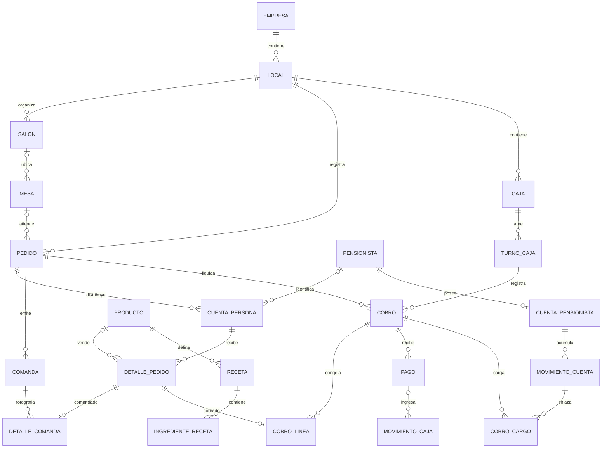
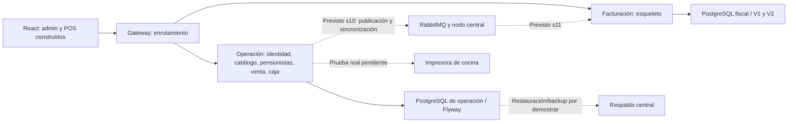

# Modelo de datos, contratos y arquitectura

Fecha: 11/10/2026. Evidencia: fuentes Java/TS, configuración y migraciones disponibles V1–V41; V41 y sus casos de uso pertenecen al trabajo local en curso. La prueba de migración desde una base vacía se registra en [validación](06-validacion-y-aceptacion.md).

## Qué modelo estamos usando

| Nivel | Modelo utilizado | Valor para RIKOS | Límite actual |
|---|---|---|---|
| Negocio | Restaurante multilocal, catálogo central, transacciones por local y cuenta única del pensionista | Permite crecer manteniendo un saldo y reglas comunes | Operación central/local y sincronización distribuida todavía no están demostradas |
| Datos | Relacional PostgreSQL, libro de movimientos, tarifas versionadas, estados y restricciones | Facilita trazabilidad y reconstrucción de saldos | Modelo lógico documenta dominios futuros y diverge en varios nombres/columnas del físico |
| Aplicación | Monolito modular de operación y servicio fiscal separado, con gateway | Mantiene operación bajo una transacción y separa integración externa | Verificación de fronteras falla; interfaces públicas exponen paquetes amplios |
| Cliente web | Una aplicación React con cinco superficies por rutas | Reutiliza sesión, componentes y API | Las cinco rutas no equivalen a cinco aplicaciones terminadas |
| Trabajo | Spec-driven por sprint y Product Backlog versionado | Une requisitos, diseño, pruebas y resultado | Estado, pendientes e índices necesitan reconciliación con el código actual |

La elección principal es apropiada para el cliente de referencia (un local, aproximadamente 25 pensionistas, dueño que delegará caja). No hay evidencia de volumen que justifique dividir la operación en más servicios. Esta valoración se deriva del código y del [usuario de referencia](../../producto/prd/02-usuario-de-referencia.md), sin medir rendimiento.

## Conciliación del modelo lógico con el físico

El [modelo lógico](../../producto/modelo-de-datos/README.md) es el diseño completo. El físico se crea por sprint mediante Flyway; no debe editarse una migración aplicada para que coincida con un documento.

| Bloque lógico | Tablas físicas observadas en migraciones | Diferencia relevante / siguiente actualización |
|---|---|---|
| 1 Organización/identidad | `empresa`, `local`, `rol`, `permiso`, `rol_permiso`, `usuario`, `usuario_rol`, `usuario_local`, `usuario_permiso_excepcion`, `sesion`, `bloqueo_pin`, `horario_servicio`, `dia_especial`, `horario_dia_especial` | Contrastar permisos por ámbito y revocación real; el diseño de dispositivos no se cumple usando User-Agent como identidad |
| 2 Catálogo | `categoria_producto`, `unidad_medida`, `producto`, `producto_servicio`, `presentacion_compra`, `conversion_unidad`, `proveedor` | Ver protección de costos y cambios de unidad; compras reales todavía no mantienen costo de última compra |
| 3 Recetas | `receta`, `ingrediente_receta` | Recálculo en grafo compartido y vigencia/unidad requieren pruebas; referenciar una receta mutable no conserva sus ingredientes históricos |
| 4 Menú | `semana_menu`, `dia_menu`, `opcion_menu`, `disponibilidad_producto` | Implementadas dentro de `catalogo`; el inventario de módulos lógico aún separa `menu` |
| 5 Pensionistas | `plan_tarifario`, `plan_tarifario_version`, `parametro_global`, `pensionista`, `responsable`, `cuenta_pensionista`, `movimiento_cuenta` | Físico usa versión completa del plan en lugar de tabla `precio_plan`. `saldo_inicial` es una extensión real. Periodos, pre-ticket y abonos completos siguen futuros |
| 6 Venta | `salon`, `mesa`, `pedido`, `cuenta_persona`, `detalle_pedido`, `detalle_pedido_componente`, `comanda`, `detalle_comanda` | Agregar salón/coordenadas/uniones, nombres/personas, versiones, campos de anulación y cierre V38. Impresiones iniciales son 0 en V33 |
| 7 Caja | `caja`, `turno_caja` (V40); `cobro`, `cobro_linea`, `pago`, `movimiento_caja`, `cobro_cargo` (V41 WIP) | El cobro actual se representa por líneas; medio de pago es CHECK, no catálogo `medio_pago`. Conciliación/cierre/reapertura no están implementados por existir estas tablas |
| 8 Facturación | En otra base: `comprobante` y `event_publication`, V1/V2 | Tabla del esqueleto difiere de diseño final `comprobante_electronico`. Emisión, reconciliación, adjuntos y envío pendiente de sprint 11 |
| 9 Inventario/compras/producción | Sin tablas físicas del circuito completo actual | Modelo propuesto, sprint 9 y parte de 14; no reportar ausencia como regresión de s6 |
| 10 Delivery/recojo | Sin tablas físicas actuales | Modelo propuesto, sprint 12 |
| 11 Transversal | `auditoria`, `motivo`, `event_publication`; motivos viven en catálogo en el código | Una tabla de publicaciones no prueba envío, reintento, deduplicación ni respaldo; `outbox`/conflictos todavía diseño |

## Relaciones del circuito construido y en curso

Las relaciones de cobro del diagrama proceden de V41, aún en trabajo local. No dibuja inventario ni comprobantes futuros como si estuvieran implementados.

Los nombres y cardinalidades representan restricciones físicas principales, no permiso para que cualquier módulo importe repositorios ajenos. La aplicación crea una cuenta al dar de alta al pensionista y exige al menos una línea por cobro: las FK/UNIQUE por sí solas no imponen esos mínimos desde el padre. Un abono puede tener movimiento de caja sin pago de venta. Los controles de consistencia agregada necesitan además transacciones y reglas de aplicación.

## Invariantes que deben conservarse

| Invariante | Defensa actual | Brecha o prueba necesaria |
|---|---|---|
| Un saldo inicial por cuenta | Índice parcial único V28 | Mantener en migraciones futuras y probar duplicidad concurrente |
| Libro de cuenta solo agrega | Trigger `BEFORE UPDATE OR DELETE` V28 | Buena base; no trasladar la política a una columna de saldo mutable |
| Un turno abierto por caja y por cajero | Índices únicos parciales V40 | Probar carreras de apertura y su error de negocio; cerrar turno aún requiere entrega 4 |
| Una misma línea aparece como máximo en una comanda | UNIQUE en `detalle_comanda` V33 | No demuestra que papel llegó a cocina; HT-10 pendiente |
| Una línea cobrada una vez | UNIQUE `cobro_linea(detalle_pedido_id)` V41 | Diferenciar reintento recuperable y conflicto; no garantiza cierre correcto entre cobros disjuntos |
| Total del cobro cuadra | CHECK `total = total_medios + total_cuentas` V41 | Agregados de pagos/cargos se comprueban en aplicación, no por ese CHECK; caso múltiples efectivo debe corregirse |
| Venta histórica estable | Campos de snapshot V41 y estados de línea | Falta composición histórica completa; comprobar protección de tablas financieras frente a edición/borrado |
| Operación pertenece al local autorizado | `local_id`, filtros y referencias | Una FK individual no garantiza que caja, turno, pedido y actor sean del mismo local; pruebas cruzadas y autorización por recurso |
| Fecha operativa consistente | Reloj `America/Lima` y fecha de pedido | Horarios nocturnos y selección de vigencia necesitan mismos límites de servicio y fecha |

## MOD-01 — El generador sobrescribe parte del timestamp ULID

**P1, confirmado por lectura y ejecución.** Fuente: [`Identificador.java`](../../../rikos-backend/contratos/src/main/java/pe/rikos/contratos/Identificador.java), método `generar`: primero escribe timestamp en posiciones 0–9; después el bucle `i = 15 ... 8` escribe aleatoriedad encima de las posiciones 8 y 9. El segundo bloque escribe diez caracteres para cuarenta bits, agregando dos posiciones de relleno. No corresponde al reparto documentado de 10 caracteres temporales y 16 aleatorios.

Comprobación con la clase compilada y JDK 21: un ID generado entre `1791751051459` y `1791751051623` decodificó sus diez primeros caracteres a `1791751051316`, fuera del intervalo. Los siete tests actuales de identificador pasan; validan longitud/alfabeto/colisiones y orden con separación de 1100 ms, sin decodificar la marca temporal.

**Impacto:** se pierde la semántica temporal exacta asumida por el contrato y la documentación. No se observó una colisión ni se afirma que todos los movimientos se hayan ordenado incorrectamente. ULID aleatorio tampoco promete orden monotónico dentro del mismo milisegundo: esa propiedad debe decidirse por separado.

**Propuesta:** corregir la distribución de bits o usar una implementación validada; pruebas de ida/vuelta del timestamp, límites del primer carácter, representación canónica y comportamiento entre milisegundos. Mantener IDs históricos y FKs; analizar compatibilidad antes de cualquier migración de identificadores. No reconstruir fechas de negocio a partir del ID histórico defectuoso; usar columnas temporales. Aceptación en [pendientes](../../pendientes/02-auditoria-integral-sprints-0-7-2026-10-11.md).

## Arquitectura construida frente a arquitectura prevista

| ID | Hallazgo | Evidencia y valoración | Solución propuesta |
|---|---|---|---|
| ARC-01 | Fronteras de módulos no verificadas en verde | `ArquitecturaDeModulosTest` ejecuta `ApplicationModules.verify()`; deuda conocida de ciclos y paquetes públicos amplios. Ver resultado actual en validaciones | Romper ciclos mediante puertos públicos pequeños y mover infraestructura transversal; conservar el test activo, sin excluirlo para declarar verde |
| ARC-02 | Despliegue local/offline aún es un diseño | `gateway/application.yaml` conserva ambas rutas; no hay perfil local del gateway que aplique lo indicado en su comentario. Fuentes no contienen circuito completo de publicación/consumo/sync | Mantener como s10/s11; definir perfiles, frontera de red, outbox/inbox, deduplicación y ensayo desconexión/reconexión |
| ARC-03 | Tests de integración apuntan por defecto a la base habitual | `application.yaml` usa `rikos_operacion`; no hay `src/test/resources` ni Testcontainers en POM. Algunas pruebas carecen de rollback según historias | Perfil de test y base efímera, migrada desde cero; impedir URL de desarrollo/producción en integración |
| ARC-04 | Guarda de semilla solo cubre perfil nube | `GuardaSemillaDesarrollo.java:33` usa `@Profile("nube")`; V9 siembra credenciales conocidas en cualquier perfil. El restaurante desplegaría perfil local | Distinguir desarrollo de producción local; exigir secreto real, administrador real y credenciales seguras antes del primer despliegue. No probarlo sobre usuarios reales |
| CAL-01 | Falta automatización reproducible de calidad | No se observa `.github` ni suite frontend en el árbol revisado. Build/lint se ejecutan manualmente; tipos API dependen del entorno | Añadir pipeline cuando Claude implemente, con entorno aislado, build/lint, contratos y arquitectura; guardar evidencia por entrega |

No se deduce una vulnerabilidad de una librería a partir de su versión. Esta auditoría revisa la configuración declarada; un análisis actualizado de dependencias tendría otro alcance.

## Documentación que induce decisiones equivocadas

| ID | Contradicción o vacío concreto | Qué registrar / corregir |
|---|---|---|
| DOC-01 | `ESTADO.md` dice sprint 7 esperando aprobación; plan README dice aprobado. TRD enumera solo tres módulos; ya hay pensionistas, venta y caja. Guía dice POS único PIN; ya hay varias pantallas | Fecha y evidencia por entrega; etiqueta en curso para V41. Conservar historial y vincular este corte |
| DOC-02 | `modelo/91` enlaza `dg/d6.png` y `dg/d7.png`, inexistentes en rutas revisadas | Sustituir por Mermaid del diseño propuesto o recuperar figuras; no dejar referencias vacías como documentación de arquitectura |
| DOC-03 | README/EMPEZAR dan comandos de arranque contradictorios con CLAUDE/TRD; `levantar.bat` solo compila con `mvn` y omite tests, no inicia los tres servicios | Unificar guía con wrapper y terminal por módulo; distinguir compilación, arranque y verificación |
| DOC-04 | Requisito «Node 20 o superior» demasiado amplio para Vite instalado | `node_modules/vite/package.json` exige `^20.19.0 || >=22.12.0`; escribir requisito exacto tomado del lock/runtime del proyecto y validarlo en pipeline |

## Decisiones de diseño que faltan para completar sprint 7

1. Alcance del bloqueo de pedido para que cerrar/cobrar/reorganizar/agregar líneas observe una sola versión consistente.
2. Qué información exacta del snapshot permite reconstruir precio, receta, ingredientes, cantidades, unidades, costo y utilidad años después.
3. Reintento idempotente del cobro y recuperación del resultado cuando el servidor guardó pero el cliente perdió la respuesta.
4. Revocación de acceso y edición jerárquica de roles, locales y permisos, compatible con un nodo local sin Internet.
5. Correcciones financieras por compensación e historial de reapertura; no borrar un cobro para permitir otro.

Estas decisiones y soluciones se entregan al refinamiento en `pendientes`; no se implementó ninguna durante esta auditoría.
