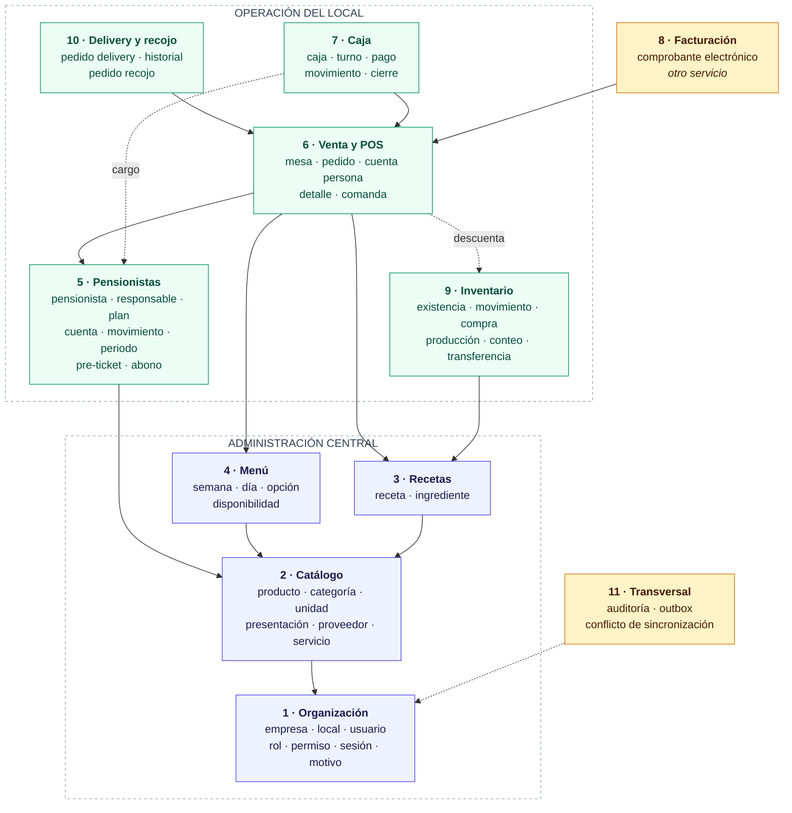

<!-- Extraído de rikos-backend/doc/RIKOS-modelo-de-datos.md (fuente completa, con la numeración de sección original intacta -- ver esa numeración si algún comentario en el código cita p. ej. "13.1"). Partido por bloque el 2026-09-29 per docs/METODO-spec-driven.md §5. -->

# Modelo de datos lógico — Sistema de Gestión Integral RIKO'S

Documento complementario de `06-modelo-de-datos.md`
Versión 1.0 · 16 de septiembre de 2026
Estado: propuesta de diseño, sujeta a revisión antes de implementarse

---

# 1. Cómo leer este documento

## 1.1 Los tres niveles

| Nivel | Qué contiene | Dónde vive |
|---|---|---|
| **Conceptual** | Entidades y relaciones, sin atributos ni tipos. Responde *qué cosas existen y cómo se relacionan* | `06-modelo-de-datos.md`, ya escrito |
| **Lógico** | Cada entidad con sus atributos, tipos, claves primarias y foráneas, cardinalidades exactas y reglas de integridad. Responde *cómo se representa* | **Este documento** |
| **Físico** | Las tablas reales con su DDL, índices y restricciones | Migraciones de Flyway, creadas sprint a sprint |

**El modelo lógico se hace completo; el físico no.** Revisar un documento no cuesta nada, y tener el mapa entero evita los choques entre módulos que solo se ven cuando se miran juntos. Crear hoy las cincuenta tablas, en cambio, significaría diseñar la mitad contra pantallas que todavía no existen, y DT-033 fijó que una migración aplicada nunca se edita. Cada sprint crea las tablas que necesita, guiado por este mapa.

## 1.2 Origen de cada decisión

Todo lo que sigue se deriva de los ocho documentos de especificación funcional. Donde el modelo agrega algo que la especificación no dice, aparece marcado como **Supuesto de modelado** con su justificación. Esa distinción importa: un supuesto se puede discutir con el propietario, un requisito no.

## 1.3 Convención de nombres

- Tablas y columnas en `snake_case`, en español, **en singular**: `pedido`, no `pedidos`.
- Clave primaria siempre `id`.
- Clave foránea con el nombre de la entidad referida más `_id`: `local_id`, `pensionista_id`.
- Tablas de relación con los dos nombres unidos: `rol_permiso`, `usuario_local`.
- Las fechas de sistema son `creado_en`, `actualizado_en`, `creado_por`, `actualizado_por`.
- Ningún nombre lleva tildes ni la letra ñ, para evitar problemas de codificación entre sistemas operativos.

## 1.4 Tipos usados en este documento

| Tipo lógico | Realización física prevista | Notas |
|---|---|---|
| `identificador` | `char(26)` | ULID generado en el origen (DT-035). Nunca autoincremental. **Ver la advertencia de 2.1** |
| `texto(n)` | `varchar(n)` | |
| `texto` | `text` | Para observaciones y notas sin límite útil |
| `entero` | `integer` | |
| `dinero` | `bigint` | **Importes en céntimos**, sin decimales flotantes (DT-035) |
| `costo` | `numeric(16,6)` | Ver la sección 2.6: los costos necesitan más precisión que los precios |
| `cantidad` | `numeric(14,4)` | Cantidades de insumos, que casi nunca son enteras |
| `booleano` | `boolean` | |
| `fecha` | `date` | |
| `hora` | `time` | |
| `momento` | `timestamptz` | Siempre con zona horaria |
| `enum(...)` | `varchar` con restricción `check` | Ver la sección 2.7 |
| `json` | `jsonb` | Solo donde se indica, y nunca para datos que se consultan o filtran |

---

# 2. Convenciones transversales

Son nueve decisiones que atraviesan todo el modelo. Conviene leerlas antes que las entidades, porque explican columnas que después aparecen repetidas en casi todas las tablas.

## 2.1 Identificadores generados en el origen

Toda tabla tiene `id identificador` como clave primaria, generado por la aplicación antes de tocar la base de datos.

**Por qué:** es la primera de las cinco decisiones irreversibles de la sección 6.2 del documento de decisiones. Con identificadores autoincrementales, dos locales sin conexión generarían el mismo número para ventas distintas, y al sincronizar habría que reasignar claves en cascada por todo el sistema. Con ULID generados en el origen, dos locales desconectados producen identificadores que no chocan nunca.

**Consecuencia práctica:** una venta creada sin Internet ya tiene su identificador definitivo desde el primer momento. No existe la figura del "identificador provisional que se cambia al sincronizar", que es donde se originan los duplicados.

## 2.2 Todo registro transaccional lleva su local

Las tablas de operación llevan `local_id` obligatorio: pedidos, movimientos de caja, movimientos de inventario, comandas, producciones, compras, deliveries y movimientos de cuenta.

**Por qué:** RN-002 y el caso crítico 20 exigen que la cuenta del pensionista funcione en todos los locales **mostrando el local de cada movimiento**. Agregar la columna después es trivial; rellenarla correctamente hacia atrás, imposible.

**Qué no lleva `local_id`:** el catálogo, las recetas, los planes tarifarios, la programación del menú y los usuarios, porque se administran centralmente y son comunes a todos los locales (`01` § Multilocal).

## 2.3 Los libros de movimientos no se actualizan, se agregan

Dos entidades del sistema son libros contables: `movimiento_cuenta` (la cuenta del pensionista) y `movimiento_inventario` (las existencias). En ambos:

- Una fila, una vez escrita, **nunca se modifica ni se borra**.
- El saldo y el stock **no son columnas**: son la suma de los movimientos.
- Corregir significa agregar un movimiento de ajuste, no editar el anterior.

**Por qué:** RN-057 ya lo exige para el inventario. Para la cuenta del pensionista lo exige el estado de cuenta mensual (US-025), que debe poder reconstruir mes a mes lo ocurrido. Y hay un beneficio que solo se ve en el modo sin conexión: dos locales que registran movimientos a la vez sobre la misma cuenta no generan conflicto de escritura, porque nadie sobreescribe nada — los movimientos simplemente se ordenan al sincronizar.

**El precio que se paga:** consultar el saldo obliga a sumar. Se resuelve con una tabla de saldo derivado que se recalcula, claramente marcada como caché y nunca como fuente de verdad. Ver `saldo_cuenta_cache` en el bloque 5.

## 2.4 El snapshot económico se escribe al cerrar la venta

`detalle_pedido` guarda, en el momento del cierre, copia de: precio aplicado, costo unitario, receta aplicada, composición del plato, utilidad y margen.

**Por qué:** RN-005 y RN-046 lo exigen, y es imposible reconstruirlo después. Si mañana sube el precio del pollo, la receta cambia y el precio del menú se ajusta, la venta de hoy tiene que seguir mostrando lo que costó hoy. Un `join` contra la tabla de recetas devolvería la receta actual, no la aplicada.

**Es duplicación deliberada.** Un modelo normalizado diría que guardar el precio en el detalle es redundante porque está en el producto. En un sistema con historial económico, esa "redundancia" es el requisito.

## 2.5 Desactivar no es borrar

Ninguna entidad del sistema se elimina físicamente. Las que pueden salir de circulación llevan `estado` o `activo`, y conservan íntegro su historial (`01` § Reglas de historial).

Aplica a: local, usuario, producto, receta, proveedor, pensionista, plan tarifario, mesa y medio de pago.

## 2.6 Precios en céntimos, costos con seis decimales

Esta es la resolución del pendiente P-15, y merece explicación porque parece una inconsistencia.

**Los importes que alguien paga** —precio del menú, total del pedido, monto del abono, importe del comprobante— se guardan como `dinero`, es decir céntimos en un entero. Nunca producen fracciones: nadie paga S/ 12.4567.

**Los costos calculados** —costo por porción de una receta con subrecetas, costo unitario de un insumo tras una compra, valorización de un movimiento de inventario— se guardan como `costo`, con seis decimales.

**Por qué la diferencia:** una receta que rinde 47 porciones con insumos por S/ 160.50 da un costo por porción de S/ 3.414893…. Redondeado a céntimos y multiplicado por las 300 porciones del mes, la desviación se vuelve visible justo en el reporte de margen, que es el que el propietario va a mirar. El costo es un número calculado, no un importe que alguien paga, y no tiene por qué redondearse hasta que se presenta.

**Regla de redondeo, donde haga falta:** redondeo al céntimo más cercano, mitad hacia arriba, aplicado **solo al presentar o al cobrar**, nunca en los cálculos intermedios. En una cuenta dividida entre varias personas, la diferencia de redondeo se asigna a la primera persona de la división, y la suma de las partes debe ser igual al total: es la comprobación que hay que escribir como prueba.

**Falta validar con el contador** el tratamiento del IGV, que es parte de P-05.

## 2.7 Los enumerados son texto con restricción, no números

Los estados se guardan como texto legible (`'pendiente'`, `'vinculado'`, `'cerrado'`) con una restricción `check`, no como enteros.

**Por qué:** una consulta directa a la base durante un incidente es legible sin tener que buscar qué significaba el 3. El costo en espacio es irrelevante frente a lo que ahorra en diagnóstico, y en este sistema alguien va a mirar la base de datos por teléfono un viernes de noche.

**Excepción:** los códigos que vienen de SUNAT (`'01'`, `'03'`, `'07'`) se guardan tal como los define el catálogo oficial, porque cambiarlos por nombres propios rompería la correspondencia con el proveedor.

## 2.8 Auditoría: dos mecanismos distintos

No hay que confundirlos.

- **Columnas de traza** (`creado_en`, `creado_por`, `actualizado_en`, `actualizado_por`) en casi todas las tablas. Responden *quién tocó esto por última vez*.
- **Tabla `auditoria`**, en el bloque 11. Registra los seis eventos que `01` § Auditoría transversal enumera explícitamente, con valores anteriores y nuevos y motivo. Responde *qué pasó exactamente y por qué*.

Las columnas de traza no sustituyen la tabla: guardan solo el último cambio, y la auditoría necesita la secuencia completa.

## 2.8 bis Las claves primarias compuestas se mapean con identificadores planos

Restricción de implementación descubierta en el sprint 1, registrada aquí porque vuelve a aparecer en cada tabla de relación del modelo.

Hibernate **no propaga** `@JdbcTypeCode(CHAR)` a una asociación `@ManyToOne` que forma parte de una clave compuesta con `@IdClass`. Como los identificadores son `char(26)`, la asociación se rompe.

**La solución adoptada:** las columnas de la clave compuesta se declaran como `@Id` de tipo `String` plano, y las asociaciones se añaden aparte como solo lectura (`insertable = false, updatable = false`) para poder seguir navegando el objeto.

**No cambia el esquema físico**: las tablas y sus claves foráneas son exactamente las del modelo. Es solo cómo se escribe el mapeo.

**Dónde vuelve a aplicar:** `rol_permiso`, `usuario_rol`, `usuario_local`, `usuario_permiso_excepcion`, `producto_servicio` y `existencia`. Conviene resolverlo igual en todas, para que el código se lea de una sola manera.

## 2.9 Bloqueo optimista en los datos maestros

Las tablas que se administran centralmente y se sincronizan hacia los locales llevan `version entero`, incrementada en cada actualización.

**Por qué:** el escritor de los datos maestros es único —el administrador central— así que *last write wins* alcanza y no hacen falta mecanismos más complejos. Pero la columna de versión permite detectar que dos administradores editaron el mismo producto a la vez, en vez de que uno pise al otro en silencio.

---

# 2bis. Mapa general del modelo

Las sesenta y nueve entidades agrupadas en once bloques, y cómo dependen entre sí. Las flechas van de quien depende hacia aquello de lo que depende: el bloque de venta necesita el catálogo y el menú, no al revés.

**Cómo leer los colores.** En azul, lo que se administra **centralmente** y es común a todos los locales: organización, catálogo, recetas y menú. En verde, lo que es **propio de cada local** y lleva `local_id`: pensionistas —cuya cuenta es única pero cuyos movimientos son por local—, venta, caja, inventario y delivery. En ámbar, lo **transversal**: la facturación, que vive en otro servicio, y la auditoría y sincronización, que atraviesan todo.

**Las dos flechas punteadas son las que más se olvidan.** Cerrar una venta descuenta inventario, y cerrar una venta de pensionista genera el cargo en su cuenta. Ninguna de las dos es una clave foránea evidente al mirar las tablas, y las dos son el núcleo de la operación.

---

