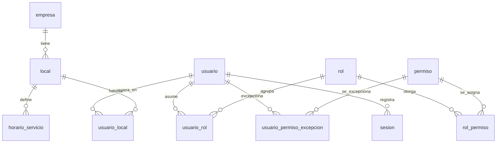

<!-- Extraído de rikos-backend/doc/RIKOS-modelo-de-datos.md (fuente completa, con la numeración de sección original intacta -- ver esa numeración si algún comentario en el código cita p. ej. "13.1"). Partido por bloque el 2026-09-29 per docs/METODO-spec-driven.md §5. -->

# 3. Bloque 1 — Organización, usuarios y permisos

Corresponde a EP-01 (Fundaciones) y a las historias US-001 a US-007. Es el bloque raíz: casi todo el resto del modelo apunta aquí.

## 3.1 `empresa`

La entidad propietaria. Existe una sola fila, pero se modela como tabla porque los datos fiscales cuelgan de ella y porque `06` § Organización declara la relación Empresa 1—N Local.

| Atributo | Tipo | Nulo | Descripción |
|---|---|---|---|
| `id` | identificador | No | PK |
| `ruc` | texto(11) | No | Único. Dato fiscal pendiente, P-04 |
| `razon_social` | texto(200) | No | |
| `nombre_comercial` | texto(120) | Sí | «Riko's» |
| `domicilio_fiscal` | texto(250) | No | P-04 |
| `creado_en` / `actualizado_en` | momento | No | |

## 3.2 `local`

Contenedor de toda la operación. Cada local tiene su propia caja, mesas, inventario, compras, producción, pedidos y delivery; **no** tiene copia del catálogo, recetas, precios, planes ni menú.

| Atributo | Tipo | Nulo | Descripción |
|---|---|---|---|
| `id` | identificador | No | PK |
| `empresa_id` | identificador | No | FK → `empresa` |
| `codigo` | texto(20) | No | Único. Se usa en el subdominio del POS (DT-029) |
| `nombre` | texto(120) | No | «San Isidro» |
| `direccion` | texto(250) | No | |
| `telefono` | texto(20) | Sí | Con prefijo de país |
| `correo` | texto(160) | Sí | Correo operativo del local |
| `latitud` | numeric(10,7) | Sí | Opcional |
| `longitud` | numeric(10,7) | Sí | Opcional |
| `serie_boleta` | texto(4) | Sí | Serie asignada por el proveedor de facturación. Conveniencia, no requisito (H-01) |
| `serie_factura` | texto(4) | Sí | Igual |
| `facebook_url` | texto(250) | Sí | Enlace a la red social del local |
| `instagram_url` | texto(250) | Sí | |
| `tiktok_url` | texto(250) | Sí | |
| `logo_url` | texto(500) | Sí | URL del logo. No hay subida de archivos todavía |
| `delivery_habilitado` | booleano | No | Si el local ofrece delivery |
| `recojo_habilitado` | booleano | No | Si el local ofrece recojo programado |
| `tiempo_min_entrega_min` | entero | Sí | Minutos |
| `tiempo_max_entrega_min` | entero | Sí | Minutos |
| `activo` | booleano | No | Por defecto verdadero |
| `version` | entero | No | Bloqueo optimista |
| `creado_en` / `actualizado_en` / `creado_por` / `actualizado_por` | | | Traza |

**Reglas**

- **RN-001, US-001 CA1.** Crear un local crea implícitamente su inventario general, su caja, sus mesas y su delivery. No se crean copias de los datos centrales.
- **US-001 CA2.** Un local tiene exactamente **un** inventario general. No se modela una tabla `inventario`: la existencia se identifica por la pareja local + producto (ver bloque 9), que es la forma de garantizar la unicidad sin una tabla intermedia que no aporta nada.
- **US-001 CA3.** `activo = falso` impide nuevas operaciones y conserva íntegro el historial.
- **`latitud` y `longitud` son opcionales y hoy no alimentan ningún cálculo.** RN-081 fija que el delivery es gratuito y sin zonas, así que no hay reparto por distancia. Se guardan porque son baratas de capturar y caras de recolectar después, y porque si algún día el propietario decide cobrar envío por zona, el dato ya está.
- **Los ocho campos de redes, logo y canales de venta se agregaron en el sprint 1 ampliado (V12), fuera de la especificación original.** `README` excluye la publicación pública del menú, así que hoy **no existe superficie que consuma los enlaces de redes ni el logo**; y comprometer un tiempo de entrega es una decisión de negocio. Se registran como DT-046 y quedan pendientes de confirmación del propietario (P-20).
- **Borrado físico del local: permitido, por decisión del equipo (DT-043).** Contradice `01` § Reglas de historial, que dice que desactivar no elimina el historial. Queda registrado como decisión consciente y no como omisión. En la práctica **solo podrá borrarse un local sin operaciones**, porque todas las claves foráneas que lo apuntan son `ON DELETE RESTRICT`: la base de datos rechazará el borrado en cuanto exista un pedido, un turno de caja o un movimiento de inventario. Conviene que el mensaje de error lo explique en esos términos, y no como un fallo del sistema.

## 3.3 `horario_servicio`

Define en qué franja horaria rige cada servicio, **por local y por día de la semana**. Es lo que permite al kiosco determinar solo el servicio (US-019 CA2).

| Atributo | Tipo | Nulo | Descripción |
|---|---|---|---|
| `id` | identificador | No | PK |
| `local_id` | identificador | No | FK → `local` |
| `servicio` | enum('desayuno','almuerzo','cena') | No | |
| `dia_semana` | enum('lunes','martes','miercoles','jueves','viernes','sabado','domingo') | No | |
| `hora_inicio` | hora | No | |
| `hora_fin` | hora | No | |
| `activo` | booleano | No | |

**Reglas**

- Único por (`local_id`, `servicio`, `dia_semana`, `hora_inicio`) entre los activos.
- **Un día puede tener varios turnos del mismo servicio**: son varias filas. Es el caso normal de un restaurante que abre de 12:00 a 15:00 y otra vez de 19:00 a 23:30.
- **Si `hora_fin` es menor o igual que `hora_inicio`, la franja termina al día siguiente.** Un turno de 19:00 a 00:30 es un caso real y frecuente; hay que manejarlo explícitamente o la comparación de horas falla justo en ese tramo.
- **Las franjas del mismo servicio y día no se solapan.** Si se solaparan, el kiosco no podría determinar el servicio sin preguntar, y US-019 dice que lo determina automáticamente. Se valida al guardar.
- Los valores exactos están pendientes (`07` § Pendientes funcionales). Se cargan como datos, no se escriben en el código.

**Por qué por día y no un solo rango por servicio.** La versión anterior de este modelo guardaba un rango por servicio y por local, sin distinguir el día. No alcanza: casi ningún restaurante abre igual el domingo que el martes, y de esos horarios depende que el kiosco cargue el consumo al servicio correcto. Corregido tras revisar la pantalla equivalente de un sistema en producción.

## 3.3 bis `dia_especial`

Feriados y días con horario distinto del habitual.

| Atributo | Tipo | Nulo | Descripción |
|---|---|---|---|
| `id` | identificador | No | PK |
| `local_id` | identificador | No | FK → `local` |
| `fecha` | fecha | No | |
| `cerrado` | booleano | No | Verdadero: el local no atiende ese día |
| `descripcion` | texto(120) | Sí | «Fiestas Patrias» |

**Reglas**

- Único por (`local_id`, `fecha`).
- **El día especial manda sobre el horario semanal.** Si existe una fila para esa fecha, se ignora por completo lo que diga `horario_servicio` para ese día de la semana.
- Si `cerrado` es verdadero, no lleva franjas: el local no atiende y el kiosco debe decirlo, no quedarse en blanco.

## 3.3 ter `horario_dia_especial`

Las franjas de un día especial que sí atiende.

| Atributo | Tipo | Nulo | Descripción |
|---|---|---|---|
| `id` | identificador | No | PK |
| `dia_especial_id` | identificador | No | FK → `dia_especial` |
| `servicio` | enum('desayuno','almuerzo','cena') | No | |
| `hora_inicio` | hora | No | |
| `hora_fin` | hora | No | |

**Regla.** Solo existen filas si el día especial **no** está cerrado. Valen las mismas reglas de cruce de medianoche y no solapamiento de 3.3.

## 3.4 `rol`

| Atributo | Tipo | Nulo | Descripción |
|---|---|---|---|
| `id` | identificador | No | PK |
| `nombre` | texto(60) | No | Único |
| `descripcion` | texto(200) | Sí | |
| `color` | texto(7) | Sí | Distintivo visual en hexadecimal |
| `es_sistema` | booleano | No | Los seis roles base no se pueden borrar ni renombrar; sus permisos sí se editan |
| `activo` | booleano | No | |

Roles base, de `01` § Actores: administrador central, administrador de local, cajero, mozo, cocina, motorizado.

## 3.5 `permiso`

| Atributo | Tipo | Nulo | Descripción |
|---|---|---|---|
| `id` | identificador | No | PK |
| `modulo` | texto(40) | No | `catalogo`, `venta`, `caja`, `inventario`, `pensionistas`, … |
| `accion` | enum(...) | No | Ver abajo |
| `codigo` | texto(80) | No | Único. `modulo.accion`, p. ej. `inventario.ajustar` |
| `descripcion` | texto(200) | Sí | |

**Acciones mínimas configurables** (`05` § Usuarios y permisos, RN-013): `ver`, `crear`, `modificar`, `desactivar`, `aprobar`, `anular`, `descontar`, `reabrir`, `ver_costos`, `exportar`, `administrar_permisos`.

**Regla.** El permiso es por módulo **y** acción; no depende del nombre del cargo. Es lo que impide resolver la autorización preguntando «¿es cajero?» en vez de «¿puede anular?».

**El catálogo no es el producto cartesiano de módulos por acciones: es una lista curada.** Sembrado en el sprint 1 ampliado con **49 permisos sobre 12 módulos** (`identidad`, `catalogo`, `recetas`, `menu`, `pensionistas`, `venta`, `caja`, `inventario`, `compras`, `delivery`, `facturacion`, `reportes`). Varias combinaciones no existen porque no tienen sentido: `recetas.ver_costos` sí y `caja.ver_costos` no; `venta.reabrir` sí y `catalogo.reabrir` no; `inventario.crear` no, porque el stock solo cambia por compras, ventas, producción o ajuste; `facturacion.modificar` tampoco, porque un comprobante emitido no se edita, se anula con nota de crédito.

**El sembrado es idempotente**: se vuelve a ejecutar al arrancar y repone lo que falte. Es lo que evita que un permiso borrado a mano deje a un rol sin poder operar sin que nadie entienda por qué.

## 3.6 `rol_permiso`

Relación N—N entre rol y permiso.

| Atributo | Tipo | Nulo |
|---|---|---|
| `rol_id` | identificador | No |
| `permiso_id` | identificador | No |

PK compuesta por las dos columnas.

## 3.7 `usuario`

| Atributo | Tipo | Nulo | Descripción |
|---|---|---|---|
| `id` | identificador | No | PK |
| `nombre_usuario` | texto(60) | No | Único |
| `nombres` | texto(120) | No | |
| `apellidos` | texto(120) | No | |
| `dni` | texto(8) | Sí | |
| `correo` | texto(160) | Sí | |
| `telefono` | texto(20) | Sí | |
| `hash_contrasena` | texto(255) | No | **Nunca en texto legible** (RN-090) |
| `hash_pin` | texto(255) | Sí | Solo mozos. Distinto de la contraseña y del PIN del pensionista |
| `intentos_fallidos` | entero | No | **Solo del ingreso por contraseña.** Por defecto 0 |
| `bloqueado_hasta` | momento | Sí | Solo del ingreso por contraseña. Nulo si no está bloqueado |
| `activo` | booleano | No | |
| `version` | entero | No | |

**Reglas**

- **RN-090, US-002 CA3, US-003 CA2.** Ni la contraseña ni el PIN se guardan ni se muestran en texto legible en ninguna pantalla ni reporte. Se almacenan con una función de derivación de clave con sal, no con un resumen simple.
- **US-002 CA2, US-005 CA2.** `activo = falso` niega el acceso y conserva la atribución de las operaciones pasadas. Un usuario **nunca** se borra: las ventas de hace seis meses tienen que seguir diciendo quién las hizo.
- **RN-091.** `intentos_fallidos` y `bloqueado_hasta` implementan el bloqueo del ingreso **por contraseña**. El umbral y la duración son configuración, no constantes del código, porque están pendientes (RF-006). Valores provisionales adoptados en el sprint 1: 5 intentos, 15 minutos.
- **El bloqueo del PIN no puede vivir aquí, y es una corrección del sprint 1.** El PIN se ingresa a ciegas: cuatro dígitos, sin elegir usuario antes. Un intento fallido no dice qué usuario falló, así que no hay fila de `usuario` que contar. El contador del PIN vive en `bloqueo_pin` (3.7 ter).
- **Un usuario puede tener varios roles.** `06` § Organización dice «Usuario puede recibir roles y excepciones», en plural, así que la relación se modela como N—N en `usuario_rol` y no como columna del usuario. El permiso efectivo es la **unión** de los permisos de todos sus roles, más las excepciones individuales.

## 3.7 ter `bloqueo_pin`

Contador de intentos fallidos del ingreso por PIN. Existe porque el PIN no identifica al usuario hasta que acierta.

| Atributo | Tipo | Nulo | Descripción |
|---|---|---|---|
| `id` | identificador | No | PK |
| `local_id` | identificador | No | FK → `local` |
| `dispositivo` | texto(120) | No | Huella del dispositivo, no el User-Agent completo |
| `intentos_fallidos` | entero | No | |
| `bloqueado_hasta` | momento | Sí | |
| `actualizado_en` | momento | No | |

**Reglas**

- Único por (`local_id`, `dispositivo`).
- **Se bloquea el dispositivo, no el local.** Es la decisión importante: con bloqueo por local, un mozo que olvidó su PIN deja la terminal de al lado inservible durante quince minutos, en plena hora de almuerzo. El ataque que RN-091 previene —probar PIN de cuatro dígitos a mano— no se vuelve viable porque haya tres tablets en el salón.
- **El contador se persiste, no vive en memoria.** Un bloqueo que se borra reiniciando el proceso no es un bloqueo. Y el nodo del local se reinicia solo cada vez que vuelve la luz después de un corte, que no es un caso raro en este negocio.
- Se limpia al acertar el PIN y por un proceso programado que borra las filas vencidas.

## 3.7 bis `usuario_rol`

Relación N—N entre usuario y rol.

| Atributo | Tipo | Nulo | Descripción |
|---|---|---|---|
| `usuario_id` | identificador | No | PK compuesta. FK → `usuario` |
| `rol_id` | identificador | No | PK compuesta. FK → `rol` |
| `asignado_en` | momento | No | |
| `asignado_por` | identificador | No | FK → `usuario` |

**Regla.** Un usuario sin ningún rol no puede operar. La comprobación es de aplicación, no de base de datos: una restricción que exigiera al menos una fila haría imposible crear el usuario antes de asignarle el rol.

## 3.8 `usuario_local`

Relación N—N. Es la que hace real el multilocal.

| Atributo | Tipo | Nulo | Descripción |
|---|---|---|---|
| `usuario_id` | identificador | No | PK compuesta |
| `local_id` | identificador | No | PK compuesta |
| `es_principal` | booleano | No | El local que se abre por defecto al iniciar sesión |

**Regla, US-005 CA1.** El usuario opera en todos los locales asignados **y en ninguno más**. Esta tabla es la que responde esa pregunta, y toda consulta de operación debe filtrarse por ella.

## 3.9 `usuario_permiso_excepcion`

Permisos otorgados o retirados a un usuario concreto, por encima de su rol.

| Atributo | Tipo | Nulo | Descripción |
|---|---|---|---|
| `usuario_id` | identificador | No | PK compuesta |
| `permiso_id` | identificador | No | PK compuesta |
| `otorgado` | booleano | No | Verdadero concede, falso retira |
| `motivo` | texto(200) | Sí | |
| `creado_en` / `creado_por` | | | Traza |

**Regla, US-005 CA3, RN-013.** El permiso efectivo es la unión de los permisos de **todos** los roles del usuario, **más** la excepción, y la excepción gana sobre el rol.

**Se resuelve una vez, al iniciar sesión, y viaja dentro del token** como lista de códigos (DT-038). No se recalcula en cada petición: sería repetir la misma consulta miles de veces al día. La consecuencia a tener presente es que **un cambio de permisos no afecta a una sesión ya abierta** hasta que el usuario vuelva a entrar; con 49 permisos el token sigue siendo pequeño, pero si el catálogo creciera mucho habría que pasar a una representación compacta. Esta resolución se calcula una vez al iniciar sesión y se guarda en la sesión, no se recalcula en cada petición.

## 3.10 `sesion`

| Atributo | Tipo | Nulo | Descripción |
|---|---|---|---|
| `id` | identificador | No | PK |
| `usuario_id` | identificador | Sí | Nulo en un intento fallido con usuario inexistente |
| `local_id` | identificador | Sí | Local activo de la sesión |
| `tipo` | enum('contrasena','pin') | No | Ingreso general o cambio rápido de mozo |
| `resultado` | enum('exitoso','fallido','bloqueado') | No | |
| `dispositivo` | texto(255) | Sí | User-Agent del navegador, **truncado** al guardar |
| `direccion_ip` | texto(45) | Sí | |
| `iniciada_en` | momento | No | |
| `finalizada_en` | momento | Sí | |

**Regla, US-002 CA5, RN-092.** Se registran los inicios de sesión **exitosos y fallidos** como acción sensible auditable. Registrar solo los exitosos deja ciego justo el caso que interesa vigilar.

**`dispositivo` se trunca al guardar, y la columna no basta por sí sola.** El valor real es el User-Agent del navegador, que en Chrome y Edge actuales pasa de 120 caracteres — el `INSERT` falla apenas se prueba desde un navegador de verdad, y no se nota con `curl`, que manda una cadena corta. Se amplió a 255 en el sprint 1, pero un User-Agent puede superar también ese límite: la aplicación **debe truncar**, no confiar en que quepa.

## 3.11 `motivo`

Lista configurable compartida por todo el sistema (US-012).

| Atributo | Tipo | Nulo | Descripción |
|---|---|---|---|
| `id` | identificador | No | PK |
| `tipo` | enum('ajuste_inventario','anulacion','descuento','rechazo_abono','sobrante_produccion','reapertura') | No | |
| `descripcion` | texto(120) | No | |
| `requiere_observacion` | booleano | No | |
| `activo` | booleano | No | |

**Reglas**

- Único por (`tipo`, `descripcion`) entre los activos.
- Los valores iniciales están pendientes (`07`). La tabla existe desde el sprint 3; los datos los carga el propietario.
- **Por qué una sola tabla y no seis:** las seis listas tienen exactamente la misma forma y el mismo mantenimiento. Una tabla con discriminador evita seis pantallas de administración idénticas.

## 3.12 Diagrama del bloque 1

---

