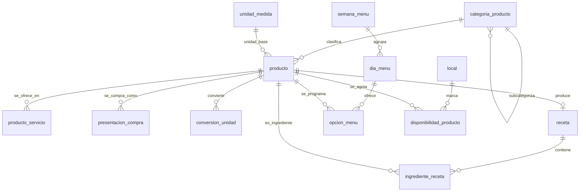

<!-- Extraído de rikos-backend/doc/RIKOS-modelo-de-datos.md (fuente completa, con la numeración de sección original intacta -- ver esa numeración si algún comentario en el código cita p. ej. "13.1"). Partido por bloque el 2026-09-29 per docs/METODO-spec-driven.md §5. -->

# 6. Bloque 4 — Menú y programación semanal

Corresponde a EP-03 y a las historias US-013, US-014, US-015.

## 6.1 `semana_menu`

| Atributo | Tipo | Nulo | Descripción |
|---|---|---|---|
| `id` | identificador | No | PK |
| `fecha_inicio` | fecha | No | Lunes de la semana (CHECK en la base). Único. `fecha_fin` es siempre `fecha_inicio + 6` |
| `fecha_fin` | fecha | No | |
| `estado` | enum('borrador','confirmado') | No | "En servicio" y "pasada" no se guardan: se calculan por fecha sobre una semana confirmada. Decidido en el sprint 4, ver `plan/sprint-04-costos-y-menu.md` |
| `confirmada_en` | momento | Sí | |
| `confirmada_por` | identificador | Sí | FK → `usuario` |

## 6.2 `dia_menu`

| Atributo | Tipo | Nulo | Descripción |
|---|---|---|---|
| `id` | identificador | No | PK |
| `semana_menu_id` | identificador | No | FK → `semana_menu` |
| `fecha` | fecha | No | Único **en toda la tabla** (una fecha pertenece a una sola semana). El día se crea al programarle la primera opción: un día sin opciones es un día sin almuerzo |
| `observacion` | texto(250) | Sí | |

## 6.3 `opcion_menu`

Cada opción disponible de un componente del almuerzo de un día.

| Atributo | Tipo | Nulo | Descripción |
|---|---|---|---|
| `id` | identificador | No | PK |
| `dia_menu_id` | identificador | No | FK → `dia_menu` |
| `producto_id` | identificador | No | FK → `producto` |
| `componente` | enum('entrada','segundo','guarnicion','refresco','postre') | No | **Derivado** de la categoría del producto y guardado |
| `tipo_menu` | enum('normal','extra') | No | El extra tiene precio propio. **Solo en segundos** (CHECK): el extra cambia el segundo, lo demás es del día. Único por (`dia_menu_id`, `producto_id`) |
| `porciones_estimadas` | entero | Sí | Planificación |
| `activo` | booleano | No | |

**Reglas**

- **RN-037.** El menú normal tiene **precio único** y no depende de las opciones elegidas. El precio no vive aquí: vive en `producto.precio_venta` del menú normal, y en el plan tarifario para el pensionista.
- **RN-023.** El menú extra se cobra al precio completo del extra, **sin tarifa reducida de pensionista**.
- **RN-038.** Si hay varias opciones de un componente, el mozo registra la elegida. Si hay una sola, se asigna directamente sin preguntar.
- **Días cerrados (sprint 4):** ningún día anterior a hoy se edita, en ningún estado de la semana. "Hoy" es la fecha en zona `America/Lima`.
- **RN-041.** Al confirmar la semana, el sistema advierte si un segundo aparece en los tres días anteriores, pero **permite confirmar igual**. Es una advertencia, no un bloqueo, y conviene que el modelo no la convierta en restricción.
- Desayuno y cena **no** se programan: usan productos fijos elegidos individualmente (`04` § Programación semanal). Por eso `componente` no tiene valores de desayuno ni cena, y lo que se ofrece en esos servicios sale de `producto_servicio` (4.1 bis), no de aquí.
- **`componente` se deriva de la categoría del producto y se guarda igual.** Al programar el menú, el sistema lo deduce de `categoria_producto.componente_menu` y lo copia aquí; el usuario no lo elige y no puede contradecirlo. Se guarda en lugar de consultarse porque la programación de una semana pasada es un registro histórico: si mañana alguien reclasifica un plato de «segundo» a «entrada», la semana de marzo debe seguir diciendo lo que dijo.

## 6.4 `disponibilidad_producto`

Qué productos están agotados **en un local concreto**. Es la única parte del menú que no es central.

| Atributo | Tipo | Nulo | Descripción |
|---|---|---|---|
| `id` | identificador | No | PK |
| `local_id` | identificador | No | FK → `local` |
| `producto_id` | identificador | No | FK → `producto` |
| `agotado` | booleano | No | |
| `motivo_id` | identificador | Sí | FK → `motivo`. Solo en la reactivación (tipo `disponibilidad`); marcar agotado no pide motivo. CHECK: si no está agotado, tiene motivo |
| `observacion` | texto(250) | Sí | Agregado en el sprint 4: si el motivo pide observación, va aquí |
| `marcado_por` | identificador | No | FK → `usuario` |
| `marcado_en` | momento | No | |

**Reglas**

- Único por (`local_id`, `producto_id`): la fila guarda el último cambio; la historia completa (quién marcó, quién reactivó, por qué) está en `auditoria` (`marcado_agotado`, `reactivacion`).
- El local es siempre el activo de la sesión: nunca viaja como dato de la petición.
- **RN-066, caso crítico 8.** Marcar agotado oculta el producto en los pedidos **nuevos** y **no altera las comandas ya emitidas**. Esto es una regla de consulta, no de datos: el pedido en curso conserva lo que ya tiene.
- La reactivación registra usuario, hora y motivo; de ahí las tres últimas columnas y la entrada correspondiente en `auditoria`.

## 6.5 Diagrama de los bloques 2, 3 y 4

---

