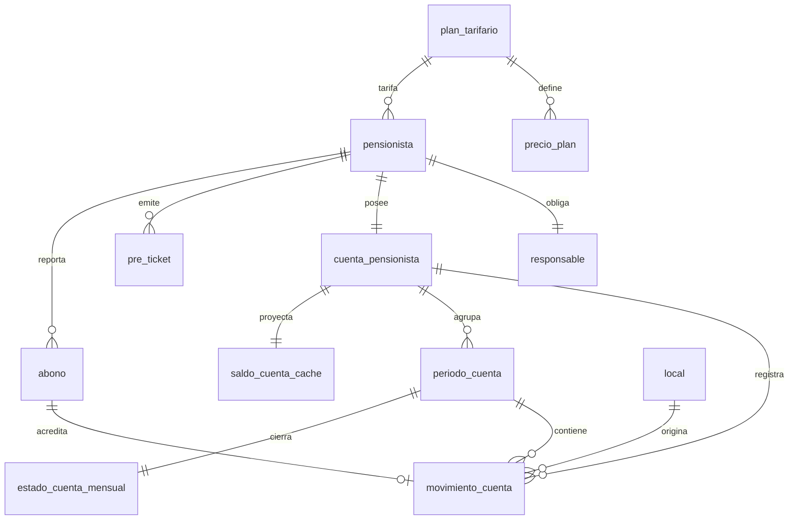

<!-- Extraído de rikos-backend/doc/RIKOS-modelo-de-datos.md (fuente completa, con la numeración de sección original intacta -- ver esa numeración si algún comentario en el código cita p. ej. "13.1"). Partido por bloque el 2026-09-29 per docs/METODO-spec-driven.md §5. -->

# 7. Bloque 5 — Pensionistas, planes y cuenta corriente

Corresponde a EP-04 y a las historias US-016 a US-026. Es el bloque que distingue a RIKO'S de cualquier POS comprado, y el que concentra las decisiones de modelado más delicadas.

> **Numeración de reglas corregida el 2026-09-29** (sprint 5) contra `flujos/90-reglas-de-negocio-consolidadas.md`. El bloque citaba números del backlog v1.0, corridos. Detalle en `plan/sprint-05-cuenta-del-pensionista.md` §4.1.
>
> **Cambios decididos en el sprint 5** (ver ese documento, §3 y §4.2): el plan tiene tres precios por comida en vez de `precio_plan` por producto; `pensionista.limite_credito` nulo significa "calculado"; `pensionista.comidas_habituales`; `hash_contrasena_portal` nulo por ahora; `movimiento_cuenta.tipo` gana `saldo_inicial`; tabla nueva `parametro_global`.

## 7.1 y 7.2 — Implementado en el sprint 5 (V26), distinto de lo de abajo

Lo que sigue describe el diseño original. **Lo construido**: `plan_tarifario` (`id`, `nombre` único, `descripcion`, `activo`) es solo la identidad del plan, y sus precios viven en `plan_tarifario_version` (`plan_id`, `precio_desayuno`, `precio_almuerzo`, `precio_cena` en céntimos, nulos = sin precio, `vigente_desde`, `vigente_hasta`). Una sola versión abierta por plan (índice único parcial). **`precio_plan` por producto no existe**: el precio es por comida. `pensionista.plan_tarifario_id` apunta al plan, no a una versión. Además, `parametro_global` (`clave`, `valor`) guarda el precio del táper y la regla del segundo consumo. Razones en `plan/sprint-05-cuenta-del-pensionista.md` §3.4 y §3.6, y en `rikos-backend/doc/historias/US-017-planes-tarifarios-y-parametros-de-cobro.md`.

## 7.3 a 7.5 — Implementado en el sprint 5 (V27)

`pensionista` lleva tres banderas de **comidas habituales** (`come_desayuno`, `come_almuerzo`, `come_cena`, al menos una; con ellas se calcula el tope, no limitan el consumo), `limite_credito` **nulo = calculado**, `hash_contrasena_portal` **nulo por ahora**, y **no** lleva local habitual. `responsable` y `cuenta_pensionista` como en el diseño (1-1). El DNI es único en la base. Detalle en `rikos-backend/doc/historias/US-016-ficha-del-pensionista.md`.

## 7.1 `plan_tarifario` (diseño original)

| Atributo | Tipo | Nulo | Descripción |
|---|---|---|---|
| `id` | identificador | No | PK |
| `nombre` | texto(100) | No | |
| `descripcion` | texto(250) | Sí | |
| `precio_almuerzo_normal` | dinero | No | |
| `vigencia_desde` | fecha | No | |
| `vigencia_hasta` | fecha | Sí | Nulo mientras siga vigente |
| `estado` | enum('activo','inactivo') | No | |
| `version` | entero | No | |

## 7.2 `precio_plan`

Precios especiales por producto fijo de desayuno y cena dentro de un plan.

| Atributo | Tipo | Nulo | Descripción |
|---|---|---|---|
| `id` | identificador | No | PK |
| `plan_tarifario_id` | identificador | No | FK → `plan_tarifario` |
| `producto_id` | identificador | No | FK → `producto` |
| `servicio` | enum('desayuno','almuerzo','cena') | No | |
| `precio` | dinero | No | |

**Reglas del plan**

- Único por (`plan_tarifario_id`, `producto_id`, `servicio`).
- **RN-021.** Los planes tienen vigencia, estado e **historial de modificaciones**. Ese historial no se modela con columnas: modificar un plan vigente crea una **fila nueva** con nueva vigencia y cierra la anterior con `vigencia_hasta`. Editar la fila existente destruiría la trazabilidad que la regla exige.
- **RN-022, caso implícito en US-017.** Los consumos anteriores conservan la tarifa aplicada, y eso lo garantiza el snapshot de `detalle_pedido` (2.4), no una consulta al plan.
- **RN-023.** El menú extra se cobra completo: `precio_plan` nunca se aplica a un extra.

## 7.3 `pensionista`

| Atributo | Tipo | Nulo | Descripción |
|---|---|---|---|
| `id` | identificador | No | PK |
| `dni` | texto(8) | No | **Único en toda la empresa** |
| `nombres` | texto(120) | No | |
| `apellidos` | texto(120) | No | |
| `telefono` | texto(20) | Sí | |
| `correo` | texto(160) | Sí | |
| `institucion` | texto(150) | Sí | Universidad o instituto |
| `codigo_estudiante` | texto(30) | Sí | |
| `carrera` | texto(120) | Sí | |
| `ciclo` | texto(20) | Sí | Opcional por especificación |
| `plan_tarifario_id` | identificador | No | FK → `plan_tarifario` |
| `limite_credito` | dinero | No | Preventivo, no bloqueante |
| `frecuencia_abono` | enum('semanal','quincenal','mensual') | Sí | Frecuencia habitual declarada |
| `hash_pin` | texto(255) | No | PIN presencial del kiosco |
| `hash_contrasena_portal` | texto(255) | No | **Credencial distinta del PIN** |
| `estado` | enum('activo','inactivo') | No | |
| `version` | entero | No | |

**Reglas**

- **US-016 CA3, `06` § Reglas de integridad.** `dni` único en la empresa. Es la restricción más importante del bloque: un pensionista duplicado significa dos cuentas corrientes para la misma persona.
- **RN-090, US-016 CA4.** Ni el PIN ni la contraseña del portal se muestran legibles, y son **dos credenciales distintas entre sí** (`05` § Respaldo y seguridad). Guardarlas en la misma columna sería el error que la regla previene.
- **US-016 CA5.** Confirmar el alta crea su `cuenta_pensionista`.
- **US-026, RN-034.** `estado = inactivo` bloquea nuevos pre-tickets y consumos, **conserva** la cuenta, el historial y el acceso al portal de consulta, y **permite abonos posteriores**. Reactivar reutiliza la misma cuenta: por eso la cuenta no se cierra ni se recrea.
- **Nota de protección de datos.** Una parte de los pensionistas puede ser menor de edad. Los datos de esta tabla caen bajo la Ley 29733; el tratamiento de datos de menores exige consentimiento del responsable, que aquí ya es obligatorio. Conviene dejarlo registrado en el charter.

## 7.4 `responsable`

| Atributo | Tipo | Nulo | Descripción |
|---|---|---|---|
| `id` | identificador | No | PK |
| `pensionista_id` | identificador | No | FK → `pensionista`. Único: relación 1—1 |
| `nombre_completo` | texto(200) | No | |
| `dni` | texto(8) | No | |
| `telefono` | texto(20) | No | |
| `correo` | texto(160) | No | |
| `parentesco` | texto(60) | No | |
| `direccion` | texto(250) | No | |

**Regla, US-016 CA2.** El responsable es **obligatorio**: no se puede guardar un pensionista sin él, y los seis campos son obligatorios. La relación es 1—1 y se modela como tabla aparte —no como columnas del pensionista— porque son seis campos con identidad propia y porque el acceso al portal es compartido entre ambos.

## 7.5 `cuenta_pensionista`

| Atributo | Tipo | Nulo | Descripción |
|---|---|---|---|
| `id` | identificador | No | PK |
| `pensionista_id` | identificador | No | FK → `pensionista`. Único: relación 1—1 |
| `abierta_en` | momento | No | |
| `estado` | enum('abierta','suspendida') | No | |

**Regla, RN-002, caso crítico 20.** La cuenta es **única y utilizable en cualquier local**. No hay una cuenta por local. El local de cada movimiento se guarda en el movimiento, no en la cuenta.

## 7.6 `movimiento_cuenta` — el libro

La tabla más importante del sistema. **Solo se agregan filas. Nunca se modifican ni se borran.**

| Atributo | Tipo | Nulo | Descripción |
|---|---|---|---|
| `id` | identificador | No | PK |
| `cuenta_id` | identificador | No | FK → `cuenta_pensionista` |
| `local_id` | identificador | No | FK → `local`. **Obligatorio**: el caso crítico 20 exige mostrarlo |
| `periodo_id` | identificador | No | FK → `periodo_cuenta` |
| `tipo` | enum('consumo','abono','ajuste','arrastre') | No | |
| `signo` | enum('cargo','credito') | No | Explícito, para no depender del signo del importe |
| `importe` | dinero | No | Siempre positivo; el sentido lo da `signo` |
| `pedido_id` | identificador | Sí | FK → `pedido`. Presente si `tipo = consumo` |
| `abono_id` | identificador | Sí | FK → `abono`. Presente si `tipo = abono` |
| `motivo_id` | identificador | Sí | FK → `motivo`. Obligatorio si `tipo = ajuste` |
| `descripcion` | texto(250) | Sí | |
| `ocurrido_en` | momento | No | Momento del hecho económico |
| `registrado_en` | momento | No | Momento en que llegó a la base. Difieren cuando hubo corte |
| `registrado_por` | identificador | No | FK → `usuario` |

**Reglas**

- **RN-015, caso crítico 1.** El consumo se registra **únicamente al cerrar en caja**. Ni al emitir el pre-ticket, ni al tomar el pedido, ni al comandar. Antes del cierre no existe movimiento.
- **RN-019, caso crítico 3.** Se permiten **múltiples consumos del mismo servicio el mismo día**, y cada uno genera su propio movimiento. No hay restricción de unicidad por día y servicio: ponerla rompería el requisito.
- **El saldo no es una columna.** Es `Σ créditos − Σ cargos`. Un campo `saldo` mutable haría imposible el estado de cuenta mensual y convertiría cada sincronización en un conflicto de escritura.
- **Dos marcas de tiempo, y no es redundancia.** `ocurrido_en` es cuándo consumió el pensionista; `registrado_en` es cuándo la fila llegó a la base. Durante un corte de Internet pueden diferir en horas, y el estado de cuenta se arma por `ocurrido_en`, mientras que la sincronización razona con `registrado_en`.

## 7.7 `saldo_cuenta_cache`

Valor derivado, recalculado. **No es fuente de verdad.**

| Atributo | Tipo | Nulo | Descripción |
|---|---|---|---|
| `cuenta_id` | identificador | No | PK. FK → `cuenta_pensionista` |
| `deuda` | dinero | No | Suma de cargos no cubiertos |
| `saldo_a_favor` | dinero | No | Créditos por encima de la deuda |
| `credito_disponible` | dinero | No | `limite_credito − deuda` (RN-017) |
| `ultimo_movimiento_id` | identificador | Sí | Hasta dónde está calculado |
| `recalculado_en` | momento | No | |

**Reglas**

- **RN-016.** `credito_disponible = limite_credito − deuda`.
- **RN-017, caso crítico 4.** El límite es **preventivo**: superarlo genera alerta y **permite el consumo igual**. El modelo no debe tener ninguna restricción que lo impida.
- **RN-018.** Se aplica primero el saldo a favor; el remanente aumenta la deuda. Esta regla se ejecuta al calcular, no al guardar: el movimiento se escribe íntegro y la imputación es una operación de lectura.
- **Regla de oro de esta tabla:** si se pierde, se reconstruye sumando el libro. Si alguna vez discrepa del libro, **manda el libro**. Conviene una comprobación programada que recalcule y avise ante cualquier diferencia.
- **`05` § Offline-first** pide conservar una copia local del saldo necesario para operar pensionistas: esta tabla es esa copia en el nodo del local.

## 7.7 bis — Por qué no hay una columna `saldo`

Merece decirse explícitamente porque es la pregunta que va a aparecer en la revisión.

Un campo `saldo` que se suma y se resta en cada operación es más simple de programar y es lo que hace la mayoría de los sistemas pequeños. Aquí no sirve por tres motivos concretos:

1. **El estado de cuenta mensual (US-025)** debe mostrar saldo inicial, consumos, abonos, ajustes y saldo final del mes. Con un campo mutable, esos números solo se pueden reconstruir si además se guarda el libro — con lo cual el campo sobra.
2. **La operación sin conexión.** Dos locales que atienden al mismo pensionista a la vez, ambos sin Internet, escribirían cada uno su propio `saldo`. Al sincronizar hay que decidir cuál gana, y cualquiera que gane pierde una transacción real. Con el libro, los dos movimientos se ordenan y ninguno se pierde.
3. **La auditoría.** Un saldo que cambió sin explicación es imposible de investigar. Un libro dice quién, cuándo, desde qué local y por qué motivo.

## 7.8 `periodo_cuenta`

| Atributo | Tipo | Nulo | Descripción |
|---|---|---|---|
| `id` | identificador | No | PK |
| `cuenta_id` | identificador | No | FK → `cuenta_pensionista` |
| `anio` | entero | No | |
| `mes` | entero | No | |
| `estado` | enum('abierto','cerrado') | No | |
| `cerrado_en` | momento | Sí | |
| `cerrado_por` | identificador | Sí | FK → `usuario` |

**Reglas**

- Único por (`cuenta_id`, `anio`, `mes`).
- **`01` § Reglas de historial** (sin número propio en la lista consolidada v2.0). Un periodo cerrado es **inalterable**. Ningún movimiento nuevo puede apuntar a un periodo cerrado; una corrección posterior se registra como ajuste en el periodo abierto.

## 7.9 `estado_cuenta_mensual`

| Atributo | Tipo | Nulo | Descripción |
|---|---|---|---|
| `id` | identificador | No | PK |
| `periodo_id` | identificador | No | FK → `periodo_cuenta`. Único |
| `saldo_inicial` | dinero | No | |
| `total_consumos` | dinero | No | |
| `total_abonos` | dinero | No | |
| `total_ajustes` | dinero | No | |
| `saldo_final` | dinero | No | |
| `ruta_pdf` | texto(500) | No | PDF fijo conservado |
| `generado_en` | momento | No | |

**Reglas**

- **RN-020, caso crítico 6.** El cierre arrastra deuda o saldo a favor al mes siguiente mediante un movimiento de `tipo = arrastre`, **sin marcar atraso automáticamente**.
- **`05` § Reportes.** Se conserva un **PDF fijo** de cada estado mensual cerrado. Los importes de esta tabla son el snapshot: aunque el libro se recalcule, el estado emitido no cambia.

## 7.10 `pre_ticket`

| Atributo | Tipo | Nulo | Descripción |
|---|---|---|---|
| `id` | identificador | No | PK |
| `codigo` | texto(12) | No | **Único y de un solo uso** |
| `pensionista_id` | identificador | No | FK → `pensionista` |
| `local_id` | identificador | No | FK → `local` |
| `servicio` | enum('desayuno','almuerzo','cena') | No | Determinado por horario |
| `estado` | enum('pendiente','vinculado','cerrado','vencido','anulado') | No | |
| `emitido_en` | momento | No | |
| `vence_en` | momento | No | Fin del horario del servicio |
| `vinculado_en` | momento | Sí | |
| `vinculado_por` | identificador | Sí | FK → `usuario`, el mozo |

**Reglas**

- **`06` § Reglas de integridad.** Código único y de un solo uso. La restricción de unicidad debe existir en la base, no solo en la aplicación: es lo que impide la doble vinculación bajo concurrencia.
- **RN-026 y RN-027, caso crítico 2.** Un pre-ticket pendiente **vence** al terminar el horario del servicio y **no genera cargo**. Igual el anulado.
- **La vinculación se guarda en un solo lado.** `cuenta_persona.pre_ticket_id` es la única relación entre pre-ticket y pedido, y lleva la restricción de unicidad. Guardar además `pre_ticket.pedido_id` crearía una referencia circular que podría quedar desalineada, con dos verdades sobre el mismo hecho.
- **El pre-ticket no selecciona platos.** Se imprime antes de que el pensionista elija; el mozo toma el pedido después. Por eso no tiene detalle.
- **Debe imprimir la leyenda** de que no es un consumo cargado. Es requisito funcional, no decorativo: evita que el pensionista crea que ya le cobraron.

## 7.11 `abono`

| Atributo | Tipo | Nulo | Descripción |
|---|---|---|---|
| `id` | identificador | No | PK |
| `pensionista_id` | identificador | No | FK → `pensionista` |
| `local_id` | identificador | Sí | FK → `local`. Nulo si se reportó desde el portal |
| `medio` | enum('efectivo','yape','plin','transferencia') | No | |
| `monto` | dinero | No | |
| `fecha_operacion` | fecha | No | |
| `numero_operacion` | texto(50) | Sí | Obligatorio si el medio es digital |
| `cuenta_destino` | texto(80) | Sí | Obligatorio si el medio es digital |
| `ruta_adjunto` | texto(500) | Sí | Imagen del comprobante. Obligatoria desde el portal |
| `origen` | enum('caja','portal') | No | |
| `estado` | enum('pendiente','aprobado','rechazado') | No | |
| `registrado_por` | identificador | Sí | FK → `usuario`. Nulo si lo reportó el pensionista |
| `aprobado_por` | identificador | Sí | FK → `usuario` |
| `aprobado_en` | momento | Sí | |
| `motivo_rechazo_id` | identificador | Sí | FK → `motivo` |
| `turno_caja_id` | identificador | Sí | FK → `turno_caja`. Solo si el medio es efectivo |

**Reglas**

- **RN-030.** El efectivo lo registra caja, queda **confirmado de inmediato** (`estado = aprobado`) y entra en la conciliación del turno. De ahí `turno_caja_id`.
- **RN-031, caso crítico 5.** El digital queda **pendiente** y **no modifica el saldo** hasta que un administrador lo aprueba. Por eso el movimiento de cuenta se crea en la aprobación, no en el registro.
- **RN-032.** Validar posible duplicidad de `numero_operacion`. **No es una restricción de unicidad**, es una **alerta**: dos abonos legítimos pueden coincidir en número entre bancos distintos. Una restricción rechazaría un abono real.
- **Solo el administrador aprueba o rechaza** (`02` § Abonos). El portal registra, nunca aprueba.
- Se permiten abonos parciales: no hay validación contra la deuda.
- **RN-029.** Hay notificación interna por abono aprobado o rechazado y por estado mensual generado. **No** por cada consumo ni por superar el límite.
- **Los adjuntos se protegen según permisos** (`05` § Respaldo y seguridad). `ruta_adjunto` apunta a almacenamiento privado, nunca a una URL pública.

## 7.12 Diagrama del bloque 5

---

