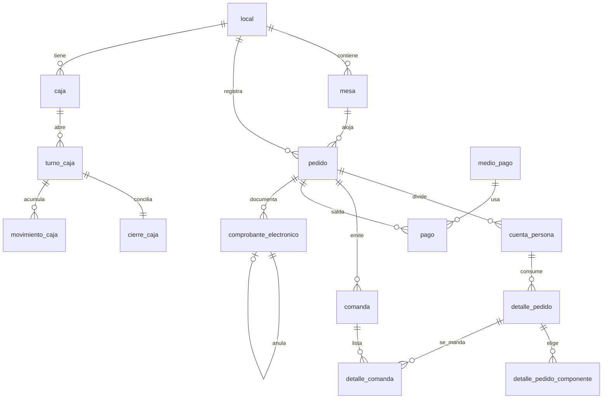

<!-- Extraído de rikos-backend/doc/RIKOS-modelo-de-datos.md (fuente completa, con la numeración de sección original intacta -- ver esa numeración si algún comentario en el código cita p. ej. "13.1"). Partido por bloque el 2026-09-29 per docs/METODO-spec-driven.md §5. -->

# 10. Bloque 8 — Facturación electrónica

Corresponde a EP-06, historia US-037, y recoge las decisiones DT-003 a DT-010 y los hallazgos H-01 a H-10.

## 10.1 `comprobante_electronico`

| Atributo | Tipo | Nulo | Descripción |
|---|---|---|---|
| `id` | identificador | No | PK. Generado por nosotros antes de enviar |
| `pedido_id` | identificador | Sí | **Referencia lógica** a `pedido`, sin FK: otra base de datos |
| `cuenta_persona_id` | identificador | Sí | **Referencia lógica**, sin FK |
| `local_id` | identificador | No | **Referencia lógica**, sin FK |
| `local_codigo` | texto(20) | No | Copia denormalizada, para no consultar al otro servicio |
| `tipo` | enum('01','03','07','nota_venta','ticket') | No | Códigos de SUNAT; los dos últimos son internos |
| `serie` | texto(4) | Sí | |
| `numero` | entero | Sí | **Lo asigna el proveedor** (H-01). Nulo hasta que responde |
| `estado_fiscal` | enum('pendiente','en_vuelo','enviado','registrado','aceptado','rechazado') | No | |
| `estado_entrega` | enum('no_aplica','pendiente','enviado','rebotado') | No | |
| `receptor_tipo_doc` | enum('dni','ruc','sin_documento') | No | |
| `receptor_numero_doc` | texto(11) | Sí | |
| `receptor_nombre` | texto(200) | Sí | |
| `receptor_direccion` | texto(250) | Sí | Obligatoria en factura |
| `receptor_correo` | texto(160) | Sí | |
| `total` | dinero | No | |
| `huella` | texto(64) | No | Resumen de fecha, cliente, total e items, para la reconciliación de DT-009 |
| `id_proveedor` | texto(60) | Sí | Identificador que devuelve Factivo |
| `codigo_respuesta` | texto(10) | Sí | |
| `mensaje_respuesta` | texto(500) | Sí | |
| `documento_afectado_id` | identificador | Sí | FK → `comprobante_electronico`. Solo en nota de crédito |
| `codigo_tipo_nota` | texto(2) | Sí | Catálogo 09 de SUNAT |
| `ruta_xml` / `ruta_pdf` / `ruta_cdr` | texto(500) | Sí | Copia propia (DT-010) |
| `correo_enviado_en` | momento | Sí | **Garantiza el envío único** (DT-006) |
| `emitido_en` | momento | No | |
| `aceptado_en` | momento | Sí | |

**Reglas**

- **H-01.** `numero` lo asigna el proveedor. Durante un corte de Internet **no existe** número: la columna admite nulo por diseño, y esa es la razón por la que no se puede imprimir una boleta numerada sin conexión.
- **DT-004.** La emisión es **siempre** asíncrona. El comprobante nace en `pendiente` y una cola lo procesa. No hay camino alternativo «si hay Internet, emito directo».
- **DT-009.** `huella` y el estado `en_vuelo` son el mecanismo que sustituye a la clave de idempotencia que Factivo no ofrece. Un solo comprobante en vuelo por serie a la vez.
- **DT-006.** `correo_enviado_en` con restricción de unicidad lógica: se verifica en la misma transacción que dispara el envío, para que la reconsulta periódica no mande el correo dos veces.
- **DT-008, H-08.** La anulación es una **nota de crédito** que apunta al original con `documento_afectado_id`. No hay comunicación de baja.
- **Dos ciclos de vida separados** (`estado_fiscal` y `estado_entrega`), según la sección 3.1 del documento de decisiones: un comprobante rechazado no entra al circuito de correo, y un reenvío no altera el estado fiscal.
- **RN-029, DT-007.** Al pensionista **no** se le envía correo por consumo: su `estado_entrega` es `no_aplica` y sus comprobantes viven en el portal.

## 10.2 Diagrama de los bloques 6, 7 y 8

---

