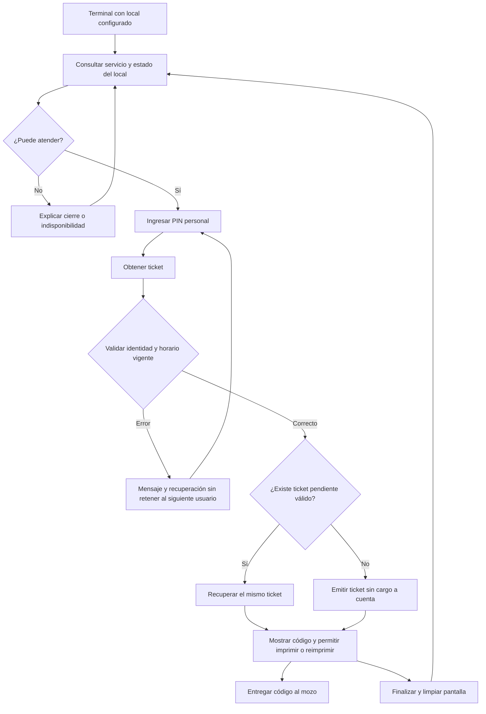

# Kiosco del pensionista: revisión de la propuesta visual

## Implementación autorizada — 12/10/2026

El usuario pidió implementar la vista y corregir el circuito, tomando su nueva imagen como referencia. Esa referencia prevalece sobre la simplificación visual propuesta abajo: se conservan panel de servicio, dos pasos, formas verdes, fotografía decorativa y teclado grande. Los controles son HTML funcional y la fotografía es un recurso independiente generado con ImageGen.

Se implementará PIN único con índice HMAC y verificación bcrypt, sin intentar recuperar los PIN antiguos desde sus hashes. Las altas y regeneraciones emitirán el nuevo formato; las cuentas anteriores conservan la recuperación asistida desde administración. La longitud se devuelve desde el servidor. El servicio y el vencimiento procederán de la franja efectiva; no habrá sustitución manual en la API pública. Los locales se elegirán de un catálogo de locales activos, se recordará la elección y se limpiará cualquier sesión al cambiarla. Se mantiene el selector visible solicitado en la referencia; una restricción adicional a personal queda como opción de despliegue, no se simula con un candado visual.

La imagen no acredita impresión física: la aplicación ofrecerá imprimir/reimprimir el mismo ticket y reiniciar sin afirmar que el papel salió. Se validarán código, pruebas del circuito y vista adaptable antes de cerrar la entrega.

**Fecha:** 12/10/2026. **Código revisado:** `5b06fa3`. **Estado:** propuesta de producto, sin implementación.

Revisión solicitada después de las imágenes del kiosco. Se contrastaron pantalla, estilos, cliente HTTP, PIN del pensionista, locales, horarios, emisión y reutilización de pre-ticket, vinculación al pedido, seguridad y pruebas existentes. Es una revisión focalizada de este circuito; no es una nueva auditoría de todas las líneas de RIKOS. No se ejecutaron navegador, impresora ni suite de aplicación en esta revisión.

Las soluciones y criterios de aceptación están en [pendientes del kiosco](../../pendientes/04-kiosco-pensionista-2026-10-12.md). La auditoría anterior de sprints 0–7 conserva su corte histórico.

## 1. Qué conservar y qué ajustar

La imagen con PIN mejora la legibilidad y el uso del espacio. Mantener fondo claro, verde de marca, teclado numérico amplio, PIN oculto y servicio determinado por horario. El objetivo es obtener un ticket para que el mozo identifique al pensionista; el kiosco no elige platos ni cobra.

| Elemento | Propuesta | Razón y relación con el sistema |
|---|---|---|
| Local | Se elige de una lista al preparar el terminal. En uso público, mostrar su nombre de forma destacada. Cambio reservado al personal. | El ticket queda asociado a un local y el POS rechaza tickets de otro. Es una recomendación nueva: la imagen anterior mostraba un selector público; el usuario pidió que el local sea seleccionable, no un texto libre. |
| Servicio | Mostrar «Almuerzo · 12:00–15:00» en un bloque compacto de contexto, debajo del local o junto al formulario. | La palabra «Almuerzo» ocupa demasiado espacio en la imagen y compite con la acción principal. El horario dibujado es ilustrativo. |
| Inicio | «Ingresa tu PIN» como único título principal. Una frase: «Obtén tu ticket y entrégalo al mozo». | Explica para qué sirve. La propuesta del usuario elimina la entrada diaria de DNI, pero requiere cambiar el contrato y la identificación del backend. |
| Pasos | Reemplazar la gran lista lateral por una frase breve; evitar repetir «Ingresa tu PIN» y «Paso 1 de 2». | Una sola entrada no necesita un asistente visual que ocupe media pantalla. |
| PIN | Campo accesible con caracteres ocultos; no fijar definitivamente cuatro posiciones hasta resolver la nueva credencial. | Hoy hay PIN aleatorios de cuatro dígitos, sin unicidad. El prototipo no es una especificación de seguridad. |
| Teclado | Mantener disposición estable; «Borrar» elimina un dígito y «Borrar todo» vacía la entrada. | Etiquetas explícitas. Usar 56 px como mínimo del proyecto y validar dimensiones en el terminal real. |
| Acción | Proponer «Obtener ticket» con confirmación explícita, deshabilitado hasta completar la entrada; al enviar, «Validando…». | Actualmente se envía al cuarto dígito. Se propone una excepción al patrón del PIN del POS: permite corregir antes de consumir un intento. Evitar ejecutar ambas formas de envío. |
| Ayuda | «¿Olvidaste tu PIN? Acércate al personal del local». | Existe regeneración por personal; no inventar un autoservicio de recuperación que el sistema no tiene. |
| Resultado | Código de atención grande, nombre suficiente para reconocer al pensionista, local, servicio, vigencia y «Entrégalo al mozo». | El código de seis dígitos se vincula a la persona del pedido en el POS. No confundir código de atención con PIN personal. |
| Privacidad | Omitir o enmascarar DNI en pantalla pública; limpiar los datos al finalizar o vencer el tiempo de sesión. | Hoy se muestran nombre completo y DNI completo y el reinicio tiene un defecto. |
| Ticket recuperado | «Ya tienes un ticket para esta atención» y «Reimprimir». | El backend ya devuelve `reutilizado`; la pantalla ya muestra una insignia, pero mantiene «Imprimir Ticket». |
| Impresión | Diferenciar ticket generado, solicitud de impresión y papel efectivamente impreso. Conservar el código si falla la impresora. | Actualmente solo se llama a `window.print()`. No hay confirmación de hardware. El POS ofrece búsqueda asistida por DNI o nombre. |

## 2. Distribución propuesta

```text
RIKO'S · Autoservicio                         Local: San Isidro
─────────────────────────────────────────────────────────────
Almuerzo · 12:00–15:00 · En atención

                    Ingresa tu PIN
          Obtén tu ticket y entrégalo al mozo
                    [ PIN oculto ]
                  [ 1 ] [ 2 ] [ 3 ]
                  [ 4 ] [ 5 ] [ 6 ]
                  [ 7 ] [ 8 ] [ 9 ]
            [Borrar todo] [0] [Borrar]
                   [Obtener ticket]

        ¿Olvidaste tu PIN? Acércate al personal del local.
```

Distribución orientativa, no medida final. El teclado debe dominar la zona de interacción. En pantalla ancha se puede conservar una columna lateral breve para contexto, sin agrandar el servicio para llenar espacio. Probar orientación y altura del terminal: la resolución de una captura no demuestra alcance físico, contraste bajo reflejos ni tamaño táctil adecuado.

## 3. Estados que faltan en una imagen de inicio

| Estado | Mensaje / comportamiento propuesto | Soporte actual |
|---|---|---|
| Preparando terminal | «Consultando atención…». Esperar contexto antes de habilitar emisión. | Falta consulta pública del contexto completo. El endpoint público del local solo devuelve código y nombre. |
| En atención | Servicio, franja vigente y teclado. | El backend determina el servicio al emitir, después de validar credenciales; la pantalla no lo consulta al entrar. |
| Fuera de horario | «Ahora no hay atención». Mostrar próximo servicio solo si el backend lo informa. | Existe error `FUERA_DE_HORARIO`; no hay respuesta de próxima apertura en el contrato revisado. |
| Día especial / cierre | Mostrar el horario excepcional o cierre vigente. | El resolver prioriza días especiales. No duplicar esta lógica en el navegador. |
| Sin conexión con el sistema | «No podemos generar tu ticket. Acércate al personal». Reintentar cuando corresponda. | Hoy el error llega tras enviar. Distinguir red del local de Internet; no prometer modo autónomo del navegador. |
| Validando | Una sola solicitud, entrada bloqueada temporalmente y mensaje visible. | Hay estado `cargando`, pero el flujo de PIN no muestra un texto específico durante la espera. |
| PIN incorrecto | Mensaje breve y entrada limpia. No revelar nombres como ayuda antes de autenticar. | Existen contador y respuesta de credenciales inválidas; deben rediseñarse para identificación solo por PIN. |
| Cuenta bloqueada | Informar al usuario afectado, permitir volver al inicio para la siguiente persona. | El backend bloquea la cuenta; el estado del frontend permanece global a la pantalla. |
| Ticket nuevo | Código, siguiente paso y acción de impresión. | Implementado parcialmente; falta separar resultado de emisión e impresión. |
| Ticket recuperado | Avisar reutilización y ofrecer reimpresión del mismo código. | Existe soporte en backend y una insignia en frontend. |
| Sesión finalizada | Limpiar PIN, nombre, DNI y código; volver al inicio con contexto actualizado. | Existe botón manual; el temporizador debe corregirse. |



Es el flujo propuesto. La identificación solo por PIN y la consulta inicial del contexto no están implementadas. El PIN se debe validar contra un único pensionista antes de mostrar sus datos. La comida se revalida en el servidor al emitir, aunque ya se hubiera mostrado antes.

## 4. Decisiones y límites

- **Petición del usuario:** local seleccionable, comida automática por horario y propuesta visual sin DNI. Esto autoriza desarrollar la propuesta documental; no convierte el prototipo en funcionalidad terminada.
- **Recomendaciones de esta revisión:** selección de local reservada al personal; confirmación explícita al enviar PIN; menos protagonismo del servicio; privacidad y recuperación de errores.
- **Solo PIN requiere más que unicidad:** establecer longitud, ámbito entre locales, búsqueda protegida, regeneración, transición desde credenciales actuales y control de intentos antes de conocer la cuenta. Un PIN inválido ya no indica a qué pensionista imputar un fallo. No copiar sin cambios el bloqueo actual por DNI.
- **Vencimiento pendiente:** el flujo US-019 exige vencimiento al terminar el servicio; el código emite con cuatro horas de validez. Resolver esa diferencia antes de mostrar «Válido hasta…» como regla definitiva.
- **Impresora pendiente:** «Recoge tu ticket» presupone una impresión viable. Validar dispositivo y política de impresión; con diálogo de navegador, explicar la acción requerida.
- **Evitar nuevas funciones ajenas a este punto:** saldo, deuda, abonos, selección de platos o información del responsable no son necesarios para obtener el ticket de atención. El circuito del mozo y caja continúa después.

## 5. Fuentes para implementar

- [Pantalla del kiosco](../../../rikos-web/src/apps/kiosco/PantallaKiosco.tsx), [cuenta regresiva](../../../rikos-web/src/comun/hooks/useCuentaRegresiva.ts), [estilos](../../../rikos-web/src/estilos/kiosco.css).
- [EmitirPreTicket](../../../rikos-backend/servicio-operacion/src/main/java/pe/rikos/operacion/pensionistas/aplicacion/EmitirPreTicket.java), [GeneradorDePin](../../../rikos-backend/servicio-operacion/src/main/java/pe/rikos/operacion/pensionistas/aplicacion/GeneradorDePin.java), [RegenerarPin](../../../rikos-backend/servicio-operacion/src/main/java/pe/rikos/operacion/pensionistas/aplicacion/RegenerarPin.java).
- [ResolverServicioVigente](../../../rikos-backend/servicio-operacion/src/main/java/pe/rikos/operacion/identidad/aplicacion/ResolverServicioVigente.java), [LocalController](../../../rikos-backend/servicio-operacion/src/main/java/pe/rikos/operacion/identidad/api/LocalController.java).
- [VincularPreTicket](../../../rikos-backend/servicio-operacion/src/main/java/pe/rikos/operacion/venta/aplicacion/VincularPreTicket.java), [diálogo del mozo](../../../rikos-web/src/features/venta/DialogoPensionista.tsx).
- [Flujos del pensionista](../flujos/04-ep04-pensionistas.md), [plan del sprint 8](../plan/sprint-08-circuito-del-pensionista.md), [reglas de diseño](02-reglas-de-diseno-transversales.md).
