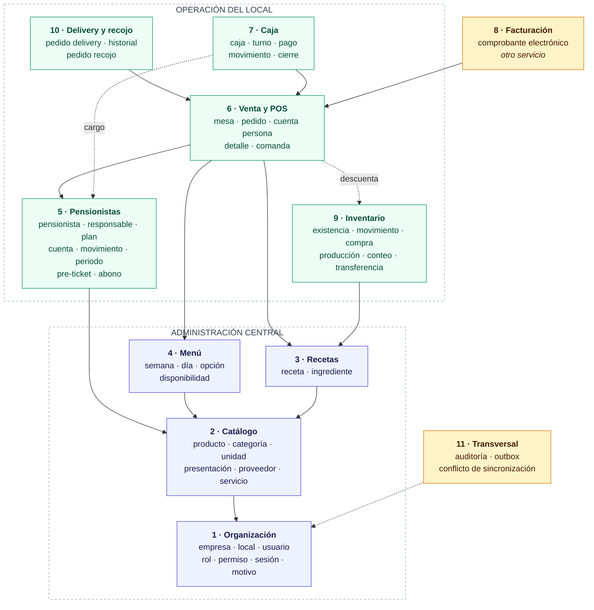
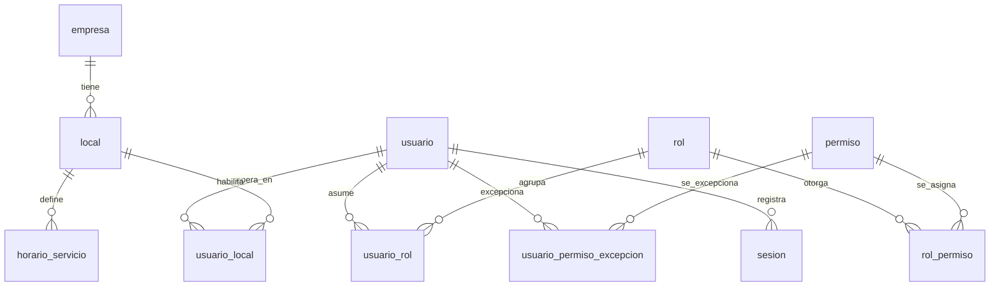
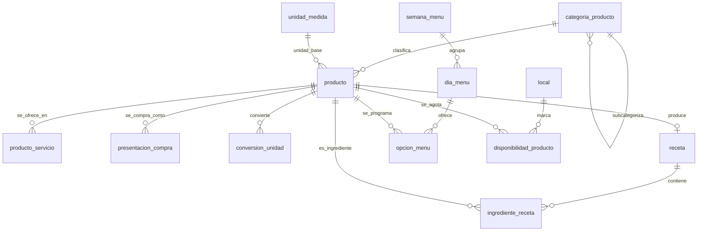
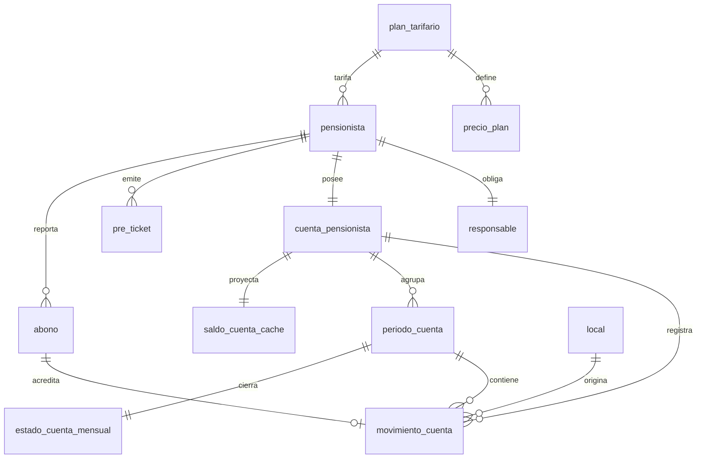
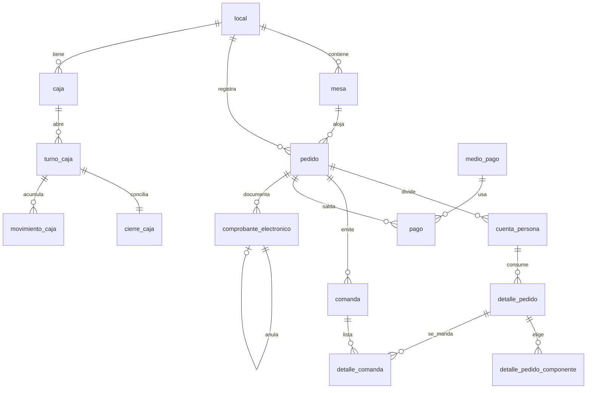

# Modelo de datos lógico — Sistema de Gestión Integral RIKO'S

Documento complementario de `06-modelo-de-datos.md`
Versión 1.0 · 16 de septiembre de 2026
Estado: propuesta de diseño, sujeta a revisión antes de implementarse

---

# 1. Cómo leer este documento

## 1.1 Los tres niveles

| Nivel | Qué contiene | Dónde vive |
|---|---|---|
| **Conceptual** | Entidades y relaciones, sin atributos ni tipos. Responde *qué cosas existen y cómo se relacionan* | `06-modelo-de-datos.md`, ya escrito |
| **Lógico** | Cada entidad con sus atributos, tipos, claves primarias y foráneas, cardinalidades exactas y reglas de integridad. Responde *cómo se representa* | **Este documento** |
| **Físico** | Las tablas reales con su DDL, índices y restricciones | Migraciones de Flyway, creadas sprint a sprint |

**El modelo lógico se hace completo; el físico no.** Revisar un documento no cuesta nada, y tener el mapa entero evita los choques entre módulos que solo se ven cuando se miran juntos. Crear hoy las cincuenta tablas, en cambio, significaría diseñar la mitad contra pantallas que todavía no existen, y DT-033 fijó que una migración aplicada nunca se edita. Cada sprint crea las tablas que necesita, guiado por este mapa.

## 1.2 Origen de cada decisión

Todo lo que sigue se deriva de los ocho documentos de especificación funcional. Donde el modelo agrega algo que la especificación no dice, aparece marcado como **Supuesto de modelado** con su justificación. Esa distinción importa: un supuesto se puede discutir con el propietario, un requisito no.

## 1.3 Convención de nombres

- Tablas y columnas en `snake_case`, en español, **en singular**: `pedido`, no `pedidos`.
- Clave primaria siempre `id`.
- Clave foránea con el nombre de la entidad referida más `_id`: `local_id`, `pensionista_id`.
- Tablas de relación con los dos nombres unidos: `rol_permiso`, `usuario_local`.
- Las fechas de sistema son `creado_en`, `actualizado_en`, `creado_por`, `actualizado_por`.
- Ningún nombre lleva tildes ni la letra ñ, para evitar problemas de codificación entre sistemas operativos.

## 1.4 Tipos usados en este documento

| Tipo lógico | Realización física prevista | Notas |
|---|---|---|
| `identificador` | `char(26)` | ULID generado en el origen (DT-035). Nunca autoincremental |
| `texto(n)` | `varchar(n)` | |
| `texto` | `text` | Para observaciones y notas sin límite útil |
| `entero` | `integer` | |
| `dinero` | `bigint` | **Importes en céntimos**, sin decimales flotantes (DT-035) |
| `costo` | `numeric(16,6)` | Ver la sección 2.6: los costos necesitan más precisión que los precios |
| `cantidad` | `numeric(14,4)` | Cantidades de insumos, que casi nunca son enteras |
| `booleano` | `boolean` | |
| `fecha` | `date` | |
| `hora` | `time` | |
| `momento` | `timestamptz` | Siempre con zona horaria |
| `enum(...)` | `varchar` con restricción `check` | Ver la sección 2.7 |
| `json` | `jsonb` | Solo donde se indica, y nunca para datos que se consultan o filtran |

---

# 2. Convenciones transversales

Son nueve decisiones que atraviesan todo el modelo. Conviene leerlas antes que las entidades, porque explican columnas que después aparecen repetidas en casi todas las tablas.

## 2.1 Identificadores generados en el origen

Toda tabla tiene `id identificador` como clave primaria, generado por la aplicación antes de tocar la base de datos.

**Por qué:** es la primera de las cinco decisiones irreversibles de la sección 6.2 del documento de decisiones. Con identificadores autoincrementales, dos locales sin conexión generarían el mismo número para ventas distintas, y al sincronizar habría que reasignar claves en cascada por todo el sistema. Con ULID generados en el origen, dos locales desconectados producen identificadores que no chocan nunca.

**Consecuencia práctica:** una venta creada sin Internet ya tiene su identificador definitivo desde el primer momento. No existe la figura del "identificador provisional que se cambia al sincronizar", que es donde se originan los duplicados.

## 2.2 Todo registro transaccional lleva su local

Las tablas de operación llevan `local_id` obligatorio: pedidos, movimientos de caja, movimientos de inventario, comandas, producciones, compras, deliveries y movimientos de cuenta.

**Por qué:** RN-002 y el caso crítico 20 exigen que la cuenta del pensionista funcione en todos los locales **mostrando el local de cada movimiento**. Agregar la columna después es trivial; rellenarla correctamente hacia atrás, imposible.

**Qué no lleva `local_id`:** el catálogo, las recetas, los planes tarifarios, la programación del menú y los usuarios, porque se administran centralmente y son comunes a todos los locales (`01` § Multilocal).

## 2.3 Los libros de movimientos no se actualizan, se agregan

Dos entidades del sistema son libros contables: `movimiento_cuenta` (la cuenta del pensionista) y `movimiento_inventario` (las existencias). En ambos:

- Una fila, una vez escrita, **nunca se modifica ni se borra**.
- El saldo y el stock **no son columnas**: son la suma de los movimientos.
- Corregir significa agregar un movimiento de ajuste, no editar el anterior.

**Por qué:** RN-057 ya lo exige para el inventario. Para la cuenta del pensionista lo exige el estado de cuenta mensual (US-025), que debe poder reconstruir mes a mes lo ocurrido. Y hay un beneficio que solo se ve en el modo sin conexión: dos locales que registran movimientos a la vez sobre la misma cuenta no generan conflicto de escritura, porque nadie sobreescribe nada — los movimientos simplemente se ordenan al sincronizar.

**El precio que se paga:** consultar el saldo obliga a sumar. Se resuelve con una tabla de saldo derivado que se recalcula, claramente marcada como caché y nunca como fuente de verdad. Ver `saldo_cuenta_cache` en el bloque 5.

## 2.4 El snapshot económico se escribe al cerrar la venta

`detalle_pedido` guarda, en el momento del cierre, copia de: precio aplicado, costo unitario, receta aplicada, composición del plato, utilidad y margen.

**Por qué:** RN-005 y RN-046 lo exigen, y es imposible reconstruirlo después. Si mañana sube el precio del pollo, la receta cambia y el precio del menú se ajusta, la venta de hoy tiene que seguir mostrando lo que costó hoy. Un `join` contra la tabla de recetas devolvería la receta actual, no la aplicada.

**Es duplicación deliberada.** Un modelo normalizado diría que guardar el precio en el detalle es redundante porque está en el producto. En un sistema con historial económico, esa "redundancia" es el requisito.

## 2.5 Desactivar no es borrar

Ninguna entidad del sistema se elimina físicamente. Las que pueden salir de circulación llevan `estado` o `activo`, y conservan íntegro su historial (`01` § Reglas de historial).

Aplica a: local, usuario, producto, receta, proveedor, pensionista, plan tarifario, mesa y medio de pago.

## 2.6 Precios en céntimos, costos con seis decimales

Esta es la resolución del pendiente P-15, y merece explicación porque parece una inconsistencia.

**Los importes que alguien paga** —precio del menú, total del pedido, monto del abono, importe del comprobante— se guardan como `dinero`, es decir céntimos en un entero. Nunca producen fracciones: nadie paga S/ 12.4567.

**Los costos calculados** —costo por porción de una receta con subrecetas, costo unitario de un insumo tras una compra, valorización de un movimiento de inventario— se guardan como `costo`, con seis decimales.

**Por qué la diferencia:** una receta que rinde 47 porciones con insumos por S/ 160.50 da un costo por porción de S/ 3.414893…. Redondeado a céntimos y multiplicado por las 300 porciones del mes, la desviación se vuelve visible justo en el reporte de margen, que es el que el propietario va a mirar. El costo es un número calculado, no un importe que alguien paga, y no tiene por qué redondearse hasta que se presenta.

**Regla de redondeo, donde haga falta:** redondeo al céntimo más cercano, mitad hacia arriba, aplicado **solo al presentar o al cobrar**, nunca en los cálculos intermedios. En una cuenta dividida entre varias personas, la diferencia de redondeo se asigna a la primera persona de la división, y la suma de las partes debe ser igual al total: es la comprobación que hay que escribir como prueba.

**Falta validar con el contador** el tratamiento del IGV, que es parte de P-05.

## 2.7 Los enumerados son texto con restricción, no números

Los estados se guardan como texto legible (`'pendiente'`, `'vinculado'`, `'cerrado'`) con una restricción `check`, no como enteros.

**Por qué:** una consulta directa a la base durante un incidente es legible sin tener que buscar qué significaba el 3. El costo en espacio es irrelevante frente a lo que ahorra en diagnóstico, y en este sistema alguien va a mirar la base de datos por teléfono un viernes de noche.

**Excepción:** los códigos que vienen de SUNAT (`'01'`, `'03'`, `'07'`) se guardan tal como los define el catálogo oficial, porque cambiarlos por nombres propios rompería la correspondencia con el proveedor.

## 2.8 Auditoría: dos mecanismos distintos

No hay que confundirlos.

- **Columnas de traza** (`creado_en`, `creado_por`, `actualizado_en`, `actualizado_por`) en casi todas las tablas. Responden *quién tocó esto por última vez*.
- **Tabla `auditoria`**, en el bloque 11. Registra los seis eventos que `01` § Auditoría transversal enumera explícitamente, con valores anteriores y nuevos y motivo. Responde *qué pasó exactamente y por qué*.

Las columnas de traza no sustituyen la tabla: guardan solo el último cambio, y la auditoría necesita la secuencia completa.

## 2.8 bis Las claves primarias compuestas se mapean con identificadores planos

Restricción de implementación descubierta en el sprint 1, registrada aquí porque vuelve a aparecer en cada tabla de relación del modelo.

Hibernate **no propaga** `@JdbcTypeCode(CHAR)` a una asociación `@ManyToOne` que forma parte de una clave compuesta con `@IdClass`. Como los identificadores son `char(26)`, la asociación se rompe.

**La solución adoptada:** las columnas de la clave compuesta se declaran como `@Id` de tipo `String` plano, y las asociaciones se añaden aparte como solo lectura (`insertable = false, updatable = false`) para poder seguir navegando el objeto.

**No cambia el esquema físico**: las tablas y sus claves foráneas son exactamente las del modelo. Es solo cómo se escribe el mapeo.

**Dónde vuelve a aplicar:** `rol_permiso`, `usuario_rol`, `usuario_local`, `usuario_permiso_excepcion`, `producto_servicio` y `existencia`. Conviene resolverlo igual en todas, para que el código se lea de una sola manera.

## 2.9 Bloqueo optimista en los datos maestros

Las tablas que se administran centralmente y se sincronizan hacia los locales llevan `version entero`, incrementada en cada actualización.

**Por qué:** el escritor de los datos maestros es único —el administrador central— así que *last write wins* alcanza y no hacen falta mecanismos más complejos. Pero la columna de versión permite detectar que dos administradores editaron el mismo producto a la vez, en vez de que uno pise al otro en silencio.


---

# 2bis. Mapa general del modelo

Las sesenta y nueve entidades agrupadas en once bloques, y cómo dependen entre sí. Las flechas van de quien depende hacia aquello de lo que depende: el bloque de venta necesita el catálogo y el menú, no al revés.



**Cómo leer los colores.** En azul, lo que se administra **centralmente** y es común a todos los locales: organización, catálogo, recetas y menú. En verde, lo que es **propio de cada local** y lleva `local_id`: pensionistas —cuya cuenta es única pero cuyos movimientos son por local—, venta, caja, inventario y delivery. En ámbar, lo **transversal**: la facturación, que vive en otro servicio, y la auditoría y sincronización, que atraviesan todo.

**Las dos flechas punteadas son las que más se olvidan.** Cerrar una venta descuenta inventario, y cerrar una venta de pensionista genera el cargo en su cuenta. Ninguna de las dos es una clave foránea evidente al mirar las tablas, y las dos son el núcleo de la operación.

---

# 3. Bloque 1 — Organización, usuarios y permisos

Corresponde a EP-01 (Fundaciones) y a las historias US-001 a US-007. Es el bloque raíz: casi todo el resto del modelo apunta aquí.

## 3.1 `empresa`

La entidad propietaria. Existe una sola fila, pero se modela como tabla porque los datos fiscales cuelgan de ella y porque `06` § Organización declara la relación Empresa 1—N Local.

| Atributo | Tipo | Nulo | Descripción |
|---|---|---|---|
| `id` | identificador | No | PK |
| `ruc` | texto(11) | No | Único. Dato fiscal pendiente, P-04 |
| `razon_social` | texto(200) | No | |
| `nombre_comercial` | texto(120) | Sí | «Riko's» |
| `domicilio_fiscal` | texto(250) | No | P-04 |
| `creado_en` / `actualizado_en` | momento | No | |

## 3.2 `local`

Contenedor de toda la operación. Cada local tiene su propia caja, mesas, inventario, compras, producción, pedidos y delivery; **no** tiene copia del catálogo, recetas, precios, planes ni menú.

| Atributo | Tipo | Nulo | Descripción |
|---|---|---|---|
| `id` | identificador | No | PK |
| `empresa_id` | identificador | No | FK → `empresa` |
| `codigo` | texto(20) | No | Único. Se usa en el subdominio del POS (DT-029) |
| `nombre` | texto(120) | No | «San Isidro» |
| `direccion` | texto(250) | No | |
| `telefono` | texto(20) | Sí | Con prefijo de país |
| `correo` | texto(160) | Sí | Correo operativo del local |
| `latitud` | numeric(10,7) | Sí | Opcional |
| `longitud` | numeric(10,7) | Sí | Opcional |
| `serie_boleta` | texto(4) | Sí | Serie asignada por el proveedor de facturación. Conveniencia, no requisito (H-01) |
| `serie_factura` | texto(4) | Sí | Igual |
| `facebook_url` | texto(250) | Sí | Enlace a la red social del local |
| `instagram_url` | texto(250) | Sí | |
| `tiktok_url` | texto(250) | Sí | |
| `logo_url` | texto(500) | Sí | URL del logo. No hay subida de archivos todavía |
| `delivery_habilitado` | booleano | No | Si el local ofrece delivery |
| `recojo_habilitado` | booleano | No | Si el local ofrece recojo programado |
| `tiempo_min_entrega_min` | entero | Sí | Minutos |
| `tiempo_max_entrega_min` | entero | Sí | Minutos |
| `activo` | booleano | No | Por defecto verdadero |
| `version` | entero | No | Bloqueo optimista |
| `creado_en` / `actualizado_en` / `creado_por` / `actualizado_por` | | | Traza |

**Reglas**

- **RN-001, US-001 CA1.** Crear un local crea implícitamente su inventario general, su caja, sus mesas y su delivery. No se crean copias de los datos centrales.
- **US-001 CA2.** Un local tiene exactamente **un** inventario general. No se modela una tabla `inventario`: la existencia se identifica por la pareja local + producto (ver bloque 9), que es la forma de garantizar la unicidad sin una tabla intermedia que no aporta nada.
- **US-001 CA3.** `activo = falso` impide nuevas operaciones y conserva íntegro el historial.
- **`latitud` y `longitud` son opcionales y hoy no alimentan ningún cálculo.** RN-081 fija que el delivery es gratuito y sin zonas, así que no hay reparto por distancia. Se guardan porque son baratas de capturar y caras de recolectar después, y porque si algún día el propietario decide cobrar envío por zona, el dato ya está.
- **Los ocho campos de redes, logo y canales de venta se agregaron en el sprint 1 ampliado (V12), fuera de la especificación original.** `README` excluye la publicación pública del menú, así que hoy **no existe superficie que consuma los enlaces de redes ni el logo**; y comprometer un tiempo de entrega es una decisión de negocio. Se registran como DT-046 y quedan pendientes de confirmación del propietario (P-20).
- **Borrado físico del local: permitido, por decisión del equipo (DT-043).** Contradice `01` § Reglas de historial, que dice que desactivar no elimina el historial. Queda registrado como decisión consciente y no como omisión. En la práctica **solo podrá borrarse un local sin operaciones**, porque todas las claves foráneas que lo apuntan son `ON DELETE RESTRICT`: la base de datos rechazará el borrado en cuanto exista un pedido, un turno de caja o un movimiento de inventario. Conviene que el mensaje de error lo explique en esos términos, y no como un fallo del sistema.

## 3.3 `horario_servicio`

Define en qué franja horaria rige cada servicio, **por local y por día de la semana**. Es lo que permite al kiosco determinar solo el servicio (US-019 CA2).

| Atributo | Tipo | Nulo | Descripción |
|---|---|---|---|
| `id` | identificador | No | PK |
| `local_id` | identificador | No | FK → `local` |
| `servicio` | enum('desayuno','almuerzo','cena') | No | |
| `dia_semana` | enum('lunes','martes','miercoles','jueves','viernes','sabado','domingo') | No | |
| `hora_inicio` | hora | No | |
| `hora_fin` | hora | No | |
| `activo` | booleano | No | |

**Reglas**

- Único por (`local_id`, `servicio`, `dia_semana`, `hora_inicio`) entre los activos.
- **Un día puede tener varios turnos del mismo servicio**: son varias filas. Es el caso normal de un restaurante que abre de 12:00 a 15:00 y otra vez de 19:00 a 23:30.
- **Si `hora_fin` es menor o igual que `hora_inicio`, la franja termina al día siguiente.** Un turno de 19:00 a 00:30 es un caso real y frecuente; hay que manejarlo explícitamente o la comparación de horas falla justo en ese tramo.
- **Las franjas del mismo servicio y día no se solapan.** Si se solaparan, el kiosco no podría determinar el servicio sin preguntar, y US-019 dice que lo determina automáticamente. Se valida al guardar.
- Los valores exactos están pendientes (`07` § Pendientes funcionales). Se cargan como datos, no se escriben en el código.

**Por qué por día y no un solo rango por servicio.** La versión anterior de este modelo guardaba un rango por servicio y por local, sin distinguir el día. No alcanza: casi ningún restaurante abre igual el domingo que el martes, y de esos horarios depende que el kiosco cargue el consumo al servicio correcto. Corregido tras revisar la pantalla equivalente de un sistema en producción.

## 3.3 bis `dia_especial`

Feriados y días con horario distinto del habitual.

| Atributo | Tipo | Nulo | Descripción |
|---|---|---|---|
| `id` | identificador | No | PK |
| `local_id` | identificador | No | FK → `local` |
| `fecha` | fecha | No | |
| `cerrado` | booleano | No | Verdadero: el local no atiende ese día |
| `descripcion` | texto(120) | Sí | «Fiestas Patrias» |

**Reglas**

- Único por (`local_id`, `fecha`).
- **El día especial manda sobre el horario semanal.** Si existe una fila para esa fecha, se ignora por completo lo que diga `horario_servicio` para ese día de la semana.
- Si `cerrado` es verdadero, no lleva franjas: el local no atiende y el kiosco debe decirlo, no quedarse en blanco.

## 3.3 ter `horario_dia_especial`

Las franjas de un día especial que sí atiende.

| Atributo | Tipo | Nulo | Descripción |
|---|---|---|---|
| `id` | identificador | No | PK |
| `dia_especial_id` | identificador | No | FK → `dia_especial` |
| `servicio` | enum('desayuno','almuerzo','cena') | No | |
| `hora_inicio` | hora | No | |
| `hora_fin` | hora | No | |

**Regla.** Solo existen filas si el día especial **no** está cerrado. Valen las mismas reglas de cruce de medianoche y no solapamiento de 3.3.

## 3.4 `rol`

| Atributo | Tipo | Nulo | Descripción |
|---|---|---|---|
| `id` | identificador | No | PK |
| `nombre` | texto(60) | No | Único |
| `descripcion` | texto(200) | Sí | |
| `color` | texto(7) | Sí | Distintivo visual en hexadecimal |
| `es_sistema` | booleano | No | Los seis roles base no se pueden borrar ni renombrar; sus permisos sí se editan |
| `activo` | booleano | No | |

Roles base, de `01` § Actores: administrador central, administrador de local, cajero, mozo, cocina, motorizado.

## 3.5 `permiso`

| Atributo | Tipo | Nulo | Descripción |
|---|---|---|---|
| `id` | identificador | No | PK |
| `modulo` | texto(40) | No | `catalogo`, `venta`, `caja`, `inventario`, `pensionistas`, … |
| `accion` | enum(...) | No | Ver abajo |
| `codigo` | texto(80) | No | Único. `modulo.accion`, p. ej. `inventario.ajustar` |
| `descripcion` | texto(200) | Sí | |

**Acciones mínimas configurables** (`05` § Usuarios y permisos, RN-013): `ver`, `crear`, `modificar`, `desactivar`, `aprobar`, `anular`, `descontar`, `reabrir`, `ver_costos`, `exportar`, `administrar_permisos`.

**Regla.** El permiso es por módulo **y** acción; no depende del nombre del cargo. Es lo que impide resolver la autorización preguntando «¿es cajero?» en vez de «¿puede anular?».

**El catálogo no es el producto cartesiano de módulos por acciones: es una lista curada.** Sembrado en el sprint 1 ampliado con **49 permisos sobre 12 módulos** (`identidad`, `catalogo`, `recetas`, `menu`, `pensionistas`, `venta`, `caja`, `inventario`, `compras`, `delivery`, `facturacion`, `reportes`). Varias combinaciones no existen porque no tienen sentido: `recetas.ver_costos` sí y `caja.ver_costos` no; `venta.reabrir` sí y `catalogo.reabrir` no; `inventario.crear` no, porque el stock solo cambia por compras, ventas, producción o ajuste; `facturacion.modificar` tampoco, porque un comprobante emitido no se edita, se anula con nota de crédito.

**El sembrado es idempotente**: se vuelve a ejecutar al arrancar y repone lo que falte. Es lo que evita que un permiso borrado a mano deje a un rol sin poder operar sin que nadie entienda por qué.

## 3.6 `rol_permiso`

Relación N—N entre rol y permiso.

| Atributo | Tipo | Nulo |
|---|---|---|
| `rol_id` | identificador | No |
| `permiso_id` | identificador | No |

PK compuesta por las dos columnas.

## 3.7 `usuario`

| Atributo | Tipo | Nulo | Descripción |
|---|---|---|---|
| `id` | identificador | No | PK |
| `nombre_usuario` | texto(60) | No | Único |
| `nombres` | texto(120) | No | |
| `apellidos` | texto(120) | No | |
| `dni` | texto(8) | Sí | |
| `correo` | texto(160) | Sí | |
| `telefono` | texto(20) | Sí | |
| `hash_contrasena` | texto(255) | No | **Nunca en texto legible** (RN-090) |
| `hash_pin` | texto(255) | Sí | Solo mozos. Distinto de la contraseña y del PIN del pensionista |
| `intentos_fallidos` | entero | No | **Solo del ingreso por contraseña.** Por defecto 0 |
| `bloqueado_hasta` | momento | Sí | Solo del ingreso por contraseña. Nulo si no está bloqueado |
| `activo` | booleano | No | |
| `version` | entero | No | |

**Reglas**

- **RN-090, US-002 CA3, US-003 CA2.** Ni la contraseña ni el PIN se guardan ni se muestran en texto legible en ninguna pantalla ni reporte. Se almacenan con una función de derivación de clave con sal, no con un resumen simple.
- **US-002 CA2, US-005 CA2.** `activo = falso` niega el acceso y conserva la atribución de las operaciones pasadas. Un usuario **nunca** se borra: las ventas de hace seis meses tienen que seguir diciendo quién las hizo.
- **RN-091.** `intentos_fallidos` y `bloqueado_hasta` implementan el bloqueo del ingreso **por contraseña**. El umbral y la duración son configuración, no constantes del código, porque están pendientes (RF-006). Valores provisionales adoptados en el sprint 1: 5 intentos, 15 minutos.
- **El bloqueo del PIN no puede vivir aquí, y es una corrección del sprint 1.** El PIN se ingresa a ciegas: cuatro dígitos, sin elegir usuario antes. Un intento fallido no dice qué usuario falló, así que no hay fila de `usuario` que contar. El contador del PIN vive en `bloqueo_pin` (3.7 ter).
- **Un usuario puede tener varios roles.** `06` § Organización dice «Usuario puede recibir roles y excepciones», en plural, así que la relación se modela como N—N en `usuario_rol` y no como columna del usuario. El permiso efectivo es la **unión** de los permisos de todos sus roles, más las excepciones individuales.

## 3.7 ter `bloqueo_pin`

Contador de intentos fallidos del ingreso por PIN. Existe porque el PIN no identifica al usuario hasta que acierta.

| Atributo | Tipo | Nulo | Descripción |
|---|---|---|---|
| `id` | identificador | No | PK |
| `local_id` | identificador | No | FK → `local` |
| `dispositivo` | texto(120) | No | Huella del dispositivo, no el User-Agent completo |
| `intentos_fallidos` | entero | No | |
| `bloqueado_hasta` | momento | Sí | |
| `actualizado_en` | momento | No | |

**Reglas**

- Único por (`local_id`, `dispositivo`).
- **Se bloquea el dispositivo, no el local.** Es la decisión importante: con bloqueo por local, un mozo que olvidó su PIN deja la terminal de al lado inservible durante quince minutos, en plena hora de almuerzo. El ataque que RN-091 previene —probar PIN de cuatro dígitos a mano— no se vuelve viable porque haya tres tablets en el salón.
- **El contador se persiste, no vive en memoria.** Un bloqueo que se borra reiniciando el proceso no es un bloqueo. Y el nodo del local se reinicia solo cada vez que vuelve la luz después de un corte, que no es un caso raro en este negocio.
- Se limpia al acertar el PIN y por un proceso programado que borra las filas vencidas.

## 3.7 bis `usuario_rol`

Relación N—N entre usuario y rol.

| Atributo | Tipo | Nulo | Descripción |
|---|---|---|---|
| `usuario_id` | identificador | No | PK compuesta. FK → `usuario` |
| `rol_id` | identificador | No | PK compuesta. FK → `rol` |
| `asignado_en` | momento | No | |
| `asignado_por` | identificador | No | FK → `usuario` |

**Regla.** Un usuario sin ningún rol no puede operar. La comprobación es de aplicación, no de base de datos: una restricción que exigiera al menos una fila haría imposible crear el usuario antes de asignarle el rol.

## 3.8 `usuario_local`

Relación N—N. Es la que hace real el multilocal.

| Atributo | Tipo | Nulo | Descripción |
|---|---|---|---|
| `usuario_id` | identificador | No | PK compuesta |
| `local_id` | identificador | No | PK compuesta |
| `es_principal` | booleano | No | El local que se abre por defecto al iniciar sesión |

**Regla, US-005 CA1.** El usuario opera en todos los locales asignados **y en ninguno más**. Esta tabla es la que responde esa pregunta, y toda consulta de operación debe filtrarse por ella.

## 3.9 `usuario_permiso_excepcion`

Permisos otorgados o retirados a un usuario concreto, por encima de su rol.

| Atributo | Tipo | Nulo | Descripción |
|---|---|---|---|
| `usuario_id` | identificador | No | PK compuesta |
| `permiso_id` | identificador | No | PK compuesta |
| `otorgado` | booleano | No | Verdadero concede, falso retira |
| `motivo` | texto(200) | Sí | |
| `creado_en` / `creado_por` | | | Traza |

**Regla, US-005 CA3, RN-013.** El permiso efectivo es la unión de los permisos de **todos** los roles del usuario, **más** la excepción, y la excepción gana sobre el rol.

**Se resuelve una vez, al iniciar sesión, y viaja dentro del token** como lista de códigos (DT-038). No se recalcula en cada petición: sería repetir la misma consulta miles de veces al día. La consecuencia a tener presente es que **un cambio de permisos no afecta a una sesión ya abierta** hasta que el usuario vuelva a entrar; con 49 permisos el token sigue siendo pequeño, pero si el catálogo creciera mucho habría que pasar a una representación compacta. Esta resolución se calcula una vez al iniciar sesión y se guarda en la sesión, no se recalcula en cada petición.

## 3.10 `sesion`

| Atributo | Tipo | Nulo | Descripción |
|---|---|---|---|
| `id` | identificador | No | PK |
| `usuario_id` | identificador | Sí | Nulo en un intento fallido con usuario inexistente |
| `local_id` | identificador | Sí | Local activo de la sesión |
| `tipo` | enum('contrasena','pin') | No | Ingreso general o cambio rápido de mozo |
| `resultado` | enum('exitoso','fallido','bloqueado') | No | |
| `dispositivo` | texto(255) | Sí | User-Agent del navegador, **truncado** al guardar |
| `direccion_ip` | texto(45) | Sí | |
| `iniciada_en` | momento | No | |
| `finalizada_en` | momento | Sí | |

**Regla, US-002 CA5, RN-092.** Se registran los inicios de sesión **exitosos y fallidos** como acción sensible auditable. Registrar solo los exitosos deja ciego justo el caso que interesa vigilar.

**`dispositivo` se trunca al guardar, y la columna no basta por sí sola.** El valor real es el User-Agent del navegador, que en Chrome y Edge actuales pasa de 120 caracteres — el `INSERT` falla apenas se prueba desde un navegador de verdad, y no se nota con `curl`, que manda una cadena corta. Se amplió a 255 en el sprint 1, pero un User-Agent puede superar también ese límite: la aplicación **debe truncar**, no confiar en que quepa.

## 3.11 `motivo`

Lista configurable compartida por todo el sistema (US-012).

| Atributo | Tipo | Nulo | Descripción |
|---|---|---|---|
| `id` | identificador | No | PK |
| `tipo` | enum('ajuste_inventario','anulacion','descuento','rechazo_abono','sobrante_produccion','reapertura') | No | |
| `descripcion` | texto(120) | No | |
| `requiere_observacion` | booleano | No | |
| `activo` | booleano | No | |

**Reglas**

- Único por (`tipo`, `descripcion`) entre los activos.
- Los valores iniciales están pendientes (`07`). La tabla existe desde el sprint 3; los datos los carga el propietario.
- **Por qué una sola tabla y no seis:** las seis listas tienen exactamente la misma forma y el mismo mantenimiento. Una tabla con discriminador evita seis pantallas de administración idénticas.

## 3.12 Diagrama del bloque 1



---

# 4. Bloque 2 — Catálogo, unidades y proveedores

Corresponde a EP-02 y a las historias US-008, US-009, US-011. Todo este bloque es **central**: no lleva `local_id`, porque el catálogo es común a todos los locales.

## 4.1 `categoria_producto`

Jerarquía de **dos niveles**: categoría y subcategoría. La lista de `04` § Catálogo —entradas, segundos y guisos, guarniciones y menestras, refrescos, postres, extras, productos fijos de desayuno y cena, insumos y subrecetas— **mezcla dos cosas distintas** que este modelo separa: la *naturaleza* de un producto dentro del sistema, y su *clasificación temática* dentro de esa naturaleza.

| Atributo | Tipo | Nulo | Descripción |
|---|---|---|---|
| `id` | identificador | No | PK |
| `categoria_padre_id` | identificador | Sí | FK → `categoria_producto`. Nulo en las categorías raíz |
| `nombre` | texto(80) | No | Único dentro de su padre |
| `naturaleza` | enum('componente_menu', 'producto_fijo', 'extra', 'insumo', 'subreceta') | No | Se declara en la raíz y las hijas la heredan |
| `componente_menu` | enum('entrada', 'segundo', 'guarnicion', 'refresco', 'postre') | Sí | Solo si `naturaleza = componente_menu` |
| `nivel` | entero | No | 1 raíz, 2 subcategoría. Derivado, guardado para validar |
| `orden` | entero | No | Orden de presentación en el POS |
| `activo` | booleano | No | |

**Reglas**

- **Profundidad máxima: dos niveles.** No es una limitación de la especificación, es una decisión: con tres o más niveles, el mozo necesita tres toques para llegar a un plato, y los reportes por categoría dejan de ser comparables entre sí. Si algún día hicieran falta tres, el modelo ya lo soporta —basta subir el tope— pero conviene no empezar ahí.
- `naturaleza` y `componente_menu` **solo se declaran en la raíz**. Una subcategoría los hereda y no puede contradecir a su padre: «Pollo» bajo «Segundos y guisos» es `componente_menu = segundo`, igual que su padre.
- **Los productos cuelgan de la hoja**, no de la raíz. `producto.categoria_id` debe apuntar a una categoría sin hijas. Un producto colgado de una categoría que tiene subcategorías queda fuera de todos los reportes desglosados, y es el error más fácil de cometer al cargar el catálogo.
- `componente_menu` es lo que permite que el sistema sepa qué hueco del menú llena un plato **sin preguntarlo dos veces**. Ver la nota de 6.3 sobre `opcion_menu`.

### 4.1.1 El árbol propuesto para Riko's

Derivado de `04` § Catálogo, `04` § Almuerzo y `01` § Contexto del negocio. Los nombres son una propuesta: el propietario puede renombrarlos, pero la **forma** del árbol es la que sostiene los reportes.

| Nivel 1 — Categoría | Naturaleza | Nivel 2 — Subcategorías propuestas |
|---|---|---|
| **Entradas** | componente_menu · entrada | Sopas y caldos · Ensaladas · Causas y fríos |
| **Segundos y guisos** | componente_menu · segundo | Pollo · Res · Cerdo · Pescados y mariscos · Sin carne |
| **Guarniciones y menestras** | componente_menu · guarnicion | Arroces · Menestras · Papas y tubérculos |
| **Refrescos** | componente_menu · refresco | — |
| **Postres** | componente_menu · postre | — |
| **Extras** | extra | Segundos especiales · Porciones adicionales |
| **Platos fijos** | producto_fijo | Caldos y sopas · Platos de fondo · Sándwiches y panes · Bebidas calientes · Jugos y refrescos |
| **Insumos** | insumo | Carnes y aves · Pescados · Verduras y frutas · Abarrotes · Lácteos y huevos · Condimentos y especias · Descartables y táperes |
| **Subrecetas** | subreceta | Fondos y bases · Salsas y aderezos · Guisos base |

**Por qué «Platos fijos» y no «Desayuno» y «Cena» como categorías separadas.** Es el punto que obliga al cambio del apartado siguiente. Un té se vende en el desayuno **y** en la cena; un caldo de gallina también. Si «Bebidas calientes» colgara de «Desayuno», el té no podría aparecer en la cena sin duplicarlo como producto, y un producto duplicado significa dos stocks, dos costos y dos líneas en cada reporte. **El servicio no es una propiedad de la categoría: es una propiedad del producto.**

**Nota sobre los táperes.** El cargo de táper de RN-009 corresponde a un producto real que se descuenta del inventario, y por eso «Descartables y táperes» es una subcategoría de insumos y no un concepto aparte.

## 4.1 bis `producto_servicio`

En qué servicios se ofrece un producto fijo. Resuelve el hueco descrito arriba.

| Atributo | Tipo | Nulo | Descripción |
|---|---|---|---|
| `producto_id` | identificador | No | PK compuesta. FK → `producto` |
| `servicio` | enum('desayuno', 'almuerzo', 'cena') | No | PK compuesta |
| `activo` | booleano | No | |

**Reglas**

- Solo aplica a productos cuya categoría tiene `naturaleza = producto_fijo`. Los componentes del menú no la necesitan: su servicio es siempre el almuerzo y su disponibilidad la fija la programación semanal.
- **Es la tabla que responde la pregunta del POS**: «son las 7 de la noche, ¿qué puedo vender?». Sin ella, la carta de la cena habría que deducirla de la categoría, y eso obliga a que cada producto pertenezca a un solo servicio.
- Se combina con `disponibilidad_producto` (6.4): esta tabla dice qué se ofrece **normalmente** en ese servicio; aquella dice qué está agotado **hoy en ese local**.
- El precio del pensionista por servicio ya lo resuelve `precio_plan`, que lleva su propia columna `servicio` (7.2). Las dos tablas son coherentes: una dice qué se ofrece, la otra a cuánto para cada plan.

## 4.2 `unidad_medida`

| Atributo | Tipo | Nulo | Descripción |
|---|---|---|---|
| `id` | identificador | No | PK |
| `codigo` | texto(10) | No | Único. `kg`, `g`, `l`, `ml`, `und` |
| `nombre` | texto(60) | No | |
| `tipo` | enum('masa','volumen','unidad') | No | |
| `activo` | booleano | No | |

## 4.3 `producto`

La entidad más referenciada del modelo. Un mismo producto puede ser vendible, insumo, preparación, o varias cosas a la vez — de ahí que sean tres banderas y no un tipo único.

| Atributo | Tipo | Nulo | Descripción |
|---|---|---|---|
| `id` | identificador | No | PK |
| `codigo` | texto(30) | No | Único |
| `nombre` | texto(150) | No | |
| `categoria_id` | identificador | No | FK → `categoria_producto`. **Debe ser una categoría hoja** |
| `unidad_base_id` | identificador | No | FK → `unidad_medida`. La unidad en que se lleva el stock |
| `es_vendible` | booleano | No | Puede aparecer en un pedido |
| `es_insumo` | booleano | No | Puede aparecer en una receta |
| `es_subreceta` | booleano | No | Es una preparación con receta propia |
| `precio_venta` | dinero | Sí | Obligatorio si `es_vendible`. Precio de público general |
| `costo_ultima_compra` | costo | Sí | Actualizado al confirmar una compra (RN-047) |
| `fecha_ultima_compra` | fecha | Sí | |
| `controla_stock` | booleano | No | |
| `activo` | booleano | No | |
| `version` | entero | No | |

**Reglas**

- **RN-047, caso crítico 10.** Confirmar una compra actualiza `costo_ultima_compra` y recalcula los costos de las recetas **futuras**. Las ventas anteriores no cambian, porque guardaron su propio snapshot (2.4).
- **Supuesto de modelado:** tres banderas booleanas en lugar de un enumerado `tipo`. `06` dice que un producto «puede ser vendible, insumo, preparación o **ambos**». Un enumerado no admite «ambos». El caso real es el arroz: se compra como insumo, entra en recetas, y puede venderse como guarnición.
- `stock_minimo` **no** va aquí: es configurable por producto **y local** (`04` § Inventario), así que vive en `existencia`.

## 4.4 `presentacion_compra`

Las formas en que se compra un producto: el saco de 50 kg, la caja de 24 unidades.

| Atributo | Tipo | Nulo | Descripción |
|---|---|---|---|
| `id` | identificador | No | PK |
| `producto_id` | identificador | No | FK → `producto` |
| `nombre` | texto(80) | No | «Saco 50 kg» |
| `unidad_id` | identificador | No | FK → `unidad_medida` |
| `factor_a_unidad_base` | cantidad | No | Cuántas unidades base entrega una presentación |
| `es_predeterminada` | booleano | No | |
| `activo` | booleano | No | |

**Regla.** Una sola presentación predeterminada por producto entre las activas.

## 4.5 `conversion_unidad`

Conversiones generales entre unidades de un mismo producto, cuando no corresponden a una presentación de compra.

| Atributo | Tipo | Nulo | Descripción |
|---|---|---|---|
| `id` | identificador | No | PK |
| `producto_id` | identificador | No | FK → `producto` |
| `unidad_origen_id` | identificador | No | FK → `unidad_medida` |
| `unidad_destino_id` | identificador | No | FK → `unidad_medida` |
| `factor` | cantidad | No | |

**Regla.** Único por (`producto_id`, `unidad_origen_id`, `unidad_destino_id`). Las conversiones se definen **por producto**, no globalmente: un litro de aceite y un litro de chicha no pesan lo mismo, y una conversión global de litros a kilos sería falsa.

## 4.6 `proveedor`

| Atributo | Tipo | Nulo | Descripción |
|---|---|---|---|
| `id` | identificador | No | PK |
| `ruc` | texto(11) | Sí | Único cuando no es nulo |
| `razon_social` | texto(200) | No | |
| `nombre_comercial` | texto(120) | Sí | |
| `telefono` | texto(20) | Sí | |
| `correo` | texto(160) | Sí | |
| `direccion` | texto(250) | Sí | |
| `contacto` | texto(120) | Sí | |
| `activo` | booleano | No | |

**Nota.** Los campos opcionales adicionales están pendientes (`07`, RF-009). El RUC admite nulo porque el mercado de abastos existe: una compra a un proveedor informal es real y el sistema no debe impedirla.

---

# 5. Bloque 3 — Recetas y costeo

Corresponde a EP-02, historia US-010. También central, sin `local_id`.

## 5.1 `receta`

| Atributo | Tipo | Nulo | Descripción |
|---|---|---|---|
| `id` | identificador | No | PK |
| `producto_id` | identificador | No | FK → `producto`. El plato o la subreceta que produce |
| `nombre` | texto(150) | No | |
| `rendimiento` | cantidad | No | Cuánto produce una ejecución |
| `unidad_rendimiento_id` | identificador | No | FK → `unidad_medida` |
| `porciones` | entero | No | En cuántas porciones se divide el rendimiento |
| `costo_por_porcion` | costo | Sí | **Derivado**, recalculado al cambiar un costo de insumo |
| `costo_total` | costo | Sí | Derivado |
| `activo` | booleano | No | |
| `version` | entero | No | |

**Reglas**

- Una receta activa por producto.
- **RN-046.** Modificar una receta actualiza la receta maestra y aplica a las ventas **nuevas**. Las anteriores conservan su copia histórica.
- `costo_por_porcion` es un valor derivado que se guarda por rendimiento, no una fuente de verdad. Se recalcula cuando cambia el costo de cualquier insumo de su árbol, en cascada hacia las recetas que la usan como subreceta.
- **RN-045.** Ver los costos requiere permiso `ver_costos`. Es un filtro de la capa de aplicación, no una columna.

## 5.2 `ingrediente_receta`

| Atributo | Tipo | Nulo | Descripción |
|---|---|---|---|
| `id` | identificador | No | PK |
| `receta_id` | identificador | No | FK → `receta` |
| `producto_id` | identificador | No | FK → `producto`. Insumo o subreceta |
| `cantidad` | cantidad | No | |
| `unidad_id` | identificador | No | FK → `unidad_medida` |
| `orden` | entero | No | |

**Reglas**

- **RN-044.** Un ingrediente puede referenciar un insumo **o una subreceta**, y ahí está la recursividad del modelo: `producto` → `receta` → `ingrediente_receta` → `producto`.
- **Restricción que hay que validar en la aplicación, no en la base:** una receta no puede contenerse a sí misma ni directa ni indirectamente. Un ciclo en el árbol de recetas produce un cálculo de costo infinito. Debe comprobarse al guardar, recorriendo el árbol.
- **Supuesto de modelado:** la profundidad de anidamiento no se limita. La especificación no fija un máximo. Conviene, sin embargo, registrar la profundidad alcanzada, porque un árbol de cinco niveles hace lento el recálculo de costos.

## 5.3 Cómo se calcula el costo

Registrado aquí porque es la regla que más consecuencias tiene y no está escrita en un solo lugar de la especificación.

```
costo_total(receta) = Σ para cada ingrediente:
     si el producto es insumo      → cantidad_convertida × costo_ultima_compra
     si el producto es subreceta   → cantidad_convertida × costo_por_porcion(subreceta)

costo_por_porcion(receta) = costo_total(receta) / porciones
```

La conversión de unidades usa `conversion_unidad` o `presentacion_compra` según corresponda, y se resuelve **siempre a la unidad base del producto** antes de multiplicar.

**Al vender el plato** se descuenta la receta completa, incluidas las cantidades de las subrecetas (`04` § Producción), pero **sin duplicar el consumo**: si la subreceta ya se produjo y su producción descontó los insumos, la venta descuenta la subreceta como producto, no sus insumos otra vez. Es el caso crítico 11 y la fuente más probable de un error de inventario.

---

# 6. Bloque 4 — Menú y programación semanal

Corresponde a EP-03 y a las historias US-013, US-014, US-015.

## 6.1 `semana_menu`

| Atributo | Tipo | Nulo | Descripción |
|---|---|---|---|
| `id` | identificador | No | PK |
| `fecha_inicio` | fecha | No | Lunes de la semana. Único |
| `fecha_fin` | fecha | No | |
| `estado` | enum('borrador','confirmado','en_servicio') | No | |
| `confirmada_en` | momento | Sí | |
| `confirmada_por` | identificador | Sí | FK → `usuario` |

## 6.2 `dia_menu`

| Atributo | Tipo | Nulo | Descripción |
|---|---|---|---|
| `id` | identificador | No | PK |
| `semana_menu_id` | identificador | No | FK → `semana_menu` |
| `fecha` | fecha | No | Único dentro de la semana |
| `observacion` | texto(250) | Sí | |

## 6.3 `opcion_menu`

Cada opción disponible de un componente del almuerzo de un día.

| Atributo | Tipo | Nulo | Descripción |
|---|---|---|---|
| `id` | identificador | No | PK |
| `dia_menu_id` | identificador | No | FK → `dia_menu` |
| `producto_id` | identificador | No | FK → `producto` |
| `componente` | enum('entrada','segundo','guarnicion','refresco','postre') | No | **Derivado** de la categoría del producto y guardado |
| `tipo_menu` | enum('normal','extra') | No | El extra tiene precio propio |
| `porciones_estimadas` | entero | Sí | Planificación |
| `activo` | booleano | No | |

**Reglas**

- **RN-039.** El menú normal tiene **precio único** y no depende de las opciones elegidas. El precio no vive aquí: vive en `producto.precio_venta` del menú normal, y en el plan tarifario para el pensionista.
- **RN-041.** El menú extra se cobra al precio completo del extra, **sin tarifa reducida de pensionista**.
- **RN-042.** Si hay varias opciones de un componente, el mozo registra la elegida. Si hay una sola, se asigna directamente sin preguntar.
- **RN-043.** Al confirmar la semana, el sistema advierte si un segundo aparece en los tres días anteriores, pero **permite confirmar igual**. Es una advertencia, no un bloqueo, y conviene que el modelo no la convierta en restricción.
- Desayuno y cena **no** se programan: usan productos fijos elegidos individualmente (`04` § Programación semanal). Por eso `componente` no tiene valores de desayuno ni cena, y lo que se ofrece en esos servicios sale de `producto_servicio` (4.1 bis), no de aquí.
- **`componente` se deriva de la categoría del producto y se guarda igual.** Al programar el menú, el sistema lo deduce de `categoria_producto.componente_menu` y lo copia aquí; el usuario no lo elige y no puede contradecirlo. Se guarda en lugar de consultarse porque la programación de una semana pasada es un registro histórico: si mañana alguien reclasifica un plato de «segundo» a «entrada», la semana de marzo debe seguir diciendo lo que dijo.

## 6.4 `disponibilidad_producto`

Qué productos están agotados **en un local concreto**. Es la única parte del menú que no es central.

| Atributo | Tipo | Nulo | Descripción |
|---|---|---|---|
| `id` | identificador | No | PK |
| `local_id` | identificador | No | FK → `local` |
| `producto_id` | identificador | No | FK → `producto` |
| `agotado` | booleano | No | |
| `motivo_id` | identificador | Sí | FK → `motivo` |
| `marcado_por` | identificador | No | FK → `usuario` |
| `marcado_en` | momento | No | |

**Reglas**

- Único por (`local_id`, `producto_id`).
- **RN-055, caso crítico 8.** Marcar agotado oculta el producto en los pedidos **nuevos** y **no altera las comandas ya emitidas**. Esto es una regla de consulta, no de datos: el pedido en curso conserva lo que ya tiene.
- La reactivación registra usuario, hora y motivo; de ahí las tres últimas columnas y la entrada correspondiente en `auditoria`.

## 6.5 Diagrama de los bloques 2, 3 y 4



---

# 7. Bloque 5 — Pensionistas, planes y cuenta corriente

Corresponde a EP-04 y a las historias US-016 a US-026. Es el bloque que distingue a RIKO'S de cualquier POS comprado, y el que concentra las decisiones de modelado más delicadas.

## 7.1 `plan_tarifario`

| Atributo | Tipo | Nulo | Descripción |
|---|---|---|---|
| `id` | identificador | No | PK |
| `nombre` | texto(100) | No | |
| `descripcion` | texto(250) | Sí | |
| `precio_almuerzo_normal` | dinero | No | |
| `vigencia_desde` | fecha | No | |
| `vigencia_hasta` | fecha | Sí | Nulo mientras siga vigente |
| `estado` | enum('activo','inactivo') | No | |
| `version` | entero | No | |

## 7.2 `precio_plan`

Precios especiales por producto fijo de desayuno y cena dentro de un plan.

| Atributo | Tipo | Nulo | Descripción |
|---|---|---|---|
| `id` | identificador | No | PK |
| `plan_tarifario_id` | identificador | No | FK → `plan_tarifario` |
| `producto_id` | identificador | No | FK → `producto` |
| `servicio` | enum('desayuno','almuerzo','cena') | No | |
| `precio` | dinero | No | |

**Reglas del plan**

- Único por (`plan_tarifario_id`, `producto_id`, `servicio`).
- **RN-033.** Los planes tienen vigencia, estado e **historial de modificaciones**. Ese historial no se modela con columnas: modificar un plan vigente crea una **fila nueva** con nueva vigencia y cierra la anterior con `vigencia_hasta`. Editar la fila existente destruiría la trazabilidad que la regla exige.
- **RN-034, caso implícito en US-017.** Los consumos anteriores conservan la tarifa aplicada, y eso lo garantiza el snapshot de `detalle_pedido` (2.4), no una consulta al plan.
- **RN-041.** El menú extra se cobra completo: `precio_plan` nunca se aplica a un extra.

## 7.3 `pensionista`

| Atributo | Tipo | Nulo | Descripción |
|---|---|---|---|
| `id` | identificador | No | PK |
| `dni` | texto(8) | No | **Único en toda la empresa** |
| `nombres` | texto(120) | No | |
| `apellidos` | texto(120) | No | |
| `telefono` | texto(20) | Sí | |
| `correo` | texto(160) | Sí | |
| `institucion` | texto(150) | Sí | Universidad o instituto |
| `codigo_estudiante` | texto(30) | Sí | |
| `carrera` | texto(120) | Sí | |
| `ciclo` | texto(20) | Sí | Opcional por especificación |
| `plan_tarifario_id` | identificador | No | FK → `plan_tarifario` |
| `limite_credito` | dinero | No | Preventivo, no bloqueante |
| `frecuencia_abono` | enum('semanal','quincenal','mensual') | Sí | Frecuencia habitual declarada |
| `hash_pin` | texto(255) | No | PIN presencial del kiosco |
| `hash_contrasena_portal` | texto(255) | No | **Credencial distinta del PIN** |
| `estado` | enum('activo','inactivo') | No | |
| `version` | entero | No | |

**Reglas**

- **US-016 CA3, `06` § Reglas de integridad.** `dni` único en la empresa. Es la restricción más importante del bloque: un pensionista duplicado significa dos cuentas corrientes para la misma persona.
- **RN-090, US-016 CA4.** Ni el PIN ni la contraseña del portal se muestran legibles, y son **dos credenciales distintas entre sí** (`05` § Respaldo y seguridad). Guardarlas en la misma columna sería el error que la regla previene.
- **US-016 CA5.** Confirmar el alta crea su `cuenta_pensionista`.
- **US-026, RN-035.** `estado = inactivo` bloquea nuevos pre-tickets y consumos, **conserva** la cuenta, el historial y el acceso al portal de consulta, y **permite abonos posteriores**. Reactivar reutiliza la misma cuenta: por eso la cuenta no se cierra ni se recrea.
- **Nota de protección de datos.** Una parte de los pensionistas puede ser menor de edad. Los datos de esta tabla caen bajo la Ley 29733; el tratamiento de datos de menores exige consentimiento del responsable, que aquí ya es obligatorio. Conviene dejarlo registrado en el charter.

## 7.4 `responsable`

| Atributo | Tipo | Nulo | Descripción |
|---|---|---|---|
| `id` | identificador | No | PK |
| `pensionista_id` | identificador | No | FK → `pensionista`. Único: relación 1—1 |
| `nombre_completo` | texto(200) | No | |
| `dni` | texto(8) | No | |
| `telefono` | texto(20) | No | |
| `correo` | texto(160) | No | |
| `parentesco` | texto(60) | No | |
| `direccion` | texto(250) | No | |

**Regla, US-016 CA2.** El responsable es **obligatorio**: no se puede guardar un pensionista sin él, y los seis campos son obligatorios. La relación es 1—1 y se modela como tabla aparte —no como columnas del pensionista— porque son seis campos con identidad propia y porque el acceso al portal es compartido entre ambos.

## 7.5 `cuenta_pensionista`

| Atributo | Tipo | Nulo | Descripción |
|---|---|---|---|
| `id` | identificador | No | PK |
| `pensionista_id` | identificador | No | FK → `pensionista`. Único: relación 1—1 |
| `abierta_en` | momento | No | |
| `estado` | enum('abierta','suspendida') | No | |

**Regla, RN-002, caso crítico 20.** La cuenta es **única y utilizable en cualquier local**. No hay una cuenta por local. El local de cada movimiento se guarda en el movimiento, no en la cuenta.

## 7.6 `movimiento_cuenta` — el libro

La tabla más importante del sistema. **Solo se agregan filas. Nunca se modifican ni se borran.**

| Atributo | Tipo | Nulo | Descripción |
|---|---|---|---|
| `id` | identificador | No | PK |
| `cuenta_id` | identificador | No | FK → `cuenta_pensionista` |
| `local_id` | identificador | No | FK → `local`. **Obligatorio**: el caso crítico 20 exige mostrarlo |
| `periodo_id` | identificador | No | FK → `periodo_cuenta` |
| `tipo` | enum('consumo','abono','ajuste','arrastre') | No | |
| `signo` | enum('cargo','credito') | No | Explícito, para no depender del signo del importe |
| `importe` | dinero | No | Siempre positivo; el sentido lo da `signo` |
| `pedido_id` | identificador | Sí | FK → `pedido`. Presente si `tipo = consumo` |
| `abono_id` | identificador | Sí | FK → `abono`. Presente si `tipo = abono` |
| `motivo_id` | identificador | Sí | FK → `motivo`. Obligatorio si `tipo = ajuste` |
| `descripcion` | texto(250) | Sí | |
| `ocurrido_en` | momento | No | Momento del hecho económico |
| `registrado_en` | momento | No | Momento en que llegó a la base. Difieren cuando hubo corte |
| `registrado_por` | identificador | No | FK → `usuario` |

**Reglas**

- **RN-015, caso crítico 1.** El consumo se registra **únicamente al cerrar en caja**. Ni al emitir el pre-ticket, ni al tomar el pedido, ni al comandar. Antes del cierre no existe movimiento.
- **RN-020, caso crítico 3.** Se permiten **múltiples consumos del mismo servicio el mismo día**, y cada uno genera su propio movimiento. No hay restricción de unicidad por día y servicio: ponerla rompería el requisito.
- **El saldo no es una columna.** Es `Σ créditos − Σ cargos`. Un campo `saldo` mutable haría imposible el estado de cuenta mensual y convertiría cada sincronización en un conflicto de escritura.
- **Dos marcas de tiempo, y no es redundancia.** `ocurrido_en` es cuándo consumió el pensionista; `registrado_en` es cuándo la fila llegó a la base. Durante un corte de Internet pueden diferir en horas, y el estado de cuenta se arma por `ocurrido_en`, mientras que la sincronización razona con `registrado_en`.

## 7.7 `saldo_cuenta_cache`

Valor derivado, recalculado. **No es fuente de verdad.**

| Atributo | Tipo | Nulo | Descripción |
|---|---|---|---|
| `cuenta_id` | identificador | No | PK. FK → `cuenta_pensionista` |
| `deuda` | dinero | No | Suma de cargos no cubiertos |
| `saldo_a_favor` | dinero | No | Créditos por encima de la deuda |
| `credito_disponible` | dinero | No | `limite_credito − deuda` (RN-017) |
| `ultimo_movimiento_id` | identificador | Sí | Hasta dónde está calculado |
| `recalculado_en` | momento | No | |

**Reglas**

- **RN-017.** `credito_disponible = limite_credito − deuda`.
- **RN-018, caso crítico 4.** El límite es **preventivo**: superarlo genera alerta y **permite el consumo igual**. El modelo no debe tener ninguna restricción que lo impida.
- **RN-019.** Se aplica primero el saldo a favor; el remanente aumenta la deuda. Esta regla se ejecuta al calcular, no al guardar: el movimiento se escribe íntegro y la imputación es una operación de lectura.
- **Regla de oro de esta tabla:** si se pierde, se reconstruye sumando el libro. Si alguna vez discrepa del libro, **manda el libro**. Conviene una comprobación programada que recalcule y avise ante cualquier diferencia.
- **`05` § Offline-first** pide conservar una copia local del saldo necesario para operar pensionistas: esta tabla es esa copia en el nodo del local.

## 7.7 bis — Por qué no hay una columna `saldo`

Merece decirse explícitamente porque es la pregunta que va a aparecer en la revisión.

Un campo `saldo` que se suma y se resta en cada operación es más simple de programar y es lo que hace la mayoría de los sistemas pequeños. Aquí no sirve por tres motivos concretos:

1. **El estado de cuenta mensual (US-025)** debe mostrar saldo inicial, consumos, abonos, ajustes y saldo final del mes. Con un campo mutable, esos números solo se pueden reconstruir si además se guarda el libro — con lo cual el campo sobra.
2. **La operación sin conexión.** Dos locales que atienden al mismo pensionista a la vez, ambos sin Internet, escribirían cada uno su propio `saldo`. Al sincronizar hay que decidir cuál gana, y cualquiera que gane pierde una transacción real. Con el libro, los dos movimientos se ordenan y ninguno se pierde.
3. **La auditoría.** Un saldo que cambió sin explicación es imposible de investigar. Un libro dice quién, cuándo, desde qué local y por qué motivo.

## 7.8 `periodo_cuenta`

| Atributo | Tipo | Nulo | Descripción |
|---|---|---|---|
| `id` | identificador | No | PK |
| `cuenta_id` | identificador | No | FK → `cuenta_pensionista` |
| `anio` | entero | No | |
| `mes` | entero | No | |
| `estado` | enum('abierto','cerrado') | No | |
| `cerrado_en` | momento | Sí | |
| `cerrado_por` | identificador | Sí | FK → `usuario` |

**Reglas**

- Único por (`cuenta_id`, `anio`, `mes`).
- **RN-024, `01` § Reglas de historial.** Un periodo cerrado es **inalterable**. Ningún movimiento nuevo puede apuntar a un periodo cerrado; una corrección posterior se registra como ajuste en el periodo abierto.

## 7.9 `estado_cuenta_mensual`

| Atributo | Tipo | Nulo | Descripción |
|---|---|---|---|
| `id` | identificador | No | PK |
| `periodo_id` | identificador | No | FK → `periodo_cuenta`. Único |
| `saldo_inicial` | dinero | No | |
| `total_consumos` | dinero | No | |
| `total_abonos` | dinero | No | |
| `total_ajustes` | dinero | No | |
| `saldo_final` | dinero | No | |
| `ruta_pdf` | texto(500) | No | PDF fijo conservado |
| `generado_en` | momento | No | |

**Reglas**

- **RN-025, caso crítico 6.** El cierre arrastra deuda o saldo a favor al mes siguiente mediante un movimiento de `tipo = arrastre`, **sin marcar atraso automáticamente**.
- **`05` § Reportes.** Se conserva un **PDF fijo** de cada estado mensual cerrado. Los importes de esta tabla son el snapshot: aunque el libro se recalcule, el estado emitido no cambia.

## 7.10 `pre_ticket`

| Atributo | Tipo | Nulo | Descripción |
|---|---|---|---|
| `id` | identificador | No | PK |
| `codigo` | texto(12) | No | **Único y de un solo uso** |
| `pensionista_id` | identificador | No | FK → `pensionista` |
| `local_id` | identificador | No | FK → `local` |
| `servicio` | enum('desayuno','almuerzo','cena') | No | Determinado por horario |
| `estado` | enum('pendiente','vinculado','cerrado','vencido','anulado') | No | |
| `emitido_en` | momento | No | |
| `vence_en` | momento | No | Fin del horario del servicio |
| `vinculado_en` | momento | Sí | |
| `vinculado_por` | identificador | Sí | FK → `usuario`, el mozo |

**Reglas**

- **`06` § Reglas de integridad.** Código único y de un solo uso. La restricción de unicidad debe existir en la base, no solo en la aplicación: es lo que impide la doble vinculación bajo concurrencia.
- **RN-030, caso crítico 2.** Un pre-ticket pendiente **vence** al terminar el horario del servicio y **no genera cargo**. Igual el anulado.
- **La vinculación se guarda en un solo lado.** `cuenta_persona.pre_ticket_id` es la única relación entre pre-ticket y pedido, y lleva la restricción de unicidad. Guardar además `pre_ticket.pedido_id` crearía una referencia circular que podría quedar desalineada, con dos verdades sobre el mismo hecho.
- **El pre-ticket no selecciona platos.** Se imprime antes de que el pensionista elija; el mozo toma el pedido después. Por eso no tiene detalle.
- **Debe imprimir la leyenda** de que no es un consumo cargado. Es requisito funcional, no decorativo: evita que el pensionista crea que ya le cobraron.

## 7.11 `abono`

| Atributo | Tipo | Nulo | Descripción |
|---|---|---|---|
| `id` | identificador | No | PK |
| `pensionista_id` | identificador | No | FK → `pensionista` |
| `local_id` | identificador | Sí | FK → `local`. Nulo si se reportó desde el portal |
| `medio` | enum('efectivo','yape','plin','transferencia') | No | |
| `monto` | dinero | No | |
| `fecha_operacion` | fecha | No | |
| `numero_operacion` | texto(50) | Sí | Obligatorio si el medio es digital |
| `cuenta_destino` | texto(80) | Sí | Obligatorio si el medio es digital |
| `ruta_adjunto` | texto(500) | Sí | Imagen del comprobante. Obligatoria desde el portal |
| `origen` | enum('caja','portal') | No | |
| `estado` | enum('pendiente','aprobado','rechazado') | No | |
| `registrado_por` | identificador | Sí | FK → `usuario`. Nulo si lo reportó el pensionista |
| `aprobado_por` | identificador | Sí | FK → `usuario` |
| `aprobado_en` | momento | Sí | |
| `motivo_rechazo_id` | identificador | Sí | FK → `motivo` |
| `turno_caja_id` | identificador | Sí | FK → `turno_caja`. Solo si el medio es efectivo |

**Reglas**

- **RN-021.** El efectivo lo registra caja, queda **confirmado de inmediato** (`estado = aprobado`) y entra en la conciliación del turno. De ahí `turno_caja_id`.
- **RN-022, caso crítico 5.** El digital queda **pendiente** y **no modifica el saldo** hasta que un administrador lo aprueba. Por eso el movimiento de cuenta se crea en la aprobación, no en el registro.
- **RN-023.** Validar posible duplicidad de `numero_operacion`. **No es una restricción de unicidad**, es una **alerta**: dos abonos legítimos pueden coincidir en número entre bancos distintos. Una restricción rechazaría un abono real.
- **Solo el administrador aprueba o rechaza** (`02` § Abonos). El portal registra, nunca aprueba.
- Se permiten abonos parciales: no hay validación contra la deuda.
- **RN-029.** Hay notificación interna por abono aprobado o rechazado y por estado mensual generado. **No** por cada consumo ni por superar el límite.
- **Los adjuntos se protegen según permisos** (`05` § Respaldo y seguridad). `ruta_adjunto` apunta a almacenamiento privado, nunca a una URL pública.

## 7.12 Diagrama del bloque 5



---

# 8. Bloque 6 — Venta, POS y comandas

Corresponde a EP-05 y a las historias US-027 a US-031. Todo este bloque lleva `local_id`.

## 8.1 `mesa`

| Atributo | Tipo | Nulo | Descripción |
|---|---|---|---|
| `id` | identificador | No | PK |
| `local_id` | identificador | No | FK → `local` |
| `numero` | texto(10) | No | Único dentro del local |
| `nombre` | texto(60) | Sí | «Terraza 3» |
| `capacidad` | entero | Sí | |
| `estado` | enum('libre','ocupada','unida','pendiente_cierre','bloqueada') | No | |
| `mesa_principal_id` | identificador | Sí | FK → `mesa`. Presente si está unida a otra |
| `activo` | booleano | No | |

**Reglas**

- **RN-058.** Los cinco estados son los que fija la especificación; no se agregan ni se quitan.
- **Unión de mesas.** Se modela con `mesa_principal_id` apuntando a la mesa que encabeza la unión, en lugar de una tabla de uniones. Es más simple y cubre el caso descrito: varias mesas se juntan bajo una, y al separarlas se limpia la referencia.
- `estado` es un valor derivado de los pedidos abiertos, pero se guarda porque el mapa de mesas se consulta constantemente y calcularlo en cada refresco sería caro.

## 8.2 `pedido`

| Atributo | Tipo | Nulo | Descripción |
|---|---|---|---|
| `id` | identificador | No | PK |
| `local_id` | identificador | No | FK → `local` |
| `numero` | texto(20) | No | Correlativo interno por local y día |
| `canal` | enum('mesa','para_llevar','delivery','recojo') | No | Los cuatro canales de `01` |
| `servicio` | enum('desayuno','almuerzo','cena') | No | Determinado por el horario del local |
| `mesa_id` | identificador | Sí | FK → `mesa`. Solo si `canal = mesa` |
| `turno_caja_id` | identificador | Sí | FK → `turno_caja`. Se asigna al cerrar |
| `mozo_id` | identificador | Sí | FK → `usuario` |
| `estado` | enum('abierto','comandado','pendiente_cierre','cerrado','anulado') | No | |
| `subtotal` | dinero | No | |
| `descuento` | dinero | No | |
| `cargo_taper` | dinero | No | Por menú, en para llevar, recojo y delivery |
| `total` | dinero | No | |
| `abierto_en` | momento | No | |
| `cerrado_en` | momento | Sí | |
| `cerrado_por` | identificador | Sí | FK → `usuario` |
| `reabierto_en` | momento | Sí | |
| `reabierto_por` | identificador | Sí | FK → `usuario` |
| `motivo_descuento_id` | identificador | Sí | FK → `motivo` |
| `comprobante_tipo` | enum('01','03','07','nota_venta','ticket') | Sí | Documento elegido al cerrar |
| `receptor_tipo_doc` | enum('dni','ruc','sin_documento') | Sí | |
| `receptor_numero_doc` | texto(11) | Sí | |
| `receptor_nombre` | texto(200) | Sí | |
| `receptor_direccion` | texto(250) | Sí | Obligatoria en factura |
| `receptor_correo` | texto(160) | Sí | Opcional y a pedido (DT-006) |

**Reglas**

- **`05` § Reportes mínimos** exige ventas por local, canal, **servicio**, producto y usuario. Sin la columna `servicio`, ese reporte solo podría deducirse de la hora del pedido, lo que falla en cuanto una franja horaria cambie.
- **Los datos del receptor se capturan aquí, no en el servicio de facturación.** La venta cierra en el local, posiblemente sin Internet, y es en ese momento cuando el cajero pide el DNI o el RUC (DT-005). El comprobante se encola con esos datos dentro; el servicio de facturación los recibe, no los pregunta. Sin estas columnas, un cierre sin conexión no tendría dónde guardar el documento que el cliente pidió.
- **RN-009, `01` § Canales.** Para llevar, recojo y delivery añaden un cargo de táper **por cada menú**, no por pedido. El precio del táper está pendiente (`07`).
- **RN-073, caso crítico 17.** Una venta **no puede reabrirse después de cerrar su turno**. Es una restricción de aplicación que compara el turno del pedido con el turno abierto; conviene además una comprobación en base de datos.
- **RN-074.** Después del cierre del turno, corregir se hace con operación compensatoria o documento relacionado, **sin alterar el cierre original**.
- Un pedido puede asociarse a un cliente regular, a uno o **varios** pensionistas, o a una mezcla de ambos: por eso el pensionista no es columna del pedido, sino de `cuenta_persona`.

## 8.3 `cuenta_persona`

La pieza que hace posible la mesa mixta. Divide un pedido en las personas que lo comparten.

| Atributo | Tipo | Nulo | Descripción |
|---|---|---|---|
| `id` | identificador | No | PK |
| `pedido_id` | identificador | No | FK → `pedido` |
| `etiqueta` | texto(40) | No | «Persona 1», o el nombre del pensionista |
| `tipo_cliente` | enum('regular','pensionista') | No | |
| `pensionista_id` | identificador | Sí | FK → `pensionista`. Obligatorio si es pensionista |
| `pre_ticket_id` | identificador | Sí | FK → `pre_ticket` |
| `subtotal` | dinero | No | |
| `total` | dinero | No | |
| `estado` | enum('abierta','cerrada') | No | |
| `cerrada_en` | momento | Sí | |

**Reglas**

- **RN-060, caso crítico 7.** Una mesa mixta separa correctamente particulares y pensionistas **desde la toma del pedido**, no al cobrar. Por eso la división por persona es parte del pedido y no del pago.
- **RN-061.** Se permiten cierres parciales sin liberar la mesa mientras haya consumos pendientes: una `cuenta_persona` puede estar cerrada mientras el pedido sigue abierto.
- Único por `pre_ticket_id` cuando no es nulo: **impide la doble vinculación** del pre-ticket.
- **Supuesto de modelado:** un pre-ticket se vincula a una sola cuenta de persona. La especificación dice «impedir doble vinculación» sin más detalle; esta es la lectura estricta.

## 8.4 `detalle_pedido`

Aquí vive el snapshot económico. Es la tabla de la que salen todos los reportes de rentabilidad.

| Atributo | Tipo | Nulo | Descripción |
|---|---|---|---|
| `id` | identificador | No | PK |
| `cuenta_persona_id` | identificador | No | FK → `cuenta_persona` |
| `producto_id` | identificador | No | FK → `producto` |
| `cantidad` | entero | No | |
| `tipo_menu` | enum('normal','extra','producto') | Sí | |
| `observacion` | texto(250) | Sí | «Sin cebolla» |
| `estado` | enum('pendiente','comandado','anulado','servido') | No | |
| `precio_unitario` | dinero | No | **Snapshot**: precio aplicado en ese momento |
| `tarifa_origen` | enum('publico','plan','extra') | No | De dónde salió el precio |
| `plan_tarifario_id` | identificador | Sí | FK → `plan_tarifario`. Plan aplicado |
| `costo_unitario` | costo | No | **Snapshot**: costo en ese momento |
| `receta_id` | identificador | Sí | FK → `receta`. **Snapshot**: receta aplicada |
| `composicion_json` | json | Sí | **Snapshot**: árbol de receta y componentes elegidos |
| `utilidad` | costo | No | Derivado, guardado |
| `margen` | numeric(7,4) | No | Derivado, guardado |
| `anulado_en` | momento | Sí | |
| `anulado_por` | identificador | Sí | FK → `usuario` |
| `motivo_anulacion_id` | identificador | Sí | FK → `motivo` |
| `anulado_post_comanda` | booleano | No | Decide si descuenta inventario |

**Reglas**

- **RN-005, RN-046, 2.4.** Los seis campos de snapshot se escriben al cerrar la venta y **no vuelven a tocarse nunca**. Un cambio de precio o de receta posterior no los afecta.
- **RN-064, caso crítico 9.** Un producto anulado **después** de comandar no se cobra, pero **descuenta la receta igual**, como pérdida. Un producto anulado **antes** de comandar no descuenta inventario. `anulado_post_comanda` es la columna que decide, y por eso no basta con `anulado_en`.
- **RN-069.** Anular requiere permiso específico y motivo.
- `composicion_json` es la única columna `json` del modelo, y es deliberado: guarda una estructura de árbol que nunca se consulta ni se filtra, solo se muestra al reimprimir o auditar una venta. Normalizarla obligaría a una tabla de snapshot por nivel de receta, que nadie consultaría.

## 8.5 `detalle_pedido_componente`

Qué opción eligió el comensal para cada componente del menú.

| Atributo | Tipo | Nulo | Descripción |
|---|---|---|---|
| `id` | identificador | No | PK |
| `detalle_pedido_id` | identificador | No | FK → `detalle_pedido` |
| `componente` | enum('entrada','segundo','guarnicion','refresco','postre') | No | |
| `producto_id` | identificador | No | FK → `producto` |
| `opcion_menu_id` | identificador | Sí | FK → `opcion_menu` |

**Regla, RN-042.** Si el día ofrece varias opciones de un componente, el mozo registra la elegida y queda una fila aquí. Si hay una sola, se asigna directamente, pero **la fila se crea igual**: el registro histórico de qué comió cada quien no depende de que hubiera alternativa.

## 8.6 `comanda`

| Atributo | Tipo | Nulo | Descripción |
|---|---|---|---|
| `id` | identificador | No | PK |
| `pedido_id` | identificador | No | FK → `pedido` |
| `local_id` | identificador | No | FK → `local` |
| `numero` | entero | No | Correlativo por pedido |
| `emitida_en` | momento | No | |
| `emitida_por` | identificador | No | FK → `usuario` |
| `impresiones` | entero | No | Por defecto 1 |
| `ultima_impresion_en` | momento | Sí | |
| `estado_impresion` | enum('pendiente','impresa','fallida') | No | |

**Reglas**

- **RN-062.** Una **sola** impresora central de cocina por local. `estado_impresion` existe porque la impresora puede estar sin papel o apagada, y eso no debe detener la venta.
- **RN-063.** Toda reimpresión se marca como **copia**. `impresiones > 1` implica que todo lo que salga después lleva la leyenda. Es lo que evita que cocina prepare dos veces el mismo plato.
- **RN-065.** Cocina avisa verbalmente o con campana; **no** cambia un estado digital. Por eso no hay estado «preparado» ni «listo» en la comanda: modelarlo sería inventar un requisito.

## 8.7 `detalle_comanda`

| Atributo | Tipo | Nulo | Descripción |
|---|---|---|---|
| `id` | identificador | No | PK |
| `comanda_id` | identificador | No | FK → `comanda` |
| `detalle_pedido_id` | identificador | No | FK → `detalle_pedido` |
| `cantidad` | entero | No | |

**Regla.** La comanda es una **foto de lo que se mandó a cocina**, no un espejo del pedido. Si después se agregan platos, se emite otra comanda. Por eso el detalle se guarda aparte y no se consulta contra `detalle_pedido` en el momento de imprimir.

---

# 9. Bloque 7 — Caja, turnos y pagos

Corresponde a EP-06 y a las historias US-032 a US-036.

## 9.1 `caja`

| Atributo | Tipo | Nulo | Descripción |
|---|---|---|---|
| `id` | identificador | No | PK |
| `local_id` | identificador | No | FK → `local` |
| `nombre` | texto(60) | No | |
| `activo` | booleano | No | |

## 9.2 `turno_caja`

| Atributo | Tipo | Nulo | Descripción |
|---|---|---|---|
| `id` | identificador | No | PK |
| `caja_id` | identificador | No | FK → `caja` |
| `local_id` | identificador | No | FK → `local` |
| `cajero_id` | identificador | No | FK → `usuario` |
| `fondo_inicial` | dinero | No | |
| `abierto_en` | momento | No | |
| `cerrado_en` | momento | Sí | |
| `estado` | enum('abierto','cerrado') | No | |

**Regla.** Una sola caja con turno abierto a la vez por caja. Es la restricción que sostiene RN-073: sin ella no se puede decidir si una venta pertenece al turno vigente.

## 9.3 `movimiento_caja`

| Atributo | Tipo | Nulo | Descripción |
|---|---|---|---|
| `id` | identificador | No | PK |
| `turno_caja_id` | identificador | No | FK → `turno_caja` |
| `local_id` | identificador | No | FK → `local` |
| `tipo` | enum('venta','abono_pensionista') | No | **Solo estos dos** |
| `medio_pago_id` | identificador | No | FK → `medio_pago` |
| `importe` | dinero | No | |
| `pago_id` | identificador | Sí | FK → `pago` |
| `abono_id` | identificador | Sí | FK → `abono` |
| `ocurrido_en` | momento | No | |
| `registrado_por` | identificador | No | FK → `usuario` |

**Regla, RN-070.** **No** se permiten gastos, retiros ni ingresos extraordinarios. La única excepción es el abono en efectivo del pensionista. El enumerado de `tipo` tiene exactamente dos valores por esa razón: agregar un tercero sería violar la regla desde el modelo.

## 9.4 `cierre_caja`

| Atributo | Tipo | Nulo | Descripción |
|---|---|---|---|
| `id` | identificador | No | PK |
| `turno_caja_id` | identificador | No | FK → `turno_caja`. Único |
| `efectivo_esperado` | dinero | No | |
| `efectivo_contado` | dinero | No | |
| `diferencia` | dinero | No | Puede ser negativa |
| `total_yape` | dinero | No | |
| `total_plin` | dinero | No | |
| `total_tarjeta` | dinero | No | |
| `total_transferencia` | dinero | No | |
| `observacion` | texto | Sí | |
| `cerrado_en` | momento | No | |
| `cerrado_por` | identificador | No | FK → `usuario` |

**Reglas**

- **RN-071.** El cajero **puede ver el efectivo esperado antes de contar**. Es una decisión del negocio, no un descuido; el modelo solo la registra.
- **RN-072, caso crítico 18.** Cualquier diferencia **desde S/ 0.01** genera alerta, y la alerta **no bloquea el cierre**.
- **`01` § Reglas de historial.** El cierre es **inalterable** una vez cerrado. Ninguna corrección posterior modifica esta fila.

## 9.5 `medio_pago`

| Atributo | Tipo | Nulo | Descripción |
|---|---|---|---|
| `id` | identificador | No | PK |
| `codigo` | enum('efectivo','yape','plin','tarjeta','transferencia','cuenta_pensionista') | No | Único |
| `nombre` | texto(40) | No | |
| `es_efectivo` | booleano | No | Entra en el arqueo |
| `activo` | booleano | No | |

**Nota.** `cuenta_pensionista` es un medio de pago porque desde el punto de vista del cobro lo es: la cuenta se salda contra el consumo. Pero **no** entra en la conciliación de caja, porque no mueve dinero en el turno. De ahí `es_efectivo` y la distinción explícita.

## 9.6 `pago`

| Atributo | Tipo | Nulo | Descripción |
|---|---|---|---|
| `id` | identificador | No | PK |
| `pedido_id` | identificador | No | FK → `pedido` |
| `cuenta_persona_id` | identificador | Sí | FK → `cuenta_persona`. Presente en cierre parcial |
| `medio_pago_id` | identificador | No | FK → `medio_pago` |
| `importe` | dinero | No | |
| `referencia` | texto(50) | Sí | Número de operación digital |
| `turno_caja_id` | identificador | No | FK → `turno_caja` |
| `registrado_en` | momento | No | |
| `registrado_por` | identificador | No | FK → `usuario` |

**Regla, RN-067.** Una cuenta se puede dividir **libremente** entre efectivo, Yape, Plin y tarjeta: por eso hay N pagos por pedido y no una columna de medio en el pedido. La suma de los pagos debe igualar el total de lo cerrado, y esa comprobación se hace en la aplicación al cerrar.

---

# 10. Bloque 8 — Facturación electrónica

Corresponde a EP-06, historia US-037, y recoge las decisiones DT-003 a DT-010 y los hallazgos H-01 a H-10.

## 10.1 `comprobante_electronico`

| Atributo | Tipo | Nulo | Descripción |
|---|---|---|---|
| `id` | identificador | No | PK. Generado por nosotros antes de enviar |
| `pedido_id` | identificador | Sí | **Referencia lógica** a `pedido`, sin FK: otra base de datos |
| `cuenta_persona_id` | identificador | Sí | **Referencia lógica**, sin FK |
| `local_id` | identificador | No | **Referencia lógica**, sin FK |
| `local_codigo` | texto(20) | No | Copia denormalizada, para no consultar al otro servicio |
| `tipo` | enum('01','03','07','nota_venta','ticket') | No | Códigos de SUNAT; los dos últimos son internos |
| `serie` | texto(4) | Sí | |
| `numero` | entero | Sí | **Lo asigna el proveedor** (H-01). Nulo hasta que responde |
| `estado_fiscal` | enum('pendiente','en_vuelo','enviado','registrado','aceptado','rechazado') | No | |
| `estado_entrega` | enum('no_aplica','pendiente','enviado','rebotado') | No | |
| `receptor_tipo_doc` | enum('dni','ruc','sin_documento') | No | |
| `receptor_numero_doc` | texto(11) | Sí | |
| `receptor_nombre` | texto(200) | Sí | |
| `receptor_direccion` | texto(250) | Sí | Obligatoria en factura |
| `receptor_correo` | texto(160) | Sí | |
| `total` | dinero | No | |
| `huella` | texto(64) | No | Resumen de fecha, cliente, total e items, para la reconciliación de DT-009 |
| `id_proveedor` | texto(60) | Sí | Identificador que devuelve Factivo |
| `codigo_respuesta` | texto(10) | Sí | |
| `mensaje_respuesta` | texto(500) | Sí | |
| `documento_afectado_id` | identificador | Sí | FK → `comprobante_electronico`. Solo en nota de crédito |
| `codigo_tipo_nota` | texto(2) | Sí | Catálogo 09 de SUNAT |
| `ruta_xml` / `ruta_pdf` / `ruta_cdr` | texto(500) | Sí | Copia propia (DT-010) |
| `correo_enviado_en` | momento | Sí | **Garantiza el envío único** (DT-006) |
| `emitido_en` | momento | No | |
| `aceptado_en` | momento | Sí | |

**Reglas**

- **H-01.** `numero` lo asigna el proveedor. Durante un corte de Internet **no existe** número: la columna admite nulo por diseño, y esa es la razón por la que no se puede imprimir una boleta numerada sin conexión.
- **DT-004.** La emisión es **siempre** asíncrona. El comprobante nace en `pendiente` y una cola lo procesa. No hay camino alternativo «si hay Internet, emito directo».
- **DT-009.** `huella` y el estado `en_vuelo` son el mecanismo que sustituye a la clave de idempotencia que Factivo no ofrece. Un solo comprobante en vuelo por serie a la vez.
- **DT-006.** `correo_enviado_en` con restricción de unicidad lógica: se verifica en la misma transacción que dispara el envío, para que la reconsulta periódica no mande el correo dos veces.
- **DT-008, H-08.** La anulación es una **nota de crédito** que apunta al original con `documento_afectado_id`. No hay comunicación de baja.
- **Dos ciclos de vida separados** (`estado_fiscal` y `estado_entrega`), según la sección 3.1 del documento de decisiones: un comprobante rechazado no entra al circuito de correo, y un reenvío no altera el estado fiscal.
- **RN-029, DT-007.** Al pensionista **no** se le envía correo por consumo: su `estado_entrega` es `no_aplica` y sus comprobantes viven en el portal.

## 10.2 Diagrama de los bloques 6, 7 y 8



---

# 11. Bloque 9 — Inventario, producción y compras

Corresponde a EP-08 y EP-09, historias US-043 a US-051. Todo lleva `local_id`: cada local tiene su propio inventario general.

## 11.1 `existencia`

| Atributo | Tipo | Nulo | Descripción |
|---|---|---|---|
| `local_id` | identificador | No | PK compuesta. FK → `local` |
| `producto_id` | identificador | No | PK compuesta. FK → `producto` |
| `stock_actual` | cantidad | No | **Derivado** del libro de movimientos |
| `stock_minimo` | cantidad | Sí | Configurable **por producto y local** |
| `ultimo_movimiento_id` | identificador | Sí | Hasta dónde está calculado |
| `recalculado_en` | momento | No | |

**Reglas**

- **US-001 CA2.** La clave primaria compuesta local + producto es lo que garantiza **un único inventario general por local**, sin necesidad de una tabla `inventario` intermedia.
- **Igual que el saldo del pensionista (2.3 y 7.7), `stock_actual` es una proyección**, no la fuente de verdad. Si discrepa del libro, manda el libro.
- **RN-056.** Se permite **stock negativo con alerta**, sin bloquear el movimiento. Ninguna restricción de la base puede impedir que baje de cero: hacerlo rompería la operación real, donde el insumo se usa antes de que alguien registre la compra.
- **`04` § Inventario.** `stock_minimo` va aquí y no en `producto` porque es configurable por local.
- **No hay columna de costo promedio.** RN-047 valoriza con el **costo de última compra**, que vive en `producto`. Guardar además un promedio móvil por local introduciría un segundo criterio de valorización que la especificación no pide y que discreparía del primero en los reportes.

## 11.2 `movimiento_inventario` — el segundo libro

**Solo se agregan filas.**

| Atributo | Tipo | Nulo | Descripción |
|---|---|---|---|
| `id` | identificador | No | PK |
| `local_id` | identificador | No | FK → `local` |
| `producto_id` | identificador | No | FK → `producto` |
| `origen` | enum('compra','produccion','venta','ajuste','transferencia','conteo','consumo_interno','anulacion_post_comanda') | No | |
| `signo` | enum('entrada','salida') | No | |
| `cantidad` | cantidad | No | Siempre positiva |
| `unidad_id` | identificador | No | FK → `unidad_medida` |
| `cantidad_base` | cantidad | No | Convertida a la unidad base del producto |
| `costo_unitario` | costo | Sí | Valorización del movimiento |
| `stock_anterior` | cantidad | No | **Requisito explícito** de `04` § Inventario |
| `stock_nuevo` | cantidad | No | Ídem |
| `referencia_tipo` | texto(40) | Sí | Tabla de origen |
| `referencia_id` | identificador | Sí | Fila de origen |
| `motivo_id` | identificador | Sí | FK → `motivo`. Obligatorio si `origen = ajuste` |
| `observacion` | texto(250) | Sí | |
| `ocurrido_en` | momento | No | |
| `registrado_en` | momento | No | |
| `registrado_por` | identificador | No | FK → `usuario` |

**Reglas**

- **RN-057.** El Kardex **es** esta tabla. El stock es su suma.
- **`04` § Inventario** exige guardar stock anterior, nuevo, diferencia, costo, usuario, fecha y local en cada ajuste. Esas columnas están todas, y se llenan en **todos** los orígenes, no solo en los ajustes: es lo que permite reconstruir el Kardex leyendo una sola tabla.
- **Caso crítico 11.** Producir una subreceta descuenta sus insumos. Vender el plato descuenta la subreceta **como producto**, no sus insumos otra vez. El enumerado de `origen` distingue los dos casos y es la única defensa contra el doble descuento.
- **Caso crítico 9.** Una anulación posterior a comanda genera un movimiento de `origen = anulacion_post_comanda`, que es una salida real aunque no haya venta. Se separa de `venta` para que el reporte de pérdidas exista.
- **Supuesto de modelado:** se usa `referencia_tipo` más `referencia_id` en lugar de ocho columnas de clave foránea. Es una relación polimórfica: la base no puede validarla, y hay que hacerlo en la aplicación. Se acepta el costo porque ocho columnas nulas en la tabla más voluminosa del sistema es peor.

## 11.3 `transferencia`

| Atributo | Tipo | Nulo | Descripción |
|---|---|---|---|
| `id` | identificador | No | PK |
| `local_origen_id` | identificador | No | FK → `local` |
| `local_destino_id` | identificador | No | FK → `local` |
| `estado` | enum('borrador','confirmada') | No | |
| `movimiento_salida_id` | identificador | Sí | FK → `movimiento_inventario` |
| `movimiento_entrada_id` | identificador | Sí | FK → `movimiento_inventario` |
| `observacion` | texto(250) | Sí | |
| `confirmada_en` | momento | Sí | |
| `confirmada_por` | identificador | Sí | FK → `usuario` |

**Regla, RN-006, `01` § Multilocal.** La transferencia genera **dos ajustes enlazados** de salida y entrada, aplicados **simultáneamente** al confirmarse. Los dos movimientos se escriben en la misma transacción; si uno falla, ninguno existe. Un inventario con la salida registrada y la entrada perdida es el peor resultado posible.

## 11.4 `conteo_fisico` y `detalle_conteo`

| `conteo_fisico` | Tipo | Nulo | Descripción |
|---|---|---|---|
| `id` | identificador | No | PK |
| `local_id` | identificador | No | FK → `local` |
| `estado` | enum('abierto','conciliado','cerrado') | No | |
| `iniciado_en` | momento | No | Momento del snapshot |
| `cerrado_en` | momento | Sí | |
| `responsable_id` | identificador | No | FK → `usuario` |

| `detalle_conteo` | Tipo | Nulo | Descripción |
|---|---|---|---|
| `id` | identificador | No | PK |
| `conteo_id` | identificador | No | FK → `conteo_fisico` |
| `producto_id` | identificador | No | FK → `producto` |
| `stock_snapshot` | cantidad | No | Stock al iniciar el conteo |
| `cantidad_contada` | cantidad | Sí | |
| `movimientos_periodo` | cantidad | No | Lo ocurrido **durante** el conteo |
| `diferencia` | cantidad | Sí | |
| `movimiento_ajuste_id` | identificador | Sí | FK → `movimiento_inventario` |

**Regla, caso crítico 12.** El conteo **no detiene la operación**. Por eso se guarda el snapshot inicial y, aparte, los movimientos ocurridos durante el conteo: la diferencia real es `cantidad_contada − (stock_snapshot + movimientos_periodo)`. Sin la columna `movimientos_periodo`, toda venta hecha durante el conteo aparecería como faltante.

## 11.5 `compra` y `detalle_compra`

| `compra` | Tipo | Nulo | Descripción |
|---|---|---|---|
| `id` | identificador | No | PK |
| `local_id` | identificador | No | FK → `local` |
| `proveedor_id` | identificador | No | FK → `proveedor` |
| `tipo_documento` | enum('factura','boleta','ticket','sin_documento') | No | |
| `serie` | texto(10) | Sí | |
| `numero` | texto(20) | Sí | |
| `fecha_documento` | fecha | No | |
| `total` | dinero | No | |
| `ruta_adjunto` | texto(500) | Sí | Imagen o PDF del documento |
| `estado` | enum('borrador','confirmada','anulada') | No | |
| `confirmada_en` | momento | Sí | |
| `confirmada_por` | identificador | Sí | FK → `usuario` |

| `detalle_compra` | Tipo | Nulo | Descripción |
|---|---|---|---|
| `id` | identificador | No | PK |
| `compra_id` | identificador | No | FK → `compra` |
| `producto_id` | identificador | No | FK → `producto` |
| `presentacion_id` | identificador | Sí | FK → `presentacion_compra` |
| `cantidad` | cantidad | No | En la presentación indicada |
| `cantidad_base` | cantidad | No | Convertida |
| `precio_unitario` | costo | No | |
| `subtotal` | dinero | No | |
| `movimiento_id` | identificador | Sí | FK → `movimiento_inventario` |

**Reglas**

- **RN-047, caso crítico 10.** Confirmar la compra aumenta el stock, actualiza `producto.costo_ultima_compra` y **recalcula las recetas futuras sin cambiar las ventas anteriores**. La segunda mitad de esa frase la garantiza el snapshot de `detalle_pedido`.
- Único por (`proveedor_id`, `tipo_documento`, `serie`, `numero`) cuando hay documento: evita registrar dos veces la misma factura, que es el error de digitación más común.
- **Fuera de alcance:** orden de compra y cuenta por pagar (`04` § Compras, exclusiones de `README`). No se modelan.
- Los adjuntos se protegen por permisos, igual que los de abonos.

## 11.6 `produccion`

| Atributo | Tipo | Nulo | Descripción |
|---|---|---|---|
| `id` | identificador | No | PK |
| `local_id` | identificador | No | FK → `local` |
| `producto_id` | identificador | No | FK → `producto`. Subreceta o plato |
| `receta_id` | identificador | No | FK → `receta` |
| `fecha` | fecha | No | |
| `servicio` | enum('desayuno','almuerzo','cena') | Sí | |
| `porciones_planificadas` | entero | Sí | |
| `porciones_preparadas` | entero | No | |
| `porciones_vendidas` | entero | Sí | Se completa al cierre del servicio |
| `rendimiento_obtenido` | cantidad | No | |
| `sobrante` | cantidad | Sí | |
| `destino_sobrante` | enum('conservar','personal','perdida','reutilizacion','otro') | Sí | |
| `motivo_id` | identificador | Sí | FK → `motivo` |
| `estado` | enum('borrador','confirmada') | No | |
| `registrado_por` | identificador | No | FK → `usuario` |

**Reglas**

- **`04` § Producción.** Producir descuenta los insumos e **ingresa el rendimiento producido**: son dos movimientos de inventario, salida de insumos y entrada de la subreceta.
- Se registran las tres cifras —planificado, preparado y vendido— porque el reporte de producción las pide juntas (`05` § Reportes mínimos).
- **El sistema no calcula automáticamente la lista de insumos requeridos** a partir de la planificación. Está dicho explícitamente y conviene no «mejorarlo».
- El destino del sobrante lo decide el encargado y **produce el ajuste de inventario correspondiente**: de ahí que el enumerado tenga cinco valores y cada uno genere un movimiento distinto.

## 11.7 `consumo_interno`

| Atributo | Tipo | Nulo | Descripción |
|---|---|---|---|
| `id` | identificador | No | PK |
| `local_id` | identificador | No | FK → `local` |
| `usuario_id` | identificador | No | FK → `usuario`. El trabajador |
| `fecha` | fecha | No | |
| `servicio` | enum('desayuno','almuerzo','cena') | No | |
| `turno` | texto(20) | Sí | |
| `producto_id` | identificador | No | FK → `producto` |
| `costo` | costo | No | Valorizado, no cobrado |
| `requirio_autorizacion` | booleano | No | |
| `autorizado_por` | identificador | Sí | FK → `usuario` |
| `movimiento_id` | identificador | Sí | FK → `movimiento_inventario` |

**Reglas, `04` § Consumo interno**

- Una comida sin cobro por trabajador y turno. Una **segunda** requiere autorización según permiso: de ahí las dos últimas columnas.
- Se reporta **separado de las ventas**. No es un pedido, no genera comprobante y no pasa por caja: por eso es una tabla propia y no un pedido con descuento del 100 %.

---

# 12. Bloque 10 — Delivery y recojo programado

Corresponde a EP-07, historias US-038 a US-042.

## 12.1 `pedido_delivery`

| Atributo | Tipo | Nulo | Descripción |
|---|---|---|---|
| `id` | identificador | No | PK |
| `pedido_id` | identificador | No | FK → `pedido`. Único |
| `local_id` | identificador | No | FK → `local` |
| `cliente_nombre` | texto(120) | No | |
| `cliente_telefono` | texto(20) | No | |
| `direccion` | texto(250) | No | |
| `referencia` | texto(250) | Sí | |
| `direccion_aceptada` | booleano | No | Caja decide (RN-081) |
| `motorizado_id` | identificador | Sí | FK → `usuario` |
| `estado` | enum('pendiente','asignado','aceptado','recogido','en_ruta','entregado','fallido') | No | |
| `monto_cobrado` | dinero | Sí | Lo que el motorizado recibió |
| `liquidado_en` | momento | Sí | |
| `liquidado_por` | identificador | Sí | FK → `usuario` |
| `ultima_latitud` / `ultima_longitud` | numeric(10,7) | Sí | Última ubicación en ruta |
| `ubicacion_actualizada_en` | momento | Sí | |

**Reglas**

- **RN-080, RN-081.** Delivery propio, **gratuito y sin zonas**. No hay columna de costo de envío ni de zona: agregarlas sería modelar algo que la especificación excluye.
- **RN-082.** Los siete estados son los que fija la especificación. **La entrega se confirma solo marcando `entregado`**.
- **Caso crítico 15.** El motorizado marca entregado, pero **la venta no se cierra hasta la liquidación en caja**. Por eso `liquidado_en` está aquí y el cierre del pedido depende de ella.
- **RN-084.** Sueldo fijo, **no se calculan comisiones**. No hay columna de comisión.
- La ubicación se guarda como **última posición**, no como recorrido: `03` pide compartir la última ubicación mientras está en ruta, no un historial de rastreo. Modelar el recorrido completo sería recolectar datos de ubicación que nadie pidió, con el problema de protección de datos que eso implica.

## 12.2 `historial_delivery`

| Atributo | Tipo | Nulo | Descripción |
|---|---|---|---|
| `id` | identificador | No | PK |
| `pedido_delivery_id` | identificador | No | FK → `pedido_delivery` |
| `estado_anterior` | texto(20) | Sí | |
| `estado_nuevo` | texto(20) | No | |
| `latitud` / `longitud` | numeric(10,7) | Sí | |
| `incidencia` | texto(250) | Sí | |
| `ocurrido_en` | momento | No | |
| `registrado_por` | identificador | No | FK → `usuario` |

**Regla.** Registra cambios de estado, ubicación e incidencias. Es lo que alimenta el reporte de entregas e incidencias por motorizado.

## 12.3 `pedido_recojo`

| Atributo | Tipo | Nulo | Descripción |
|---|---|---|---|
| `id` | identificador | No | PK |
| `pedido_id` | identificador | No | FK → `pedido`. Único |
| `local_id` | identificador | No | FK → `local` |
| `fecha_hora_recojo` | momento | No | Fecha y hora **futuras** |
| `persona_recoge` | texto(120) | No | |
| `celular` | texto(20) | No | |
| `pago_anticipado` | booleano | No | Obligatorio para cliente regular |
| `estado_preparacion` | enum('pendiente','en_preparacion','listo') | No | |
| `estado_retiro` | enum('pendiente','retirado','no_recogido','cancelado') | No | |

**Reglas**

- **RN-076, RN-077.** Cliente regular: **pago anticipado antes de confirmar**. Pensionista: cargo al cerrar el pedido.
- **RN-078.** Cancelación **sin cobro** solo antes de enviar la comanda.
- **Casos críticos 13 y 14.** Si ya se preparó y no se recoge: se descuenta inventario y se registra `no_recogido`. Al cliente regular **no se le devuelve el pago**; al pensionista se le **carga el pedido completo** y se emite su comprobante. Dos estados separados —preparación y retiro— son necesarios porque esa combinación (preparado + no recogido) es justamente la que dispara la regla.

---

# 13. Bloque 11 — Auditoría, sincronización y soporte

Corresponde a EP-01 (US-006) y EP-10 (US-058 a US-061), más las habilitantes técnicas.

## 13.1 `auditoria`

| Atributo | Tipo | Nulo | Descripción |
|---|---|---|---|
| `id` | identificador | No | PK |
| `local_id` | identificador | Sí | FK → `local` |
| `usuario_id` | identificador | No | FK → `usuario` |
| `evento` | enum('descuento','anulacion','reapertura','ajuste_inventario','transferencia','cambio_receta','cambio_precio','cambio_permiso','aprobacion_abono','rechazo_abono','cierre_caja','marcado_agotado','cambio_plan') | No | |
| `entidad` | texto(60) | No | Tabla afectada |
| `entidad_id` | identificador | No | Fila afectada |
| `valor_anterior` | json | Sí | |
| `valor_nuevo` | json | Sí | |
| `motivo_id` | identificador | Sí | FK → `motivo` |
| `observacion` | texto(500) | Sí | |
| `ocurrido_en` | momento | No | |

**Reglas**

- **`01` § Auditoría transversal.** Registra usuario, fecha, hora, local, valores anteriores y nuevos, y motivo cuando aplique, en los seis grupos de eventos que la especificación enumera. El enumerado los cubre todos.
- **Esta tabla no se modifica ni se borra jamás.** Es el único registro de por qué el sistema está como está.
- `valor_anterior` y `valor_nuevo` son `json` porque cada evento afecta a una entidad distinta y no hay una forma común. Nunca se consultan por su contenido, solo se muestran.
- **Caso crítico 19.** Un usuario sin permiso no puede ver costos, anular, descontar ni ajustar inventario. El intento denegado **también** se registra: sin eso, la auditoría solo ve lo que sí ocurrió.

## 13.2 `outbox`

| Atributo | Tipo | Nulo | Descripción |
|---|---|---|---|
| `id` | identificador | No | PK |
| `tipo_evento` | texto(80) | No | |
| `agregado_tipo` | texto(60) | No | |
| `agregado_id` | identificador | No | |
| `carga` | json | No | El evento serializado |
| `local_id` | identificador | Sí | FK → `local` |
| `estado` | enum('pendiente','enviado','fallido') | No | |
| `intentos` | entero | No | |
| `ultimo_error` | texto(500) | Sí | |
| `creado_en` | momento | No | |
| `enviado_en` | momento | Sí | |

**Reglas**

- **DT-016, DT-017.** Se escribe **en la misma transacción** que el hecho de negocio. Si la venta se guarda, el evento se guarda; si la venta falla, no queda un evento huérfano. Es lo que hace que la sincronización no pierda ni duplique.
- En el nodo del local esta tabla **es** la cola: no hay RabbitMQ allí. El sincronizador la vacía cuando vuelve Internet.
- **RN-087.** Prevenir duplicados mediante identificadores únicos e idempotencia: el consumidor descarta un evento cuyo `id` ya procesó.

## 13.3 `conflicto_sincronizacion`

| Atributo | Tipo | Nulo | Descripción |
|---|---|---|---|
| `id` | identificador | No | PK |
| `entidad` | texto(60) | No | |
| `entidad_id` | identificador | No | |
| `local_id` | identificador | No | FK → `local` |
| `descripcion` | texto(500) | No | |
| `resolucion` | enum('local_gana','central_gana','ambos_conservados','manual') | No | |
| `resuelto_en` | momento | No | |
| `resuelto_por` | identificador | Sí | FK → `usuario` |

**Regla, RN-088, `05` § Offline-first.** Resolver conflictos **sin perder transacciones** y **dejar registro de la resolución**. Esta tabla es ese registro. Las reglas exactas de resolución están pendientes (`07`).

## 13.4 `event_publication`

Tabla que exige Spring Modulith para su registro de eventos publicados. Su estructura la define el framework; se versiona con Flyway según DT-034 y **no se diseña a mano**.

---

# 14. Reglas de integridad transversales

Las cuatro que `06` § Reglas de integridad esenciales declara, más las que se desprenden del resto.

| # | Regla | Dónde se implementa |
|---|---|---|
| 1 | DNI de pensionista único en la empresa | Restricción `unique` en `pensionista.dni` |
| 2 | Código de pre-ticket único y de un solo uso | `unique` en `pre_ticket.codigo` más `unique` en `cuenta_persona.pre_ticket_id` |
| 3 | Número de operación digital detecta posibles duplicados | **Alerta** en la aplicación, no restricción: dos bancos distintos pueden repetir número |
| 4 | Una venta cerrada conserva snapshot económico inmutable | Columnas de snapshot en `detalle_pedido`, escritas al cerrar y nunca actualizadas |
| 5 | Los cierres mensuales y de caja son inalterables | Sin operación de actualización en la capa de aplicación; comprobación por estado |
| 6 | Desactivar no elimina historial | Ninguna tabla admite borrado físico |
| 7 | Una receta no puede contenerse a sí misma | Recorrido del árbol al guardar; la base no puede validarlo |
| 8 | La suma de los pagos iguala el total cerrado | Comprobación al cerrar, con la regla de redondeo de 2.6 |
| 9 | Un turno abierto por caja a la vez | Índice único parcial sobre `turno_caja` donde `estado = 'abierto'` |
| 10 | Los movimientos de los dos libros no se actualizan ni se borran | Permisos de base de datos y ausencia de operaciones de actualización en el código |

---

# 15. Lo que este modelo deja fuera a propósito

Para que nadie lo agregue creyendo que falta:

- **Reservas de mesas** — excluido en `README`.
- **Fidelización de clientes regulares** — excluido.
- **Asistencia, horarios, planilla y remuneraciones** — excluido, RN-014.
- **Órdenes de compra y cuentas por pagar** — excluido.
- **Importación masiva desde Excel** — excluida.
- **Comisiones de motorizados** — sueldo fijo, RN-084.
- **Zonas y costo de delivery** — gratuito y sin zonas, RN-081.
- **Estado digital de «pedido listo» en cocina** — cocina avisa verbalmente, RN-065.
- **Ficha extensa del cliente regular** — solo los datos que exige el comprobante.
- **Historial de recorrido del motorizado** — solo la última ubicación.

---

# 16. Orden de construcción de las tablas

Qué migración crea qué, siguiendo el plan de sprints. Es el puente entre este modelo lógico y el físico.

| Sprint | Tablas que se crean |
|---|---|
| 0 | `event_publication`, `outbox` |
| 1 | `empresa`, `local`, `rol`, `permiso`, `rol_permiso`, `usuario`, `usuario_rol`, `usuario_local`, `sesion`, `bloqueo_pin` |
| 2 | `categoria_producto`, `unidad_medida`, `producto`, `producto_servicio`, `presentacion_compra`, `conversion_unidad`, `proveedor` |
| 3 | `usuario_permiso_excepcion`, `auditoria`, `motivo`, `horario_servicio`, `dia_especial`, `horario_dia_especial` |
| 4 | `receta`, `ingrediente_receta`, `semana_menu`, `dia_menu`, `opcion_menu`, `disponibilidad_producto` |
| 5 | `plan_tarifario`, `precio_plan`, `pensionista`, `responsable`, `cuenta_pensionista`, `movimiento_cuenta`, `saldo_cuenta_cache`, `periodo_cuenta` |
| 6 | `mesa`, `pedido`, `cuenta_persona`, `detalle_pedido`, `detalle_pedido_componente`, `comanda`, `detalle_comanda` |
| 7 | `caja`, `turno_caja`, `medio_pago`, `pago`, `movimiento_caja`, `cierre_caja` |
| 8 | `pre_ticket`, `abono` |
| 9 | `existencia`, `movimiento_inventario`, `transferencia`, `conteo_fisico`, `detalle_conteo`, `compra`, `detalle_compra`, `produccion`, `consumo_interno` |
| 10 | `conflicto_sincronizacion` |
| 11 | `serie_comprobante`, `comprobante_electronico`, `intento_emision`, `envio_correo`, `reconciliacion`, `emisor_local`, `outbox` (todas en la base de `servicio-facturacion`) · `comprobante_resumen` (en la de operación) |
| 12 | `pedido_delivery`, `historial_delivery`, `pedido_recojo` |
| 13 | `estado_cuenta_mensual` |

**Nota sobre el sprint 11.** `comprobante_electronico` vive en la base de datos de `servicio-facturacion`, que es un servicio separado (DT-011). No tiene clave foránea contra `pedido`: guarda el identificador del pedido como valor, sin restricción, porque cruzan la frontera entre dos servicios. Es la única relación del modelo que la base de datos no puede garantizar, y es deliberado.

---

# 17. Pendientes que este modelo deja abiertos

| ID | Qué falta | Afecta a |
|---|---|---|
| RF-006 | Umbral de intentos fallidos, duración del bloqueo y método de recuperación de acceso | `usuario` |
| RF-009 | Campos opcionales adicionales de clientes y proveedores | `proveedor` |
| RF-010 | Cantidad de locales, mesas, usuarios concurrentes y volumen pico | Dimensionamiento e índices |
| P-05 | Tratamiento del IGV y de las ventas a crédito, con el contador | `comprobante_electronico`, regla de redondeo de 2.6 |
| P-15 | Confirmación de la política de redondeo propuesta en 2.6 | Todo el modelo económico |
| `07` | Horarios exactos de servicio, precios, precio del táper, motivos iniciales, frecuencia de conteos, reglas de cortesía y productos compartidos, política de retención de respaldos | Datos, no estructura |
| `07` | Reglas exactas de resolución de conflictos entre operaciones offline de varios locales | `conflicto_sincronizacion` |

Ninguno de estos pendientes impide empezar: todos son datos o afinamientos, no cambios de estructura.

---
---

# PARTE II — Especificación física por microservicio

La parte I describe **qué** se representa. La parte II describe **cómo** se implementa: en qué base de datos vive cada tabla, qué claves foráneas existen y con qué comportamiento, qué índices hacen falta y cómo se rastrea cada tabla hasta el requisito que la justifica.

---

# 18. Notación empleada

Los diagramas usan **notación pie de cuervo** (crow's foot), que es la que entienden sin ambigüedad desarrolladores, arquitectos y administradores de base de datos.

| Símbolo en el diagrama | Lectura | Ejemplo del modelo |
|---|---|---|
| `||--||` | Uno a uno obligatorio en ambos lados | `pensionista` — `cuenta_pensionista` |
| `||--o|` | Uno a cero-o-uno | `turno_caja` — `cierre_caja` |
| `||--o{` | Uno a cero-o-muchos | `local` — `pedido` |
| `||--|{` | Uno a uno-o-muchos | `receta` — `ingrediente_receta` |
| `}o--o{` | Muchos a muchos, resuelto con tabla intermedia | `usuario` — `local` vía `usuario_local` |
| Línea punteada | **Referencia lógica sin clave foránea**, porque cruza la frontera entre microservicios | `comprobante_electronico` — `pedido` |

En las tablas de atributos:

| Marca | Significado |
|---|---|
| **PK** | Clave primaria |
| **PK compuesta** | Forma parte de una clave primaria de varias columnas |
| **FK →** | Clave foránea con integridad garantizada por la base de datos |
| **Referencia lógica** | Guarda el identificador de otra entidad **sin** clave foránea. La integridad la garantiza la aplicación |
| **UQ** | Restricción de unicidad |
| **CK** | Restricción de comprobación (`check`) |
| **IX** | Índice no único |

---

# 19. Frontera entre microservicios

El backend son dos servicios desplegables por separado (DT-011), cada uno con **su propia base de datos**. Ninguno lee las tablas del otro.

| | `servicio-operacion` | `servicio-facturacion` |
|---|---|---|
| Base de datos | `rikos_operacion` | `rikos_facturacion` |
| Tablas | 69 | 8 |
| Corre en el nodo del local | **Sí** | **No** |
| Corre en la nube | Sí | Sí |
| Qué resuelve | Toda la operación del restaurante | Emisión, seguimiento y entrega de comprobantes |

## 19.1 La única relación que la base de datos no puede garantizar

`comprobante_electronico.pedido_id` apunta a un pedido que vive en **otra base de datos**. No hay clave foránea, y no puede haberla: PostgreSQL no valida integridad referencial entre bases distintas.

**Cómo se compensa, en tres medidas concretas:**

1. **El identificador viaja completo.** Como los identificadores se generan en el origen (2.1), el ULID del pedido es definitivo desde antes del envío. No existe un identificador provisional que después haya que traducir.
2. **Se denormaliza lo mínimo necesario.** `comprobante_electronico` guarda `local_codigo`, `receptor_*` y `total` como copias, para que la bandeja de comprobantes se pueda mostrar **sin consultar al otro servicio**. Si `servicio-operacion` está caído, la bandeja sigue funcionando.
3. **La consistencia es eventual y auditada.** Una comprobación programada contrasta las ventas cerradas con comprobante encolado contra los comprobantes existentes, y reporta las que no aparecen. Es la misma idea de la reconciliación de DT-009, aplicada hacia adentro en vez de hacia el proveedor.

## 19.2 Por qué el pedido no viaja entero

Tentación frecuente: copiar el pedido completo con su detalle al servicio de facturación. **No conviene.** El comprobante necesita importes y datos del receptor, no recetas, costos ni asignación por persona. Copiar de más significa mantener sincronizadas dos versiones de la misma información y filtrar costos y márgenes a un servicio que no tiene por qué verlos.

Lo que viaja en el evento `facturacion.solicitudes` es exactamente lo que el comprobante necesita: identificador del pedido, local, tipo de documento, datos del receptor, líneas con descripción, cantidad y precio, y total.

## 19.3 Las tres formas de comunicación, y por qué ninguna es una consulta

Pregunta que aparece siempre al ver dos servicios con bases separadas: *¿y cuando facturación necesite el nombre del cliente, o el usuario, no le pregunta a operación?* **No.** Y el motivo no es purismo arquitectónico, es RN-086.

Si cerrar una venta dependiera de una llamada a `servicio-facturacion` —o al revés—, el local no podría vender durante un corte de Internet. DT-004 lo resuelve de raíz: la emisión es **siempre** asíncrona, y el comprobante se encola con todo lo que necesita adentro.

Existen exactamente tres canales:

| # | Canal | Sentido | Qué transporta | Síncrono |
|---|---|---|---|---|
| 1 | Cola `facturacion.solicitudes` | operación → facturación | El encargo completo: pedido, local, tipo de documento, datos del receptor, líneas e importes | No |
| 2 | Cola `facturacion.resultados` | facturación → operación | Serie, número, estado fiscal y rutas de los archivos | No |
| 3 | API de la bandeja, detrás del gateway | **frontend** → facturación | Consultar estado, reintentar, reenviar correo | Sí |

**El canal 3 no es comunicación entre servicios.** Es el navegador del administrador llamando a `servicio-facturacion` a través del gateway, igual que llama a `servicio-operacion`. Los dos servicios siguen sin conocerse. Y solo funciona desde la nube, que es donde está el administrador: en el nodo del local ese servicio ni siquiera corre (DT-015).

## 19.4 Qué necesita cada servicio del otro, caso por caso

Enumerado exhaustivamente, porque cada caso se resuelve distinto y es donde se cuela el acoplamiento.

| Qué necesita facturación | De dónde sale | Por qué no se consulta |
|---|---|---|
| **Datos del receptor** (DNI o RUC, nombre, dirección, correo) | Viajan en el evento, capturados por caja al cerrar (`pedido.receptor_*`) | El cajero los pide en el mostrador, sin Internet. Preguntarlos después sería preguntarle a quien ya cerró la caja |
| **Líneas del comprobante** (descripción, cantidad, precio) | Viajan en el evento | Es la foto de lo vendido. Consultarla después devolvería el pedido de *hoy*, no el de cuando se emitió |
| **Local y su serie** | Tabla replicada `emisor_local` | Es dato maestro, cambia una vez al año. Replicarlo cuesta menos que consultarlo mil veces al día |
| **Datos fiscales del emisor** (RUC, razón social, domicilio por local) | Tabla replicada `emisor_local` | Igual. Y sin ellos no se puede emitir, así que no pueden depender de que el otro servicio responda |
| **Quién reintentó desde la bandeja** | El identificador del usuario viene en el token que valida el gateway | La autenticación ya la resolvió el gateway; volver a preguntar quién es sería hacerlo dos veces |
| **Costos, márgenes, recetas, asignación por persona** | **Nada. No los necesita** | El comprobante no los lleva. Enviarlos filtraría información a un servicio que no tiene por qué verla |

| Qué necesita operación de facturación | De dónde sale | Por qué no se consulta |
|---|---|---|
| **Número y estado del comprobante** de una venta | Llega por la cola `facturacion.resultados` y se guarda en `comprobante_resumen` | El portal del pensionista (RN-028) y la reimpresión desde caja (`03` § Facturación) tienen que funcionar aunque facturación esté caído |
| **El PDF y el XML** para mostrarlos o reenviarlos | La ruta llega en el mismo evento; el archivo se sirve desde el almacenamiento propio (DT-010) | Los enlaces del proveedor no requieren token: la URL misma es la credencial (H-06). Exponerlos sería publicar el comprobante |

## 19.5 `emisor_local` — datos maestros replicados en facturación

Tabla de solo lectura desde el punto de vista del negocio: la mantiene la cola, nadie la edita a mano.

| Atributo | Tipo | Nulo | Descripción |
|---|---|---|---|
| `local_id` | identificador | No | PK. Mismo identificador que en operación |
| `local_codigo` | texto(20) | No | UQ |
| `local_nombre` | texto(120) | No | |
| `ruc_emisor` | texto(11) | No | De la empresa. P-04 |
| `razon_social_emisor` | texto(200) | No | P-04 |
| `domicilio_fiscal` | texto(250) | No | Por local. P-04 |
| `serie_boleta` / `serie_factura` | texto(4) | Sí | |
| `actualizado_en` | momento | No | Cuándo llegó la última réplica |

**Reglas**

- Se actualiza por el evento `local.actualizado` que publica `servicio-operacion` al dar de alta o modificar un local. Es el mismo mecanismo de outbox de todo lo demás.
- **Es una réplica, no una fuente de verdad.** Si discrepa con operación, manda operación. Una comprobación programada las contrasta.
- **Por qué replicar y no consultar:** son datos que cambian una vez al año y se necesitan en cada emisión. Y sobre todo: sin ellos no se puede emitir, así que hacerlos depender de que el otro servicio responda convertiría una caída de operación en una parada de la facturación.

## 19.6 `comprobante_resumen` — el reflejo en operación

La contraparte: lo mínimo que `servicio-operacion` necesita saber de un comprobante para no tener que preguntar.

| Atributo | Tipo | Nulo | Descripción |
|---|---|---|---|
| `comprobante_id` | identificador | No | PK. El mismo identificador que en facturación |
| `pedido_id` | identificador | No | FK → `pedido` |
| `cuenta_persona_id` | identificador | Sí | FK → `cuenta_persona` |
| `tipo` | enum('01', '03', '07', 'nota_venta', 'ticket') | No | |
| `serie` | texto(4) | Sí | |
| `numero` | entero | Sí | Nulo mientras el proveedor no responda |
| `estado_fiscal` | enum('pendiente', 'en_vuelo', 'enviado', 'registrado', 'aceptado', 'rechazado') | No | |
| `ruta_pdf` / `ruta_xml` | texto(500) | Sí | |
| `actualizado_en` | momento | No | |

**Reglas**

- Se escribe y actualiza **solo** desde el consumidor de la cola `facturacion.resultados`. Ninguna otra parte del código la toca.
- **Es lo que hace posible el portal del pensionista.** RN-028 le permite consultar sus comprobantes; si esa pantalla llamara a `servicio-facturacion`, dejaría de funcionar cada vez que ese servicio se reinicie.
- **Y la reimpresión desde caja.** `03` § Facturación electrónica pide consulta y reimpresión de la representación del comprobante: con esta tabla, caja sabe qué número tiene la boleta sin salir del nodo local.
- No lleva los datos del receptor: esos ya están en `pedido`.
---

# 20. Esquema de `servicio-operacion`

69 tablas en `rikos_operacion`, contando la `event_publication` que genera Spring Modulith. Es el monolito modular: todo lo que debe funcionar durante un corte de Internet vive aquí, porque además comparte transacción.

## 20.1 Inventario de tablas por módulo de Spring Modulith

Los módulos coinciden con los definidos en DT-013.

| Módulo | Tablas | Sprint |
|---|---|---|
| `identidad` | `empresa`, `local`, `horario_servicio`, `dia_especial`, `horario_dia_especial`, `rol`, `permiso`, `rol_permiso`, `usuario`, `usuario_rol`, `usuario_local`, `usuario_permiso_excepcion`, `sesion`, `bloqueo_pin` | 1 y 3 |
| `catalogo` | `categoria_producto`, `unidad_medida`, `producto`, `producto_servicio`, `presentacion_compra`, `conversion_unidad`, `proveedor`, `receta`, `ingrediente_receta` | 2 y 4 |
| `menu` | `semana_menu`, `dia_menu`, `opcion_menu`, `disponibilidad_producto` | 4 |
| `pensionistas` | `plan_tarifario`, `precio_plan`, `pensionista`, `responsable`, `cuenta_pensionista`, `movimiento_cuenta`, `saldo_cuenta_cache`, `periodo_cuenta`, `estado_cuenta_mensual`, `pre_ticket`, `abono` | 5, 8 y 13 |
| `venta` | `mesa`, `pedido`, `cuenta_persona`, `detalle_pedido`, `detalle_pedido_componente`, `comanda`, `detalle_comanda`, `comprobante_resumen` | 6 y 11 |
| `caja` | `caja`, `turno_caja`, `medio_pago`, `pago`, `movimiento_caja`, `cierre_caja` | 7 |
| `inventario` | `existencia`, `movimiento_inventario`, `transferencia`, `conteo_fisico`, `detalle_conteo`, `compra`, `detalle_compra`, `produccion`, `consumo_interno` | 9 |
| `delivery` | `pedido_delivery`, `historial_delivery`, `pedido_recojo` | 12 |
| `comun` | `motivo`, `auditoria`, `outbox`, `conflicto_sincronizacion`, `event_publication` | 0, 3 y 10 |

**Regla de Spring Modulith que esto impone:** un módulo **no** consulta las tablas de otro. `venta` no hace un `join` contra `pensionista`: pide el dato al módulo `pensionistas` por su interfaz pública. Las claves foráneas entre módulos existen en la base —son la misma base— pero el código no las recorre libremente. Es la disciplina que el build verifica automáticamente y la razón principal por la que se eligió Spring Boot (DT-012).

## 20.2 Diagrama de `servicio-operacion`

Las 69 tablas agrupadas por módulo, con las dependencias entre módulos.

**Una advertencia sobre por qué no es un diagrama plano de 47 cajas.** Se dibujó primero así, con las 66 tablas y el centenar de relaciones sueltas: el resultado era una maraña de cinco metros de ancho en la que no se distinguía nada. Un diagrama que no se puede leer no documenta, decora. La representación **tabla por tabla con todas sus conexiones** está en la sección 22, que es donde un administrador de base de datos va a mirar; este diagrama responde la otra pregunta, la de arquitectura: qué módulo depende de cuál.


**Cómo se lee.** La flecha va de quien depende hacia aquello de lo que depende. Lo importante es que **no hay ciclos entre módulos**: `venta` depende de `catalogo`, `catalogo` no depende de `venta`. Es la condición que Spring Modulith verifica en el build, y la que permite que un módulo se pueda extraer como servicio independiente si algún día hiciera falta.

Las relaciones **dentro** de cada módulo están en los cuatro diagramas de la parte I (3.12, 6.5, 7.12, 10.2).

---

# 21. Esquema de `servicio-facturacion`

8 tablas en `rikos_facturacion`, contando `emisor_local` (19.5). La parte I describía solo `comprobante_electronico`, porque desde el punto de vista del negocio es la única entidad. Desde el punto de vista físico hacen falta seis tablas más, todas derivadas de decisiones ya tomadas: la emisión serializada con reconciliación de DT-009, el envío único de correo de DT-006, y la clasificación de errores de la sección 3.2 del documento de decisiones.

## 21.1 `serie_comprobante`

| Atributo | Tipo | Nulo | Descripción |
|---|---|---|---|
| `id` | identificador | No | PK |
| `serie` | texto(4) | No | UQ junto con `tipo` |
| `tipo` | enum('01','03','07') | No | Boleta, factura o nota de crédito |
| `local_codigo` | texto(20) | Sí | Referencia lógica. Nulo si la serie es común |
| `ultimo_numero_conocido` | entero | Sí | Lo último que devolvió el proveedor |
| `emision_en_curso` | booleano | No | **El cerrojo de DT-009** |
| `activo` | booleano | No | |

**Reglas**

- **DT-009.** `emision_en_curso` es lo que garantiza que **nunca haya dos comprobantes en vuelo de la misma serie**. Sin ese cerrojo, un timeout deja dos documentos indistinguibles en el listado del proveedor y la reconciliación no puede decidir cuál es cuál.
- `ultimo_numero_conocido` **no** se usa para numerar: el número lo asigna el proveedor (H-01). Sirve para detectar saltos de correlativo, que son la señal de que algo se emitió sin que nos enteráramos.
- **P-03** sigue abierto: falta confirmar si el proveedor permite varias series bajo la misma cuenta. Si no las permitiera, `local_codigo` queda nulo y todos los locales comparten serie, lo que **no** rompe nada porque el número lo asigna el proveedor.

## 21.2 `comprobante_electronico`

Definida en 10.1. Se le agregan aquí las columnas que corresponden al nivel físico.

| Atributo adicional | Tipo | Nulo | Descripción |
|---|---|---|---|
| `serie_id` | identificador | Sí | FK → `serie_comprobante` |
| `intentos` | entero | No | Contador, para la bandeja |
| `proximo_intento_en` | momento | Sí | Espera exponencial entre reintentos |
| `requiere_revision` | booleano | No | Verdadero lo saca de la cola y lo manda a la bandeja |
| `creado_en` / `actualizado_en` | momento | No | Traza |

## 21.3 `intento_emision`

Un registro por llamada al proveedor. **Solo se agregan filas.**

| Atributo | Tipo | Nulo | Descripción |
|---|---|---|---|
| `id` | identificador | No | PK |
| `comprobante_id` | identificador | No | FK → `comprobante_electronico` |
| `numero_intento` | entero | No | UQ junto con `comprobante_id` |
| `enviado_en` | momento | No | |
| `respondido_en` | momento | Sí | Nulo si hubo timeout |
| `codigo_http` | entero | Sí | |
| `codigo_respuesta` | texto(10) | Sí | Código del proveedor o de SUNAT |
| `mensaje` | texto(1000) | Sí | |
| `categoria` | enum('exito','reintentable','no_reintentable','requiere_reconciliacion','alerta_token') | No | Ver sección 3.2 del documento de decisiones |
| `carga_enviada` | json | Sí | Payload, para poder reproducir el caso |

**Regla, sección 3.2 de decisiones.** `categoria` es lo que distingue un 422 —payload inválido, reintentar no arregla nada— de un timeout o un 500, que **pueden haber creado el documento** y por tanto exigen reconciliar antes de reintentar. La integración de referencia trataba todo 4xx y 5xx por igual; aquí no.

## 21.4 `reconciliacion`

| Atributo | Tipo | Nulo | Descripción |
|---|---|---|---|
| `id` | identificador | No | PK |
| `fecha_consultada` | fecha | No | El rango es un solo día (H-03) |
| `ejecutada_en` | momento | No | |
| `motivo` | enum('programada','timeout','codigo_2800','manual') | No | |
| `documentos_proveedor` | entero | No | Cuántos devolvió el listado |
| `documentos_locales` | entero | No | Cuántos teníamos registrados |
| `adoptados` | entero | No | Cuántos huérfanos se reconocieron como nuestros |
| `discrepancias` | json | Sí | Detalle de lo que no cuadró |

**Regla, DT-009.** Ante un timeout **no se reintenta a ciegas**: se consulta el listado del día, se compara con lo registrado, y como solo había un documento en vuelo para esa serie, el que aparezca de más es el nuestro. Esta tabla es el registro de esa operación, y es lo que permite demostrar después por qué un comprobante quedó con el número que tiene.

## 21.5 `envio_correo`

| Atributo | Tipo | Nulo | Descripción |
|---|---|---|---|
| `id` | identificador | No | PK |
| `comprobante_id` | identificador | No | FK → `comprobante_electronico` |
| `destinatario` | texto(160) | No | |
| `estado` | enum('pendiente','enviado','rebotado','descartado') | No | |
| `intentos` | entero | No | |
| `proveedor_mensaje_id` | texto(120) | Sí | Devuelto por el proveedor de correo |
| `error` | texto(500) | Sí | |
| `enviado_en` | momento | Sí | |

**Reglas**

- **DT-006.** El disparador es el estado **Aceptado**, nunca Registrado: recién ahí hay CDR y el documento es válido.
- El envío debe ocurrir **exactamente una vez**. Lo garantizan dos cosas juntas: `comprobante_electronico.correo_enviado_en` verificado en la misma transacción que crea esta fila, y una restricción de unicidad sobre `comprobante_id` entre los envíos que no son reintento manual.
- `rebotado` alimenta la bandeja: el reenvío manual desde caja crea una fila nueva, no modifica la anterior.

## 21.6 `outbox` y `event_publication`

El servicio de facturación tiene **su propio** `outbox`, con la misma estructura que el de operación (13.2), para publicar en la cola `facturacion.resultados` sin acoplar la transacción a RabbitMQ. Y su propia `event_publication` de Spring Modulith (DT-034).

## 21.7 Diagrama de `servicio-facturacion`


## 21.8 Qué **no** está en este servicio

Registrado porque es donde se cuela el acoplamiento:

- **No hay tabla de clientes.** Los datos del receptor llegan dentro del evento y se guardan denormalizados en el comprobante. `emisor_local` es la única réplica, y es del **emisor**, no del cliente.
- **No hay costos ni márgenes.** El servicio de facturación no tiene por qué conocerlos.
- **No hay detalle de receta ni asignación por persona.** El comprobante lleva líneas con descripción, cantidad y precio, nada más.
- **No hay usuarios.** Quién cerró la venta es dato de `servicio-operacion`; aquí solo se registra quién reintentó desde la bandeja, y eso se guarda como identificador suelto.

---

# 22. Representación tabla por tabla: todas las conexiones

Cada clave foránea del sistema, con su cardinalidad, su obligatoriedad y su comportamiento ante borrado y actualización. Es la vista que necesita un administrador de base de datos para escribir el DDL sin tener que interpretar nada.

## 22.1 Política general de integridad referencial

Tres reglas, y las excepciones se marcan una por una en la tabla siguiente.

| Situación | `ON DELETE` | `ON UPDATE` | Motivo |
|---|---|---|---|
| **Por defecto, toda FK** | `RESTRICT` | `RESTRICT` | Ninguna entidad del sistema se borra (2.5): se desactiva. Una FK en cascada sería una puerta a perder historial |
| **Detalle que no existe sin su cabecera** | `CASCADE` | `RESTRICT` | `detalle_compra` sin `compra` no significa nada. Aplica solo a detalles en estado borrador |
| **Referencia opcional a un catálogo** | `SET NULL` | `RESTRICT` | Desactivar un motivo no debe impedir leer el movimiento que lo usó |

**`ON UPDATE RESTRICT` en todas.** Las claves primarias son ULID generados en el origen y **nunca cambian**. Una cascada de actualización sería código muerto que oculta un error si alguna vez alguien intenta cambiar un identificador.

**La regla que más importa:** ninguna tabla de los dos libros —`movimiento_cuenta` y `movimiento_inventario`— ni `auditoria`, `sesion`, `cierre_caja` o `estado_cuenta_mensual` admite borrado por cascada desde ningún lado. Son el historial del negocio.

## 22.2 Módulo `identidad`

| Tabla origen | Columna | Tabla destino | Cardinalidad | Nulo | ON DELETE |
|---|---|---|---|---|---|
| `local` | `empresa_id` | `empresa` | N—1 | No | RESTRICT |
| `horario_servicio` | `local_id` | `local` | N—1 | No | RESTRICT |
| `dia_especial` | `local_id` | `local` | N—1 | No | RESTRICT |
| `horario_dia_especial` | `dia_especial_id` | `dia_especial` | N—1 | No | CASCADE |
| `usuario_rol` | `usuario_id` | `usuario` | N—1 | No | CASCADE |
| `usuario_rol` | `rol_id` | `rol` | N—1 | No | RESTRICT |
| `usuario_rol` | `asignado_por` | `usuario` | N—1 | No | RESTRICT |
| `rol_permiso` | `rol_id` | `rol` | N—1 | No | CASCADE |
| `rol_permiso` | `permiso_id` | `permiso` | N—1 | No | RESTRICT |
| `usuario_local` | `usuario_id` | `usuario` | N—1 | No | CASCADE |
| `usuario_local` | `local_id` | `local` | N—1 | No | RESTRICT |
| `usuario_permiso_excepcion` | `usuario_id` | `usuario` | N—1 | No | CASCADE |
| `usuario_permiso_excepcion` | `permiso_id` | `permiso` | N—1 | No | RESTRICT |
| `sesion` | `usuario_id` | `usuario` | N—1 | **Sí** | RESTRICT |
| `sesion` | `local_id` | `local` | N—1 | Sí | RESTRICT |
| `bloqueo_pin` | `local_id` | `local` | N—1 | No | RESTRICT |

**Nota sobre las cascadas.** `usuario_rol`, `rol_permiso`, `usuario_local` y `usuario_permiso_excepcion` son tablas de relación puras: no llevan historial propio, y quitar un rol a un usuario es una operación normal. El usuario mismo **nunca** se borra, así que la cascada no se dispara nunca en la práctica; está para que quitar la asignación sea una sola operación.

`sesion.usuario_id` admite nulo porque un intento fallido con un nombre de usuario inexistente **también se registra** (3.10). Si la columna fuera obligatoria, justo ese caso —el que más interesa vigilar— no se podría guardar.

## 22.3 Módulo `catalogo`

| Tabla origen | Columna | Tabla destino | Cardinalidad | Nulo | ON DELETE |
|---|---|---|---|---|---|
| `categoria_producto` | `categoria_padre_id` | `categoria_producto` | N—1 | Sí | RESTRICT |
| `producto` | `categoria_id` | `categoria_producto` | N—1 | No | RESTRICT |
| `producto` | `unidad_base_id` | `unidad_medida` | N—1 | No | RESTRICT |
| `producto_servicio` | `producto_id` | `producto` | N—1 | No | CASCADE |
| `presentacion_compra` | `producto_id` | `producto` | N—1 | No | RESTRICT |
| `presentacion_compra` | `unidad_id` | `unidad_medida` | N—1 | No | RESTRICT |
| `conversion_unidad` | `producto_id` | `producto` | N—1 | No | CASCADE |
| `conversion_unidad` | `unidad_origen_id` | `unidad_medida` | N—1 | No | RESTRICT |
| `conversion_unidad` | `unidad_destino_id` | `unidad_medida` | N—1 | No | RESTRICT |
| `receta` | `producto_id` | `producto` | 1—1 | No | RESTRICT |
| `receta` | `unidad_rendimiento_id` | `unidad_medida` | N—1 | No | RESTRICT |
| `ingrediente_receta` | `receta_id` | `receta` | N—1 | No | CASCADE |
| `ingrediente_receta` | `producto_id` | `producto` | N—1 | No | RESTRICT |
| `ingrediente_receta` | `unidad_id` | `unidad_medida` | N—1 | No | RESTRICT |

**`presentacion_compra` es RESTRICT y `conversion_unidad` es CASCADE**, aunque ambas cuelgan del producto. La diferencia: una presentación aparece en `detalle_compra` de compras ya registradas, así que borrarla rompería historial. Una conversión de unidades es configuración pura que nadie referencia.

## 22.4 Módulo `menu`

| Tabla origen | Columna | Tabla destino | Cardinalidad | Nulo | ON DELETE |
|---|---|---|---|---|---|
| `dia_menu` | `semana_menu_id` | `semana_menu` | N—1 | No | CASCADE |
| `opcion_menu` | `dia_menu_id` | `dia_menu` | N—1 | No | CASCADE |
| `opcion_menu` | `producto_id` | `producto` | N—1 | No | RESTRICT |
| `disponibilidad_producto` | `local_id` | `local` | N—1 | No | RESTRICT |
| `disponibilidad_producto` | `producto_id` | `producto` | N—1 | No | CASCADE |
| `disponibilidad_producto` | `motivo_id` | `motivo` | N—1 | Sí | SET NULL |
| `disponibilidad_producto` | `marcado_por` | `usuario` | N—1 | No | RESTRICT |
| `semana_menu` | `confirmada_por` | `usuario` | N—1 | Sí | RESTRICT |

**La cascada de `semana_menu` solo aplica en borrador.** Una semana en estado `confirmado` o `en_servicio` ya tiene ventas asociadas a sus opciones y no se borra: se desactiva. La comprobación es de aplicación.

## 22.5 Módulo `pensionistas`

| Tabla origen | Columna | Tabla destino | Cardinalidad | Nulo | ON DELETE |
|---|---|---|---|---|---|
| `precio_plan` | `plan_tarifario_id` | `plan_tarifario` | N—1 | No | CASCADE |
| `precio_plan` | `producto_id` | `producto` | N—1 | No | RESTRICT |
| `pensionista` | `plan_tarifario_id` | `plan_tarifario` | N—1 | No | RESTRICT |
| `responsable` | `pensionista_id` | `pensionista` | 1—1 | No | RESTRICT |
| `cuenta_pensionista` | `pensionista_id` | `pensionista` | 1—1 | No | RESTRICT |
| `saldo_cuenta_cache` | `cuenta_id` | `cuenta_pensionista` | 1—1 | No | CASCADE |
| `periodo_cuenta` | `cuenta_id` | `cuenta_pensionista` | N—1 | No | RESTRICT |
| `estado_cuenta_mensual` | `periodo_id` | `periodo_cuenta` | 1—1 | No | RESTRICT |
| `movimiento_cuenta` | `cuenta_id` | `cuenta_pensionista` | N—1 | No | RESTRICT |
| `movimiento_cuenta` | `local_id` | `local` | N—1 | **No** | RESTRICT |
| `movimiento_cuenta` | `periodo_id` | `periodo_cuenta` | N—1 | No | RESTRICT |
| `movimiento_cuenta` | `pedido_id` | `pedido` | N—1 | Sí | RESTRICT |
| `movimiento_cuenta` | `abono_id` | `abono` | 1—1 | Sí | RESTRICT |
| `movimiento_cuenta` | `motivo_id` | `motivo` | N—1 | Sí | RESTRICT |
| `movimiento_cuenta` | `registrado_por` | `usuario` | N—1 | No | RESTRICT |
| `pre_ticket` | `pensionista_id` | `pensionista` | N—1 | No | RESTRICT |
| `pre_ticket` | `local_id` | `local` | N—1 | No | RESTRICT |
| `pre_ticket` | `vinculado_por` | `usuario` | N—1 | Sí | RESTRICT |
| `abono` | `pensionista_id` | `pensionista` | N—1 | No | RESTRICT |
| `abono` | `local_id` | `local` | N—1 | Sí | RESTRICT |
| `abono` | `turno_caja_id` | `turno_caja` | N—1 | Sí | RESTRICT |
| `abono` | `registrado_por` / `aprobado_por` | `usuario` | N—1 | Sí | RESTRICT |
| `abono` | `motivo_rechazo_id` | `motivo` | N—1 | Sí | RESTRICT |

**`saldo_cuenta_cache` es la única CASCADE del módulo**, y es coherente: es caché. Si desapareciera la cuenta, el caché no tiene sentido; y si el caché se pierde, se reconstruye sumando el libro.

**`movimiento_cuenta.motivo_id` es RESTRICT, no SET NULL**, a diferencia de `disponibilidad_producto`. La razón: en un ajuste de cuenta el motivo es parte del hecho económico y el estado de cuenta debe poder mostrarlo años después. Un motivo referenciado por un movimiento se desactiva, no se borra.

## 22.6 Módulo `venta`

| Tabla origen | Columna | Tabla destino | Cardinalidad | Nulo | ON DELETE |
|---|---|---|---|---|---|
| `mesa` | `local_id` | `local` | N—1 | No | RESTRICT |
| `mesa` | `mesa_principal_id` | `mesa` | N—1 | Sí | SET NULL |
| `pedido` | `local_id` | `local` | N—1 | No | RESTRICT |
| `pedido` | `mesa_id` | `mesa` | N—1 | Sí | RESTRICT |
| `pedido` | `turno_caja_id` | `turno_caja` | N—1 | Sí | RESTRICT |
| `pedido` | `mozo_id` / `cerrado_por` / `reabierto_por` | `usuario` | N—1 | Sí | RESTRICT |
| `pedido` | `motivo_descuento_id` | `motivo` | N—1 | Sí | RESTRICT |
| `cuenta_persona` | `pedido_id` | `pedido` | N—1 | No | CASCADE |
| `cuenta_persona` | `pensionista_id` | `pensionista` | N—1 | Sí | RESTRICT |
| `cuenta_persona` | `pre_ticket_id` | `pre_ticket` | 1—1 **UQ** | Sí | RESTRICT |
| `detalle_pedido` | `cuenta_persona_id` | `cuenta_persona` | N—1 | No | CASCADE |
| `detalle_pedido` | `producto_id` | `producto` | N—1 | No | RESTRICT |
| `detalle_pedido` | `receta_id` | `receta` | N—1 | Sí | RESTRICT |
| `detalle_pedido` | `plan_tarifario_id` | `plan_tarifario` | N—1 | Sí | RESTRICT |
| `detalle_pedido` | `motivo_anulacion_id` | `motivo` | N—1 | Sí | RESTRICT |
| `detalle_pedido` | `anulado_por` | `usuario` | N—1 | Sí | RESTRICT |
| `detalle_pedido_componente` | `detalle_pedido_id` | `detalle_pedido` | N—1 | No | CASCADE |
| `detalle_pedido_componente` | `producto_id` | `producto` | N—1 | No | RESTRICT |
| `detalle_pedido_componente` | `opcion_menu_id` | `opcion_menu` | N—1 | Sí | RESTRICT |
| `comanda` | `pedido_id` | `pedido` | N—1 | No | RESTRICT |
| `comanda` | `local_id` | `local` | N—1 | No | RESTRICT |
| `comanda` | `emitida_por` | `usuario` | N—1 | No | RESTRICT |
| `detalle_comanda` | `comanda_id` | `comanda` | N—1 | No | CASCADE |
| `detalle_comanda` | `detalle_pedido_id` | `detalle_pedido` | N—1 | No | RESTRICT |
| `comprobante_resumen` | `pedido_id` | `pedido` | N—1 | No | RESTRICT |
| `comprobante_resumen` | `cuenta_persona_id` | `cuenta_persona` | N—1 | Sí | RESTRICT |

**Las cascadas del pedido son solo para pedidos abiertos.** Un pedido `cerrado` no se borra nunca: RN-074 exige corregirlo con documento relacionado. La cascada existe porque un pedido abierto que se anula sin haber comandado sí puede desaparecer entero. La regla que lo controla es de aplicación, y conviene además un `trigger` de base de datos que rechace el borrado cuando `estado = 'cerrado'`: es la última línea de defensa contra un `DELETE` mal escrito en una consulta manual.

**`comanda` es RESTRICT, no CASCADE**, aunque cuelgue del pedido. Una comanda impresa ya salió por la impresora de cocina: es un hecho ocurrido en el mundo físico y su registro no se borra.

## 22.7 Módulo `caja`

| Tabla origen | Columna | Tabla destino | Cardinalidad | Nulo | ON DELETE |
|---|---|---|---|---|---|
| `caja` | `local_id` | `local` | N—1 | No | RESTRICT |
| `turno_caja` | `caja_id` | `caja` | N—1 | No | RESTRICT |
| `turno_caja` | `local_id` | `local` | N—1 | No | RESTRICT |
| `turno_caja` | `cajero_id` | `usuario` | N—1 | No | RESTRICT |
| `cierre_caja` | `turno_caja_id` | `turno_caja` | 1—1 **UQ** | No | RESTRICT |
| `cierre_caja` | `cerrado_por` | `usuario` | N—1 | No | RESTRICT |
| `movimiento_caja` | `turno_caja_id` | `turno_caja` | N—1 | No | RESTRICT |
| `movimiento_caja` | `local_id` | `local` | N—1 | No | RESTRICT |
| `movimiento_caja` | `medio_pago_id` | `medio_pago` | N—1 | No | RESTRICT |
| `movimiento_caja` | `pago_id` | `pago` | 1—1 | Sí | RESTRICT |
| `movimiento_caja` | `abono_id` | `abono` | 1—1 | Sí | RESTRICT |
| `movimiento_caja` | `registrado_por` | `usuario` | N—1 | No | RESTRICT |
| `pago` | `pedido_id` | `pedido` | N—1 | No | RESTRICT |
| `pago` | `cuenta_persona_id` | `cuenta_persona` | N—1 | Sí | RESTRICT |
| `pago` | `medio_pago_id` | `medio_pago` | N—1 | No | RESTRICT |
| `pago` | `turno_caja_id` | `turno_caja` | N—1 | No | RESTRICT |
| `pago` | `registrado_por` | `usuario` | N—1 | No | RESTRICT |

**Todo el módulo es RESTRICT, sin una sola excepción.** Es dinero. Nada de lo que entra aquí se borra en cascada por ningún camino.

**`pago.pedido_id` es RESTRICT mientras `cuenta_persona.pedido_id` es CASCADE**, y eso crea una asimetría deliberada: un pedido con pagos registrados **no se puede borrar**, porque la FK lo impide desde la base de datos, sin depender de que la aplicación se acuerde.

## 22.8 Módulo `inventario`

| Tabla origen | Columna | Tabla destino | Cardinalidad | Nulo | ON DELETE |
|---|---|---|---|---|---|
| `existencia` | `local_id` + `producto_id` | `local`, `producto` | PK compuesta | No | RESTRICT |
| `movimiento_inventario` | `local_id` | `local` | N—1 | No | RESTRICT |
| `movimiento_inventario` | `producto_id` | `producto` | N—1 | No | RESTRICT |
| `movimiento_inventario` | `unidad_id` | `unidad_medida` | N—1 | No | RESTRICT |
| `movimiento_inventario` | `motivo_id` | `motivo` | N—1 | Sí | RESTRICT |
| `movimiento_inventario` | `registrado_por` | `usuario` | N—1 | No | RESTRICT |
| `movimiento_inventario` | `referencia_id` | — | **Polimórfica** | Sí | — |
| `transferencia` | `local_origen_id` / `local_destino_id` | `local` | N—1 | No | RESTRICT |
| `transferencia` | `movimiento_salida_id` / `movimiento_entrada_id` | `movimiento_inventario` | 1—1 | Sí | RESTRICT |
| `conteo_fisico` | `local_id` | `local` | N—1 | No | RESTRICT |
| `conteo_fisico` | `responsable_id` | `usuario` | N—1 | No | RESTRICT |
| `detalle_conteo` | `conteo_id` | `conteo_fisico` | N—1 | No | CASCADE |
| `detalle_conteo` | `producto_id` | `producto` | N—1 | No | RESTRICT |
| `detalle_conteo` | `movimiento_ajuste_id` | `movimiento_inventario` | 1—1 | Sí | RESTRICT |
| `compra` | `local_id` | `local` | N—1 | No | RESTRICT |
| `compra` | `proveedor_id` | `proveedor` | N—1 | No | RESTRICT |
| `compra` | `confirmada_por` | `usuario` | N—1 | Sí | RESTRICT |
| `detalle_compra` | `compra_id` | `compra` | N—1 | No | CASCADE |
| `detalle_compra` | `producto_id` | `producto` | N—1 | No | RESTRICT |
| `detalle_compra` | `presentacion_id` | `presentacion_compra` | N—1 | Sí | RESTRICT |
| `detalle_compra` | `movimiento_id` | `movimiento_inventario` | 1—1 | Sí | RESTRICT |
| `produccion` | `local_id` / `producto_id` / `receta_id` | `local`, `producto`, `receta` | N—1 | No | RESTRICT |
| `produccion` | `motivo_id` | `motivo` | N—1 | Sí | RESTRICT |
| `produccion` | `registrado_por` | `usuario` | N—1 | No | RESTRICT |
| `consumo_interno` | `local_id` / `producto_id` | `local`, `producto` | N—1 | No | RESTRICT |
| `consumo_interno` | `usuario_id` / `autorizado_por` | `usuario` | N—1 | No / Sí | RESTRICT |
| `consumo_interno` | `movimiento_id` | `movimiento_inventario` | 1—1 | Sí | RESTRICT |

**`movimiento_inventario.referencia_id` es la única columna del modelo sin clave foránea dentro del mismo servicio.** Es una relación polimórfica: `referencia_tipo` dice de qué tabla viene y `referencia_id` cuál fila. La base de datos **no puede validarla**. Se acepta el costo porque la alternativa —ocho columnas de clave foránea, siete de ellas nulas, en la tabla más voluminosa del sistema— es peor en espacio, en índices y en legibilidad.

**La compensación:** una comprobación programada que recorra los movimientos del día y verifique que cada `referencia_id` existe en la tabla que dice `referencia_tipo`. Cuesta poco y detecta un error de código que de otro modo aparecería meses después como un Kardex que no cuadra.

**La cascada de `detalle_compra` aplica solo en estado `borrador`.** Una compra confirmada ya movió stock y actualizó costos: no se borra, se anula.

## 22.9 Módulo `delivery`

| Tabla origen | Columna | Tabla destino | Cardinalidad | Nulo | ON DELETE |
|---|---|---|---|---|---|
| `pedido_delivery` | `pedido_id` | `pedido` | 1—1 **UQ** | No | RESTRICT |
| `pedido_delivery` | `local_id` | `local` | N—1 | No | RESTRICT |
| `pedido_delivery` | `motorizado_id` | `usuario` | N—1 | Sí | RESTRICT |
| `pedido_delivery` | `liquidado_por` | `usuario` | N—1 | Sí | RESTRICT |
| `historial_delivery` | `pedido_delivery_id` | `pedido_delivery` | N—1 | No | CASCADE |
| `historial_delivery` | `registrado_por` | `usuario` | N—1 | No | RESTRICT |
| `pedido_recojo` | `pedido_id` | `pedido` | 1—1 **UQ** | No | RESTRICT |
| `pedido_recojo` | `local_id` | `local` | N—1 | No | RESTRICT |

**Restricción que la base no puede expresar y hay que validar en la aplicación:** un pedido tiene `pedido_delivery` **o** `pedido_recojo`, nunca ambos, y solo si su `canal` es el correspondiente. Es una restricción entre tres tablas; se comprueba al crear.

## 22.10 Módulo `comun`

| Tabla origen | Columna | Tabla destino | Cardinalidad | Nulo | ON DELETE |
|---|---|---|---|---|---|
| `auditoria` | `usuario_id` | `usuario` | N—1 | No | RESTRICT |
| `auditoria` | `local_id` | `local` | N—1 | Sí | RESTRICT |
| `auditoria` | `motivo_id` | `motivo` | N—1 | Sí | RESTRICT |
| `auditoria` | `entidad_id` | — | **Polimórfica** | No | — |
| `outbox` | `local_id` | `local` | N—1 | Sí | RESTRICT |
| `conflicto_sincronizacion` | `local_id` | `local` | N—1 | No | RESTRICT |
| `conflicto_sincronizacion` | `resuelto_por` | `usuario` | N—1 | Sí | RESTRICT |

## 22.11 `servicio-facturacion`

| Tabla origen | Columna | Tabla destino | Cardinalidad | Nulo | ON DELETE |
|---|---|---|---|---|---|
| `comprobante_electronico` | `serie_id` | `serie_comprobante` | N—1 | Sí | RESTRICT |
| `comprobante_electronico` | `documento_afectado_id` | `comprobante_electronico` | N—1 | Sí | RESTRICT |
| `intento_emision` | `comprobante_id` | `comprobante_electronico` | N—1 | No | RESTRICT |
| `envio_correo` | `comprobante_id` | `comprobante_electronico` | N—1 | No | RESTRICT |
| `comprobante_electronico` | `pedido_id` | `pedido` **(otra BD)** | — | Sí | **Sin FK** |
| `comprobante_electronico` | `cuenta_persona_id` | `cuenta_persona` **(otra BD)** | — | Sí | **Sin FK** |
| `serie_comprobante` | `local_codigo` | `emisor_local` | N—1 | Sí | RESTRICT |
| `comprobante_electronico` | `local_id` | `emisor_local` | N—1 | No | RESTRICT |
| `emisor_local` | `local_id` | `local` **(otra BD)** | — | No | **Sin FK** |

**Ninguna cascada en todo el servicio.** Un comprobante emitido es un documento fiscal: no se borra por ningún camino, ni siquiera el rechazado. Y sus intentos de emisión son la prueba de qué se envió y qué respondió el proveedor.

---

# 23. Índices sugeridos

PostgreSQL crea automáticamente un índice por cada clave primaria y por cada restricción de unicidad. **No los crea para las claves foráneas**, y esa es la primera fuente de lentitud en un esquema como este.

## 23.1 Regla general

**Toda columna de clave foránea lleva índice.** No se listan una por una en las tablas siguientes: se dan por creadas. Lo que sí se lista son los índices **compuestos y parciales**, que son los que resuelven las consultas reales del sistema y que nadie crea por costumbre.

## 23.2 Índices que sostienen la operación diaria

| Tabla | Índice | Tipo | Qué consulta resuelve |
|---|---|---|---|
| `pedido` | (`local_id`, `estado`) donde `estado <> 'cerrado'` | Parcial | El mapa de mesas y la lista de pedidos abiertos. Es la consulta más frecuente del POS y el índice parcial la mantiene pequeña aunque haya años de ventas |
| `pedido` | (`local_id`, `abierto_en`) | Compuesto | Reportes por rango de fechas y local |
| `pedido` | (`turno_caja_id`) donde `turno_caja_id` no es nulo | Parcial | Cierre de turno: qué ventas pertenecen a este turno |
| `mesa` | (`local_id`, `estado`) | Compuesto | Mapa de mesas |
| `cuenta_persona` | (`pre_ticket_id`) **UQ** donde no es nulo | Único parcial | **Impide la doble vinculación del pre-ticket bajo concurrencia.** No es optimización, es integridad |
| `detalle_pedido` | (`cuenta_persona_id`, `estado`) | Compuesto | Qué falta comandar de esta cuenta |
| `comanda` | (`local_id`, `emitida_en`) | Compuesto | Reimpresión y auditoría de comandas del día |
| `turno_caja` | (`caja_id`) **UQ** donde `estado = 'abierto'` | Único parcial | **Garantiza un turno abierto por caja.** Sostiene RN-073 desde la base de datos, no desde la aplicación |
| `pre_ticket` | (`codigo`) **UQ** | Único | Requisito de `06` § Reglas de integridad |
| `pre_ticket` | (`local_id`, `estado`, `vence_en`) donde `estado = 'pendiente'` | Parcial | El proceso que vence los pre-tickets al terminar el servicio |
| `disponibilidad_producto` | (`local_id`, `producto_id`) **UQ** | Único | Un estado de disponibilidad por producto y local |
| `producto_servicio` | (`servicio`, `producto_id`) | Compuesto | «Son las 7, ¿qué puedo vender?» |
| `horario_servicio` | (`local_id`, `dia_semana`, `servicio`) | Compuesto | Qué servicio rige ahora mismo. El kiosco lo consulta en cada ingreso |
| `dia_especial` | (`local_id`, `fecha`) **UQ** | Único | Un día especial por fecha y local; se consulta antes que el horario semanal |

## 23.3 Índices de los dos libros

Son las tablas que más crecen. Un índice mal elegido aquí se nota al año.

| Tabla | Índice | Tipo | Qué consulta resuelve |
|---|---|---|---|
| `movimiento_cuenta` | (`cuenta_id`, `ocurrido_en`) | Compuesto | Estado de cuenta y saldo. **El más importante del sistema** |
| `movimiento_cuenta` | (`periodo_id`) | Simple | Cierre mensual |
| `movimiento_cuenta` | (`cuenta_id`, `id`) | Compuesto | Recálculo incremental del caché desde `ultimo_movimiento_id`. Funciona porque el ULID ordena cronológicamente (P-14) |
| `movimiento_cuenta` | (`local_id`, `ocurrido_en`) | Compuesto | Caso crítico 20: movimientos por local |
| `movimiento_inventario` | (`local_id`, `producto_id`, `ocurrido_en`) | Compuesto | **El Kardex.** Sin él, cada consulta de stock recorre la tabla entera |
| `movimiento_inventario` | (`referencia_tipo`, `referencia_id`) | Compuesto | Trazar un movimiento hasta su origen, y la comprobación de integridad de 22.8 |
| `movimiento_inventario` | (`local_id`, `ocurrido_en`) | Compuesto | Reporte de Kardex por periodo |
| `auditoria` | (`local_id`, `ocurrido_en`) | Compuesto | Bitácora filtrada, ADM-31 |
| `auditoria` | (`entidad`, `entidad_id`) | Compuesto | «¿Qué le pasó a este registro?» |
| `auditoria` | (`usuario_id`, `ocurrido_en`) | Compuesto | «¿Qué hizo este usuario?» |

**Nota sobre el volumen.** Con tres locales y unos 200 pedidos diarios por local, `movimiento_inventario` crece del orden de 3.000 filas al día: cerca de un millón al año. Es perfectamente manejable para PostgreSQL **con estos índices** y penoso sin ellos. Si algún día creciera más, el particionado por rango de fecha es el siguiente paso, y el índice `(local_id, producto_id, ocurrido_en)` ya está preparado para eso.

## 23.4 Índices de sincronización y colas

| Tabla | Índice | Tipo | Qué consulta resuelve |
|---|---|---|---|
| `outbox` | (`estado`, `creado_en`) donde `estado = 'pendiente'` | Parcial | El sincronizador lee solo lo pendiente. Sin el índice parcial, la consulta empeora a medida que crece el histórico de enviados |
| `sesion` | (`usuario_id`, `iniciada_en`) | Compuesto | Auditoría de accesos |
| `sesion` | (`resultado`, `iniciada_en`) donde `resultado <> 'exitoso'` | Parcial | Detección de intentos de acceso fallidos |
| `bloqueo_pin` | (`local_id`, `dispositivo`) **UQ** | Único | Un contador por dispositivo |

## 23.5 Índices de `servicio-facturacion`

| Tabla | Índice | Tipo | Qué consulta resuelve |
|---|---|---|---|
| `comprobante_electronico` | (`pedido_id`) **UQ** donde no es nulo y el tipo no es nota de crédito | Único parcial | **Impide emitir dos comprobantes para la misma venta.** Es la defensa contra el duplicado, y vive en la base de datos porque el proveedor no ofrece idempotencia (H-02) |
| `comprobante_electronico` | (`estado_fiscal`, `proximo_intento_en`) donde `estado_fiscal` en (`pendiente`,`enviado`) | Parcial | La cola de emisión |
| `comprobante_electronico` | (`requiere_revision`) donde es verdadero | Parcial | La bandeja de comprobantes |
| `comprobante_electronico` | (`serie`, `numero`) **UQ** donde `numero` no es nulo | Único parcial | Detecta un correlativo asignado dos veces |
| `comprobante_electronico` | (`emitido_en`) | Simple | Reconciliación por rango de fechas (H-03) |
| `comprobante_electronico` | (`huella`, `emitido_en`) | Compuesto | Reconciliación de DT-009: encontrar nuestro documento en el listado del proveedor |
| `intento_emision` | (`comprobante_id`, `numero_intento`) **UQ** | Único | |
| `envio_correo` | (`estado`) donde `estado` en (`pendiente`,`rebotado`) | Parcial | Cola de correos y bandeja de rebotes |
| `emisor_local` | (`local_codigo`) **UQ** | Único | Resolución del emisor al armar el payload |
| `comprobante_resumen` | (`pedido_id`) | Simple | Reimpresión desde caja |
| `comprobante_resumen` | (`cuenta_persona_id`) | Simple | Comprobantes del pensionista en el portal (RN-028) |

**El índice único parcial sobre `pedido_id` merece atención.** Es el que garantiza que una venta no genere dos boletas, incluso si el evento llega duplicado por la cola. Tiene que excluir las notas de crédito, porque una venta puede tener su boleta **y** su nota de crédito, ambas apuntando al mismo pedido.

---

# 24. Campos de auditoría estándar

Dos mecanismos distintos que conviene no confundir (2.8). Aquí queda definido exactamente qué lleva cada tabla.

## 24.1 El juego estándar de columnas de traza

| Columna | Tipo | Nulo | Se escribe |
|---|---|---|---|
| `creado_en` | momento | No | Al insertar. Valor por defecto: el momento actual |
| `creado_por` | identificador | Sí | Al insertar. Nulo solo en filas creadas por procesos del sistema |
| `actualizado_en` | momento | Sí | En cada actualización |
| `actualizado_por` | identificador | Sí | En cada actualización |
| `version` | entero | No | Bloqueo optimista. **Solo en datos maestros** (2.9) |

`creado_por` y `actualizado_por` **no llevan clave foránea a `usuario`** en las tablas de alto volumen. En las demás sí. El criterio: en `movimiento_inventario`, que crece un millón de filas al año, la FK añade un índice que nunca se consulta por ese lado; en `producto`, que tiene cientos de filas, no cuesta nada y ayuda.

## 24.2 Qué lleva cada grupo de tablas

| Grupo de tablas | Traza completa | `version` | Fila en `auditoria` |
|---|---|---|---|
| Datos maestros: `local`, `usuario`, `producto`, `receta`, `plan_tarifario`, `proveedor`, `categoria_producto` | Sí | **Sí** | Solo en los eventos que `01` enumera: cambio de receta, de precio, de permiso, de plan |
| Catálogos casi estáticos: `rol`, `permiso`, `medio_pago`, `unidad_medida` | **No llevan traza** | No | No por sí mismos |
| Tablas de relación: `usuario_rol`, `rol_permiso`, `usuario_local`, `producto_servicio` | Solo `creado_en` y `creado_por` | No | **Sí en `rol_permiso`, `usuario_rol` y `usuario_permiso_excepcion`**: los tres son cambio de permiso, que `01` § Auditoría transversal exige registrar |
| Transaccionales: `pedido`, `compra`, `produccion`, `conteo_fisico`, `abono` | Sí | No | Sí en descuentos, anulaciones, reaperturas y aprobación de abonos |
| **Libros**: `movimiento_cuenta`, `movimiento_inventario` | Columnas propias: `registrado_en`, `registrado_por`, `ocurrido_en` | No | Sí en los ajustes y transferencias |
| **Inalterables**: `auditoria`, `sesion`, `cierre_caja`, `estado_cuenta_mensual`, `intento_emision` | Solo de creación | No | No: son ellas mismas el registro |

## 24.3 Por qué los libros no usan `creado_en`

Usan `ocurrido_en` y `registrado_en`, y la diferencia importa (7.6). `ocurrido_en` es cuándo pasó el hecho económico; `registrado_en` es cuándo la fila llegó a la base. Durante un corte de Internet pueden separarse horas. El estado de cuenta se arma por `ocurrido_en`; la sincronización razona con `registrado_en`. Una sola columna `creado_en` obligaría a elegir, y cualquiera de las dos elecciones rompe uno de los dos usos.

## 24.4 Cómo se escribe la traza

**No con `triggers` de base de datos.** Con la capa de aplicación: Spring Data JPA con `@CreatedDate`, `@CreatedBy`, `@LastModifiedDate` y `@LastModifiedBy`, y un `AuditorAware` que devuelve el usuario de la sesión.

**El motivo de no usar `triggers`:** el nodo del local y la nube corren la misma aplicación pero pueden tener versiones de esquema distintas durante un despliegue. Un `trigger` es lógica que vive solo en la base y que nadie recuerda al depurar; además no sabe qué usuario está operando sin pasarle una variable de sesión, que es exactamente el tipo de acoplamiento que después falla en silencio.

**La tabla `auditoria` sí se escribe explícitamente**, desde la capa de aplicación, en la misma transacción que el hecho auditado. Si la venta se anula, la fila de auditoría existe; si la anulación falla, no queda una auditoría de algo que no pasó.

---

# 25. Matriz de trazabilidad

Cada tabla hasta el requisito que la justifica. Es lo que permite defender el modelo: ninguna tabla existe «porque suele haberla».

| Tabla | Documento fuente | Historias | Reglas de negocio |
|---|---|---|---|
| `empresa`, `local` | `01` § Multilocal; `06` § Organización | US-001 | RN-001, RN-002, RN-007 |
| `horario_servicio`, `dia_especial`, `horario_dia_especial` | `02` § Autoservicio; `07` § Pendientes | US-007, US-019 | RN-030 |
| `rol`, `permiso`, `rol_permiso`, `usuario_rol` | `05` § Usuarios y permisos; `06` § Organización | US-004 | RN-013 |
| `usuario`, `usuario_local`, `usuario_permiso_excepcion` | `05` § Usuarios y permisos | US-002, US-003, US-005 | RN-011, RN-012, RN-013, RN-090, RN-091 |
| `sesion` | `05` § Respaldo y seguridad | US-002 | RN-092 |
| `bloqueo_pin` | `05` § Respaldo y seguridad | US-003 | RN-091 |
| `motivo` | `03` § Caja; `04` § Inventario; `07` § Pendientes | US-012 | RN-069 |
| `categoria_producto`, `producto`, `producto_servicio` | `04` § Catálogo, § Almuerzo | US-008, US-014 | RN-047 |
| `unidad_medida`, `conversion_unidad`, `presentacion_compra` | `04` § Inventario | US-009 | — |
| `proveedor` | `04` § Compras | US-011 | — |
| `receta`, `ingrediente_receta` | `04` § Recetas y costos | US-010 | RN-044, RN-045, RN-046 |
| `semana_menu`, `dia_menu`, `opcion_menu` | `04` § Programación semanal | US-013, US-014 | RN-039, RN-041, RN-042, RN-043 |
| `disponibilidad_producto` | `03` § Disponibilidad | US-015 | RN-055 |
| `plan_tarifario`, `precio_plan` | `02` § Planes tarifarios | US-017 | RN-033, RN-034, RN-041 |
| `pensionista`, `responsable` | `02` § Ficha | US-016, US-026 | RN-035, RN-036, RN-090 |
| `cuenta_pensionista`, `movimiento_cuenta`, `saldo_cuenta_cache` | `02` § Cuenta corriente | US-018 | RN-015, RN-017, RN-018, RN-019, RN-020 |
| `periodo_cuenta`, `estado_cuenta_mensual` | `02` § Cuenta corriente; `05` § Reportes | US-025 | RN-024, RN-025 |
| `pre_ticket` | `02` § Autoservicio presencial | US-019, US-020 | RN-030 |
| `abono` | `02` § Abonos | US-021, US-023, US-024 | RN-021, RN-022, RN-023, RN-029 |
| `mesa` | `03` § POS y mesas | US-027, US-029 | RN-058 |
| `pedido`, `cuenta_persona`, `detalle_pedido` | `03` § POS y mesas; `04` § Recetas | US-028, US-031, US-033 | RN-005, RN-009, RN-046, RN-060, RN-061, RN-064, RN-073, RN-074 |
| `detalle_pedido_componente` | `04` § Almuerzo | US-028 | RN-042 |
| `comanda`, `detalle_comanda` | `03` § Comandas | US-030 | RN-062, RN-063, RN-065 |
| `caja`, `turno_caja`, `cierre_caja` | `03` § Caja | US-032, US-036 | RN-070, RN-071, RN-072 |
| `medio_pago`, `pago`, `movimiento_caja` | `03` § Caja | US-033, US-034, US-035 | RN-067, RN-070 |
| `comprobante_electronico` y tablas de facturación | `03` § Facturación electrónica; DT-003 a DT-010 | US-037 | RN-075, RN-088 |
| `emisor_local` | DT-011, DT-017; `07` § Pendientes (P-04) | US-037 | RN-088 |
| `comprobante_resumen` | `02` § Portal; `03` § Facturación electrónica | US-022, US-037 | RN-028 |
| `existencia`, `movimiento_inventario` | `04` § Inventario y Kardex | US-043, US-044, US-045 | RN-056, RN-057 |
| `transferencia` | `01` § Multilocal; `04` § Inventario | US-046 | RN-006 |
| `conteo_fisico`, `detalle_conteo` | `04` § Inventario | US-048 | Caso crítico 12 |
| `compra`, `detalle_compra` | `04` § Compras | US-050 | RN-047 |
| `produccion` | `04` § Producción | US-049 | Caso crítico 11 |
| `consumo_interno` | `04` § Consumo interno | US-051 | — |
| `pedido_delivery`, `historial_delivery` | `03` § Delivery propio | US-040, US-041, US-042 | RN-080, RN-081, RN-082, RN-084 |
| `pedido_recojo` | `03` § Recojo programado | US-038, US-039 | RN-076, RN-077, RN-078 |
| `auditoria` | `01` § Auditoría transversal | US-006 | RN-003, RN-004 |
| `outbox`, `conflicto_sincronizacion` | `05` § Offline-first; DT-016, DT-017 | US-058 a US-061 | RN-086, RN-087, RN-088 |
| `event_publication` | DT-034 | HT-04 | — |

**Las tres tablas sin regla de negocio propia** —`unidad_medida` y su familia, `proveedor`, `consumo_interno`— no son una omisión: la especificación las describe funcionalmente sin enunciar una regla que restrinja su comportamiento.

---

# 26. Hallazgos de la revisión y correcciones aplicadas

Revisión completa del modelo lógico realizada el 16 de septiembre de 2026, con criterio de diseño relacional y de frontera entre microservicios. Se encontraron **nueve defectos**, todos corregidos en esta versión. Los defectos 7 y 8 salieron de revisar qué necesita cada servicio del otro, caso por caso (19.4); el noveno apareció al generar el código DBML, que obliga a escribir cada tabla explícitamente.

| # | Hallazgo | Gravedad | Corrección |
|---|---|---|---|
| 1 | `comprobante_electronico` declaraba `pedido_id`, `cuenta_persona_id` y `local_id` como **claves foráneas**, pero esa tabla vive en la base de datos del otro microservicio. Una FK entre bases distintas no existe | **Alta** | Reclasificadas como referencias lógicas sin FK. Se agregó `local_codigo` denormalizado para que la bandeja funcione con el otro servicio caído, y la sección 19 explica cómo se compensa la falta de integridad |
| 2 | La vinculación del pre-ticket estaba guardada **dos veces**: `pre_ticket.pedido_id` y `cuenta_persona.pre_ticket_id`. Dos verdades sobre el mismo hecho, que pueden desalinearse | **Alta** | Se eliminó `pre_ticket.pedido_id`. La relación queda solo en `cuenta_persona`, con índice único parcial que impide la doble vinculación bajo concurrencia |
| 3 | **No había dónde guardar los datos del receptor del comprobante** en `servicio-operacion`. La venta cierra en el local, posiblemente sin Internet, y es ahí donde el cajero pide el DNI o el RUC; el comprobante se encola después | **Alta** | Se agregaron `comprobante_tipo` y `receptor_*` a `pedido`. Sin esto, un cierre sin conexión perdía el documento que el cliente pidió |
| 4 | `pedido` no tenía columna `servicio`, pero `05` § Reportes exige ventas por local, canal, **servicio**, producto y usuario | Media | Se agregó `pedido.servicio`. Deducirlo de la hora habría fallado en cuanto cambiara una franja horaria |
| 5 | `usuario` tenía **un solo** `rol_id`, mientras `06` § Organización dice «Usuario puede recibir roles y excepciones», en plural. El modelo contradecía la fuente | Media | Se reemplazó por la tabla `usuario_rol` (N—N). El permiso efectivo pasa a ser la unión de los permisos de todos sus roles, más las excepciones |
| 6 | `existencia.costo_promedio` introducía un **segundo criterio de valorización** junto al costo de última compra de RN-047. Dos números que responden lo mismo y discrepan | Baja | Se eliminó la columna. La valorización es una sola: costo de última compra |

| 7 | **`servicio-operacion` no tenía dónde guardar el número ni el estado del comprobante.** El portal del pensionista (RN-028) y la reimpresión desde caja lo necesitan, y habrían tenido que consultar al otro servicio — rompiendo la operación durante un corte | **Alta** | Se agregó `comprobante_resumen`, alimentada por la cola `facturacion.resultados` |
| 8 | **`servicio-facturacion` no tenía los datos fiscales del emisor.** Sin RUC, razón social y domicilio por local no se puede armar el payload, y consultarlos al otro servicio haría que una caída de operación detuviera la facturación | **Alta** | Se agregó `emisor_local`, réplica de datos maestros mantenida por evento |

| 9 | **El recuento de tablas del documento estaba equivocado.** Decía 47 tablas en `servicio-operacion` y 54 en total; contándolas una por una al generar el código DBML resultan **66 y 74**. El error venía de la primera versión y se arrastró por todas las secciones | Baja | Corregido en las seis secciones donde aparecía. No afecta el diseño —ninguna tabla faltaba ni sobraba—, pero un recuento erróneo en un documento de referencia es exactamente el tipo de dato que alguien cita después sin verificar |

## 26.1 Lo que se revisó y quedó conforme

Para que la revisión sea verificable, también lo que **no** cambió:

- **Consistencia nomenclatural.** Las 77 tablas siguen la convención de 1.3 sin excepciones: `snake_case`, singular, sin tildes ni ñ, FK con el nombre de la entidad más `_id`, tablas de relación con los dos nombres unidos.
- **Cobertura de las reglas de integridad de `06`.** Las cuatro reglas esenciales tienen implementación identificada (sección 14), y tres de las cuatro viven en la base de datos, no solo en el código.
- **Alcance.** No se agregó ninguna entidad fuera de la especificación. Las ocho tablas de `servicio-facturacion` derivan de decisiones ya tomadas (DT-006, DT-009 y la sección 3.2 del documento de decisiones), y la sección 15 lista explícitamente lo que se deja fuera a propósito.
- **Las dos relaciones polimórficas** —`movimiento_inventario.referencia_id` y `auditoria.entidad_id`— están documentadas como tales, con su comprobación programada como compensación. No son un descuido.

## 26.2 Lo que sigue siendo riesgo, y no es corregible desde el modelo

- **P-14 quedó resuelto en el sprint 1.** Se verificó generando cinco identificadores con un segundo de separación: el prefijo crece de forma monótona y el orden alfabético coincide con el cronológico. Los tres índices de recálculo incremental de la sección 23 son válidos.
- **P-15, el redondeo.** La sección 2.6 propone una política; falta la validación del contador en la parte del IGV.
- **RF-010, el dimensionamiento.** La cantidad de locales, mesas, usuarios concurrentes y volumen pico sigue sin definirse. Los índices de la sección 23 se dimensionaron contra un supuesto de tres locales y 200 pedidos diarios por local. Si el volumen real fuera un orden de magnitud mayor, hay que revisar el particionado de los dos libros.
